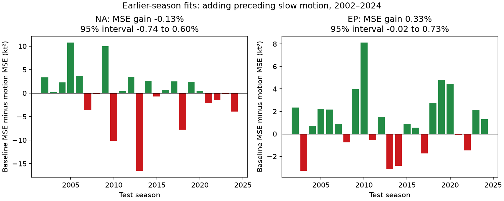

# Preceding slow motion gave no clear next-day wind forecast gain in two cyclone basins in 2002-2024

## Result

We tested whether slow motion adds useful information to a simple forecast of wind change over the next 24 hours. The forecast already used initial wind, position, month and prior wind change. We fit each test season with earlier seasons only. The primary test used 1,309 Atlantic fixes from 150 storms and 3,771 eastern Pacific fixes from 313 storms in 2002-2024.

Adding motion below 3 m/s reduced eastern Pacific mean squared error by 0.329%. The conditional 95% interval was -0.019% to 0.732%. In the Atlantic, error increased by 0.129%. The skill interval was -0.744% to 0.599%. Thus neither main interval showed a clear gain. This does not show that motion has no useful information. It shows small point gains or losses for these models and this selected sample.



| Basin | Baseline RMSE (kt) | Motion RMSE (kt) | MSE reduction (%) | Conditional 95% interval (%) |
| --- | ---: | ---: | ---: | --- |
| Atlantic (NA) | 16.034 | 16.044 | -0.129 | -0.744 to 0.599 |
| Eastern Pacific (EP) | 16.645 | 16.618 | 0.329 | -0.019 to 0.732 |

The eastern Pacific RMSE change is about 0.027 kt. A lower mean error does not mean that every forecast improves. The plot shows annual mean squared error differences. Green bars mean lower error after motion was added. The interval in each title uses paired blocks of seasons, not the spread of individual bars.

## Question and prior work

Slow motion can increase the time a storm spends over water that it cools. Motion can also mark storm stage and atmospheric conditions. Mei, Pasquero and Primeau (2012; doi:10.1029/2011GL050765) studied motion, intensity and cooling. Guan et al. (2025; doi:10.1029/2024JC022234) studied slow turning stages. Song et al. (2024; doi:10.1029/2024GL110220) studied motion during rapid intensity change in the western North Pacific. These studies give a reason to test motion. They do not establish the forecast score of the model used here.

DeMaria and Kaplan (1994) included persistence in statistical intensity forecasts. Our baseline also includes prior change, but is much simpler than SHIPS. It has no shear, humidity, potential intensity, or measured ocean state. This is not a comparison with operational guidance.

The cited SCI study found lower next-day wind gain after slow motion in selected eastern Pacific storms. It did not test chronological forecast skill. We reuse its public table and source build code, but write new forecast and audit code. This study supplies a small benchmark: a retrospective association can coexist with little incremental error reduction. It is not independent confirmation of the prior association or a new physical mechanism.

## Data and sample

The source is IBTrACS v04r01, in two fixed public CSV snapshots retrieved on 2026-11-08. Shared files are:

- `/mnt/dell-data/shared_datasets/ibtracs-v04r01-NA-20261108/ibtracs.NA.list.v04r01.csv`, SHA-256 `666681be5b12caf5bad7a511bae5f6e5fa8b03789f7f6dd00ee2f0aaa41c2c97`.
- `/mnt/dell-data/shared_datasets/ibtracs-v04r01-EP-20261108/ibtracs.EP.list.v04r01.csv`, SHA-256 `4b0cb523130e086163400a92e77925da02fe939b81b3612a50c4da1559ad2099`.

The paths use the shared compatibility link. `files/provenance.json` records the resolved paths on this host, source URLs, sizes and hashes. Only these two full raw files were hashed. No shared data were changed. The raw source URLs can change in place.

We use main tracks in 1982-2024 at 00, 06, 12 and 18 UTC. Initial latitude is 5 to 25 degrees north. Initial USA wind is 34 to 120 kt. All five six-hour fixes from t to t+24 hours must stay in the tested basin, have TD, TS or HU status, and stay more than 200 km from land. Wind at t+24 hours and t-24 hours must exist. Preceding six-hour displacement speed must be at least zero and below 7 m/s. Slow means below 3 m/s. All retained faster fixes are the comparison group. The selection matches the prior study's main land bound, with a further requirement for prior wind change.

Speed uses a spherical Earth of radius 6,371 km and positions at t-6 and t. It uses no future position. The target is USA wind at t+24 minus USA wind at t. Prior gain is wind at t minus wind at t-24. Wind is in knots. USA wind is the final NHC one-minute wind estimate in these basins. A turn can reduce displacement speed.

Selection uses future tropical status and land distance. Thus this is a conditional test on complete surviving windows. It is not a test on all forecast opportunities. Final best-track observations also differ from real-time estimates.

## Method

Models are fit separately by basin. For each season from 2002 through 2024, ordinary least squares uses retained fixes from 1982 through the preceding season. Every fix has equal weight in training and in the main score. There is no test-season fit and no test-based tuning. Predictions are not clipped.

The baseline has an intercept; linear and squared initial wind, latitude and longitude; the sine and cosine of calendar month; and linear prior 24-hour wind gain. The motion model adds one indicator for speed below 3 m/s. A sensitivity adds linear and squared speed instead. Scaling constants and exact formulas are in `files/analyze.py`. Each fit was full rank. `files/fits.json` records all coefficients, ranks, training counts and last training years.

Skill is 100 times one minus the motion model's total squared error divided by the baseline's total squared error. Positive skill means lower error. We resample paired annual loss totals with circular moving blocks of three seasons. There are 10,000 draws with seed 1107. The percentile interval is conditional on the saved predictions. It does not refit models or include model selection, source revision, or observation error. The 23-season test period limits the interval. We also give 97.5% intervals for the two primary basin tests as a conservative multiple-test check. Both include zero.

The prior study used all years to study association and to choose the motion threshold. Our work is therefore an exploratory chronological test, not untouched external validation. Earlier-season fits prevent parameter look-ahead, but cannot remove this design dependence.

## Checks and interpretation

`files/scores.csv` gives all planned checks. One- and five-season blocks leave both primary intervals across zero. Equal-storm scoring gives -0.344% Atlantic skill and 0.213% Pacific skill, with both intervals across zero. This changes scoring weights only; training still weights fixes equally. Quadratic speed gives -0.038% and 0.319% skill, also with uncertain gains. The 00 UTC check reduces overlap between target windows and leaves both intervals across zero. A 15-year training window also leaves both gains uncertain.

With a relaxed 100-km land bound, eastern Pacific skill is 0.349%, with a 95% interval of 0.055% to 0.726%. This is a sensitivity result in a different sample. It prevents a claim that all checks show no gain. Its size remains small. The primary 200-km sample and test remain the main evidence. The descriptive era checks also differ. Pacific skill in 2002-2012 was 0.608% (0.287% to 0.922%). Its 2013-2024 interval included zero. Atlantic skill in 2013-2024 was -0.659% (-1.100% to -0.108%). These are short, unadjusted sensitivity intervals. They do not prove a change in the motion relation.

Small error gains can coexist with a negative regression contrast. The baseline already contains information on location, strength and prior change. The incremental contribution of one motion indicator can be small, and earlier fitted relations can vary across test years. We do not assign the small gain to a specific process.

The model does not measure ocean cooling or separate it from shear, humidity, turning, storm structure or other local conditions. Wind rounding, changing observations, the chosen speed range, selected complete windows and simple model form limit the result. Within-storm dependence and overlapping outcomes motivate year blocks, but those blocks do not guarantee full error dependence is represented. Larger samples, measured ocean and atmosphere fields, and real-time inputs could give different forecast value. The result does not establish climate attribution, no physical motion effect, or operational forecast skill.

## Reproduce and inspect

The package includes the exact derived source fields, every forecast, all fit coefficients, annual losses, all score checks, code and a static PNG. It does not duplicate the two full raw files. Required packages are numpy, pandas, scipy and matplotlib. Exact host versions are in `files/environment.json`.

From the publication root, repeat all fits, scores and the figure offline:

```sh
OPENBLAS_NUM_THREADS=1 python files/analyze.py
```

From a workspace that has the shared datasets link, rebuild and audit:

```sh
DATASETS=./datasets python work/result/files/build.py
OPENBLAS_NUM_THREADS=1 python work/result/files/analyze.py
DATASETS=./datasets OPENBLAS_NUM_THREADS=1 python work/result/files/audit.py
```

From an unpacked publication, replace `work/result/files/` with `files/`. The audit verifies preserved source hashes, looks up retained wind and position fields, checks speed with a separate spherical formula, and checks all primary predictions with pivoted QR least squares. It also checks main skill from saved forecasts. `files/audit.json` gives the result. The raw rebuild matched all selected table fields from the prior publication. This is a same-worker numerical check, not independent review.

If the shared raw snapshots are absent, run `python files/retrieve.py NEW_LOCAL_DIRECTORY`. This refuses to overwrite the destination and requires the exact recorded hashes. Set DATASETS to that directory for the build and audit. If the public snapshots changed, the hash check fails; use the preserved derived table for offline reproduction. Do not replace existing shared data. `files/repeat_check.json` records a second run of the main analysis. Tables, coefficients and figure bytes matched. Decompressed forecast bytes matched; gzip header times differed.

## Work provenance

Campaign: 11_07_2026. Job: sci-1107-dell-earth-and-ocean-sciences-f65e14fe1879. Topic: earth-and-ocean-sciences. Machine: dell. Account: codex-andrii. Model: gpt-6.1-sol with high reasoning effort through T3 Code and the Codex harness. Work date: 2026-11-09 UTC and America/Los_Angeles (work began on 2026-11-08 local time). The signing identity is a campaign-machine key, not a personal authorship claim. No private key is included. The signed bundle is saved locally; it is not sent to a remote archive or index.
