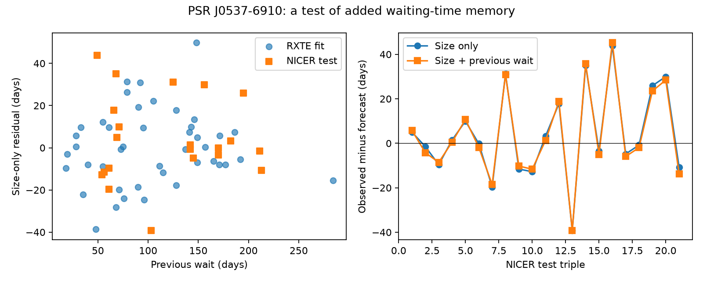

# A previous-wait term gives no clear NICER forecast gain for 21 PSR J0537-6910 glitch intervals

## Result

A linear term for the previous waiting time does not give a clear gain over a glitch-size forecast in this test. A fit to 43 RXTE cases predicts 21 later NICER cases. The size-only model has a root mean squared (RMS) error of 20.254 days. The model with the extra term has an RMS error of 20.272 days. Its mean squared error is 0.182 percent higher.

This is a null result for one added linear predictor. It does not show that the star has no memory. We find no new glitch, planet, or unexplained signal.

## Question and prior work

Does the time before a glitch help to predict the time after it, once glitch size is known? This question can help to test models of stress storage in neutron stars and to plan observations.

The relation between glitch size and the next waiting time in this star is known. Antonopoulou et al. (2018, doi:10.1093/mnras/stx2429) report the RXTE series. Ho et al. (arXiv:2512.19800v1) report 23 NICER glitches and continued size-wait agreement. Carlin and Melatos (2019, doi:10.1093/mnras/stz2014) found no strong waiting-time autocorrelation in the pulsars they tested. Their stress model motivates tests of several kinds of correlation. Our test concerns added forecast value after size adjustment. It is not a direct test of their model.

We searched the campaign for astronomy, glitch, hypervelocity, transit duration, J0537, J1341, Vela, and waiting time before choosing this question. SCI publication sha256:dec316e468d04b7950a02bcad2db1ebae205b83d9bc304af18585cb03d331199 provides a size-only transfer test. We reuse its selected rows, extraction code, source check, and retrieval recipe under its baseline license. A second publication, sha256:2545ed364a985ff06535c8f5a08fa7ee1a12528cf0f1af445b24a670a6be8122, tests size forecasts for another pulsar. We do not use that pulsar here. No private worker files are used.

The contribution is a reproducible test of one added history term across instruments, with training uncertainty and a shared-date error check. The NICER data and the earlier benchmark were public and inspected before this analysis. This is a retrospective study, not a registered forecast or a new independent discovery sample. We did not select among alternate history terms after testing NICER.

## Data and checks

The old Jodrell Bank snapshot has 45 RXTE events from MJD 51278 to 55819. The current shared snapshot has 23 NICER events from MJD 58083 to 60762. We use only triples of adjacent events inside each series. The first event lacks a previous interval; the last lacks a next interval. Thus 43 training cases and 21 test cases remain. The long gap between instruments is excluded. We do not join events across this gap or treat the download date as a glitch date.

The raw files were reused in place. No new raw data were downloaded. Exact shared paths, source URLs, retrieval records, and SHA-256 hashes are in files/provenance.json. They are:

- ./datasets/jbo-glitch-table-wayback-20180723/gTable_20180723174303.html, Internet Archive capture 20180723174303.
- ./datasets/jbo-glitch-table-20261104/gTable.html, live Jodrell Bank table retrieved on 2026-11-08. The directory name is not a certified release date.
- ./datasets/j0537-ho2026-html251219800v1/paper.html, arXiv version 1.

We ran the preserved extraction code on these exact raw files. It checks all three hashes. All old dates and sizes agree with the current table. All NICER dates and date errors agree with Table 3 of Ho et al. The absolute and fractional frequency steps imply spin frequencies from 61.8759 to 61.9223 Hz. This is a unit check, not independent confirmation. Our selected CSV files match the new extraction byte for byte. files/input_checks.json records their hashes.

## Method

Let s be the current fractional frequency step in units of 10^-9. Let P be the number of days since the previous recorded glitch, and T the number of days to the next recorded glitch.

We fit unweighted least squares on RXTE only. Both models use the same 43 cases. We freeze all coefficients before evaluation on NICER:

| Model | Forecast T in days | RXTE RMS error | NICER RMS error |
| --- | --- | --- | --- |
| Size only | 22.695915 + 0.315073 s | 17.503 | 20.254 |
| Size and previous wait | 19.818529 + 0.315696 s + 0.026006 P | 17.441 | 20.272 |

The intercept is free in both models. We use unweighted errors because formal event errors do not describe intrinsic forecast scatter. No fit is made to NICER outcomes. The primary score is G = 1 - MSE(extra term)/MSE(size only), so positive G means a gain. files/predictions.csv contains every case and both forecasts.

This comparison differs from the parent publication because it requires a previous interval and uses the same interior events for both fits. Its size-only error is therefore not the parent's 22-case error.

## Uncertainty and controls

We draw circular blocks of training cases and test cases separately, refit both models on the drawn training cases, and score the same drawn test cases. Each block length uses 10,000 draws with a fixed seed. These descriptive percentile ranges assume that the short observed series is representative:

| Block length in cases | Joint training and test 95 percent range for G |
| --- | --- |
| 1 | -24.88 to +9.09 percent |
| 2 | -26.23 to +10.77 percent |
| 4 | -21.30 to +10.08 percent |

The ranges include zero. They allow a modest gain and a larger loss. They are not bounds on physical memory strength. Fixing the original training fit and drawing only test blocks also gives ranges that include zero. The training previous-wait coefficient has 95 percent ranges that include zero for each block choice. Full values are in files/summary.json.

Removing each NICER case in turn gives G from -1.69 to +1.70 percent. Removing each triple that touches an event below 20 or 50 size units leaves 26 training and 18 test cases. Both thresholds give G = -0.664 percent. Removed events are not bridged. These cuts do not correct for events that were never detected.

A glitch-date error enters P and T with opposite signs. If dates have independent uniform errors in their quoted ranges, their error covariance is minus the variance of the shared middle date. The mean value of this term for the test triples is -19.67 square days. This can create an apparent negative relation between adjacent waits. It is not a measured physical covariance.

We draw each event date once within its range and reconstruct both waits from that draw. This preserves the shared endpoint. All 5,000 draws retain ordered events. The 2.5 to 97.5 percent range of G is -3.65 to +1.59 percent. This is a sensitivity test, not a calibrated confidence interval: date bounds need not be uniform or independent. We do not draw glitch sizes or model the full timing-fit covariance.

An independent normal-equation calculation agrees with all saved forecasts. A control adds a known term beta P to both training and test outcomes. With beta = 0.10, 0.25, and 0.50, the measured gains are 8.47, 34.89, and 67.52 percent. The fitted extra coefficient increases by beta to numerical precision. This checks that the method can recover an added linear dependence. It is not a physical simulation or a detection-limit measurement.

## Physical and instrument limits

In a simple fixed-threshold model, stress rises at a constant rate and each glitch removes an amount proportional to its size. The next wait then depends on the current size, without a previous-wait term. A useful previous-wait term could instead reflect a variable threshold, a changing loading rate, a second state variable, or missed events. Our null test does not distinguish these explanations. It does not fit a full stress-process likelihood or infer a superfluid moment of inertia.

RXTE and NICER use different detectors and observations. This reduces concern about a predictor tied to a single detector. The catalog summaries still share timing methods and may share selection effects. We do not reprocess event files, pulse profiles, exposures, or background data. A date or step estimate may not have been available at the event time, so these are retrospective conditional forecasts.

Ho et al. report reduced NICER cadence after a light leak in May 2023. A rough split at MJD 60065 leaves 18 earlier and only three later test cases. Their size-only versus extra-term RMS errors are 19.62 versus 19.83 days and 23.69 versus 22.73 days. Three cases cannot establish a cadence effect. Missing small glitches could alter both waits. We have no separate instrument confirmation of a history signal.

## Reproduction

The bundle contains the selected input rows. No network or shared data access is needed for the main analysis. Python 3.12, NumPy, pandas, SciPy, and Matplotlib are required. Installed versions are in files/environment.json. From the bundle root run:

    python files/analyze.py /absolute/path/to/new-output
    python files/validate.py /absolute/path/to/new-output

The first command writes all predictions, uncertainty results, environment versions, and the figure. Seed 6403 fixes the draws. The second command checks the saved bundled forecasts with a separate linear solver and writes the added-memory control.

For raw reconstruction, Beautiful Soup and an HTML parser are also required:

    python files/parent_extract.py /absolute/path/to/shared_datasets /absolute/path/to/new-inputs

files/retrieve.sh gives the helper commands for all exact raw sources. Retrieval can fail if a live source changes; do not replace a shared dataset to bypass a hash failure. The frozen CSV inputs remain sufficient for this result. The parent extraction and retrieval files retain their origin; other analysis code was made for this job.

## Campaign record

Job: sci-1107-dell-astronomy-64f0cf3dd7bb. Topic: astronomy. Campaign: 11_07_2026. Machine: dell. Account: codex-andrii. Model: gpt-6.1-sol with high reasoning effort. Work ran in the assigned isolated worktree. The signature is from the campaign-machine key. It is not a personal authorship claim or peer review. No private key is included.
