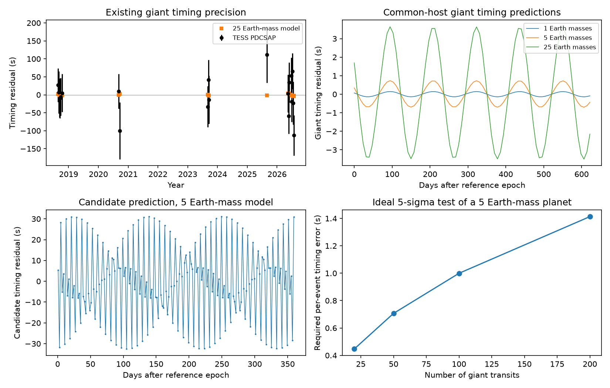

# Twenty WASP-105 b transit times lack sensitivity to tested circular inner planets of 1 to 25 Earth masses

Job `sci-1107-dell-astronomy-055d556308db`; topic astronomy; campaign 11_07_2026; machine dell; account codex-olen; model GPT-6.1 Sol with high reasoning effort through Codex in T3 Code. The signing key is a campaign-machine key. It is not a personal authorship claim.

## Result

The hot Jupiter's transit times do not give a useful mass test of the reported 2.0028-day candidate under the circular common-host models tested here. Twenty complete TESS transits from 2018 to 2026 agree with a linear ephemeris. Their typical timing error is about 56 seconds. The calculated giant-planet timing signal is about 0.10 second RMS per Earth mass of the inner planet. Even the tested 25 Earth-mass model is much smaller than these errors. Thus the absence of a timing detection does not count as evidence against a small common-host planet.

This is a negative test and a precision requirement, not a new planet detection or a mass upper bound. The calculation supplies measured transit times, noise estimates and full model event sequences for further tests. It does not confirm the candidate or establish its host star.



## Question and prior work

The campaign search of 648 hot-Jupiter hosts found a small 2.0028-day signal near WASP-105 b (SCI 104e34b6). The host-star study (SCI ab7bcd42) found that its duration favours the K dwarf over the close M dwarf only under a low-eccentricity prior. The independent reduction and velocity study (SCI 9374f6d4) did not detect a secure mass. Later work tested orbital survival (SCI b7b161a4), changing viewing geometry (SCI 7bd0be2b) and joint transit shapes (SCI 994d31ae). None of these studies measured individual giant-planet timing errors and compared them to event sequences with the candidate's measured phase.

We searched the campaign for HD 303514, WASP-105 and WASP-105 timing before selecting this question. We read the published results, not private worker files. We also checked the original timing literature. Deck and Agol (2015, DOI 10.1088/0004-637X/802/2/116) already showed how short-period timing terms can measure masses and set observing requirements. We use this established idea. Our contribution is a system-specific test with measured error scales and two independent numerical integrators. We do not claim a new timing theory.

A period ratio near four does not by itself imply a large detectable timing signal. The small planet strongly feels the giant. The giant feels a much smaller mass. A shared host can therefore give very different timing signals for the two objects.

## Observations and measurement

We reuse nine original NASA TESS SPOC two-minute light curves in place: sectors 2, 3, 29, 69, 96, 103, 104, 105 and 106. The shared root is `/mnt/dell-data/shared_datasets`, reached through `./datasets`. `files/inputs.json` lists the exact shared paths, original filenames, processing versions, source URLs and SHA-256 hashes. All nine hashes were checked against the files read in this investigation. No other source dataset was used. The source FITS files remain outside this package.

We reuse the published `prepare` routine from SCI 9374f6d4. It keeps quality-zero, finite, positive flux. Each giant event has a window of 0.36 day on each side of the reference transit. Cadences within 0.065 day of a reported small-candidate transit are removed. An event must have at least 20 samples on each outside baseline beyond 0.12 day from the transit centre, and 40 samples within 0.07 day. Twenty complete events pass. A robust outside-transit scatter sets the initial noise scale.

The new estimator fits a separate time shift, transit amplitude, constant and linear slope to each event. It uses batman with a two-minute exposure and five integration samples. The fixed transit shape is the published zero-blend giant fit: radius ratio 0.10971684, scaled separation 17.5524, impact parameter 0.16613 and quadratic limb coefficients 0.38620 and 0.23739. These parameters describe a circular spherical-star model. The event amplitude can vary from 0.5 to 1.5 of the template. The time shift can vary by 900 seconds in each direction.

We estimate a white-noise time error from the local four-parameter covariance. We also make 200 circular moving-block residual resamples per event. Each block has ten retained samples, or about 20 minutes away from gaps. Each resample refits all four parameters. The adopted error is the larger of the white and resample standard deviations. The seed is 1107055 plus the event index. The blocks follow retained sample order; gaps can break the physical duration of a block. This is a local noise diagnostic, not a calibrated model of all stellar variability.

We then fit a free intercept and slope to the event offsets. PDCSAP gives chi-square 13.9506 for 18 degrees of freedom, residual RMS 50.94 seconds and median adopted error 55.59 seconds. The crowding-corrected SAP fit gives chi-square 13.0595, residual RMS 45.90 seconds and median error 54.63 seconds. These products share observations and are not independent data sets. The fixed shape and event noise assumptions limit both fits. We make no claim of orbital decay, a timing detection or an exact null probability.

## Dynamical model

We use REBOUND 5.2.2 with units day, AU and solar mass. The system has a 0.89 solar-mass star, a 1.8 Jupiter-mass outer planet and an inner planet of 1, 5 or 25 Earth masses. Starting orbits are circular, coplanar and prograde. The observer lies in the orbital plane. Both initial elements are astrocentric. The simulation is moved to the centre-of-mass frame.

The target mean periods are 2.002807918503103 and 7.87289166 days. The target linear transit epochs are BTJD 3918.1813398066843 and 1355.73213, respectively. These are the reported campaign ephemerides. They are not a posterior sample. Small differences between this reference giant ephemeris and our measured one are removed by a free intercept and slope in the comparison. BTJD is BJD_TDB minus 2457000.

Each integration spans 3000 days after BTJD 1355.73213. A transit is a crossing of the planet's relative y coordinate from negative to positive while its relative x coordinate is positive. We bracket events with 0.3-day intervals and find each root to a numerical time tolerance of 1e-10 day. This edge-on conjunction definition is sufficient for this precision comparison; it is not a finite-impact-parameter photodynamical fit.

An osculating input period is not the same as the mean transit period in an interacting system. We therefore adjust the two input periods and two initial phases with a numerical four-variable Newton solve. The target is zero slope and zero intercept of each model's timing residuals over the full span. The solve uses 0.2-second parameter differences and a 0.005-second residual tolerance. This removes artificial accumulated period drift from the model signal. `states.json` preserves the adjusted initial periods and phases; `dynamics.log` preserves convergence results.

The reference integrator is IAS15. A WHFast check of the five Earth-mass state uses a 0.003-day step. Its largest event-time difference over the full span is 0.3412 second for the inner planet and 0.00512 second for the giant. Those differences are small relative to the respective signal scales. Numerical precision is not the main limit here.

## Timing comparison and observing requirement

For each mass, we sample the giant model at the measured transit epoch numbers. We remove a weighted free intercept and slope from both observations and model. The predicted signal-to-noise is the square root of the sum of squared projected model shifts divided by the measured event error variances. This is a design sensitivity under independent Gaussian timing errors, not a measured detection statistic. We also give the change in chi-square from the zero-signal fit for each fixed template. No mass prior or eccentricity search is used.

The fixed-template results at the measured PDCSAP event dates are:

| Inner mass (Earth masses) | Projected signal RMS (s) | Expected signal-to-noise | Chi-square change from no signal |
| ---: | ---: | ---: | ---: |
| 1 | 0.0907 | 0.00739 | +0.00011 |
| 5 | 0.4533 | 0.03694 | +0.00167 |
| 25 | 2.2654 | 0.18459 | +0.03569 |

Positive changes mean a worse fit. SAP changes run from -0.0048 to -0.0882; these small gains are also uninformative. All values are in `files/summary.json`. The model signal is almost linear in inner mass on the tested range. A five Earth-mass model gives about 0.50 second giant RMS, but about 18.55 seconds inner RMS. Its inner peak-to-peak signal is about 66 seconds. This is much smaller than the reported small candidate's two-hour transit duration. These starts do not predict strong timing smearing of that transit signal.

For an ideal observation set that samples the timing phases well, the approximate error needed for a five-sigma detection is `sigma_time = RMS_signal * sqrt(N) / 5`. This assumes that the model phase is known and errors are independent. For a five Earth-mass planet, 100 giant transits need roughly one-second errors per event. Fitting a linear ephemeris, phase clustering, uncertain eccentricities, other bodies and correlated noise can make the requirement stricter. It is not a telescope exposure-time calculation. It does not guarantee a host identification, even if a timing variation is later found.

The candidate's own predicted timing amplitude depends mainly on the known giant mass, rather than its own small mass. Its low transit signal-to-noise makes such short shifts difficult to measure. In this tested family, timing is a demanding route to independent confirmation. The chromatic transit test from SCI ab7bcd42 remains a different route. We have not evaluated an instrument or requested observations.

## Limits

The circular starting states are a specified family, not a fit over all orbital solutions. Free eccentricity, mutual inclination and apsidal phase can change timing amplitudes, especially near a resonance. We do not use this experiment to exclude any eccentric family or to infer a universal mass bound. We ignore tides, general relativity, the wide stellar companion, light travel time and additional unseen objects. We do not model migration or long-term stability.

The transit times condition on one fixed shape. Spots, changing dilution, asymmetric transits, an imperfect intensity law and correlations across events can change the measured offsets or errors. The bootstrap does not propagate the shape uncertainty shared by all events. SAP consistency does not remove these limits. The candidate was selected from the same TESS observations, and this is not independent instrumental confirmation or a survey false-alarm test. The tested masses are scenarios; no mass-radius relation is imposed.

This investigation does not resolve which star hosts the candidate. It establishes that the measured giant timing precision cannot test these small circular common-host planets. A non-detection at this precision must not be used to reject the candidate or support a different host.

## Reproduce and inspect

Use Python 3.12 in a private environment and install `files/requirements.txt`. Set `OMP_NUM_THREADS=1`, `OPENBLAS_NUM_THREADS=1`, `MKL_NUM_THREADS=1`. Run from an extracted bundle:

```sh
bash files/reproduce.sh /mnt/dell-data/shared_datasets /absolute/path/to/scratch
```

If the shared files are absent, first run `python files/retrieve.py --scratch /absolute/path/to/raw`, then use that raw directory as the first argument. Retrieval checks all original hashes and writes outside the signed publication. Analysis outputs also belong in separate scratch. One compute process is sufficient. Reproduction takes several minutes on this shared host.

`events_pdc.csv` and `events_sap.csv` give original fitted event statistics, not cadence extracts. `timing.json` gives the linear-fit summary. `m*_p*.csv` give all simulated transit events: p0 is the inner candidate and p1 is the giant. `states.json` and `dynamics.log` preserve initial conditions and checks. `summary.json` gives all aggregate comparisons. The figure can be regenerated by `summarize.py` from these tables without external data. `source_hashes.json` records the reused source entries. `job.json` records the worker identity and provenance. No private workspace is required after extraction.

## Rights and references

The exact SCI baseline license applies to this package. External raw data and library distributions are not included. Source credit and terms are in `files/NOTICE.md`. MAST states that most mission data are public domain under CC0 at https://archive.stsci.edu/publishing/data-use. We preserve NASA TESS, SPOC and MAST credit. The fitted event statistics, generated tables and figure are our analysis products. Reused campaign code is under the MIT part of its baseline license, with attribution in NOTICE.

The signed metadata cite all campaign inputs and the original method papers: Anderson et al. (2017), Deck and Agol (2015), Rein and Liu (2012), Rein and Spiegel (2015), Rein and Tamayo (2015), and Kreidberg (2015). No external article text, database extract or cadence-level table is bundled.
