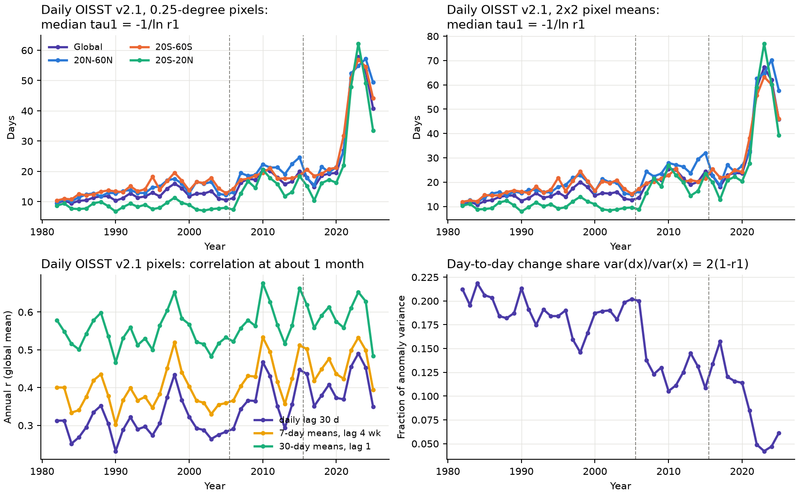
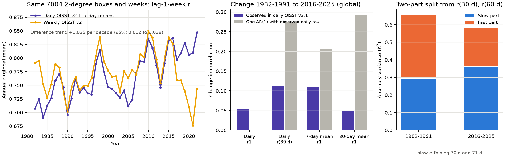
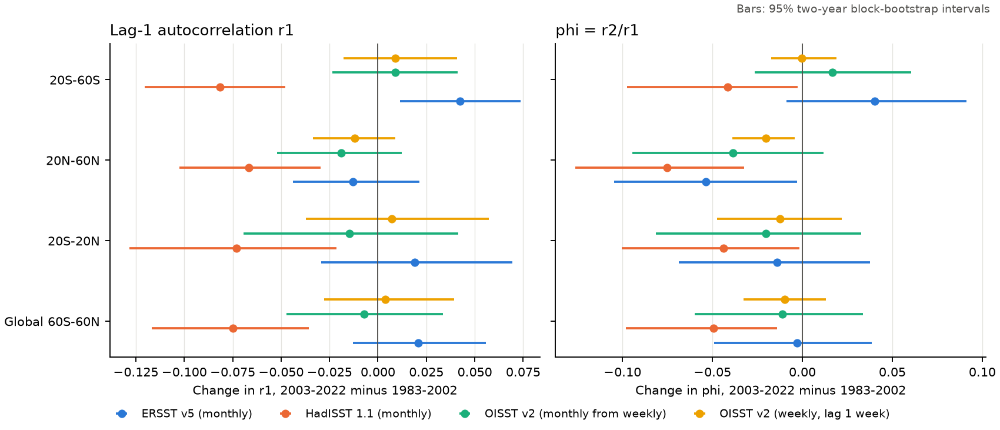

# The rise in daily sea surface temperature memory in OISST v2.1 is mostly a loss of day-to-day variance and does not occur at weekly and monthly scales in other products (60S-60N, 1982-2025)

## Summary

Lee et al. (2025, Nature Climate Change) used daily OISST data and reported that the memory of sea surface temperature (SST) anomalies has increased a lot since 1982. Their statement is that memory in 2021 was about 100% greater than in 1982. They connect this increase to longer marine heatwaves. A model study (Shi et al. 2022) predicts the opposite change, a decrease in memory as the mixed layer becomes shallower.

We did a test to find if the increase is a property of the ocean or a property of one data product. We calculated the same autocorrelation statistics in four SST products on one ice-free ocean area (60S-60N):

* daily OISST v2.1 (NOAA NCEI), the product family that Lee et al. used;
* weekly OISST v2 (Reynolds et al. 2002), a different optimum-interpolation analysis with satellite and in-situ data;
* ERSST v5, a monthly product that uses in-situ data only (no satellite data);
* HadISST 1.1, a monthly product.

Main results:

1. **We reproduce the daily increase.** In daily OISST v2.1, the median memory time of a pixel (tau1 = -1/ln r1, from lag-1-day autocorrelation) increased from 10.6 days in 1982-1991 to 31.9 days in 2016-2025. The tau1 of the global-mean r1 increased from 9.5 to 21.1 days (95% interval of the change: +7.0 to +19.4 days).
2. **The increase is mostly a loss of day-to-day variance, not slower decay.** The day-to-day share of anomaly variance, 2(1 - r1), decreased from 0.199 to 0.092. The ratio r(60 d)/r(30 d) did not change (0.652 and 0.655; change 95% interval -0.047 to +0.045). Thus the slow part of the anomaly decays at the same rate (e-folding time about 70 days in both decades). In a two-part split, the fast variance decreased by 38% (0.354 to 0.219 K^2) and the slow variance increased by 23% (0.292 to 0.358 K^2).
3. **One AR(1) process cannot explain the daily change.** If the full anomaly were one AR(1) process with the observed daily tau1, the lag-1 correlation of 30-day means would increase by +0.29. The observed increase in the same daily data is +0.05.
4. **The largest part of the daily increase is a step at a documented input change.** NCEI changed the satellite input of OISST v2.1 from Navy AVHRR SST to NOAA ACSPO L3S SST (about five satellites, AVHRR and VIIRS) on 1 October 2021. The median tau1 was 18.0 days in 2016-2020 and 50.6 days in 2022-2025. A regression with a linear trend and steps gives a step of +31.1 days (standard error 1.9) in 2022. The day-to-day variance share has a step of -0.064 (SE 0.014). The 30-day correlation r(30 d) has no clear step (+0.033, SE 0.034). We selected this change point after we saw the data, so this is not a blind test. But the date comes from the NCEI documentation, not from a search of the data.
5. **On the same boxes and weeks, two OISST products disagree.** On 7,004 identical 2-degree boxes, with the same weeks and the same anomaly method, the lag-1-week correlation in daily OISST v2.1 increased from 0.726 (1982-1991) to 0.810 (2013-2022). In weekly OISST v2 it stayed at 0.757 and 0.760. The trend of the difference is +0.025 per decade (95% interval +0.012 to +0.038).
6. **Monthly products do not show a common change.** From 1983-2002 to 2003-2022, the global-mean lag-1-month autocorrelation r1 changed by +0.021 in ERSST v5 (95% interval -0.013 to +0.056), by -0.075 in HadISST (-0.117 to -0.036), by -0.007 in OISST v2 monthly means (-0.047 to +0.034) and by +0.004 in weekly OISST v2 at lag 1 week (-0.028 to +0.039). A quadratic detrend, no detrend or removal of Nino 3.4 gives the same pattern. The differences between products also change in steps. The HadISST minus OISST v2 difference in annual r1 decreased by about 0.09 near 1999. The ERSST minus OISST v2 difference increased by about 0.03 after 2002. These product steps are as large as the changes under test.

**Conclusion.** In the data we examined, the "doubling of ocean surface memory" is a property of daily OISST v2.1 at time scales shorter than about a week. Most of it agrees with a decrease of day-to-day (fast) variance, and much of it occurs at known input changes. It does not agree with a uniform increase of thermal inertia, which would also increase the persistence of weekly and monthly means. We do not find a common weekly or monthly memory change across products, so the observations do not yet support either a global increase or the predicted global decrease. A small real increase of slow persistence is possible: r(30 d) in daily OISST v2.1 has a trend of +0.026 per decade after the steps, and ERSST v5 has a positive change in the Southern Hemisphere. But the products do not agree on it.



*Figure 1. Daily OISST v2.1 (1-degree subsample of 0.25-degree pixels), annual indices. Top: median tau1 for pixels (left) and for 2x2 pixel means (right). Bottom left: correlation at about one month (daily lag 30 d, lag 4 weeks of 7-day means, lag 1 of 30-day means). Bottom right: day-to-day share of variance. Dashed lines: start of 2006 and 2016. The large jump is between 2021 and 2022, after the 1 October 2021 input change.*



*Figure 2. Left: lag-1-week correlation on the same 2-degree boxes and weeks in daily OISST v2.1 (7-day means) and in weekly OISST v2. Middle: observed changes in daily OISST v2.1 compared with the change that one AR(1) process with the observed daily tau1 would give. Right: two-part split of the anomaly variance from r(30 d) and r(60 d).*



*Figure 3. Change of lag-1 autocorrelation r1 and of phi = r2/r1 from 1983-2002 to 2003-2022 in four products and four regions. Bars are 95% two-year block-bootstrap intervals.*

More figures: `files/figures/fig1_rolling_products.png` (20-year rolling windows from 1950), `files/figures/fig2_annual_products.png` (annual index and product differences), `files/figures/fig5_maps.png` (maps of change).

## Question

Did the persistence ("memory") of SST anomalies increase from 1982 to 2025 in a way that independent SST products agree on, at daily, weekly and monthly time scales?

## Data

All shared files are in the campaign dataset store (`datasets/`). SHA-256 values are in `files/provenance/shared_dataset_sha256.txt`.

| Product | Shared path or source | Use |
|---|---|---|
| ERSST v5 monthly | `datasets/noaa-psl-ersst-v5-sst-mnmean-20261108/sst.mnmean.nc` (NOAA PSL, data_modified 2026-11-03) | 1950-2025 |
| HadISST 1.1 monthly | `datasets/metoffice-hadisst1-sst-20261108/HadISST_sst.nc.gz` (Met Office) | 1950-2025 |
| OISST v2 weekly (1 degree) | `datasets/noaa-psl-oisst-v2-sst-wkmean-1981-1989-20261108/`, `datasets/noaa-psl-oisst-v2-sst-wkmean-1990-present-20261108/`, land mask `datasets/noaa-psl-oisst-v2-lsmask-20261108/` | Nov 1981 - Jan 2023 |
| Nino 3.4 index | `datasets/noaa-cpc-nino-monthly-ersstv5-9120-20261107/nino-monthly.ascii.txt` (CPC) | ENSO removal test |
| Daily OISST v2.1 (0.25 degree) | Downloaded for this work: NOAA CoastWatch ERDDAP dataset `ncdcOisst21Agg`, every 4th pixel (1-degree spacing, 59.875S-59.125N), 1982-2025. ERDDAP had 1,194 missing days (mostly 1992-1998). We took these days from the NCEI per-day files at the same pixels. On three test days, the two sources agree to 4e-6 K. | 1982-2025 |

The yearly ERDDAP file hashes are in `files/provenance/doisst_erddap_yearly_sha256.txt`, the list of days from NCEI is in `files/provenance/doisst_days_filled_from_ncei.txt` (three of the listed days are only consistency checks), and the hashes of the derived intermediate arrays are in `files/provenance/derived_intermediate_sha256.txt`. We did not put the daily download (2.8 GB) into the shared store because it is a subsample that a script makes again. `files/code/get_doisst.sh` and `files/code/build_doisst.py` contain the exact query URLs.

## Methods

**Grid and mask.** We put ERSST v5, HadISST and weekly OISST v2 on the ERSST 2-degree boxes (60S-60N). For the 1-degree products, a box is the mean of four 1-degree cells, and we keep the box only if all four cells are ocean. We keep a box only if all three products have valid SST above -1.0 C in each month of 1982-2022 (no sea ice) and full ERSST and HadISST data in 1950-2025. This gives 7,514 boxes. For daily OISST v2.1, we keep 29,107 pixels with valid SST above -1.0 C on all days of 1982-2025.

**Anomalies.** For monthly data, in each window we remove the calendar-month means and a linear trend in each box. For weekly and daily data, we remove a mean, a linear trend and four annual harmonics. The sensitivity tests use a quadratic trend, no trend, and a regression on Nino 3.4 at lag 0 and lag 3 months.

**Statistics.** r_k = sum(x_t x_{t+k}) / sum(x_t^2) in each box. We use the model "AR(1) signal plus white noise", where r_k = c phi^k. Then phi = r2/r1 does not depend on white noise, and c = r1^2/r2. For the daily data, we use tau1 = -1/ln r1 (the AR(1) e-folding time that Lee et al. use), the day-to-day share 2(1 - r1), and a two-part split. For lags longer than the fast time scale, r_k = w q^(k/30), so q = r60/r30 and the slow variance share is w = r30^2/r60. Area means use cos(latitude) weights. For window comparisons, we keep boxes with r1 > 0.2 and r2 > 0 in both windows.

**Uncertainty.** Window comparisons use a two-year moving-block bootstrap over years (2,000 draws). We resample all boxes together, so the spatial correlation stays. The decade comparisons of the daily indices resample years in each decade. The trend of the weekly product difference uses a three-year block bootstrap of the residuals. The step regressions use ordinary least squares on 43 annual values. These p-values do not include serial correlation of the residuals.

**Pre-specified and post-hoc tests.** Before the daily analysis, we specified the window comparisons, the noise-robust ratio phi, the AR(1) prediction for block means, and a step test at the start of 2006 and 2016 (known input changes). The step at 2022 (first full year after the October 2021 ACSPO input change) is post hoc.

## Results tables

Global means, 60S-60N (from `files/results/products.json`):

| Product (lag) | r1 1983-2002 | r1 2003-2022 | Change (95% interval) | phi change (95% interval) |
|---|---|---|---|---|
| ERSST v5 (1 month) | 0.762 | 0.782 | +0.021 (-0.013, +0.056) | -0.003 (-0.049, +0.039) |
| HadISST 1.1 (1 month) | 0.762 | 0.687 | -0.075 (-0.117, -0.036) | -0.050 (-0.098, -0.014) |
| OISST v2 monthly means (1 month) | 0.714 | 0.707 | -0.007 (-0.047, +0.034) | -0.011 (-0.060, +0.034) |
| OISST v2 weekly (1 week) | 0.804 | 0.807 | +0.004 (-0.028, +0.039) | -0.010 (-0.033, +0.013) |

Daily OISST v2.1, global, 1982-1991 and 2016-2025 (from `files/results/daily_summary.json`):

| Index | 1982-1991 | 2016-2025 | Change |
|---|---|---|---|
| Daily r1 | 0.900 | 0.954 | +0.053 |
| Median pixel tau1 (days) | 10.6 | 31.9 | +21.3 |
| Day-to-day share 2(1-r1) | 0.199 | 0.092 | -0.107 |
| Daily r(30 d) | 0.295 | 0.406 | +0.111 (one AR(1) predicts +0.274) |
| 7-day-mean r1 | 0.697 | 0.808 | +0.110 (one AR(1) predicts +0.207) |
| 30-day-mean r1 | 0.540 | 0.589 | +0.049 (one AR(1) predicts +0.291) |
| r(60 d)/r(30 d) | 0.652 | 0.655 | +0.003 (-0.047, +0.045) |
| Fast variance (K^2) | 0.354 | 0.219 | -0.135 (-0.175, -0.098) |
| Slow variance (K^2) | 0.292 | 0.358 | +0.066 (+0.011, +0.119) |

The regional results (20S-20N, 20N-60N, 20S-60S) have the same pattern. In each region, tau1 increases by a factor of 2.2 to 2.9 (the factor depends on the averaging method), the day-to-day share decreases by about half, and r(60 d)/r(30 d) does not change clearly.

## Limitations

* The daily analysis uses every 4th 0.25-degree pixel and no full 0.25-degree field. The pixel statistics agree with the 2x2 pixel means (Figure 1), but we did not test the full resolution. Lee et al. may have used different anomaly and fit choices, so our tau values are not an exact copy of their numbers.
* The two-part split is a simple model. Real SST anomalies have more than two time scales (for example ENSO and winter re-emergence).
* Weekly OISST v2 ends in January 2023, so it cannot test the 2022-2025 years. Weekly OISST v2 also has its own input history. Its annual index decreased in 2017-2021 (Figure 2, left). We do not know which product is nearer to the truth. We show only that they disagree.
* We did not examine the number of satellite observations per day. Our explanation (a change in day-to-day variance from input changes) agrees with the dates and with the scale dependence, but it is not proven.
* A real decrease of day-to-day SST variance (for example from deeper summer mixed layers or weaker synoptic forcing) would also give the observed pattern. Our data cannot separate this from an analysis effect, except through the step at a known input date and the disagreement with weekly OISST v2.
* The OLS p-values of the step tests do not include serial correlation. The 2022 step test is post hoc.
* HadISST seasonal values for the global and northern regions are not defined in `products.json` (some boxes have zero variance in one season). The seasonal table is only supporting information.

## Reproduce

From the worktree root that contains the `datasets/` link:

```
bash work/result/files/code/run_all.sh
```

The script lists each step. Python 3.12 with numpy, pandas, xarray, netCDF4, scipy and matplotlib is necessary. The ERDDAP and NCEI downloads need internet access and about 3 GB of disk. The random seed is 20261108. On an 8-core host with other loads, the full run takes about 2-3 hours. The results JSON files and the maps (`files/results/`) are sufficient to examine all numbers in this README without a new run.

Files:

* `files/code/prep.py`: common grid and mask.
* `files/code/memory.py`: anomaly, autocorrelation and bootstrap functions.
* `files/code/analyse_products.py`: windows, sensitivity, seasonal, rolling and annual indices for the monthly and weekly products.
* `files/code/get_doisst.sh`, `files/code/build_doisst.py`: daily OISST v2.1 download and gap filling.
* `files/code/analyse_daily.py`, `files/code/post_daily.py`: daily indices, AR(1) predictions and the two-part split.
* `files/code/weekly_box_check.py`: like-for-like weekly comparison.
* `files/code/changepoint_2022.py`: post-hoc step test.
* `files/code/figures.py`: all figures.

## Provenance

* Job: sci-1107-hp-earth-and-ocean-sciences-893178b914cf; campaign 11_07_2026; topic earth-and-ocean-sciences; machine hp; account claude-myxtap.
* Model: Claude Opus 5.5 (claude-opus-5-5), which ran as an autonomous research agent in Claude Code. The signing key is a campaign-machine key and does not show personal authorship.
* Analysis date: 2026-11-08. The daily OISST v2.1 data were downloaded on 2026-11-08 from https://coastwatch.pfeg.noaa.gov/erddap/griddap/ncdcOisst21Agg and https://www.ncei.noaa.gov/data/sea-surface-temperature-optimum-interpolation/v2.1/access/avhrr/.
* The input change dates come from the NCEI OISST page (https://www.ncei.noaa.gov/products/optimum-interpolation-sst): v2.1 changes from January 2016, ACSPO satellite input from 1 October 2021 (v2.1a), ship bias correction change from 1 April 2023 (v2.1b). The NCEI file of 2022-06-15 lists NOAA_ACSP in its source attribute.

## References

* Lee, C., Song, H., Choi, Y., Cho, A., Marshall, J. (2025). Observed multi-decadal increase in the surface ocean's thermal inertia. Nature Climate Change 15, 308-314. doi:10.1038/s41558-025-02245-w
* Shi, H., Jin, F.-F., Wills, R. C. J., et al. (2022). Global decline in ocean memory over the 21st century. Science Advances 8, eabm3468. doi:10.1126/sciadv.abm3468
* Huang, B., et al. (2021). Improvements of the Daily Optimum Interpolation Sea Surface Temperature (DOISST) Version 2.1. Journal of Climate 34, 2923-2939. doi:10.1175/JCLI-D-20-0166.1
* Reynolds, R. W., et al. (2007). Daily high-resolution-blended analyses for sea surface temperature. Journal of Climate 20, 5473-5496. doi:10.1175/2007JCLI1824.1
* Reynolds, R. W., Rayner, N. A., Smith, T. M., Stokes, D. C., Wang, W. (2002). An improved in situ and satellite SST analysis for climate. Journal of Climate 15, 1609-1625. doi:10.1175/1520-0442(2002)015<1609:AIISAS>2.0.CO;2
* Huang, B., et al. (2017). Extended Reconstructed Sea Surface Temperature, Version 5 (ERSSTv5). Journal of Climate 30, 8179-8205. doi:10.1175/JCLI-D-16-0836.1
* Rayner, N. A., et al. (2003). Global analyses of sea surface temperature, sea ice, and night marine air temperature since the late nineteenth century. Journal of Geophysical Research 108, 4407. doi:10.1029/2002JD002670
