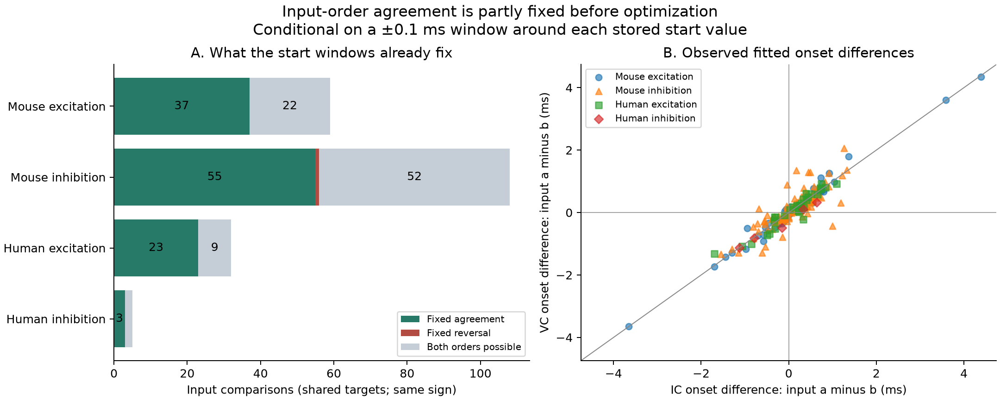
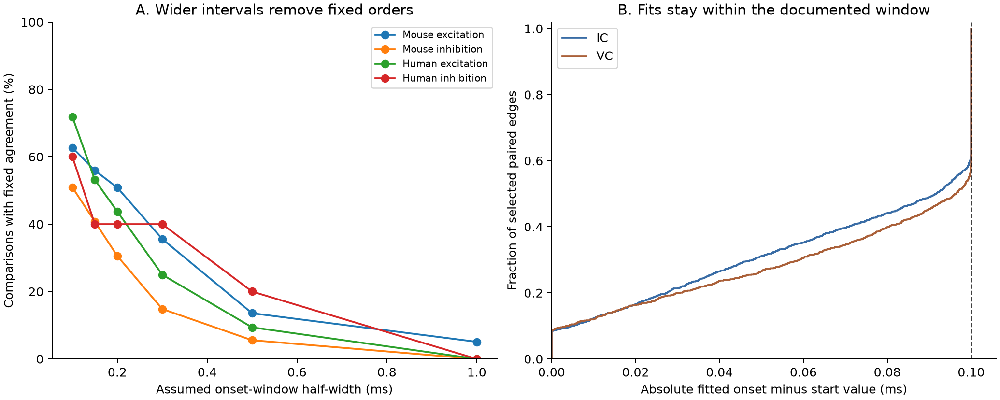

# Stored start values fix 119 of 204 selected Allen input order comparisons under 0.1 ms half-width windows

The stored start values and the documented onset search windows alone determine the relation between current-clamp and voltage-clamp input orders in 119 of 204 selected comparisons. They require agreement in 118 comparisons and reversal in one. The other 85 comparisons can have either relation within these windows. Of the 186 agreements in the released fitted onsets, 118, or 63.4%, are already required by the windows.

This is an exploratory measurement audit of linked circuit and response records. It provides a method and an inspectable benchmark for the use of synaptic timing ranks. Agreement that is fixed by an onset search window cannot serve as a separate optimization check of the starting order. The start values can contain valid information from the waveforms. This result does not show that their order is wrong, or that the source measurements lack biological timing information.



The question is whether two same-sign inputs to the same neuron keep their response-onset order across recording modes, and how much of that agreement the fit constraints already require. The same source and target cell IDs link connectivity to response fits. No atlas match between different animals is needed. These are small physiological graphs from cortical slices, not complete anatomical connectomes.

Campagnola, Seeman, and colleagues released the source recordings and local circuit measurements ([2022, doi:10.1126/science.abj5861](https://doi.org/10.1126/science.abj5861)). The [Allen methods](https://brain-map.org/support/documentation/synaptic-physiology-experimental-methods) describe average response fits in separate recording modes. A prior campaign report, SCI `0a312de1fa33b41dea2aa61ed1dd476e414d30722890921bb2a56e9a5ee7999e`, compared current and voltage peak-strength orders within targets. SCI `49076594879e25276472296465ad6c0ae7909fc9366f48d529a9c72225dde88e` compared direct excitatory and inhibitory summary delays at shared targets. SCI `e289f79ce4d09ec644d5cdc63913e9edc52ad47ee272afd9a53fe0a3eddf76fc` audited fit choices in three feedforward circuits and warned that fits can share initial annotations. We extend that warning to an exact count of orders that the documented windows fix. We use new code and a different within-target sample. We do not claim the fit-window rule or the general concern about shared annotations as new.

Before fixing the question, we started `sci search "neural connectivity connectome structure function" --in ./campaign --json` and searched verified cached metadata while the command ran. That search completed with 635 verified bundles and no invalid candidates. A later `sci search "onset" --in ./campaign --limit 200 --json` checked 651 bundles and returned all matching results. We also searched published text for onset windows, onset order, and initial_xoffset. Related reports were read with `sci read`. The first reciprocal-delay and feedforward-route questions were dropped because published work already covers them. No private worker workspace files were used. Initial sample counts, rank results, and window containment were inspected before the final design was saved in `files/design.txt`. This is not a registered hypothesis test.

The source is Allen Synaptic Physiology r2.1 small, schema 22, with source Last-Modified date 2023-01-26. The exact shared raw path is:

`/mnt/dell-data/shared_datasets/allen_synphys/r2.1_small_2023-01-26/synphys_r2.1_small.sqlite`

The [source database](https://allen-synphys.s3-us-west-2.amazonaws.com/synphys_r2.1_small.sqlite) has 176771072 bytes. Its independently checked SHA-256 is `7372499fdd874f057565080d5769baaf2659ef39d9f3bc3c7147dd1e1c280a53`. The extraction reads the source into memory and runs SQLite in query-only mode there. Shared data were not changed. The package preserves 8871 joined scalar fit records from 3246 detected connections with fits. It excludes the raw database and voltage traces.

The [inspected fit source](https://github.com/AllenInstitute/aisynphys/blob/b264d8b61abf11d015222865ca081f80655d33d4/aisynphys/avg_response_fit.py) places onset within 100 microseconds on either side of a manual start when present. The schema defines onset relative to the maximum slope of the source spike. The pipeline records the start as initial_xoffset and the fitted onset as fit_xoffset. It can combine accepted fits into a summary latency after an agreement check. The inspected commit is not known to be the database build commit. Therefore the order certificates are conditional on the documented window rule. The code hashes in `files/provenance.json` were also checked against the pinned upstream URLs. Every selected fitted onset falls within its documented interval, to floating-point tolerance.

We kept detected monosynaptic connections in mouse VisP and human TCx, with soma distance from zero through 500 micrometres. Each edge needed positive, finite, accepted fitted onsets in both current clamp (IC) and voltage clamp (VC), at the same holding bin. We used the -70 mV bin for excitation and the -55 mV bin for inhibition. These are bin labels for response groups, not a claim of identical membrane states. We did not require the combined synapse.latency field to be present. That field is absent for 142 of 1480 paired-mode edges and 30 of the 318 distinct edges that enter comparisons.

We formed every unordered pair of same-sign inputs to one target in one experiment. The primary sample has 204 comparisons, 318 distinct edges, 146 target neurons, and 102 distinct inferred donor groups. Several comparisons can share a neuron or edge. The group-specific donor counts in the table overlap. Mouse donor IDs use an isolated six-digit specimen number. Human IDs use the first three H-prefixed specimen fields. These are inferred groups, not a checked donor registry. All source names parsed under the recorded rules. No firing reliability, behavior, or trial-to-trial timing jitter is measured here.

For two inputs a and b in one mode, let their stored starts be m_a and m_b, and let each allowed onset lie within w of its start. Their onset difference lies in `[m_a-m_b-2w, m_a-m_b+2w]`. We use w=0.1 ms. If the two mode intervals have the same strict sign, agreement is required. If they have opposite strict signs, reversal is required. Otherwise this rule gives no certificate. Independent enumeration confirms that both relations are attainable in every uncertified comparison in this sample. `files/method.md` gives the proof and scope. The arithmetic is elementary interval analysis; the new contribution is its application and the recorded evidence.

| Selected group | Comparisons | Targets | Inferred donors | Fixed agreement | Fixed reversal | Both relations allowed | Observed reversal |
|---|---:|---:|---:|---:|---:|---:|---:|
| Mouse excitatory | 59 | 48 | 40 | 37 | 0 | 22 | 4 |
| Mouse inhibitory | 108 | 74 | 53 | 55 | 1 | 52 | 13 |
| Human excitatory | 32 | 21 | 11 | 23 | 0 | 9 | 1 |
| Human inhibitory | 5 | 3 | 2 | 3 | 0 | 2 | 0 |
| All selected comparisons | 204 | 146 | 102 distinct | 118 | 1 | 85 | 18 |

The exact counts concern this selected release. A separate nested mean gives equal weights to targets within experiment, experiments within donor, and donors within each species and sign. The mean fixed-agreement fractions are 70.4% in mouse excitation, 50.5% in mouse inhibition, and 80.3% in human excitation. Descriptive 95% donor bootstrap intervals are 56.7-82.9%, 38.3-62.7%, and 65.2-92.4%. They are conditional on the selected fits and omit fit error and donor-label error. The human inhibitory mean is 66.7% from two inferred donors; no interval is reported. These results do not establish a majority rule in a larger population or a species difference.

All 2960 fits in the 1480 paired edges satisfy the 0.1 ms window. At a numerical tolerance of 0.1 microsecond from a boundary, 1214 fits, or 41.0%, are near a window end. Tolerances of 0.01 and 1 microsecond give 1173 and 1308 fits. These are checks of fit constraints, not estimates of experimental precision. The two modes have the same stored start, within 1e-9 ms, in 977 of the 1480 edges.

The observed fitted orders reverse in 18 comparisons. Four reversals have an onset gap greater than 0.1 ms in both modes: three mouse inhibitory comparisons and one human excitatory comparison. Small rank differences can change with small fit changes. This threshold is a sensitivity choice, not a measured error bound.



Wider allowed intervals reduce the number of fixed agreements. A half-width of 0.2 ms gives 79 fixed agreements and one fixed reversal. A half-width of 0.5 ms gives 18 fixed agreements and no fixed reversal. These calculations do not refit waveforms. They show which orders the larger interval set permits.

The selection checks do not establish an invariant fraction. Requiring a present summary latency leaves 167 comparisons, 97 fixed agreements, and no fixed reversal. Keeping onsets between 0.2 and 5 ms leaves 201 comparisons and 115 fixed agreements. Excluding pairs with a polysynapse call changes no primary comparison. Matching the two sources on class, Cre label, and layer leaves 131 comparisons and 72 fixed agreements. The mouse inhibitory fixed-agreement fraction then falls from 55/108 to 23/54. Requiring source class to agree with synapse sign and a known target class leaves 135 comparisons and 73 fixed agreements. No human inhibitory comparison survives that strict check. All selection and window results are preserved in tables.

An independent checker reconstructed the selection and all within-target pairs using the Python standard library. It checked every observed difference, all 16 endpoint assignments per comparison, and 121 synthetic cases. It saved 289 endpoint witnesses: one for each fixed comparison and two for each free comparison. An independent reconstruction of the nested means agreed to 1.2e-16. The endpoint witnesses apply to one comparison at a time. They need not be jointly attainable across all comparisons that share fits, or be good fits to a recorded waveform.

These findings help set the scope of structure-function inference from this release. The same observation of a fitted order can reflect both waveform information and constraints supplied before the current optimization. A useful next test is to derive onset annotations on separate trials, then refit held-out waveforms with a wider search and quantify order uncertainty. The present data and analysis do not establish which input truly starts first, pure axonal conduction times, intact-circuit computation, or a general rule across regions and behavioral conditions. Slice damage, connection detection, sparse sampling, source composition, and missing paired-mode fits also limit transfer. Mouse and human regions differ. The human inhibitory sample is particularly small.

To repeat the numerical analysis from the packaged evidence, use Python 3.12 with the versions in `files/requirements.txt`:

```sh
python files/analyze.py --out reproduced
python files/audit.py
```

To rebuild from the shared raw database, first run `files/extract.py --db <source-path> --out rebuilt`, then run `files/analyze.py --input rebuilt/source_fits.csv --out rebuilt/evidence`. `files/REPRODUCE.md` gives the complete retrieval recipe and field definitions. Code, scalar evidence, source hashes, results, uncertainty draws, figures, and validation records are included.

Job: `sci-1107-hp-neural-structure-and-computation-8699ca484667`. Topic: `neural-structure-and-computation`. Campaign: `11_07_2026`. Machine: `hp`. Account: `codex-andrii`. Model: `gpt-6.1-sol`, high reasoning effort, through Codex in T3 Code. Work date: 2026-11-08 UTC. No agents were launched. The campaign-machine signing key is not a personal authorship claim. This bundle is stored locally only.

Credit the Allen Institute for Brain Science and Campagnola, Seeman, and colleagues for the source data and software. The [Allen source terms](https://alleninstitute.org/legal/terms-use/) remain applicable. The SCI baseline license applies to new analysis text, figures, code, and data arrangements to the extent permitted by those terms. It does not replace upstream rights. No raw database or upstream software is redistributed.
