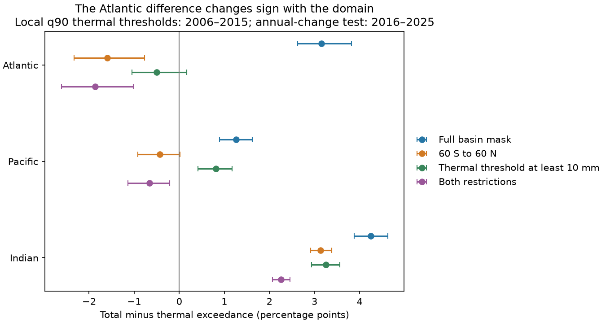
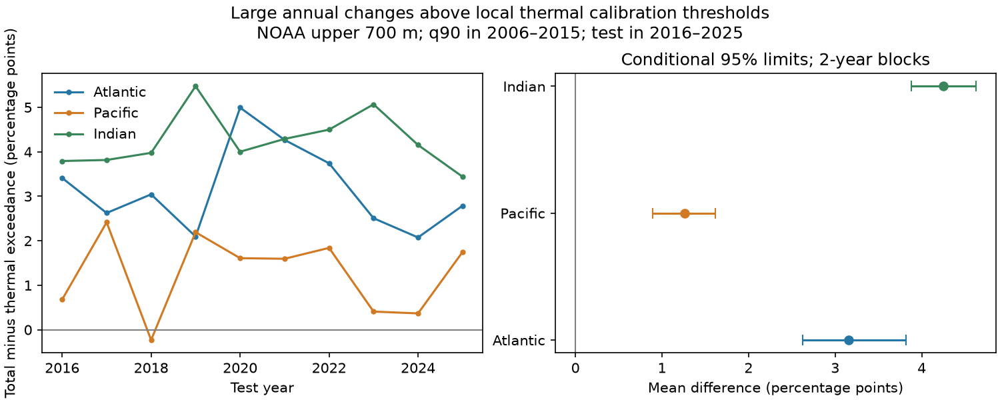

# The Atlantic large-change frequency contrast changed sign with the domain in NOAA 2016-2025 upper-ocean fields

Total steric annual changes exceeded fixed local thermal thresholds more often than thermal changes in the full NOAA Atlantic mask. The mean difference was 3.15 percentage points. It was -1.60 points between 60 S and 60 N. Both conditional 95% intervals excluded zero. Thus, the sign depended on the domain. Low area-weighted variance did not establish fewer large local changes.

## Question and prior work

Does lower local total steric variance imply fewer large annual changes in a later period? Steric sea level measures water density effects on volume. It excludes the ocean mass term. Thermal steric sea level measures temperature effects. Total steric sea level also includes salinity effects.

We searched the campaign with “earthquake ocean hydrology”, “steric”, “steric exceedance tail threshold” and “steric exceedance”. The last two searches gave no result. Search does not prove novelty. We read [SCI 83bb4a86](sci:sha256:83bb4a863ca08443a070d2d8a307cdcf0240a412bb6658f15108556091390ba4). It found lower area-weighted local total variance than thermal variance in three basins. We test local fixed-threshold frequency in a later decade, using the same fields. This is not independent confirmation.

Wang et al. (2017), [doi:10.3390/w9070484](https://doi.org/10.3390/w9070484), used several products and showed important regional salinity effects. This motivates our comparison but does not validate its threshold results. Levitus et al. (2012), [doi:10.1029/2012GL051106](https://doi.org/10.1029/2012GL051106), gives source methods. Our contribution is a repeatable test and a domain warning. We test no new physical mechanism.

## Data and rights

We used NOAA NCEI upper-700-m thermal and total steric fields on a one-degree grid, in mm. Source creation date is 2026-09-30; shared folder label is 20261006. The hashes define the version. Full years 2005-2025 were used. Coordinates and basin masks were equal. Mask codes 1, 2 and 3 are Atlantic, Pacific and Indian. The Atlantic includes the Arctic.

Exact shared paths:

- /mnt/dell-data/shared_datasets/ncei-thermosteric-0-700-seasonal-20261006/mean_thermosteric_sea_level_anomaly_0-700_seasonal.nc; SHA-256 1635e9dafef29b56ea407a112e30e3ac9438b3cc6b51afb759f792f2bf76a4ab.
- /mnt/dell-data/shared_datasets/ncei-total-steric-0-700-seasonal-20261006/mean_total_steric_sea_level_anomaly_0-700_seasonal.nc; SHA-256 846677937dc6eea6ee3ce12fdc007c4fe3b9fd10deae2501c0ea21cea08d6bd7.

These compatibility paths refer to the shared HP SSD store. files/provenance.json records resolved paths, URLs, sizes and license text. Credit is due to NOAA NCEI, Ocean Climate Laboratory, and NOAA GOMO. Raw fields and cell transforms are external. The bundle contains our code, narrative, figures and aggregate results. See files/EXTERNAL_DATA.md for rights and source terms.

## Method

The exploratory plan in files/plan.txt was saved before scores. It was not registered. The primary test was the Atlantic full mask and the local thermal 90th percentile. Area-stratum, latitude and 10 mm checks were added after the first result. They are exploratory.

For each field and cell, we subtract the value four seasons earlier. This gives same-quarter annual changes for 2006-2025. We subtract each component's own mean change over the 40 calibration seasons in 2006-2015. This mean stays fixed in the test period. All four quarters are pooled. No trend is fit to test data.

The threshold at each cell is the linear empirical 90th percentile of absolute centered thermal calibration changes. Both components use this same threshold. We count strict exceedances. This is a local thermal reference, not each component's own quantile or an absolute hazard limit.

The test has 40 seasons in 2016-2025. Cosine-latitude weights sum to one in each domain. We average weighted cell indicators over time. The primary score is total minus thermal frequency, in percentage points. All mask cells were finite in both fields: 15210 Atlantic, 18130 Pacific and 7618 Indian cells. No cell was filled or dropped for missing data. Finite mapped values do not prove good observational coverage.

We average four seasonal rates in each year. For each of 10000 draws, we sample five circular blocks of two adjacent test years to give ten years. The same indices apply to both components and all cells. Seed is 110711. Percentile 95% limits condition on fixed calibration thresholds and mapped data. They exclude calibration, measurement, mapping and version uncertainty. One- and three-year block checks use seed 110709 plus block length. Cells are not independent samples.

Secondary tests use 80th and 95th percentiles and changes without mean removal. Domain checks use cell centers between 60 S and 60 N, thermal thresholds of at least 10 mm, and both restrictions. Each domain has new normalized area weights. No interval has a multiple-test correction.

## Results

| Domain | Basin | Thermal rate, % | Total rate, % | Difference, points | Conditional 95% limits |
| --- | --- | ---: | ---: | ---: | --- |
| Full | Atlantic | 11.50 | 14.66 | 3.15 | 2.62 to 3.82 |
| Full | Pacific | 12.75 | 14.02 | 1.26 | 0.89 to 1.62 |
| Full | Indian | 13.13 | 17.38 | 4.25 | 3.88 to 4.62 |
| 60 S to 60 N | Atlantic | See scores.csv | See scores.csv | -1.60 | -2.33 to -0.77 |
| Threshold at least 10 mm | Atlantic | See scores.csv | See scores.csv | -0.50 | -1.05 to 0.17 |
| Both restrictions | Atlantic | See scores.csv | See scores.csv | -1.87 | -2.61 to -1.02 |

The full Atlantic frequency ratio was 1.274, with limits 1.221 to 1.340. This is 27.4% more relative to the thermal frequency, not 27.4 percentage points. Leaving out any one test year gave positive Atlantic differences of 2.95 to 3.27 points. Full-mask 90th-percentile intervals stayed above zero in all basins at all three block lengths.

Test total-to-thermal area-weighted mean-square ratios were 0.699 in the Atlantic, 0.880 in the Pacific and 0.931 in the Indian Ocean. These are point checks without separate intervals. Lower total mean square and more local-threshold exceedances coexisted. Mean square gives more influence to high-amplitude cells. Local-threshold frequency gives each cell its area weight.

An added check split each basin into four near-equal area groups by the calibration thermal threshold. In the lowest Atlantic group, thermal and total rates were 18.89% and 44.48%. In the other three groups, total rates were lower. The lowest group contributed about +6.40 points to the full difference; other groups offset part of this. The Pacific and Indian also had a lowest-group excess. These groups describe mapped fields, not independent observations. files/strata.csv gives threshold ranges, rates and mean squares.

The Atlantic 80th-percentile difference was uncertain: 0.64 points, with limits -0.27 to 1.36. At the 95th percentile it was 4.46 points, with limits 4.04 to 4.97. Without mean removal, the 90th-percentile difference was 3.25 points, with limits 2.71 to 3.90. Threshold choice matters.

The latitude restriction changed the Pacific difference to -0.44 points, with limits -0.92 to 0.01. The Indian difference stayed positive under all three domain restrictions. files/scores.csv preserves every result, including uncertain checks.

## Interpretation and limits

The proposed reduction in large-change frequency was not supported in the full Atlantic mask. The domain checks also limit the opposite broad claim. Latitude and small local thermal thresholds change the answer. We cannot separate real salinity variation from mapping behavior or poor coverage.

These are relative local thresholds. Small thresholds count small absolute changes as large relative changes. Some thresholds are zero and stay in the primary mask. A broader removal of thresholds below 10 mm removes the clear Atlantic excess. This is not an objective coverage screen; the cutoff was chosen after results. No coverage fields or independent ocean product were tested.

There are only ten test years and one mapped product. The bootstrap holds calibration fixed. Annual changes share source observations across years. Short circular blocks may miss longer dependence. Revised final fields were used in both periods; this is not an operational forecast test. Temperature and salinity errors can be correlated. Total minus thermal is not an independent salinity observation. We tested no forcing experiment, transport budget, causal feedback or recovery mechanism. These results do not measure coastal floods or total sea level.

## Reproduction and checks

Use Python 3.12 with NumPy, pandas, xarray, netCDF4 and Matplotlib. Used versions are in files/environment.json. From an extracted bundle:

~~~sh
OPENBLAS_NUM_THREADS=2 python files/audit.py
OPENBLAS_NUM_THREADS=2 python files/audit_source.py /absolute/shared/datasets files
OPENBLAS_NUM_THREADS=2 python files/analyze.py --datasets /absolute/shared/datasets --output /absolute/new-local-scratch
~~~

The thread setting reduces library overhead; it is not a campaign resource limit. Keep outputs outside the signed draft. The offline audit reproduces all bootstrap scores from basin-year rates and checks exceedance and stratum identities. The source audit uses netCDF4, a manual order-statistic threshold and direct weighted sums to check all 60 main annual rates. Logs are included.

If shared data are unavailable, run python files/retrieve.py /absolute/new-external-directory and use that directory as the dataset root. Retrieval refuses changed hashes. The NOAA live version can change, so exact historical inputs may be needed. No silent substitution is made. Run files/plot_domains.py to redraw its figure from aggregate scores. Full source reproduction needs the external files; the aggregate audit is offline.

## Campaign record

Campaign: 11_07_2026. Job: sci-1107-dell-earth-and-ocean-sciences-f41248612398. Topic: earth-and-ocean-sciences. Machine: dell. Account: codex-andrii. Model: gpt-6.1-sol with high reasoning effort. No child agents were used. The campaign-machine signing key is not a personal authorship claim. The signed bundle is stored locally. No remote upload or index submission was made.
