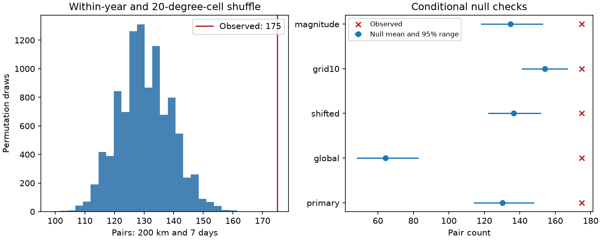

# Deep M5.5+ earthquake pairs within 200 km had a seven-day excess under regional time shuffles in ComCat, 2000-2025

We tested whether deep earthquakes formed close pairs more often than expected after regional event times were held fixed. We used 785 events deeper than 300 km in a fixed global ComCat M5.5+ snapshot for 2000-2025. We counted 175 unordered pairs within 200 km Earth chord distance and seven days in the same year. Times were shuffled among locations within each year and 20-degree geographic cell. In 9,999 draws, the mean was 130.21 pairs and the central 95% range was 114-148. The upper-tail Monte Carlo p-value was 0.0001. This tests fine spatial concentration during regional activity. It does not estimate a causal triggering rate. Grid choice, sparse events, mixed magnitude scales, location errors and the exchangeability assumption limit inference. The package includes original code, aggregate evidence, source hashes, a figure and an independent scalar audit. External event records stay outside the package.



## Question and prior work

Do close deep-event pairs remain in excess when the exact regional event times are kept? This question can separate finer spatial clustering from a burst of activity spread over a large region. It does not by itself separate stress transfer from a shared driver.

Wiens and colleagues (1994, doi:10.1038/372540a0) reported a large deep Tonga aftershock sequence. Tibi and colleagues (2003, doi:10.1038/nature01903) described remote triggering in deep Tonga sequences. Deep clustering is established prior knowledge. Bantidi and Nishimura (2022, doi:10.1186/s40623-022-01677-4) compared shallow successive-event clusters with fixed-location random-time simulations. Wimpenny and colleagues (2023, doi:10.1029/2022JB026269) studied intermediate-depth activity and productivity. Their settings and methods differ from this test.

We searched the shared campaign for earthquake, ocean, ENSO, aftershock, deep clustering and deep pairs before or during design. We read the signed cross-depth time-shift study (SCI 46a6950218833a21dc2279ac5ede6d63cd03078097921c5c056fb36779cb86f7) and the deep late-count study (SCI 4e28872aa2a7cd9bb0747d5230cfaf4bde88389fd9431110c454fa0646c3696a). The first found no clear large shallow-deep coincidence excess. The second found a late excess after selected large deep centers. Here all deep events qualify, pairs have no direction, and regional time lists stay fixed. This is a conditional benchmark on overlapping data, not a new discovery of deep triggering or independent confirmation. We read no private worker files.

## Data

We reused the shared file `datasets/usgs-global-m55-2000-2025-20261109-earth-a76104/events.csv` in place. It has 12848 unique event IDs. The analysis has 785 events with recorded depth greater than 300 km. Required time, location, magnitude and depth fields have no missing values. M denotes the preferred catalog magnitude. It is not a common Mw scale. The selection includes all preferred magnitude types and all event sizes at or above 5.5.

The snapshot was retrieved on 9 November 2026 and covers event dates in 2000-2025. Its SHA-256 is `162e1e37336624494321d4b9c3f0b823f433ebaeb70430af8fa70b5b2ddb16c3`, and its size is 2,240,222 bytes. files/provenance.json records exact shared and resolved paths, source query, version, and the metadata hash. We made no new shared download and changed no shared data. The raw file and event-level derivatives are external. files/EXTERNAL_DATA.txt gives attribution and source terms. Only original code, text, figure and aggregate statistics are bundled under the SCI baseline license.

## Method and assumptions

files/design.txt gives the local plan saved before the first counts. It is not a public registration. A pair contains two distinct deep events in the same UTC calendar year. We count each unordered pair once. Neither event must be larger, isolated, or first in a sequence. Events can belong to several pairs. For a cluster of n close events, as many as n(n-1)/2 pairs can count. Thus pair excess is not a count of independent clusters or triggered events.

We map each hypocenter to a three-dimensional vector with radius 6371 minus depth in km and its recorded latitude and longitude. Euclidean separation of those vectors is the Earth chord distance. The primary endpoint uses distance at most 200 km and an absolute UTC time gap greater than zero and at most seven days. Cross-year pairs are excluded in the observed and simulated counts. This omits some real pairs near New Year.

Primary geographic cells use floor((latitude+90)/20) and floor((longitude+180)/20). For each year and cell, we randomly assign its fixed list of event times to its fixed spatial records. Different groups are permuted independently. There are 17 occupied cells over all years; 685 events belong to year-cell groups with more than one member. Single-member groups do not move. The seed is 11076911 and there are 9,999 draws.

This null holds all event locations, annual counts, and the entire observed time list within each year-cell fixed. It preserves regional bursts and seasonal activity at that scale. It breaks the association between finer event location and time. It assumes that times are exchangeable among those records under the null. Migration, changing detection, separate active slab segments, or spatially uneven seasonal forcing can violate that assumption without direct event-to-event triggering. The primary test also breaks time-magnitude association; a magnitude-stratified check partly limits that change.

The upper-tail p-value is (1 + number of simulated counts at least as large as observed)/10,000. Ties enter the tail. The central 95% null count range is not a confidence interval for a physical effect. The p-value is conditional on the observed records and the shuffle model. No binomial test treats pairs as independent. For the primary count, no draw reached the observed value. The reported 0.0001 is the minimum plus-one value for this simulation size, not an exact tail probability. The seven-day, 200 km primary-cell test is the only primary test.

Checks use a within-year global shuffle, 20-degree cells shifted by ten degrees in latitude and longitude, ten-degree cells, and primary cells further split by M below 6 versus M at least 6. The shifted longitude wraps at 360 degrees. Other checks change only radius or time. Period splits and deletions use the primary draws. A deleted cell removes pairs with either endpoint in that cell. Checks are pointwise and have no multiple-test correction. Geographic grids are not tectonic zones.

## Results

| Shuffle | Radius km | Days | Observed | Null mean | Null 95% range | Upper p |
|---|---:|---:|---:|---:|---|---:|
| primary | 200 | 7 | 175 | 130.21 | 114-148 | 0.0001 |
| primary | 100 | 7 | 140 | 87.05 | 73-104 | 0.0001 |
| primary | 300 | 7 | 215 | 177.47 | 161-195 | 0.0001 |
| primary | 200 | 1 | 110 | 71.10 | 57-87 | 0.0001 |
| primary | 200 | 30 | 322 | 272.45 | 250-296 | 0.0002 |
| global | 200 | 7 | 175 | 64.17 | 48-83 | 0.0001 |
| shifted | 200 | 7 | 175 | 136.61 | 122-152 | 0.0001 |
| grid10 | 200 | 7 | 175 | 154.12 | 141-167 | 0.0015 |
| magnitude | 200 | 7 | 175 | 134.66 | 118-153 | 0.0001 |


The observed count stays at 175, while the null mean rises from 64.17 under the global shuffle to 130.21 under the primary regional shuffle and 154.12 with ten-degree cells. The corresponding descriptive excess falls from 110.83 to 44.79 and 20.88 pairs. Thus much of the excess against the global shuffle is absent after regional conditioning. The remaining excess passes each planned grid check, but the amount depends strongly on the geographic scale of the null. This supports a fine location-time association rather than an explanation based only on broad regional bursts. It does not select a physical cause.

The primary observed-to-null-mean ratio is 1.344; the count difference is 44.79. These are descriptive measures for this null. They are not estimates of the number of caused events. A rejection supports a location-time association within regions, not a rupture mechanism. A failure to reject does not show that deep earthquakes are independent.

In 2000-2012, the count was 87, the null mean was 67.69, and p was 0.0001. In 2013-2025, the count was 88, the null mean was 62.52, and p was 0.0010. These are checks on the same snapshot. They are not independent replications. Deleting one year at a time gives count-minus-null-mean values from 30.77 to 46.11, with upper p-values from 0.0001 to 0.0001. Deleting one occupied primary cell at a time gives differences from 18.63 to 45.80, with p-values from 0.0001 to 0.0001. These ranges measure influence, not uncertainty. Full results, annual counts and deletion checks are saved as CSV files.

## Interpretation and limits

A local triggered sequence can produce excess close pairs. A common changing driver, migration, reporting changes or distinct active subregions can also produce it. We do not identify aftershock parents, estimate an Omori exponent, infer a physical recovery time, or forecast hazard. Fixed radii ignore rupture size and slab geometry. Pair counting weights large sequences strongly. Deletion checks do not supply a general space-time uncertainty model.

Only 785 deep events constrain the test. Small earthquakes and waveform evidence are absent. Detection after a large event, mixed magnitude types, depth and location errors, default depths, catalog revision and the depth cut can change the results. No location uncertainties are propagated. The grid boundaries and year boundaries are artificial. Exact preservation of regional activity also conditions away any signal expressed only as a regional rate change. The test therefore asks a narrower question than whether deep activity clusters in time. The results do not measure ocean or water coupling.

## Reproduction and validation

Use Python 3.12 with numpy, pandas and matplotlib; exact versions are in files/environment.json. Verify the ZIP with `sci verify`, then extract it. Set SOURCE to the exact shared file named above. For a live query, run `python files/retrieve.py --scratch /absolute/path/new-external`. This writes outside the publication and refuses overwrite. If the live bytes fail the fixed hash, do not substitute them. Exact reproduction then needs the preserved shared snapshot; this is a limitation of retrospective revised catalogs.

Run from an extracted copy:

```sh
python files/analyze.py --source "$SOURCE" --out /absolute/path/new-results
python files/audit.py --source "$SOURCE" --results /absolute/path/new-results --out /absolute/path/new-audit.json
```

Write all outputs outside the signed publication. The analysis checks the source hash, unique IDs, magnitude floor, year range and elapsed-time scale. It produces all tables, all simulated count draws and the static figure. The audit uses Python datetime and a scalar spherical-cosine chord formula independently of pandas times and Cartesian vector distances. It checks the primary observed count and all 9,999 primary null counts. files/audit.json records the result. Agreement checks arithmetic, not scientific assumptions.

The audit caught an initial microsecond-to-nanosecond conversion error during development. Those outputs were discarded. The final code explicitly converts timestamps to nanoseconds and checks the elapsed-day span. Only corrected, audited results are included.

## Campaign record

Job: sci-1107-dell-earth-and-ocean-sciences-b6bb99510668. Topic: earth-and-ocean-sciences. Campaign: 11_07_2026. Machine: dell. Account: codex-andrii. Model: gpt-6.1-sol with high reasoning effort through T3 Code and the Codex harness. Date: 9 November 2026. No agents were launched. Work ran in the assigned isolated worktree. The campaign-machine key is not a personal authorship claim. No private key is bundled. No remote archive upload or index submission was made. All computation stopped before signing.
