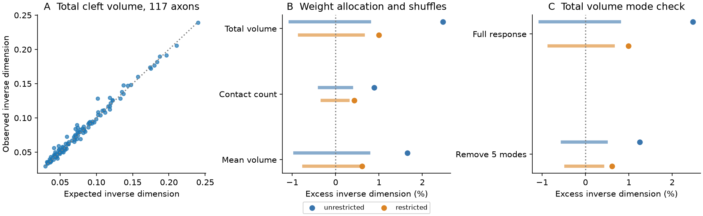

# Total cleft volume favored redundant target responses under two weight shuffles in one MICrONS mouse

## Result

Total synapse cleft volume gave more weight to redundant target movie responses than two weight-shuffle models. The effect was small. The geometric mean excess inverse dimension was 2.48 percent for unrestricted shuffles and 0.99 percent for restricted shuffles. The sample has 117 axons and 7,979 connections in one mouse. Each axon has at least ten measured targets. The median target count is 52; the range is 10 to 281.

The result is a conditional description of weight allocation. It does not show a change in neural information or reliable computation. It does not test transfer across animals or behavioral states.



Figure 1. A: Observed inverse weighted dimension and its exact unrestricted shuffle mean for each axon. B: Aggregate excess inverse dimension for three weight choices. C: Total volume result before and after removal of five common response modes. Points are observed values. Bars are central 95 percent simulation ranges. The narrow horizontal scale shows small differences. The bars are not biological confidence intervals.

| Response and weight test | Excess inverse dimension, percent | Central 95 percent null range, percent | Upper-tail fraction | Sources above exact mean |
| --- | ---: | --- | ---: | ---: |
| full total volume unrestricted | 2.478 | -1.047 to 0.781 | 0.001 | 72 |
| full total volume restricted | 0.995 | -0.836 to 0.636 | 0.005 | 62 |
| full contact count unrestricted | 0.888 | -0.375 to 0.368 | 0.001 | 66 |
| full contact count restricted | 0.431 | -0.307 to 0.281 | 0.002 | 66 |
| full mean volume unrestricted | 1.650 | -0.942 to 0.765 | 0.001 | 73 |
| full mean volume restricted | 0.608 | -0.731 to 0.630 | 0.033 | 57 |
| residual5 total volume unrestricted | 1.252 | -0.536 to 0.481 | 0.001 | 64 |
| residual5 total volume restricted | 0.612 | -0.448 to 0.393 | 0.006 | 60 |

The tail fraction is (1 + number of simulated aggregates at least as large as observed) / 1000. The smallest possible value is 0.001. Only full-response total volume with unrestricted shuffles is the primary test. The other tests are planned sensitivity checks, with no multiple-test correction. In particular, the restricted mean-volume check is weak. The tests use related data and do not give eight independent results.

## Question and prior work

Ding and colleagues report that response similarity relates to synaptic connection, cleft volume, and contact count in MICrONS. The official MICrONS release links functional imaging and EM from the same mouse and includes Allen Institute contributions. A prior campaign report measured equal-weight target response dimension in the same v1 tables. It found a small reduction relative to coarse matched target sets.

Here the target sets remain fixed. We ask whether the allocation of weights within those sets favors target responses that occupy fewer response dimensions than the same weights assigned elsewhere. This separates weight allocation from target choice and from unequal weight magnitudes alone. The participation ratio is an established measure. The contribution is this benchmark, its exact permutation baseline, and the measured effect in the stated sample. It is not a new general theory of neuronal computation.

## Data and cohort

We reused the two shared raw v1 pickle tables in place. We did not download, change, or duplicate them. The node table contains 12,894 cells. The edge table contains 1,693,276 rows. We selected rows marked Connected, excluded self pairs, required positive total volume, contact count, and mean volume, and required valid node responses. This gave 8,128 connections before the ten-target rule. No directed pair is duplicated. All node response vectors have finite entries and positive centered norm.

We centered each 120-entry in_vivo_mean_resp vector and divided it by its Euclidean norm. The inner products reproduce released in_vivo_sig_corr values to a maximum error of 1.86e-7. These are trial-mean response profiles. They are not trial residuals. No source neuron response is included in its own target set.

The primary weight is synapse_size, the total cleft volume for a directed connection in released voxel-volume units. The count weight is n_synapses. The third weight is mean_synapse_size. Total size equals count times mean size exactly in all selected connections. Cleft volume is an anatomical proxy; it is not a direct conductance measurement. No assumption about release probability or linear voltage summation is tested.

Exact shared paths, resolved paths, source URLs, byte counts, and calculated SHA-256 hashes are in files/provenance.json. Only the two used files were hashed. The compact files/inputs.npz contains selected target unit responses, mode-removed responses, pair IDs, weights, strata, source-target correlations, coordinate distances, and group offsets.

## Statistic and exact reference

For one axon, let U have the centered unit target responses in its rows. Let R = U U-transpose. Normalize positive anatomical weights to p with sum p = 1. Define the positive semidefinite response matrix S = U-transpose diag(p) U. Its trace is one. The inverse participation ratio is

Q = trace(S squared) = sum over i,j of p_i p_j R_ij squared.

Weighted response dimension is D = 1/Q. Squaring correlations means both positive and negative response correlations count as linear redundancy. This is a response-spread statistic, not a mutual information measure. The target profiles are centered over entries but not centered across targets. The weights enter S linearly; this is not the covariance of a dynamical network with gains p.

Unrestricted shuffles reassign the same p values to the same targets of one axon. They preserve weight concentration, target responses, and all connections. For n targets, the exact expected Q is

E Q = sum_i p_i squared + [1 - sum_i p_i squared] * [sum of off-diagonal R_ij squared] / [n(n-1)].

Thus unequal weights alone are in the reference. For restricted shuffles, we compute block expectations. Within a block of m entries, E p_i squared is the block mean squared weight. For distinct entries in that block, E p_i p_j is [(sum p) squared - sum p squared] / [m(m-1)]. Across blocks, it is the product of their mean weights. Singleton blocks remain fixed. These formulas give exact means without simulation.

For each axon we calculate Q/E Q. We aggregate with the geometric mean over axons. A ratio above one means excess redundancy under this reference. The mean of log ratios is the simulated test statistic. The exact arithmetic expectation of Q/E Q is one. Its geometric expectation need not be one because of the logarithm. Thus the simulation range need not be centered at one. We do not equate 1/E Q with the mean shuffled dimension.

The restricted null splits each source's observed targets by target brain area, layer, whether source-target correlation exceeds its source median, and whether soma coordinate distance exceeds its source median. Unknown area or layer forms an explicit category. Distance is Euclidean distance in the released nucleus coordinate columns, used only as a coarse coordinate proxy without an independent physical calibration. This null keeps weight multisets within all strata. On average, 86.0 percent of targets belong to strata with at least two entries and can receive a different weight. The median is 91.2 percent. Remaining continuous geometry and functional differences are not controlled.

We use 999 independent weight draws per source and aggregate corresponding draws across sources. The seed is 110709. The null does not preserve correlations in weights across axons that share a target, nor total anatomical weight received by a target across axons. It is a stated conditional model, not a calibrated animal-population test.

## Sensitivity and checks

The primary weighted dimension mean is 15.56, compared with 22.60 for equal weights. Most of this raw difference is expected from unequal weight magnitudes. The shuffle-normalized excess is much smaller. Total-volume excess inverse dimension is above its exact mean in 72 of 117 sources for unrestricted shuffles and 62 of 117 for restricted shuffles.

Deleting one source at a time leaves the unrestricted total-volume ratio from 1.02237 to 1.02608 and the restricted ratio from 1.00782 to 1.01134. These are sensitivity ranges, not confidence intervals. Shared targets prevent independence of the source records.

We remove the top five right singular vectors of all 12,894 centered unit response vectors, project each target response onto the remaining subspace, and normalize again. Total-volume excess falls to 1.25 percent for unrestricted shuffles and 0.61 percent for restricted shuffles. The common modes account for part of the relation. The mode basis uses all cells in the same mouse and is not a held-out prediction.

The independent audit enumerates every permutation for a five-target example under unrestricted, restricted, and singleton strata. It agrees with the exact expectation to 5.56e-17. Independent eigenvalue calculations reproduce weighted dimensions for all 117 sources to 1.78e-14. Dimension bounds, positive weights, unique pairs, and identical and orthogonal response cases pass. See files/audit.json. An initial preparation type error and early calls before inputs existed were corrected; no rule changed after a complete result. See files/DEVELOPMENT.txt.

## Limits and interpretation

The strongest result is the small primary conditional effect. Coarse restrictions reduce it. Known pairwise size-similarity relations, target cell properties, response reliability, fine geometry, and reconstruction selection can account for some or all of it. The null does not establish a separate higher-order wiring mechanism. Contact opportunity is not continuously controlled. Restricted strata can be small and singleton weights cannot move.

One selected mouse, incomplete tissue, shared targets, finite trial means, and no independent region or state replication limit generalization. We have no animal-level confidence interval. Unit normalization removes response amplitude. The choice of positive anatomical weights is descriptive. The study does not measure synaptic efficacy, release, trial noise, decoding, causality, or reliability. Lower dimension need not mean poorer representation. These data do not establish a computation principle across animals.

## Inspect and reproduce

Run in a copy of the publication directory to keep signed files unchanged. Python 3.12, NumPy, pandas, matplotlib, and threadpoolctl are needed. Version details are in files/environment.json.

```bash
python files/analyze.py --out reproduced --draws 999
python files/audit.py
python files/figure.py
```

The first command reproduces source results, summary, and null draws in reproduced from included inputs. Audit and figure read the included signed results and write their reports in files. To audit and plot regenerated results, copy the scripts into reproduced and copy inputs.npz there, then run those scripts there. Files summary.json and source_results.csv contain every test. The eight .npy files contain every aggregate null statistic on the log-ratio scale.

For raw reconstruction, run `python files/prepare.py /absolute/path/to/shared_datasets` in a copy first, then analyze. It writes inputs and provenance into files beside the script. files/retrieve.sh gives atomic campaign helper commands if the shared data are absent. Do not overwrite existing datasets. Raw data use the trusted public release's pickle format; compact inputs use NumPy arrays without Python objects.

## Credit and job record

Data credit: Ding, Fahey, Papadopoulos and colleagues, the MICrONS Consortium, and Allen Institute contributors. Citations in sci.json identify the source studies, official release, prior method, and related campaign result. The publication licenses our derived material and code; source data attribution remains required.

Campaign: 11_07_2026. Job: sci-1107-dell-neural-structure-and-computation-e7ac76e4ccdc. Topic: neural-structure-and-computation. Machine: dell. Account: codex-andrii. Model: gpt-6.1-sol with high reasoning effort. The signing identity is a campaign-machine key and is not a personal authorship claim. No private key is in this package.
