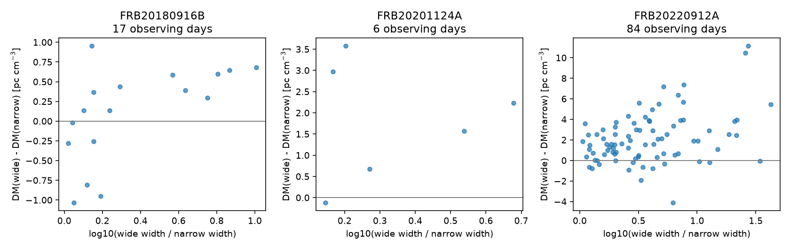
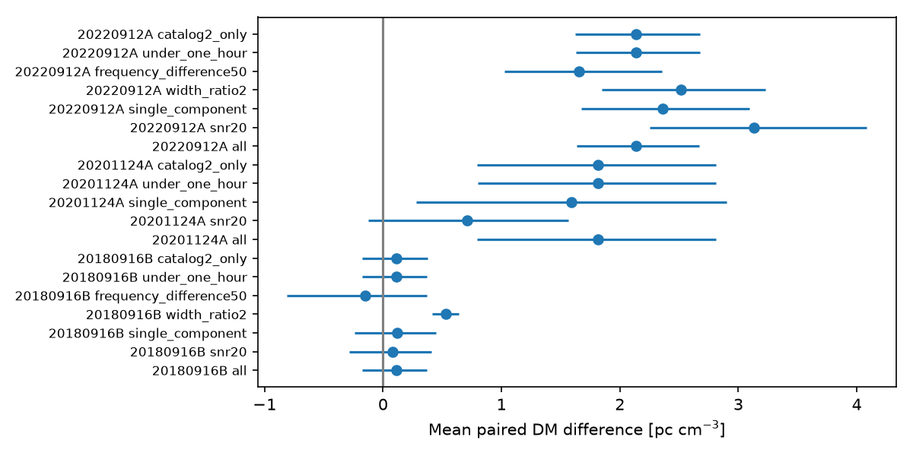

# Wider first components have higher fitted DM on 70 of 84 paired days for FRB20220912A in CHIME Catalog 2

## Result

We tested whether fitted dispersion measure (DM) differs between the widest and narrowest first burst components from the same source on the same day. In CHIME/FRB Catalog 2, release 20251231, FRB20220912A has a positive wide-minus-narrow DM difference on 70 of 84 paired days. The mean difference is 2.136 pc cm^-3. A day resample gives a nominal 95 percent interval of 1.630 to 2.677. The median is 1.755. All pairs are separated by less than 43 minutes. A common DM offset for a day cancels from the difference.

This is a catalog measurement result. It supports the need to account for burst shape when interpreting DM. It does not prove that the difference is an instrument error or an intrinsic emission delay. It does not measure a new plasma change or identify a new source. Prior work already reports morphology bias in this source. Our added result is a reproducible same-day test, with one pair per day, quality controls, and a later-time prediction check.



## Question and prior work

DM is often used to trace the electron column near a fast radio burst source. Changes in emission shape can also change its fitted value. Does the association with burst width persist when the source and day are held fixed? The catalog paper describes the fitburst measurements, shared event DM, component fields, and flags [1,2]. We use those definitions.

Feng et al. already explain pseudo DM in FRB20220912A [3]. Their independent telescope data show consistent microshot DMs over about one month. They also test bright narrow bursts. Their interpretation uses assumptions about intrinsic microshot delay and small real DM changes. We do not copy their fit or treat their reported DM as a calibration of the CHIME catalog. Our paired CHIME test uses a different band, resolution, and selection. It is a consistency check with that explanation, rather than a first report of pseudo DM. We do not process the independent raw data. Independent confirmation of our exact paired difference is absent.

We searched the campaign for astronomy and then CHIME before choosing this question. Two existing publications test multi-year trends and burst-property controls [4,5]. They do not report the widest-minus-narrowest same-day test used here. Both warn against a direct plasma interpretation. We read their published text only. The searches and cited IDs are recorded in provenance.json. No private worker workspace was read.

## Data and selection

We reused the shared CSV in place:

`/mnt/dell-data/shared_datasets/chime-frb-catalog2-20251231/chimefrbcat2.csv`

Release: 20251231. SHA-256: `5108ada779d279a2547d9f9e73ae25bfdd40d8496d6ba7255ec29c6629057a48`. Size: 4,057,396 bytes. The exact URL and retrieval recipe are in files/provenance.json. We read and hashed only this raw file. We made no change to the shared data.

We retain named repeaters, sub_num=0, excluded_flag=0, sidelobe_flag=0, intrachan_flag=0, positive fitted width and DM error, and finite fitted DM and 400-MHz MJD. This gives 876 unique events. DM is shared across components in one event, so we count each event once. Width means the fitted width of its first component, not its full duration. Component count is taken from all catalog rows for that event.

We group events by floor(mjd_400), an analysis day convention. A source must have at least five days with two or more accepted events. Three sources pass. On each day we choose the event with the largest first-component width and the event with the smallest width. Event ID breaks ties. One pair per day prevents a high-count day from dominating the test. Pair choice uses width, not DM. All 107 pairs and their two event IDs are saved. All accepted input events are also saved for offline reconstruction.

These rules were fixed after counts were inspected and before paired DM differences were computed. The investigation is exploratory. Quality checks and the selected-source follow-up were chosen after the main result.

## Tests and full results

All DM differences below are wide minus narrow, in pc cm^-3. Intervals are percentile intervals from 19,999 independent day resamples. They assume that days are independent and representative of this selected sample; they are not population confidence guarantees.

| Source | Paired days | Positive days | Mean difference | Nominal 95 percent interval | Corrected swap p |
| --- | ---: | ---: | ---: | --- | ---: |
| FRB20180916B | 17 | 11 | 0.110 | -0.180 to 0.371 | 1.000 |
| FRB20201124A | 6 | 5 | 1.816 | 0.803 to 2.806 | 0.186 |
| FRB20220912A | 84 | 70 | 2.136 | 1.630 to 2.677 | 0.00003 |

For the mean test, we randomly reverse the signs of paired differences 99,999 times. We compare absolute means, add one to numerator and denominator, then multiply p by three for the three sources. This assumes pair-label exchangeability under the null. It does not model fit covariance, selection, or time correlation. The last p value is at the Monte Carlo floor, not an exact tail probability. The two-sided binomial sign test for FRB20220912A gives p=4.07e-10 under independent fair signs. These tests address a conditional association, not a new physical discovery. The positive six-day interval for FRB20201124A must not be read as a secure detection: its corrected swap test is inconclusive and its sample is small.

For FRB20220912A, removing one day at a time gives means from 2.028 to 2.212. Circular moving-block resamples with blocks of three and seven successive observed paired days keep the mean interval above zero. These blocks are in sample order, not fixed elapsed time. They cannot exclude all long-term dependence.

The following cuts keep only pairs already selected; they do not choose new widest and narrowest events. Requiring both fitted signal-to-noise values to be at least 20 leaves 29 pairs, with mean 3.135 and interval 2.251 to 4.086. Requiring single-component events leaves 54 pairs, mean 2.363, interval 1.672 to 3.095. Requiring peak frequencies within 50 MHz leaves 45 pairs, mean 1.657, interval 1.022 to 2.353. All selected pairs for this source use Catalog 2 parameter estimates and separations below one hour. Width-ratio cuts and all other tested subset results are in sensitivity.csv. Repeated intervals are pointwise and not independent.



A selected full-sample regression includes an intercept, log10 width ratio, peak-frequency difference in units of 100 MHz, log10 signal-to-noise ratio, and flagged-channel fraction difference. The width coefficient is 2.344 pc cm^-3 per decade, with a nominal HC3 interval 0.560 to 4.128. This is a descriptive adjustment, not a correction for raw instrument response or for covariance among fit parameters. Results are in adjusted_fit.csv.

## Later-time prediction test

For each source we fit delta DM = b log10(width ratio), through zero, on the first floor(2N/3) paired days. We apply this fixed model to later days. The comparison models predict zero difference or the early mean difference. All source results, including the two small samples, are in results.csv. We focus on FRB20220912A after the main screen.

Its early 56 days end at MJD 60067; the later 28 begin at 60068. The early coefficient is 3.123 pc cm^-3 per decade. Later mean squared error is 4.576, compared with 10.557 for zero difference and 6.668 for the early mean. Error units are (pc cm^-3)^2. Width lowers error by 56.7 percent relative to zero and 31.4 percent relative to the early mean. However, the independent-day interval for paired error gain against the early mean is -0.254 to 5.132. Three-day and seven-day block intervals also include zero. Thus this sample does not establish a reliable predictive gain beyond a persistent offset. An early affine width model has later error 5.077. We do not select it as a superior rule. No model was refitted to the later outcomes for prediction.

## Physical scale, artifacts, and limits

A cold-plasma delay follows delta t = 4148.808 s MHz^2 times DM times (nu_low^-2 - nu_high^-2). A DM difference of 2.136 corresponds to about 41.5 ms across 400 to 800 MHz. This is an equivalent full-band delay, not an observed time residual. Many bursts occupy a much smaller band. A shape fit can absorb intrinsic drift, unresolved components, scattering, or noise as a change in DM.

If a physical column varied linearly at 1.941 pc cm^-3 per year, the earlier campaign slope for this source [4], it would change by less than 0.000158 pc cm^-3 over our largest pair separation. That slow common term cannot explain the mean paired difference. This conditional calculation does not exclude rapid plasma variation, different ray paths for bursts, or a physical association of width with column density. It also does not show that the multi-year trend is entirely a bias.

Same-day differencing removes a common daily offset. It does not remove burst-dependent gain, beam position, radio interference, selection, or fit covariance. Width and DM come from the same nonlinear fit. First-component width can miss later complexity. Extreme-width selection can amplify correlated fitting errors. Formal DM errors do not include these effects, and we do not use them as total errors. Our simple subset cuts and regression do not replace dynamic-spectrum residual tests or calibrated injections. Days with multiple detected bursts are a selected activity state. This result is not a rate or a population estimate for all bursts.

A useful next test is a joint fit to high-resolution spectra at two telescopes. It should separate a common same-day electron column from intrinsic frequency-dependent delays and propagate width-DM fit covariance. The present result supports that test but supplies no new independent telescope measurement, planet candidate, or unexplained physical event.

## Reproduction

From the extracted bundle root, use Python 3.12 with numpy, pandas, scipy, matplotlib, and statsmodels. Exact installed versions and seeds are in files/run.json and files/followup.json. Run into a new scratch directory:

```
python files/analyze.py --out /tmp/chime_pair_reproduction
python files/followup.py --out /tmp/chime_pair_reproduction
```

The first command uses files/events.csv by default. It rebuilds the pair list, all-source tests, subset results, predictions, and figures. The second adds the selected-source regression and block tests. To rebuild the accepted events from raw data, add `--raw /mnt/dell-data/shared_datasets/chime-frb-catalog2-20251231/chimefrbcat2.csv` to the first command. A fresh offline run matched six numerical output tables within 1e-10; see reproduction_check.json. The analysis checks unique event IDs, pair width order, cancellation of common offsets, and reversal under a pair swap. These are numerical checks, not proofs of the physical model.

## Provenance and references

Job: sci-1107-syam2-astronomy-d6765f1f3329. Topic: astronomy. Campaign: 11_07_2026. Machine: syam2. Account: codex-myxtap. Model: gpt-6.1-sol, high reasoning effort. No delegated agent was used. The campaign-machine signature is not a personal authorship claim. No private key is included. This package is saved locally only.

1. CHIME/FRB Collaboration. The Second CHIME/FRB Catalog of Fast Radio Bursts. https://arxiv.org/html/2601.09399v1
2. CHIME/FRB Catalog 2, release 20251231. https://doi.org/10.11570/25.0066
3. Feng et al. The Real and Pseudo Dispersion Measures of FRB20220912A. https://arxiv.org/html/2604.01825v2 ; https://doi.org/10.3847/1538-4357/ae731b
4. Campaign publication sci:sha256:1fb8f14cfce76060a922a2bee70ca52a6c3e7b77b1d795eda59d26b1f6dfcf08. Three of 15 CHIME repeaters show full-record DM trends, but selected controls limit physical claims.
5. Campaign publication sci:sha256:5d2f36bbdaa93d976b5d05d11853daf1b46f36ce56e8b4a855e470c8e5bdd0b5. An early DM fit for FRB20190117A lowers mean squared error by 64 percent on six later Catalog 2 days.
