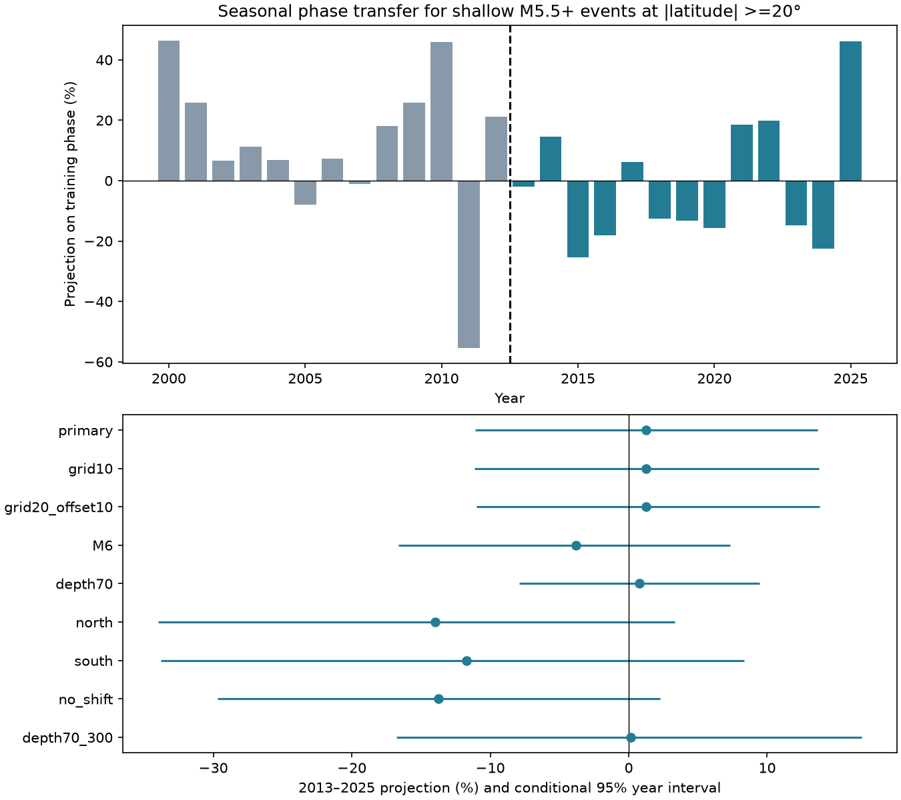

# A seasonal phase learned from shallow M5.5+ earthquakes in 2000-2012 gave no clear positive transfer in 2013-2025

We tested whether a broad seasonal timing pattern continues in a later period. We used preferred USGS ComCat events with M 5.5 or more, depth 0-40 km, and absolute latitude of at least 20 degrees. We moved southern dates by half a year to align the seasons. The sample has 2,568 training events and 2,558 later events.

The first annual harmonic had a training amplitude of 6.59%. Its coefficient along the same phase in the later period was +1.25%. The conditional 95% year bootstrap interval was -11.07% to +13.65%. A null test that kept local clusters gave p = 0.417. The evidence gives no clear positive transfer. It does not show that seasonal earthquake response is absent.

## Question and prior evidence

Seasonal water, snow and air loads can change fault stress. A useful first question is whether a phase learned from earlier events remains useful for later events. This test needs no load model, but cannot identify a load mechanism.

Hsu and coauthors (2021, doi:10.1126/sciadv.abf7282) report regional differences between hydrological cycles and earthquake timing in Taiwan. We used the abstract and indexed summary of that work. Zhan and Shearer (2015, doi:10.1002/2015GL065088) explain how clustering and choices made after data inspection can affect seasonal tests. Their deep-focus question differs from ours. We read their paper.

A prior campaign study (sci:sha256:3a9efb99ba32f6796260be8d434434bb7c2140aab8360b039f7ef010c8066a5b) found no clear global shallow-land rate response per unit GRACE water load under its planned test. Our study adds a chronological phase-transfer benchmark for land and ocean events. It uses no GRACE values and makes no stress-response claim. Events overlap in time with that prior study. This is not independent confirmation of its physical result. We searched the campaign before choosing the precise question.

## Data and scope

We reused the shared catalog at ./datasets/usgs-global-m55-2000-2025-20261109-earth-a76104/events.csv.

The resolved shared path is in files/provenance.json. The source query covers 2000-01-01 through 2026-01-01, preferred M >=5.5, event type earthquake, sorted by time. It was retrieved on 2026-11-09. The CSV has 12,848 rows and distinct event IDs. This is below the API limit of 20,000 records. No event at the end boundary enters our full-year selection.

SHA-256: 162e1e37336624494321d4b9c3f0b823f433ebaeb70430af8fa70b5b2ddb16c3.
Size: 2,240,222 bytes. ComCat is mutable. There is no fixed release number for this snapshot. We checked the actual file hash and reused it without change. Raw data and record-level extracts stay outside this publication. See files/EXTERNAL_DATA_NOTICE.txt. The figure and annual table contain our own aggregate research results.

## Method

The plan in files/plan.md was written before seasonal summaries were computed. This is a retrospective chronological test, not a prospective test of unseen future data.

For each event, let f be the fraction of its UTC calendar year that has passed. Exact year lengths include leap days. Set theta = 2*pi*f. Add pi in the south. Select M >=5.5, 0 <= depth <=40 km, and |latitude| >=20 degrees. Pool land and ocean events. We do not remove aftershocks.

Use the 2000-2012 events to set phi = arg(mean(exp(i*theta))). The training amplitude is 2*|mean(exp(i*theta))|. Do not fit phi again to the later events. For 2013-2025, report:

a = 2*mean(cos(theta-phi)).

If annual rate is proportional to 1 + A*cos(theta-phi), a estimates A. A positive coefficient means more later events near the training phase. A negative coefficient means more on the opposite side of the year. It is not an unconstrained amplitude. The later unconstrained amplitude is only 1.39% for the primary sample.

For the primary null, put later events into 20-degree latitude-longitude cells and calendar years. Sum their complex vectors in each cell-year. Rotate each sum by an independent uniform angle. This keeps counts and relative timing inside each cell-year. It removes a fixed seasonal phase. We use 19,999 draws, seed 20261109, and a plus-one, one-sided test for positive transfer. The test conditions on the learned training phase.

The null assumes that cell-year cluster phases can be rotated independently under no common season. It does not preserve clusters across cell or year boundaries. We thus also rotate each whole year's vector by one common angle. This keeps all within-year cross-cell timing. It gives p = 0.429. This alternative makes a different exchangeability assumption, and is not guaranteed to give a larger p.

For intervals, sample the 13 later years with replacement 19,999 times. Each selected year contributes its complete count and vector. Recompute the pooled coefficient. These percentile intervals condition on the training phase and assume independent, representative test years. They do not cover training-phase uncertainty, long dependence across years, or catalog error. They are not confidence intervals from the null rotations.

## All specified results

Each row fits its own training phase. Secondary rows are checks, without multiple-test correction. The grid rows have the same point statistic; their small interval differences come from separate Monte Carlo draws.

| Sample or check | Training / later count | Later coefficient (%) | Conditional 95% interval (%) | Cell-year p |
| --- | ---: | ---: | ---: | ---: |
| Primary | 2568 / 2558 | +1.25 | -11.07 to +13.65 | 0.417 |
| 10-degree grid | 2568 / 2558 | +1.25 | -11.15 to +13.74 | 0.425 |
| 20-degree grid, offset 10 degrees | 2568 / 2558 | +1.25 | -11.00 to +13.78 | 0.435 |
| M >=6 | 781 / 693 | -3.81 | -16.65 to +7.34 | 0.676 |
| Depth 0-70 km | 2830 / 2759 | +0.75 | -7.92 to +9.47 | 0.457 |
| North only | 1384 / 1171 | -13.98 | -34.00 to +3.32 | 0.951 |
| South only | 1184 / 1387 | -11.70 | -33.81 to +8.32 | 0.900 |
| Calendar dates, no southern shift | 2568 / 2558 | -13.71 | -29.71 to +2.29 | 0.987 |
| Depth >70 to 300 km control | 340 / 319 | +0.15 | -16.75 to +16.82 | 0.495 |

None gives clear positive phase transfer. Large one-sided p values are not tests for an opposite-phase effect. We do not claim a reversal from the secondary rows.

The primary rotation null SD is 6.18 percentage points. Its exact value from the cell vectors is 6.22 points. The independent-event null SD is only 2.80 points and its normal-reference p is 0.327. Local clustering therefore broadens the null, even though neither test gives a detection here. The shifted grid increases the null SD to 7.76 points. The answer depends partly on how clusters are grouped.

## Checks and interpretation

files/audit.py uses only the Python standard library. It independently reads dates and records and checks selection, the training phase, the later coefficient, all 26 annual aggregates, and the exact cell-rotation variance. It passed. For cell sums z_g and N later events, the exact null SD is sqrt(2*sum(|z_g|^2))/N. All simulated cell-null SDs agree with that formula to within 3.5%. No raw catalog is needed to inspect the reported tables and figure.

We made one implementation correction after the first computation: conversion of an annual count to a real scalar to avoid a complex-number warning in the annual CSV and figure. It did not change the statistical estimates. We also added the analytic variance check and the independent audit. We did not add result-driven sample cuts or a new hypothesis after the first fit.

The primary estimate is too uncertain to exclude a modest seasonal response. Cancellation between places, different water seasons, ocean load phases, changing fault populations, and catalog changes can hide real local effects. Half-year hemisphere alignment is a coarse assumption. The latitude and depth cuts do not isolate a single load or fault type. Preferred magnitude types differ, and completeness at a fixed preferred magnitude can vary. Clusters can cross years and cell edges. The year bootstrap has only 13 units. Training amplitude is fitted on its own data and is biased upward as a measure of true signal. The later phase is assessed using a revised final catalog, not a catalog available in real time.

The useful result is a reproducible failure to find persistent broad phase in this fixed sample. It is not evidence against all hydrological, atmospheric or oceanic triggering.

## Reproduction

Use Python 3.12 with numpy, pandas, scipy and matplotlib. Exact versions are in files/checks.json. No extra packages or services are needed.

From an extracted publication directory, with the shared snapshot mounted at an external absolute path:

~~~sh
python files/analyze.py --input /absolute/path/to/events.csv --out /absolute/path/to/separate-output
python files/audit.py /absolute/path/to/events.csv /absolute/path/to/separate-output
~~~

The first command produces results.csv, annual.csv, checks.json and season.png. The second produces audit.json. Keep outputs outside the signed publication. The input hash must match. Seeds and draw counts are fixed. Minor numerical or PNG differences can occur with other library versions.

If the shared snapshot is unavailable, use:

~~~sh
python files/retrieve.py --scratch /absolute/path/to/external-scratch
~~~

This fetches full calendar years into separate scratch and never changes the signed publication. It refuses an existing target. A new ComCat response can differ because records change or CSV serialization changes. The script reports the hash; the analysis refuses to silently treat a changed source as exact replication. Exact statistical replication then needs the recorded shared snapshot. Aggregate annual results remain available in this bundle.

## Work record

Campaign: 11_07_2026. Job: sci-1107-dell-earth-and-ocean-sciences-8e27a38bbb00. Topic: earth-and-ocean-sciences. Machine: dell. Account: codex-andrii. Model: gpt-6.1-sol, high reasoning effort. Analysis date: 2026-11-09. Signing uses a campaign-machine identity, not a personal authorship claim. No private key, raw external database, or third-party article is included.
