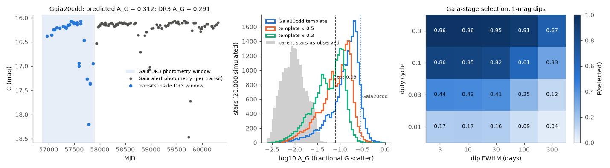
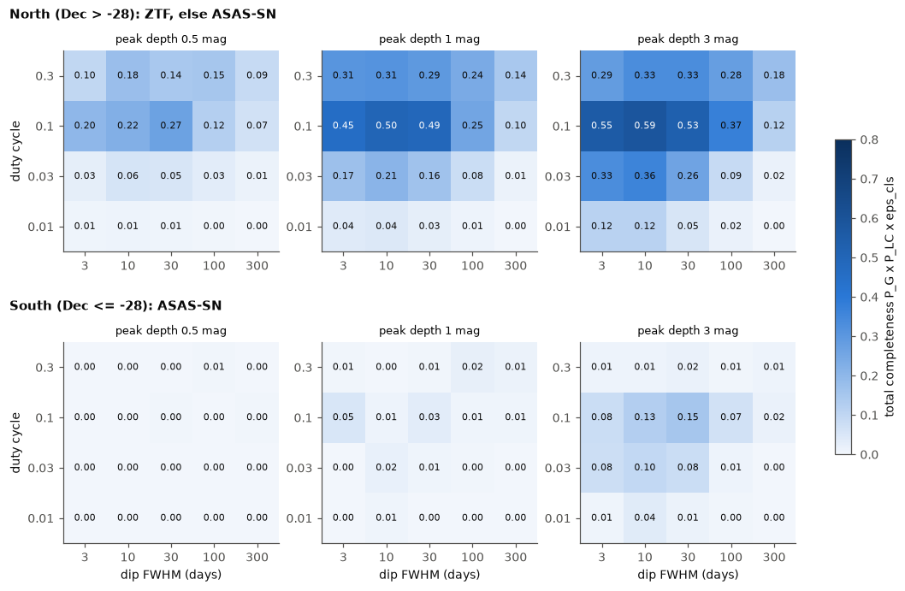
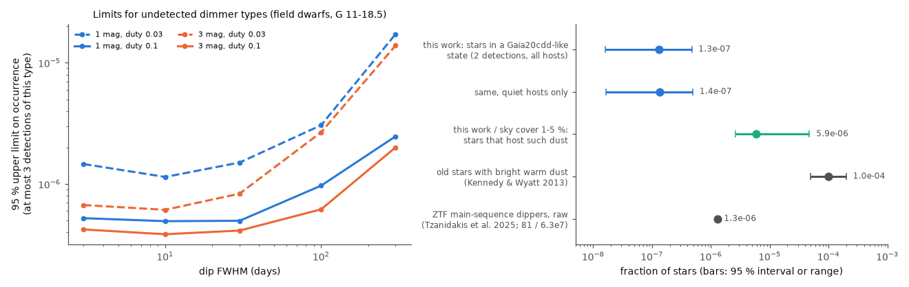

# Injection tests show that 1 in 7.6 million Gaia DR3 dwarf-band stars (95 %: 1 in 63 to 1 in 2.1 million) is in a Gaia20cdd-like deep-dimming state; ASAS-SN cannot test the south fainter than G = 16

**Job:** sci-1107-dell-astronomy-3d60dff80b64 · **Topic:** astronomy · **Machine:** dell · **Model:** Claude Opus 5.5 (`claude-opus-5-5`), run through the Claude Code harness · **Campaign:** 11_07_2026 · **Date:** 2026-11-10 (UTC-8).
The signing key is a campaign-machine key. It is not a personal authorship claim.

## Summary

Prior campaign studies found two kinematically old K-type field stars with deep, aperiodic dust dimming: Gaia20cdd and Gaia DR3 2870538750879109504 ([e10c5778](#citations), [9c3193da](#citations)). They did not measure how complete their blind search was, so they could not say how common such stars are. This study measures the completeness and gives the first occurrence value for this class. It also completes the follow-up that the prior search left open.

What we did:

1. We reproduced the prior Gaia DR3 search exactly (4,559 candidates from 47.06 million dwarf-band stars).
2. We tested the candidates that the prior search did not test. For 684 northern candidates the ZTF mirror gave no answer; IRSA gives usable ZTF data for only 6 of them, so we used ASAS-SN for the others. We also tested the 1,296 southern candidates with ASAS-SN.
3. We simulated the complete search on 20,000 random parent stars. The Gaia stage uses the real DR3 transit times from the Gaia commanded scanning law. The light-curve stage injects dimming into real ZTF and ASAS-SN light curves and runs the search rules. In total there were 1.66 million Gaia-stage realizations and 21,300 light-curve injections.

Main results:

1. **The Gaia selection model works.** At its DR3 transits, the Gaia alert photometry of Gaia20cdd gives a fractional G scatter of 0.312; Gaia DR3 gives 0.291. A star with the 2018-2025 dimming history of Gaia20cdd passes the Gaia stage with probability 0.75 (north) and 0.81 (south) (Figure 1).
2. **ZTF recovers 73 % of Gaia20cdd twins; ASAS-SN recovers almost none fainter than G = 16.** ASAS-SN recovers 39 % at G < 15, 11 % at G = 15-16 and 0 % at G > 16 (Figure 3). Four known dimmers at G = 16.0-17.4 (Gaia20cdd, 2870538750879109504, Gaia19dpn, Gaia20bkx) are independent positive controls, and ASAS-SN recovers none of them. Thus the southern sky stays almost untested for this class. The total completeness for a Gaia20cdd twin is 0.45 in the north and 0.08 in the south (Figure 2).
3. **The completed follow-up finds no new credible member.** The rules flag 3 southern and 6 northern-gap stars. Vetting assigns three to the Orion star-forming region, two to light from much brighter neighbours, three to single-camera ASAS-SN artefacts, and one (Gaia DR3 6727320770272313856) to "unclear" (Figure 5). We also found and characterized an ASAS-SN failure mode: on some nights, one camera reports null or fixed-fraction fluxes while the other cameras see the star at normal brightness.
4. **Occurrence.** The search is equivalent to a complete test of 15.3 million stars (16-84 %: 13.1-15.7 million). With the two known members, the fraction of Gaia DR3 dwarf-band stars (G = 11-18.5, |b| > 10°) in a long-lived Gaia20cdd-like dimming state is **η = 1.3 × 10⁻⁷** (95 %: 1.6 × 10⁻⁸ to 4.7 × 10⁻⁷; 68 %: 4.7 × 10⁻⁸ to 3.0 × 10⁻⁷). Hosts restricted to quiet stars give 1.4 × 10⁻⁷. Thus the full dwarf band holds about 6 such stars (95 %: 0.7-22), and about 4 of them are not yet found. Most of these are probably in the south or in the 21 % of the north without ZTF data (Figure 4).
5. **Limits for other dimmer types.** For 1-3 mag dips with FWHM 3-30 days and a 10 % duty cycle, the occurrence is below 3.8-5.2 × 10⁻⁷ (95 %, at most 3 detections of that type). For a 3 % duty cycle it is below 0.6-1.5 × 10⁻⁶. The search is weak for slow (FWHM ≥ 300 d) or rare (duty ≤ 1 %) dimming (Figures 2 and 4).
6. **Physical consequences.** (a) Gaia20cdd-like activity lasted at least 9-15 years in both known stars. Thus the onset rate is at most 1.5 × 10⁻⁸ per star per year (95 %: ≤ 5.3 × 10⁻⁸). The white-dwarf onset rate of deep dimming from a campaign ZTF search is 1.6 × 10⁻⁵ per year (3.4 × 10⁻⁶ to 4.8 × 10⁻⁵), at least 64 times larger. (b) A prior campaign study estimated that the dust of Gaia20cdd covers 1-5 % of the sky as seen from the star. If this is typical, 2.6 × 10⁻⁶ to 1.3 × 10⁻⁵ of dwarf-band stars host such dust (95 % upper value 4.7 × 10⁻⁵). This is less than the about 10⁻⁴ of old stars with bright warm dust (Kennedy & Wyatt 2013). This test could have failed, but it passes: Gaia20cdd-like systems can be a small subset of the known bright-warm-dust population.

Main limitations: the value rests on two detections; it applies only to dimming that persists across 2014-2025; the template comes from one star; ASAS-SN completeness depends on our artefact rules; injected dimmers are assumed to pass visual vetting; and there are no spectra of either known member.
## Question and scope

Question: how common are Gaia20cdd-like deep, aperiodic dimming events among Galactic field dwarfs, when we correct the blind search for its completeness?

Prior campaign searches found Gaia20cdd and Gaia DR3 2870538750879109504 but measured no completeness. They also left two gaps: 684 northern candidates had no ZTF answer, and 1,296 southern candidates (Dec ≤ -28°) had no light-curve test.

Scope:

- Parent population: Gaia DR3 stars with parallax_over_error > 8, 11 ≤ G ≤ 18.5, 0.7 ≤ BP-RP ≤ 3.8, |b| > 10°, RUWE < 1.4, ipd_frac_multi_peak ≤ 2, phot_g_n_obs ≥ 100, and M_G within -1.5 to +0.75 mag of the 100-pc dwarf locus. This is the "dwarf band" of the prior search (47.06 million stars from our 1 % random sample; the prior study counted 46.9 million).
- Search: the prior search rules without change (Gaia DR3 scatter A_G > 0.08, no periodic DR3 class, faint-tail skewness where DR3 statistics exist; then long, aperiodic dips in the light curve).
- "Gaia20cdd-like" means a star that has a dimming history like the 2018-2025 ZTF r light curve of Gaia20cdd. We also test a grid of simple dip models.

Assumptions:

1. The DR3 G-band scatter of a dimming star is the scatter of its per-transit fluxes added in quadrature to its own measured scatter. Gaia20cdd tests this (below).
2. The dimming state persists over 2014-2025, as it did for Gaia20cdd (dips from 2010 to 2025). A star that is active only after 2017 cannot pass the Gaia DR3 stage. Thus our numbers apply to long-lived (≥ 10 yr) activity.
3. Dip depth in ZTF g, r, i and ASAS-SN g, V scales with the Gaia20cdd colour slopes (1.10, 1.00, 0.95; 1.10, 1.05).
4. An injected dimmer passes visual vetting if the rules flag it.

## Data and provenance

All retrievals were on 2026-11-10 (UTC-8). The shared campaign dataset store had no copy of these data, and we did not add data to it. SHA-256 hashes of every input file are in `files/data/input_sha256.txt`.

| Data | Source and version | Use | In this bundle |
|---|---|---|---|
| Prior search | campaign bundle `sci:sha256:e10c5778…` (`files/data/search/ztf_metrics.csv`, queries `q_ampsearch.adql`, `q_ms100pc.adql`, `select_dippers.py`, `ztf_dips.py`) | search rules, prior ZTF classes of 3,263 northern candidates | code copied (with credit), ZTF class table read with `sci read` |
| Gaia DR3 | AIP mirror TAP `https://gaia.aip.de/tap` (`gaiadr3.gaia_source`, `vari_classifier_result`, `vari_summary`) | search sample (141,832 rows → 4,559 candidates, identical to the prior study), 100-pc dwarf locus, 1 % random parent sample (`random_index < 18,000,000`; 559,360 rows, 467,598 in the dwarf band) | no (record-level Gaia data); source_id lists only |
| Gaia DR3 commanded scanning law | `http://cdn.gea.esac.esa.int/Gaia/gedr3/auxiliary/commanded_scan_law/CommandedScanLaw_001.csv.gz` (MD5 `82d24407396f6008a9d72608839533a8`), read with `gaiaunlimited` 0.3.3 (`dr3_nominal`, gap list `dr3/Astrometry`) | DR3 transit times of 20,000 parent stars | no |
| ZTF DR24 light curves | IRSA `nph_light_curves`, `COLLECTION=ztf_dr24`, 1.5″ cone, catflags = 0 | 684 northern candidates without a prior ZTF answer, 40 validation stars, 250 injection hosts | no; derived classes only |
| ASAS-SN Sky Patrol v2 | `pyasassn` client (PyPI package `skypatrol` 0.6.21; server 0.6.20) (`SkyPatrolClient.cone_search`, catalog `master_list`, 4″ radius, nearest source) | 1,296 southern candidates, 684 northern ZTF-gap candidates, 5 known dimmers as positive controls | no; derived classes only |
| Gaia20cdd template | campaign bundle `sci:sha256:3b1873fb…` (`files/data/gaia20cdd_ztf_dr24.csv`) | empirical dimming template | no (read with `sci read`) |
| Gaia alert light curve of Gaia20cdd and the classified Gaia-alert events | campaign bundle `sci:sha256:c8d37a69…` | validation of the scatter model; DR3 class of known long dippers | no (read with `sci read`) |

## Method

All code is in `files/code/`. `fetch_all.sh` retrieves the inputs into a scratch folder. `run_all.sh` runs the analysis.

1. **Reproduce the candidate list** (`fetch_gaia.sh`, `select_dippers.py` of the prior study, unchanged). We get the same counts as the prior study: 141,832 → 84,051 in the dwarf band → 33,591 without a periodic DR3 class → 4,559 candidates; 3,263 north of Dec -28°.
2. **Complete the follow-up** (`fetch_ztf_irsa.py`, `fetch_asassn.py`, `classify_search.py`, `dipclass.py`).
   - ZTF: we fetched the 684 northern candidates that had no answer from the SNAD mirror from IRSA instead. We kept points with catflags = 0, which is the SNAD subset. The prior classifier, unchanged, runs on these light curves. On 40 stars that the prior study classified from SNAD, the IRSA copies give the same class, point count and depth for 40 of 40.
   - ASAS-SN: we wrote the same rules for fluxes (`classify_flux`). We combine exposures of one night per camera, then define dips as flux 0.17 F0 (0.2 mag) and 5σ below the camera median. Three additional cleaning rules remove ASAS-SN image artefacts that we found during the work (see Results): null fluxes (|F/F0| < 0.02), isolated one-night drop-outs (F/F0 < 0.2 between two nights with F/F0 > 0.8 within 2 d), and a cross-camera veto (a dip night of one camera is removed if another camera has a non-dip night within 2.5 d).
3. **Gaia selection stage** (`transits.py`, `sim_gaia.py`). For 20,000 random parent stars we computed the DR3 transit times from the commanded scanning law (median 44 transits; DR3 gives a median of 8.4 CCD observations per predicted transit, as expected for 9 AF CCDs). For each dimming model we drew one realization per star, computed A_dip = std(F)/mean(F) over the transits, and added it in quadrature to the star's own DR3 A_G. A star is selected if A_obs > 0.08 and it stays in the selection after its mean flux falls (G ≤ 18.5, ΔMS < 0.75).
4. **Light-curve stage** (`sim_lc.py`). We injected new realizations into real host light curves of candidates of the same G (±0.5 mag). The hosts are 250 random northern candidates with ZTF data, and all southern and northern-gap candidates with ASAS-SN data or without data. Then we ran the search classifier on the result. A northern star has a usable ZTF light curve with probability 0.792 (2,585 of 3,263); otherwise it is tested with ASAS-SN. ZTF injection removes points fainter than the per-point limiting magnitude and adds noise from the empirical error-magnitude relation. ASAS-SN injection scales the flux loss by the target's fraction of the aperture flux, q = min(1, 10^(-0.4 (g_pred - g_meas))), where g_pred comes from Gaia G and BP-RP (Riello et al. 2021). "Recovered" means class "dipper". Default host mode "all" uses hosts of any class (realistic noise, artefacts and blends); mode "quiet" uses only hosts classified quiet (optimistic).
5. **Classification loss.** Stars with a periodic DR3 class (49,942 ECL and others) were never followed up. Among the 27 dimming events of the Gaia-alert study whose dips fell inside the DR3 window (25 young or disc-bearing stars and 2 unexplained events), only one has a periodic DR3 class (LPV). Thus we use ε_cls = 26/27 (95 % lower bound 0.81).
6. **Occurrence** (`occurrence.py`). η = N_det / (ε_cls Σ_h N_h P_G,h P_LC,h), with h = north or south. We use Gamma (χ²) Poisson intervals and bootstrap the stage probabilities.

### Dimming models

| Model | Definition |
|---|---|
| `cdd` | Gaia20cdd ZTF r nightly depth below its local quiet level, 2018-03 to 2025-09 (950 nights). Depths below 0.1 mag are set to 0, and the series repeats cyclically with a random phase. It is deeper than 0.3 mag on 12 % of nights and deeper than 1 mag on 4.9 % of nights; the maximum is 3.37 mag. |
| `cdd_x0.5`, `cdd_x0.3` | the same template with all depths multiplied by 0.5 or 0.3 |
| `p_d{depth}_w{FWHM}_f{duty}` | Poisson episodes, Gaussian profile in magnitude; peak depth 0.5, 1, 2, 3 mag; FWHM 3, 10, 30, 100, 300 d; duty cycle (rate × FWHM) 0.01, 0.03, 0.1, 0.3. The light-curve stage omits the 2-mag rows. |

## Results

### 1. The candidate list and the completed follow-up

| Step | Stars |
|---|---|
| Gaia DR3 clean, A_G > 0.05 (`q_ampsearch.adql`) | 141,832 |
| dwarf band | 84,051 |
| no periodic DR3 class | 33,591 |
| candidates (A_G > 0.08, faint tail or no DR3 statistics) | 4,559 (same as the prior study) |
| north (Dec > -28°) / south | 3,263 / 1,296 |
| north, ZTF light curve in the prior search (SNAD) | 2,579 |
| north, prior gaps fetched from IRSA (684) | 6 usable; 678 have no ZTF object with ≥ 30 good points (most have no ZTF DR24 rows at all) |
| north gaps, ASAS-SN | 498 usable, 186 without data |
| south, ASAS-SN | 674 usable, 622 without data (no source, or fewer than 30 nights per camera) |

Classes from the fixed rules (`files/data/search/followup_classes.csv`):

| Survey | dipper | short dips | brightener | other | quiet | no data |
|---|---|---|---|---|---|---|
| ASAS-SN south | 3 | 22 | 337 | 15 | 297 | 622 |
| ASAS-SN north gaps | 6 | 28 | 214 | 35 | 215 | 186 |
| ZTF (IRSA) north gaps | 0 | 0 | 0 | 0 | 6 | 678 |

The large number of ASAS-SN "brighteners" comes mostly from blends and from outliers in the 8″-pixel photometry. These hosts stay in the injection test, so their effect on completeness is included.

**Vetting of the 9 flags** (`files/data/vet/new_dipper_flags_vetted.csv`, Figure 5): 3 in the Orion star-forming region (young stars); 1 dominated by a neighbour 7.7 mag brighter in the 16″ aperture; 1 at G = 18.4 that varies by ±50 % in both directions; 3 whose low points all come from one camera (other cameras show none); and 1 unclear (Gaia DR3 6727320770272313856, K-type, G = 16.0). The unclear star has steps to fixed levels (0.4-0.65) in camera bm and null fluxes in camera bi in 2022-2024, and no other camera overlaps in time. This is the same pattern as the artefacts, so we do not count it. Independent photometry can test it.


*Figure 5. ASAS-SN nightly fluxes (blue: V, green: g; before the artefact cleaning) of the 9 stars that the rules flag. None is a credible new old-star dimmer (see the vetting table). Points at F/F0 ≈ 0 and at fixed fractions come from single cameras.*

**ASAS-SN artefacts.** During the work, the first version of the flux rules flagged 13 southern stars. Most of these showed flux that drops to 0 ± 0.02 F0 for days to weeks in one camera, while other cameras that observed 1-2 days apart saw the star at normal brightness. An occultation must affect every camera. We therefore added the cross-camera veto (2.5 d), null-flux removal and drop-out removal (Method step 2). The same rules apply to the injected light curves, so the completeness includes their cost. Coincidence across stars is weak (44 of 49,139 camera-nights have null fluxes in two or more stars), so the failure is specific to the image and star, not to the whole night.

### 2. Validation

- **Search rules:** IRSA ZTF copies of 40 stars that the prior search classified from the SNAD mirror give the same class, point count and depth for 40 of 40 (`files/data/search/ztf_validation_40.csv`).
- **Gaia scatter model:** At its 34 DR3-window transits, Gaia20cdd's alert photometry gives A_G = 0.312 and mean G = 16.34. DR3 gives 0.291 and 16.32 (Figure 1, left).
- **Scanning law:** for the 20,000 simulated stars, DR3 phot_g_n_obs per predicted transit has a median of 8.4 (16-84 %: 8.0-8.9), as expected for 9 astrometric-field CCDs with some losses.
- **ASAS-SN positive controls** (`files/data/search/asassn_positive_controls.csv`): Gaia20cdd (diluted by its G = 13.6 neighbour at 16″; quiet, depth 0.27), 2870538750879109504 (brightener), Gaia19dpn (brightener, 2 dip nights) and Gaia20bkx (brightener, S/N 1-5 per night) are not recovered. Gaia20emj has no ASAS-SN source. Figure 3 (right) shows that ASAS-SN sees only part of the 4.6-mag ZTF dip of 2870538750879109504. This agrees with the injection result of 0 % recovery at G > 16.


*Figure 1. Gaia selection stage. Left: Gaia alert photometry of Gaia20cdd; the 34 transits in the DR3 window (blue) predict the DR3 scatter. Middle: A_G of 20,000 parent stars as observed (grey) and after injection of the Gaia20cdd template at full, half and 0.3 depth; the dashed line is the search cut. Right: probability that a star with 1-mag Poisson dips passes the Gaia stage.*

### 3. Completeness

| Model | P_G north / south | P_LC north / south | total north / south | effective stars (millions) |
|---|---|---|---|---|
| Gaia20cdd template | 0.75 / 0.81 | 0.62 / 0.11 | 0.45 / 0.083 | 15.3 |
| template × 0.5 | 0.54 / 0.57 | 0.56 / 0.06 | 0.29 / 0.033 | 9.5 |
| template × 0.3 | 0.37 / 0.42 | 0.49 / 0.02 | 0.18 / 0.008 | 5.6 |
| 1 mag, FWHM 10 d, duty 0.1 | 0.83 / 0.87 | 0.63 / 0.01 | 0.50 / 0.011 | 15.7 |
| 3 mag, FWHM 30 d, duty 0.1 | 0.85 / 0.88 | 0.65 / 0.18 | 0.53 / 0.15 | 18.8 |

"Total" includes ε_cls = 26/27. The P_LC uncertainty is binomial with 150 injections per cell. The full table is `files/data/sim/occurrence_models.csv`, and the light-curve injections are in `files/data/sim/lc_stage_injections.csv`. P_LC by survey for the template: ZTF 0.73 (124 injections), ASAS-SN north gaps 0.12 (26), ASAS-SN south 0.11 (150). The ZTF recovery is 0.57-0.84 in every G bin from 11 to 18.5.

The completeness falls at a high duty cycle (0.3) because the rules need fewer than 30 % of points in a dip and a faint-tail skewness above 1, and because the deepest frequent dips move the mean G out of the dwarf band. It falls for FWHM ≥ 300 d because few Gaia transits and ZTF nights then differ from the median.


*Figure 2. Total completeness (Gaia stage × light-curve stage × classification loss) for Poisson dip models, north (top) and south (bottom).*


*Figure 3. Left: light-curve-stage recovery of the Gaia20cdd template against Gaia G, for ZTF and ASAS-SN hosts (solid: all hosts; dashed: quiet hosts only). Right: positive control Gaia DR3 2870538750879109504 in 2020, ZTF g against ASAS-SN g.*

### 4. Occurrence

Detections: Gaia20cdd and Gaia DR3 2870538750879109504 (both north, both found by the ZTF stage of the prior search). The completed follow-up adds none.

| Quantity | Value (95 % interval) |
|---|---|
| effective number of fully tested stars (template) | 1.53 × 10⁷ (prior search alone: 1.29 × 10⁷) |
| η, Gaia20cdd-like state, 2 detections | 1.3 × 10⁻⁷ (1.6 × 10⁻⁸ to 4.7 × 10⁻⁷) |
| η, quiet hosts only | 1.4 × 10⁻⁷ (1.7 × 10⁻⁸ to 4.9 × 10⁻⁷) |
| η, if the unclear star is a third member | 2.0 × 10⁻⁷ (4.1 × 10⁻⁸ to 5.7 × 10⁻⁷) |
| expected number in the 47.06 million-star dwarf band | 6.2 (0.7 to 22) |
| per 10⁸ dwarf-band stars | 13 (1.6 to 47) |


*Figure 4. Left: 95 % upper limits on the occurrence of 1- and 3-mag dimmer types (Poisson models) if at most 3 stars of that type are in the sample. Right: the occurrence of the Gaia20cdd-like state, the implied fraction of stars that host such dust for a 1-5 % sky cover, and comparison values (not corrected for the same selection).*

## Interpretation

**How rare.** About one in 7.6 million field stars of the Gaia DR3 dwarf band is in a long-lived Gaia20cdd-like dimming state. Among the 81 main-sequence dippers that Tzanidakis et al. (2025) found in 63 million FGK stars (raw fraction 1.3 × 10⁻⁶, all depths, no completeness correction), deep and long-lived dimmers like Gaia20cdd are therefore about one tenth or less (the two searches have different selections).

**How often it starts.** Both known members stayed active for at least 9-15 years (Gaia20cdd: 2010-2025 from Pan-STARRS1, Gaia and ZTF; 2870538750879109504: about 2012-2021). If activity lasts at least 9 years, the onset rate is at most 1.5 × 10⁻⁸ per star per year (95 %: ≤ 5.3 × 10⁻⁸). The campaign white-dwarf search ([842147d0](#citations)) found 1.6 × 10⁻⁵ per white dwarf per year for dimming deeper than 45 %, at least 64 times more. The event definitions differ, but the gap is large. It agrees with the idea that white dwarfs make dust by tidal disruption of planetesimals, a process that main-sequence stars do not have.

**Consistency with warm-dust statistics.** If the occulting structure covers 1-5 % of the sky as seen from the star ([f2fc68a1](#citations)), then 2.6 × 10⁻⁶ to 1.3 × 10⁻⁵ of dwarf-band stars host such dust (95 % upper value 4.7 × 10⁻⁵). Kennedy & Wyatt (2013) found bright warm dust (BD+20 307-like) around about 10⁻⁴ of old main-sequence stars. Thus Gaia20cdd-like occulting dust can be a sub-population (roughly 3-13 % for the central values) of the bright-warm-dust systems, which supports the collisional-dust interpretation of the prior studies. A value above 10⁻⁴ would have contradicted this.

**Predictions that can fail.** (1) Gaia DR4 epoch photometry (2014.6-2019.9, all sources) allows a direct search of the full dwarf band. It should find about 6 (0.7-22) stars with long-lived Gaia20cdd-like dimming in this G and latitude range, most of them south of Dec -28° or in northern ZTF gaps. If DR4 finds more than about 22 such stars, our completeness model or the activity-lifetime assumption is wrong. (2) Surveys that monitor 10⁸ field dwarfs to the same depth (for example the Rubin Observatory LSST) should contain about 13 (1.6-47) stars in this state.

## Limitations

- **Two detections.** The Poisson interval spans a factor of 30. The value assumes that both members belong to one class; their dust differs ([41a8213f](#citations)).
- **Persistent activity only.** The search needs Gaia DR3 scatter in 2014-2017 and light-curve dips in 2017-2025. Short-lived episodes (a few years) are not covered, and η does not count them.
- **One empirical template.** The Poisson grid shows how the completeness changes with depth, duration and duty cycle. Very slow (FWHM ≥ 300 d) or rare (duty ≤ 1 %) dimming has low completeness.
- **Visual vetting** is assumed to accept every injected dimmer that the rules flag. Real members in young-star regions or with bright neighbours would be rejected; this can lower the true completeness slightly.
- **ASAS-SN rules.** The artefact rules are ours. The injections include their cost, but unknown artefact types can remain. The southern result is close to no test for G > 16.
- **Classification loss** (ε_cls) comes from 27 Gaia-alert dimming events, mostly young stars. If old-star dimmers are more often classified as eclipsing binaries in DR3, the completeness is lower and η is higher (at most by 1/0.81 at the 95 % bound that we use in the bootstrap).
- **Parent definition.** The dwarf band includes binaries and some subgiants; η is per star in this band, not per single main-sequence star.
- **Light-curve noise model.** ZTF injections add noise from an empirical error-magnitude relation and remove points fainter than the per-point limit; correlated systematics are only present through the real hosts.

## Reproducibility

Software: Python 3.12.16, numpy 2.5.4, pandas 3.1.1, scipy 1.18.1, astropy 8.0.2, matplotlib 3.11.2, pyarrow 26.0.1, gaiaunlimited 0.3.3, skypatrol (pyasassn) 0.6.21; sci 0.2.0.

```bash
pip install gaiaunlimited==0.3.3 skypatrol==0.6.21     # in a private environment
bash files/code/fetch_all.sh /path/to/workdir /path/to/campaign   # external data into scratch (about 1.5 GB)
cd /path/to/workdir && bash code/run_all.sh                       # analysis, figures
```

`fetch_all.sh` uses `sci read` to get the prior bundle files, runs the AIP Gaia jobs, downloads the scanning law, and fetches ZTF and ASAS-SN light curves. `files/data/input_sha256.txt` lists the SHA-256 of every input file that we used (2,971 files). TAP row order and survey content can change. The random seeds are fixed in `sim_gaia.py` (2026), `sim_lc.py` (7, and one seed per job), `occurrence.py` (1) and `transits.py` (42).

Runtime on the shared campaign machine (load 100-200 on 23 CPUs): Gaia stage about 30 min, light-curve stage about 2 h with 12 processes, downloads about 1.5 h.

## Files

| Path | Content |
|---|---|
| `files/code/` | all code (scripts from the prior search `e10c5778` are copied unchanged: `q_ampsearch.adql`, `q_ms100pc.adql`, `q_parent_count.adql`, `select_dippers.py`, `ztf_dips.py`, `fetch_ztf_snad.sh`; `aip_job.sh` and `fetch_gaia.sh` repeat the prior job commands) |
| `files/data/search/followup_classes.csv` | class and metrics for the 684 northern-gap (ZTF and ASAS-SN) and 1,296 southern candidates (Gaia DR3 source_id only) |
| `files/data/search/ztf_validation_40.csv` | IRSA versus prior SNAD classes |
| `files/data/search/asassn_positive_controls.csv` | ASAS-SN rules on 5 known dimmers |
| `files/data/search/asassn_camera_night_coincidence.csv` | per camera-night counts of null-flux stars |
| `files/data/vet/new_dipper_flags_vetted.csv` | 9 flags with vetting group and reason |
| `files/data/sim/gaia_stage_summary.csv`, `gaia_stage_cdd_by_G.csv` | Gaia-stage probabilities per model and hemisphere |
| `files/data/sim/lc_stage_injections.csv` | 21,300 light-curve injections (model, hemisphere, host mode, G, survey, host source_id, host class, result) |
| `files/data/sim/occurrence_models.csv`, `files/data/occurrence.json` | completeness and occurrence |
| `files/data/*_ids.csv`, `asassn_controls.csv` | source_id lists for the validation, host and control sets |
| `files/data/input_sha256.txt` | hashes of all external inputs |
| `files/NOTICE-external-data.md` | external data terms and credits |

## Citations

| Key | Reference | Use |
|---|---|---|
| e10c5778 | `sci:sha256:e10c5778e2cdc5e8ba2b7d63d16467bd56481193238d828095553e8e7e21af5d` (campaign) | search rules and code, prior ZTF classes, 2870538750879109504 |
| 9c3193da | `sci:sha256:9c3193da712c17cc811cf30f5c5879067b885ea8a63664095fe091d7f09a934f` (campaign) | second blind search; context |
| c8d37a69 | `sci:sha256:c8d37a696bf74dc1e6f47a8079ff078175951c1fffc365baf3a2350b8674eadd` (campaign) | Gaia alert light curve of Gaia20cdd; DR3 classes of known long dimmers |
| 3b1873fb | `sci:sha256:3b1873fb6e59a7e75db94c629abc34466d17bcd5354b157a3334dfe8483f24fe` (campaign) | Gaia20cdd ZTF DR24 light curve (template) |
| 41a8213f | `sci:sha256:41a8213f7514d7980fb9db6e69cfdbfd4bc14c296d1a2d7bc06922fd1052429c` (campaign) | dust of the two members differs |
| f2fc68a1 | `sci:sha256:f2fc68a12d3e79ed680a91926fde216aebec38718c293a0f0a429bb795b5f5ab` (campaign) | geometry for the hosting fraction |
| 842147d0 | `sci:sha256:842147d01deb9a8eeb192929bda102a857d8df4c984c432d57c261a06d6eff17` (campaign) | white-dwarf onset rate |
| ed03c8a2, cc955b57 | campaign NEOWISE dwarf-dimmer study and Hipparcos-Gaia study | context |
| Gaia DR3 | Gaia Collaboration, Vallenari et al. 2023, A&A 674, A1, doi:10.1051/0004-6361/202243940 | parent sample, scatter |
| Gaia scanning law / gaiaunlimited | Cantat-Gaudin et al. 2023, A&A 669, A55, doi:10.1051/0004-6361/202244784 | DR3 transit times |
| Gaia photometric relations | Riello et al. 2021, A&A 649, A3, doi:10.1051/0004-6361/202039587 | G, BP-RP → SDSS g |
| ZTF | Bellm et al. 2019, PASP 131, 018002, doi:10.1088/1538-3873/aaecbe; Masci et al. 2019, doi:10.1088/1538-3873/aae8ac | light curves |
| ASAS-SN Sky Patrol v2 | Hart et al. 2023, arXiv:2304.03791; Kochanek et al. 2017, PASP 129, 104502, doi:10.1088/1538-3873/aa80d9 | light curves |
| Kennedy & Wyatt 2013 | MNRAS 433, 2334, arXiv:1305.6607 | warm-dust fraction of old stars |
| Tzanidakis et al. 2025 | arXiv:2508.03964 | ZTF main-sequence dippers |
