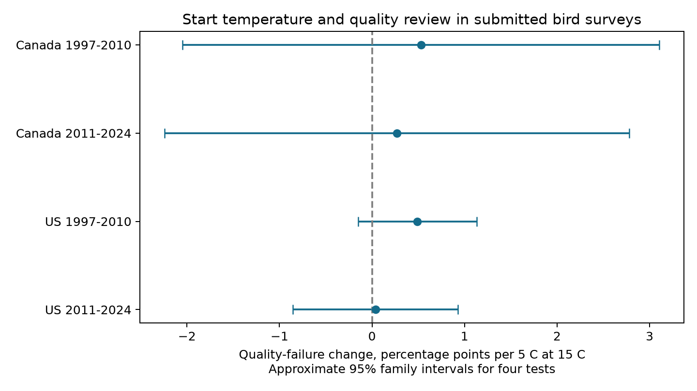

# Start warmth gave no clear common link to quality failure in submitted Canada and US bird surveys in 1997-2024

We tested whether warmer survey starts were linked to failure of bird-survey quality review. We used 69,432 submitted standard runs from Canada and the US in two periods from 1997 to 2024. Four models controlled route-observer effects, state-year effects, date, start time, wind and sky. Estimated changes at 15 C ranged from 0.04 to 0.53 percentage points of failure per 5 C. All four intervals included zero after correction for four tests. The early US estimate was positive in two sensitivity checks. The results do not establish a common temperature link or show that accepted surveys are free of weather selection. Cancelled surveys, incomplete records, few year clusters and unmeasured local conditions limit inference. The package preserves code, an input panel, source hashes, checks and a figure.

## Question and prior work

Does quality review change the weather sample used in climate and biodiversity studies? We test a necessary diagnostic: the link between survey-start temperature and quality failure among submitted standard bird-survey runs. Failure means QualityCurrentID is zero. It does not mean that a bird species was absent. We test ordinary survey mornings, not a heat-wave threshold.

The [USGS data release](https://doi.org/10.5066/P14SNUV4) records quality status and weather. The source dictionary states that objective quality rules began in 1997. Earlier decisions used manual review. [Canadian instructions](https://www.canada.ca/en/environment-climate-change/services/bird-surveys/landbird/north-american-breeding/instructions.html) require suitable wind and visibility, little rain, fixed counts and survey timing. Quality failure can result from start time, finish time, date, incomplete stops or poor weather. The retained RunType document lists no temperature threshold. Quality review can therefore select weather through related conditions even without a direct temperature rule.

The [prior duration study](sci:sha256:1342177d222f40a68ea1f943ab8cc1abcb1926202e8e0f065b8569d9c51bda7f) used accepted runs and left acceptance untested. We test that gap. The [prior weather study](sci:sha256:b83acf4f161f20ee1a26522a4a99e9707f2ebe4f62c4675206bdf8a36a283d96) supplied preserved source definitions, not analysis code. Both use overlapping raw records. Our test is not independent validation of their biological or richness results.

We ran local SCI searches for phenology, lilac, and bird quality. Initial plant questions were already covered. The complete bird-quality search returned 39 broad matches; no title tested this quality-failure outcome. This is a limited search, not a claim of global novelty. We read the prior duration publication and the relevant source definitions before fitting. The plan in files/plan.txt is exploratory and was not registered.

## Data and sample

We use only Weather.csv from the fixed 2025 release for 1966-2024. This is not a claim that the release is current. The raw file has 141,266 runs. Canada and US standard-protocol runs (RPID 101) in 1997-2024 give 82,867 rows. We do not filter on quality or RunType. RunType also includes random-route and protocol criteria, so it is a different outcome. Our sample includes standard runs on routes of either establishment type; we do not infer random geographic coverage.

We require a known observer, a valid May-July date, a valid start clock between 02:00 and 10:00, and a start temperature between -10 and 45 C after Fahrenheit conversion. These rules keep 82,650 rows. They exclude 44 of 4,594 failures and 173 of 78,273 passing runs. Missing or invalid values and these broad timing limits can still select the sample. We do not filter on endpoint weather, survey duration, route completion, or bird counts. There are no duplicate route-years in the eligible panel.

Each model requires four reports per route-observer group in its own sample. The main models retain 69,432 runs. The two countries give separate geographic samples. The periods are 1997-2010 and 2011-2024. There is no 2020 run. The later samples have 13 years. Routes and observers can recur across periods. The countries share methods and weather patterns. These are four distinct tests, not four independent experiments or new monitoring programs.

The middle 90 percent of start temperatures is about 3-18 C in Canada and 4.4-23.9 C in the US. The 15 C evaluation point lies within all four ranges. These observations give weak support for claims about dangerous heat. The source has 13 Canadian province or territory codes and 49 US state or district codes in each main sample. Exact support appears in files/estimates.csv.

## Model and uncertainty

Each separate least-squares model has this form:

    100 * failure = route_observer_effect + state_year_effect
                    + b * x + c * x_squared
                    + date + date_squared + clock + clock_squared
                    + start_wind_categories + start_sky_categories + error
    x = (start_temperature_C - 15) / 5

The coefficient b is the local slope at 15 C, in percentage points per 5 C. Under the quadratic model, it also gives half the fitted contrast from 10 to 20 C at fixed controls. It is not a constant slope over all temperatures. Missing start wind or sky values use code 9 categories. Other recorded codes are kept as separate categories. We do not interpret sky code 4 as a measure of pollution because it combines fog and smoke.

Route-observer effects remove stable observer and route differences. State-year effects remove shared annual conditions in each state or province. The remaining signal is within-group variation relative to state-year conditions. It is not the response to a shared climate trend. Date and clock use fixed calendar days and local time, not time since sunrise. Start wind and sky controls define a conditional temperature contrast; they can remove part of a broader weather-selection link.

Repeated group-mean projections remove the effects. We fit the remaining variables by least squares. The variance is the sum of state-cluster and year-cluster score covariances. Each term uses G/(G-1), and the sum uses (n-1)/(n-k). The code counts the fixed-effect rank through connected components and counts the residual predictor rank. We do not subtract the state-year covariance. The additive form is conservative relative to the usual subtraction when that subtracted covariance is positive, but it does not ensure correct coverage under other dependence.

The reference is a t distribution with one less than the smaller state or year cluster count. Main intervals use the Bonferroni threshold for four tests, giving approximate 95 percent family coverage if the marginal intervals are valid. There are only 13-14 year clusters. Spatial dependence, unequal clusters and quality rules can make these intervals inaccurate. Linear probability models can produce values outside zero to one. We use them to estimate conditional slopes, not individual probabilities.

## Results

| Country | Period | Runs | Routes | Failure percent | Percentage points per 5 C at 15 C | Four-test interval |
| --- | --- | ---: | ---: | ---: | ---: | --- |
| Canada | 1997-2010 | 5,666 | 623 | 6.25 | +0.528 | -2.048 to +3.104 |
| Canada | 2011-2024 | 5,777 | 714 | 5.54 | +0.271 | -2.240 to +2.781 |
| US | 1997-2010 | 30,507 | 3,004 | 5.03 | +0.490 | -0.151 to +1.131 |
| US | 2011-2024 | 27,482 | 2,963 | 4.17 | +0.037 | -0.856 to +0.930 |

All main estimates are positive, but all four corrected intervals include zero. This is not a test of equivalence or proof that temperature selection is absent. In particular, the Canadian intervals allow changes of several percentage points against baseline failure rates near 6 percent. We did not test a country or period difference; a clearer estimate in one sample does not prove such a difference.

The early US slope without start wind and sky controls is +1.080 percentage points per 5 C, with interval +0.255 to +1.906. With a fair-start restriction (wind at most 3 and sky at most 2), it is +0.626, with interval +0.012 to +1.239. Both later US and both Canadian intervals include zero in those checks. All four route-only effect checks and all four linear-temperature checks include zero. Full results for 20 fits are in files/estimates.csv. The linear check has a constant slope, so it has a different target from the local quadratic slope. The checks repeat the four-report rule. Their intervals correct within each set of four, not across every analysis choice.

The checks show that the early US association depends on controls and sample rules. They do not identify which part of the quality decision caused it. The fair-start result is close to its interval boundary and is not an independent replication. Removing wind and sky changes the conditional question, while the fair-start rule changes the submitted-run population. Neither can establish a causal heat effect.

## Interpretation and limits

This study adds a reproducible test of one observation process in climate-biodiversity work. It does not establish a common temperature link to quality failure across the four samples. It also does not validate analyses that use accepted runs alone. Reviewers can reject warm and cold runs for different reasons while their average local temperature slope is small. Nonlinear effects away from 15 C, later weather and cancelled surveys remain outside this test.

We observe submitted runs only. Planned surveys that were cancelled, delayed, or never reported are absent. A known-temperature rule and repeated-observer rule can omit unusual runs. Temperature rounding, errors, route changes, local storms, changing observer skill, and unrecorded comments can affect the results. The failure code combines several causes; we cannot separate them. Endpoint weather and completion could explain failures, but adjusting for them would change the target and could control consequences of start conditions.

We do not estimate true species richness, population damage, species range change, a human-caused climate trend, or an air-pollution interaction. Our contribution is a method and diagnostic within the observation-bias part of that objective. Stronger work needs planned survey dates, cancelled visits, stop completion and local weather, separate rejection reasons, and repeated counts to estimate detection.

## Provenance and reproduction

Campaign: 11_07_2026. Job: sci-1107-dell-climate-pollution-biodiversity-8b477b6067e0. Topic: climate-pollution-biodiversity. Machine: dell. Account: codex-andrii. Model: gpt-6.1-sol, high reasoning effort, through T3 Code and the Codex harness. Analysis date: 2026-11-08 UTC. No additional agents were used. The campaign-machine key is not a personal authorship claim. The publication is stored locally; no remote upload or index submission is made.

The exact shared raw path is /mnt/dell-data/shared_datasets/usgs-bbs-2025-weather/Weather.csv. SHA-256 is bd8ceccc2045089762aacf32c4e160cdf75feb9bb387621949fb349b97b8d8b7. files/provenance.json gives the source URL, release, size and documentation hashes. The raw file was used in place and was not changed. files/panel.csv retains all eligible rows and derived variables. Source documentation was retrieved from the verified prior bundle; verification reports and its citation preserve attribution. That documentation retains its original terms under the source publication license.

Each of 20 temperature coefficients was checked against a direct sparse dummy-variable regression and a scalar partial regression. The largest direct-fit difference was 1.16e-9 percentage points. These checks test arithmetic, not observation assumptions. files/replication.json records a second raw rebuild and second analysis run. See files/REPRODUCE.md for the offline fit and full raw rebuild. Exact library versions are in files/environment.json. The source CSV and documentation are the only external data needed. The auxiliary PDF reader used to inspect definitions is not needed for the analysis.
