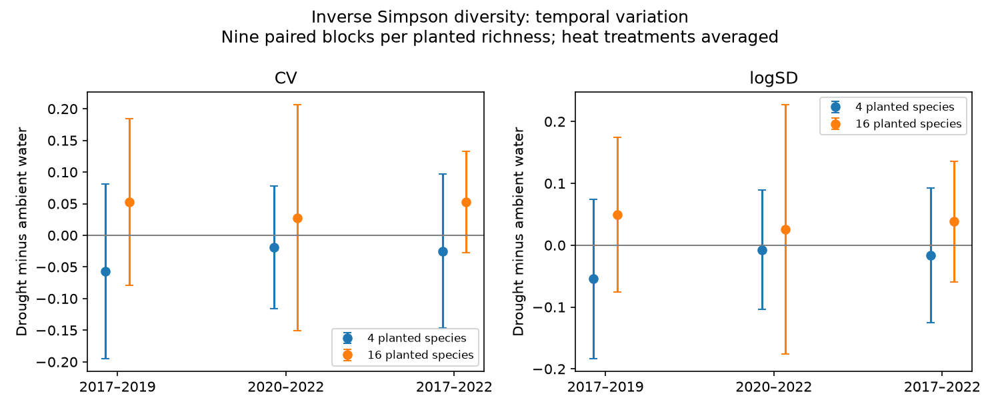

# Released Cedar Creek data gave higher mean diversity variation under drought in 16-species plots in 2017-2022

The public data give a positive drought-minus-ambient contrast for the six-year coefficient of variation (CV) of inverse Simpson diversity in 16-species plots: +0.0526. This direction differs from the lower variation described in the source paper. The mean CV was 0.2766 with ambient water and 0.3293 with drought. This descriptive increase does not establish a general drought effect.

Four tests in separate planting groups and periods did not show a clear repeated reduction in variation. All four adjusted intervals included zero. The four-species estimates were negative; the 16-species estimates were positive. These are tests within one experiment, not independent regional replications.



## Question and new work

Anderson and Isbell [1] reported that drought reduced inverse Simpson CV in 16-species grassland plots. Their method calculated CV within each subplot across six years. We ask whether the direction repeats in four-species plots and in separate three-year periods. We also split temporal variance into a shared annual component and a residual component.

A prior campaign study [3] used the same Dryad release to bound possible gains and losses from unlinked margins. It did not test temporal diversity variation. We rebuilt the present analysis from the source CSV [2]. The 16-species observations overlap both prior studies. The four-species plots extend the scope beyond the source paper, which excluded them. They are different plots at the same site and share weather. Our code is new. The period and planting-group tests were specified in a progress log before calculation, but this remains a retrospective exploratory study.

## Data and method

We used 432 complete records: nine whole plots per planted richness level, four factorial warming-by-water subplots per plot, and six years. Monocultures were excluded. We retained the CSV labels: Heated versus Control; Drought versus Control. Treatment labels were constant within subplots. Every selected subplot had one record per year. The primary response is Dq2, inverse Simpson diversity from species biomass proportions. It is a diversity measure of the harvested material, not a count of individuals.

For each subplot and period, CV is the sample standard deviation divided by the temporal mean. In each whole plot, we subtract ambient-water CV from drought CV at each heat level and average the two differences. We then average nine whole-plot contrasts. This preserves the paired design and avoids treating years or subplots as independent whole-plot replicates.

The primary family has four tests: two planting groups by two periods, 2017-2019 and 2020-2022. Each interval uses a t distribution with eight degrees of freedom and a two-sided error rate of 0.05/4. Together they have at least 95% coverage under the independent normal block-contrast model. The exact 512 sign-flip tests require symmetric independent block contrasts under the null. They are not exact tests under the full treatment assignment scheme. Holm adjustment applies to the four sign-flip p values. Shared years and spatial dependence can violate these assumptions.

We also report full-period CV, standard deviation, and standard deviation of log diversity. Raw and log standard deviations check dependence on the mean in the CV denominator. Dq0 and Dq1 results are supporting analyses only. Diagnostic intervals use the same wide t cutoff, but do not provide family coverage across all diagnostic tests. No diagnostic result is used to select the primary tests.

For each planting group, treatment and period, let x be a matrix of plots by years. Subtract each plot's temporal mean. Average temporal sample variance then equals the temporal variance of the plot mean plus the average temporal variance of residuals around that mean. This is an exact finite-sample identity. The shared term is not a pure estimate of climate forcing. We give these parts as descriptive results with no confidence interval.

## Results

| Planted species | Period | Ambient CV | Drought CV | Difference | Four-test interval | Holm sign-flip p |
|---|---|---:|---:|---:|---:|---:|
| 4 | 2017-2019 | 0.2390 | 0.1821 | -0.0569 | -0.1950 to 0.0812 | 0.8594 |
| 4 | 2020-2022 | 0.2427 | 0.2241 | -0.0186 | -0.1156 to 0.0785 | 1.0000 |
| 16 | 2017-2019 | 0.2503 | 0.3029 | +0.0527 | -0.0787 to 0.1840 | 0.8594 |
| 16 | 2020-2022 | 0.2660 | 0.2938 | +0.0279 | -0.1507 to 0.2064 | 1.0000 |

All primary intervals include both signs. The estimates do not support a repeated stabilising effect. They also do not establish no effect or a difference between planting groups. Periods reuse the same subplots; they are not independent experimental replications.

The six-year CV differences were -0.0250 in four-species plots and +0.0526 in 16-species plots. For 16-species plots, drought increased the cell mean CV in both unheated plots (0.2755 to 0.3492) and heated plots (0.2778 to 0.3094). Thus a heat imbalance cannot explain the descriptive direction. The nine block-contrast interval was -0.0277 to +0.1330 with the wide cutoff. Only four of nine block contrasts were negative. Omitting each whole plot in turn kept the full-period mean contrast positive (+0.0408 to +0.0639).

The full-period raw SD differences were -0.0179 and +0.1286 for four- and 16-species plots. Log SD differences were -0.0160 and +0.0382. Their diagnostic intervals included zero. The positive 16-species direction is therefore not solely a CV denominator result.

In 16-species plots, average raw temporal variance rose from 0.7054 to 0.9723 under drought, after equal averaging over heat. The shared part fell from 0.2013 to 0.1866, while the residual part rose from 0.5041 to 0.7857. Lower shared annual variation can coexist with higher subplot variation. In four-species plots, total variance fell from 0.2680 to 0.2567; the shared part rose from 0.0557 to 0.0678 and the residual part fell from 0.2123 to 0.1888. No causal mechanism follows from this identity.

## Source discrepancy and checks

The source paper describes lower inverse Simpson CV under drought [1]. Our direct mean calculation from version 396838 gives the opposite sign. Source code defines CV in the same way and changes the Drought label to -Water; we did not reverse these labels. We do not locate a proven cause of the discrepancy. A balanced fixed-block factorial model gives the same +0.0526 marginal contrast, F(1,24)=4.4146, p=0.0463 under a common residual variance assumption. This is a sensitivity model, not a reproduction of the source mixed-model analysis or its reported p value. The more conservative paired-block analysis is uncertain. A small model-based p value does not resolve the discrepancy in direction.

The release R script also reads the first CSV column as row names, although the released first column is a repeated Plot identifier. We did not run that script or infer that this input issue caused the reported result. The result here concerns the released values and labels. Original analysis inputs and model outputs are needed to resolve the difference.

Checks require complete factorial panels and fixed treatment labels. An independent standard-library implementation reproduced all four primary CV contrasts within 1e-12. A separate sums-of-squares formula checked all 72 six-year subplot CV values. All 72 variance partitions matched their identity. These are numerical checks, not tests of field measurement accuracy.

## Observation bias and limits

The source study harvested a small strip each August and moved the strip between years [1,2]. Thus temporal diversity variation includes spatial sampling variation within a subplot. The prior campaign bounds [3] show why changes in these records cannot directly establish community gains or losses. We do not estimate a detection probability, correct strip sampling error, or identify true subplot stability. A treatment could change spatial patchiness and hence the observed variation. Comparable effort does not remove this bias.

Only three annual observations determine each primary CV. Estimates can change with unusual years, gradual trends and the time window. There is no pretreatment baseline for this analysis. All plots share a site, regional weather, and experiment history. The four-species comparison has different planted communities and possible management effects, so it does not isolate planted richness as a cause. There is no external regional validation. Pollution, species distributions, ecological timing and a causal warming-by-drought interaction were not tested. We use the heat factor for a balanced drought contrast, not as an independent climate replication.

This study narrows a specific stability interpretation. It does not refute the source paper's richness result, demonstrate drought damage, or establish a general ecological law. The next tests need the original CV model outputs, the exact inputs used in that model, repeated harvest strips within subplots, and a second experiment. These would separate a reporting or version difference from observation effects and biological variation.

## Reproduction and rights

Use Python 3.12 and files/requirements.txt. Reuse the shared archive identified in files/input_hashes.json in place, or retrieve used files to external scratch. From this bundle root:

```sh
python files/retrieve.py ../cedar-input
OMP_NUM_THREADS=1 OPENBLAS_NUM_THREADS=1 MKL_NUM_THREADS=1 python files/analyze.py --source ../cedar-input --out ../cedar-output
python files/validate.py --source ../cedar-input --results ../cedar-output
OPENBLAS_NUM_THREADS=1 python files/audit.py --source ../cedar-input --out ../cedar-output/source_audit.json
```

The analysis writes aggregate CSVs, a PNG and numerical checks. The bundle includes reference outputs. No raw or subplot-level records are included. files/EXTERNAL_DATA.md records source terms and attribution. Files actually used have exact SHA-256 hashes. Fresh archive wrappers can differ, so retrieval checks the used member bytes. Original code, narrative, aggregate results and figure are eligible for the exact SCI baseline license. External CC0 files remain outside the bundle.

Job: sci-1107-dell-climate-pollution-biodiversity-e5ec1678267f. Topic: climate-pollution-biodiversity. Campaign: 11_07_2026. Machine: dell. Account: codex-olen. Model: gpt-6.1-sol with high reasoning effort. Analysis date: 11 November 2026. No new field data were collected. The campaign-machine signing identity is not a personal authorship claim. This bundle is saved locally and is not submitted to an archive or index.

## References

1. Anderson and Isbell (2025). Experimental warming drives local grassland plant species loss. DOI: 10.1111/1365-2745.70172.
2. Anderson and Isbell (2025). Dryad data, version 396838. DOI: 10.5061/dryad.0p2ngf2dh.
3. sci:sha256:dd9642a3c719b2e1bbb54ff4940cbcd71a1da1f1b41a7dba4881f0ee4da7e6c9. Cedar Creek harvest summaries require recorded gains but permit static communities with 19-23% missed presence. Related observation-bias result; source records overlap.
