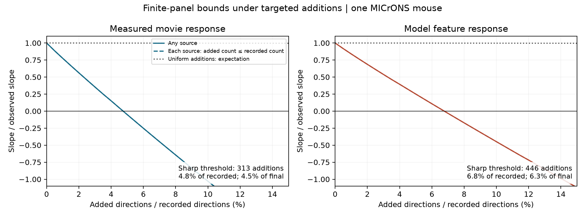

# Adding 313 selected connections removes an adjusted movie response similarity slope in one MICrONS panel

We tested how unrecorded connections can change a relation between neural responses and circuit structure. In one selected MICrONS mouse panel, the smallest set of added connection directions that removes the positive adjusted slope has 313 members. This is 4.75% of the 6,587 recorded connections, or 4.54% of the 6,900 connections in that completed panel. The result is an exact sensitivity threshold for a fixed descriptive model. It is not an estimate of missing connectivity.

## Question and prior work

Neurons with similar responses often connect more than anatomical opportunity alone predicts. Ding, Fahey, Papadopoulos and colleagues tested this rule across mouse visual areas with matched calcium imaging and electron microscopy [1]. Earlier campaign work found a positive relation after separate controls for both endpoint neurons [2]. However, a clean reconstructed arbor need not be complete [3]. Thus, a positive recorded relation and a relation that is robust to selective missing connections are different claims.

We asked: within the released candidate directions, what is the smallest number of additions that makes an adjusted response similarity slope nonpositive? We also asked whether a cap on additions from each source changes that threshold. We did not try to infer actual missing edges or a causal effect of connectivity on computation.

## Data and fixed analysis choices

We reused the public functional connectomics release v1, dated 12 April 2025, through an existing compact extraction [4]. It has 295,371 distinct source-to-target directions with positive axon-dendrite co-travel length, 8,128 recorded connections, 148 sources and 11,035 targets. These measurements describe one mouse, animal 17797, in V1 and higher visual areas RL, AL and LM. IDs are nucleus IDs.

The primary score is the released correlation of measured mean responses to natural-movie stimuli. The separate model check uses cosine similarity of digital-twin feature weights. These scores are different quantities. The quality cohort requires response correlation ceiling CCmax >0.4 and model prediction correlation CCabs >0.2 at both endpoints. It has 234,393 candidate directions and 6,608 recorded connections before constant-score strata are removed.

We defined opportunity bins from within-source co-travel ranks. Equal lengths stay in the same bin. Each control stratum fixes source neuron, target area, target layer and one of four opportunity bins. Missing target layer is an explicit Unknown label. Within each stratum, we used average functional ranks divided by stratum size. We removed constant-score strata. We then removed both stratum means and additive target-neuron effects by converged alternating projection. The primary panel has 233,797 directions, 6,587 recorded connections, 144 sources and 8,904 targets.

The slope is a linear projection of the binary recorded connection label on this fixed rank score, with the stated controls. It does not equal the Poisson coefficient in the earlier campaign report. The plan and its pre-result clarification are in [analysis_plan.md](files/analysis_plan.md). The controls do not use connection labels and stay fixed during a hypothetical completion.

## Exact method

Let z be the functional score after projection on the controls. Let y be the recorded binary connection label. The adjusted slope is beta = C/V, where C = sum(z y) and V = sum(z squared). If a set of zero labels is changed to one, its new numerator is C plus the sum of z over that set.

Therefore, to reduce the slope with at most k additions, select the k most negative residual scores among recorded zeros. The first prefix with a nonpositive numerator gives the exact minimum. A positive numerator at k minus one proves that no smaller set works. For a source cap, retain only the allowed number of most negative zeros per source, then apply the same rule. The proof is in [method.md](files/method.md). This is an application of residualized least squares and sorted scores, not a new causal identification theorem.

A useful reference is uniform addition. If every zero has the same addition probability q, the expected slope is (1-q) times the observed slope. The same expectation holds for a uniformly selected fixed count k, with q = k divided by the number of zeros. This follows because z sums to zero. It requires no independent-neuron assumption. It is a reference error pattern, not a measured reconstruction process.

## Results



Figure 1. Each solid curve gives the smallest slope permitted by an addition budget. The dashed curve also caps each source's added count at its recorded count. The dotted curve gives the expectation for uniform additions. All controls and functional scores stay fixed. The two panels show measured and model-derived function separately. Only one mouse is tested.

The primary slope is 0.0131272 connection units per within-stratum rank unit, or 1.31272 percentage points per rank unit. Its numerator is 208.327319. The best 312 additions leave a positive numerator of 0.0458845. The best 313 give -0.5918364. Thus, the threshold is 313, with a clear numerical margin on both sides. The supplied witness spans 51 source neurons and 247 target neurons. Each witness direction had no recorded connection in the input.

The threshold is 0.13776% of the 227,210 recorded zeros. Uniform addition of 313 zeros retains 99.86224% of the slope in expectation. Thus the placement of additions matters much more than their count under these two scenarios.

The planned source cap allows at most as many added directions as recorded directions for each source. It leaves the minimum at 313. This cap corresponds to at most 50% unrecorded connections within each completed source sample. It is an assumption, not an error estimate. In a further check added after the primary result, a cap of 10% of each source's recorded count raises the minimum to 329. A 5% cap cannot remove the slope. Integer source budgets are rounded down; sources with no recorded connection receive no additions under these caps.

All four quality-filtered projection groups have positive observed slopes:

| Projection group | Candidate directions | Recorded connections | Minimum additions | Added / recorded |
|---|---:|---:|---:|---:|
| V1 to V1 | 77,239 | 2,411 | 160 | 6.64% |
| V1 to higher visual areas | 14,506 | 508 | 23 | 4.53% |
| Higher visual areas to V1 | 49,088 | 1,135 | 42 | 3.70% |
| Higher visual areas to higher visual areas | 92,952 | 2,531 | 89 | 3.52% |

Each group rebuilds ranks, bins and endpoint controls within that group. The group thresholds need not sum to the pooled threshold. These are groups from one animal, not independent animal replications.

The model feature score needs 446 additions in the pooled quality panel, or 6.77% of recorded connections. With no quality cutoff, the measured and model thresholds are 353/8,109 = 4.35% and 507/8,109 = 6.25%. All planned score and group slopes are positive. Two and eight opportunity bins give measured thresholds of 319 and 300. Raw measured correlation in place of rank gives 353. Removing the target effects gives 554. The full table, including both cap settings, is in [bounds.csv](files/results/bounds.csv).

All 144 whole-source deletion refits kept a positive slope. Their minimum-addition counts ranged from 294 to 317. As fractions of the remaining recorded connections, the range was 4.55% to 4.90%. These are sensitivity ranges, not confidence intervals. Complete refits are in [source_deletions.csv](files/results/source_deletions.csv).

## Verification and reproducibility

We checked integer optimality on 100 small panels by full subset enumeration, and compared the capped and uncapped objectives with independent linear programs. An independent sparse least-squares fit checks the two-block score projection. A standard-library calculation checks the primary numerator, the 312/313 crossing and every witness label. The tests identified rounding at a mathematically zero boundary in a small test panel. A scale-dependent floating-point tolerance fixes that boundary. It does not change the empirical thresholds. The primary crossing margins are far larger than this tolerance.

We rebuilt all 295,371 candidate directions and all 13 input fields directly from the original public source pickles. They agree with the included input after the upstream ten-significant-digit CSV serialization is reproduced. The source files passed their SHA-256 checks. No shared source file was changed. Exact paths, versions, hashes, attribution and study identity are in [PROVENANCE.md](files/PROVENANCE.md).

A separate clean replay rebuilt the 48 planned case rows, the primary score residuals, the full witness and the optimizer checks. All five numerical output files matched byte for byte. Full source deletion refits were run once and were not duplicated in that replay. The exact comparison is in [replay_comparison.json](files/results/replay_comparison.json).

The package contains the full compact input, analysis source, all planned results, source deletion checks, the minimum witness, numerical tests, and the figure. Run from an extracted bundle:

```bash
python files/analyze.py --input files/input_pairs.csv.gz --output replay --deletions
```

See [REPRODUCE.md](files/REPRODUCE.md) for source retrieval, input checks and the added source-cap check. Write replay outputs outside the signed files.

## Interpretation and limits

A positive adjusted response-connection relation occurs in this selected panel. It does not imply that its sign is robust to all small missing-edge patterns. A targeted completion with 4.54% of final connections unrecorded can remove the tested slope. An equal count of uniform additions has a very different expected effect. This result supports reporting an explicit error pattern, a budget and a denominator when judging structural evidence for functional wiring rules.

The witness is a mathematical construction. We have no evidence that its directions are the missing biological connections. Additions can occur only among existing positive-opportunity candidates. Real reconstruction changes can also alter opportunity, cell matching, score estimates and candidate membership. False positive connections are outside the test. The source cap does not constrain target counts. The controls remove additive cell effects but do not remove every pair-level geometric or biological factor. Opportunity bins are coarse. Natural-movie mean response correlation does not measure synaptic efficacy, causal transmission, trial reliability or behavior. The linear rank slope is one chosen summary; other estimands can have different thresholds.

There is one animal and no matched behavioral comparison or independent-animal replication. The exact bound has no sampling confidence interval. Source deletion ranges measure conditional sensitivity, not population uncertainty. The method can be applied to other panels, but this study does not establish a general biological missing rate or a circuit mechanism across animals, regions or conditions.

## References

1. Ding, Fahey, Papadopoulos and colleagues (2025). [Functional connectomics reveals general wiring rule in mouse visual cortex](https://doi.org/10.1038/s41586-025-08840-3). MICrONS Consortium (2025). [Functional connectomics spanning multiple areas of mouse visual cortex](https://doi.org/10.1038/s41586-025-08790-w).
2. Prior campaign endpoint-control study. SCI sha256:c59a7cc9c394931da48264dbdd64f4dd2ef21ea50f820313c35558be9be14d07.
3. MICrONS primary documentation. [CAVE query: proofread cells](https://tutorial.microns-explorer.org/quickstart_notebooks/03-cave-query-proofread-cells.html). Current documentation motivates the question; it does not supply an error rate for this frozen panel.
4. SCI Response Reliability Study. [Positive-opportunity extraction from functional connectomics v1](https://sci.azaho.org/publication/?id=c9642774-fe83-4105-a31e-d27cb48567dc). This study reuses its data extraction, with original MICrONS attribution.
