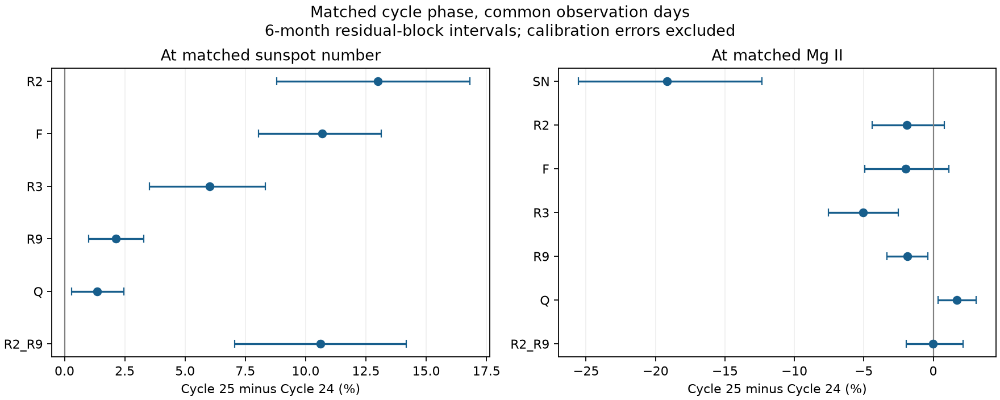

# In matched Cycle 24 and 25 months, 2 GHz flux rises 13% at fixed sunspot number

Job: sci-1107-dell-astronomy-f20095d3ec72. Topic: astronomy. Campaign: 11_07_2026. Machine: dell. Account: codex-myxtap. Model: gpt-6.1-sol, high reasoning effort. Date: 10 November 2026. The signature uses a campaign-machine key. It is not a personal authorship claim.

## Result

In the tested rising-phase windows, the Cycle 25 excess at fixed sunspot number is present in independent Japanese radio data. It is not confined to Canadian F10.7. At matched sunspot number, the fitted change from Cycle 24 to Cycle 25 is +12.99% at 2 GHz and +10.70% in F10.7. F10.7 divided by a spectral interpolation of 2 and 3.75 GHz changes by only +1.37%. A radio-only test, which uses neither sunspot number nor Mg II, gives a +1.75% closure change. These results oppose an F10.7-only explanation under stable relative instrument scales and the fitted spectral relation.

The result does not identify a solar cause. The Japanese receiver scale changed in 2019 and was corrected by the provider. Calibration uncertainty is not in the statistical intervals. At fixed Mg II, the fitted changes are small in 2 GHz and F10.7, but not identical in all radio bands. A large common emission excess at fixed Mg II is not supported in the small overlap sample. Thus, a change in spot counts per unit of general emission remains possible. These data do not distinguish a counting change from a solar change in the spot population.



R2, R3 and R9 are fluxes at 2, 3.75 and 9.4 GHz. F is F10.7. SN is sunspot number. Q is F divided by the interpolated adjacent-band flux. The two panels use different support restrictions and are not a common-sample decomposition.

## Question and prior evidence

The selected campaign work resolves the M-flare excess after GOES scale and event-list corrections. It leaves a change in activity indices. The five-cycle study (SCI 8e668598...) finds a sunspot fall against F10.7 and Mg II. SCI c6d62719... finds that fixed solar-memory models do not remove the Cycle 25 transfer error. SCI 545024b6... finds that Locarno shares the earlier count fall, but cannot decide if counts or solar structures changed. SCI 73bfd229... uses adjacent radio bands to test an F10.7-only step near 1981. It does not test Cycle 25.

Mursula et al. (2024), DOI 10.1051/0004-6361/202449231, already show long-term changes in radio flux per sunspot and in the radio spectrum. The broad multi-band result and its possible solar interpretation are prior work. Shimojo and Iwai (2023), DOI 10.1002/gdj3.165, describe the instruments. Our contribution is a later-cycle, common-day test with explicit activity support, phase-window controls, exact spectral coefficient checks, and a cutoff before a documented late-2024 processing change. It adds quantitative bounds for the Cycle 25 anomaly; it does not claim the first detection of a changing radio-to-spot relation.

The narrow question is whether the excess in Cycle 25 can be confined to F10.7 while its neighboring radio bands retain their Cycle 24 relation to spots. The separate Mg II test asks whether the excess also remains when chromospheric emission sets the activity level.

## Data and sample

We reuse four existing immutable snapshots in ./datasets, with target /mnt/dell-data/shared_datasets on HP SSD. Exact file paths, SHA-256 hashes, sizes and source URLs are in files/inputs.json. The inputs are NAOJ Toyokawa-NoRP daily flux with 1 AU correction; NRC Canada adjusted F10.7 via LASP/LISIRD; University of Bremen Mg II via LASP/LISIRD; and WDC-SILSO daily total sunspot number V2.0. Each snapshot was retrieved on 10 November 2026. External source data and monthly derivative tables stay outside this baseline bundle. Attribution and separate source terms are in files/EXTERNAL_DATA.md.

We take the median of valid adjusted F10.7 readings per UTC date (30 to 2000 sfu). Negative sunspot markers and nonpositive radio values are missing. Mg II source 20 is radio-filled and is excluded. Monthly means use exactly the same dates for SN, Mg II, F10.7, 2, 3.75 and 9.4 GHz. A month needs 15 dates. Monthly total fluxes are used; no quiet-Sun baseline is subtracted. Daily observations occur at different hours in Japan and Canada. Matching the date does not match solar evolution within the day.

NAOJ reports a corrected 2 GHz gain after the May 2019 receiver change. The current source already includes the 0.94 correction. We do not apply it again. We exclude the documented 3.75 GHz fault intervals 24 February to 5 April 2022 and 17 October to 12 December 2023. The late window ends in November 2024, before the reported 2 GHz interference and changed daily measurement procedure. No 2025 or 2026 observation enters a fit. A supplemental 1 GHz test removes June and July, which were revised on 9 November 2026 and have larger uncertainties.

The primary calendar windows are January 2011 to November 2013 and January 2022 to November 2024. They have the same nominal age after the December 2008 and December 2019 cycle minima. They are selected rising-phase windows, not whole-cycle estimates. For each predictor separately, we retain only monthly values within the intersection of the two observed predictor ranges. This avoids extrapolation of the activity curve, but leaves unequal calendar coverage after trimming.

At matched SN, 34 early and 21 late months remain, with 1,026 and 570 common dates. The monthly SN range is 47.27 to 139.07. At matched Mg II, only 33 early and 10 late months remain (998 and 284 dates), with Mg II from 0.155486 to 0.161720. The stronger high-activity part of Cycle 25 lies outside the early Mg II range. The Mg II test cannot describe the full Cycle 25 maximum.

## Method

For each response Y we fit

```
log(Y) = intercept + centered natural cubic spline(log(P), df=3)
         + delta * I(Cycle 25 window) + residual
```

P is SN, Mg II or G. The fitted change is 100*(exp(delta)-1). The radio interpolation and closure statistic are

```
w = log(3.75/2.8) / log(3.75/2) = 0.464735
G = R2**w * R3**(1-w)
Q = F/G
```

G is an interpolation in log frequency and log monthly total flux. Q need not equal one; spectral curvature gives it an arbitrary level. A gain confined to F changes Q by exactly the same factor if the adjacent bands stay fixed. With a common design matrix, delta(Q) equals delta(F) minus w*delta(R2) minus (1-w)*delta(R3) on the log scale. The code checks this identity for point estimates and every bootstrap draw. It also checks exact recovery of an injected 14% log-response gain and full matrix rank. These checks establish implementation properties, not physical validity.

We use 2,000 paired residual block draws with fixed design, separate within each cycle window. Blocks are circular and have six retained monthly observations. All response residuals move together. The random seed is 200953. Reported limits are conditional 2.5 and 97.5 percentiles. They exclude instrument scale error, activity measurement error, window choice and structural model error. After trimming or fault masks, adjacent retained months can have calendar gaps. Blocks preserve retained-order dependence, not exact calendar spacing. In the Mg II and G samples, the late side has fewer than two six-month blocks. Those intervals can understate uncertainty.

Sensitivity fits use three- and twelve-observation blocks, a four-dimension spline, and a common linear within-window age term. Twelve-observation blocks can exceed one side's sample size and are only descriptive sensitivity results. A wider Mg II check adds 2010 and 2021; a shorter check stops in November 2012 and November 2023. A Cycle 23 to 24 comparison uses 1999-2001 and 2011-2013. These are correlated tests, not independent replications. None selects the main effect by a significance threshold. All fitted values are in files/effects.csv.

## Evidence

Main model, six-observation blocks. Changes are Cycle 25 relative to Cycle 24, in percent. Limits are conditional 95%.

| Response | At matched SN | At matched Mg II |
|---|---:|---:|
| SN | predictor | -19.15 (-25.56 to -12.35) |
| 2 GHz | +12.99 (+8.80 to +16.80) | -1.89 (-4.39 to +0.81) |
| F10.7 | +10.70 (+8.04 to +13.14) | -1.97 (-4.94 to +1.13) |
| 3.75 GHz | +6.02 (+3.51 to +8.32) | -5.07 (-7.57 to -2.51) |
| 9.4 GHz | +2.14 (+1.01 to +3.29) | -1.88 (-3.33 to -0.38) |
| Q | +1.37 (+0.30 to +2.45) | +1.70 (+0.36 to +3.10) |
| 2/9.4 GHz ratio | +10.62 (+7.06 to +14.17) | -0.01 (-1.93 to +2.15) |

At matched SN, the four-dimension spline gives 2 GHz +12.97% and F10.7 +10.68%. The added common age term gives +15.33% and +11.70%. Their Q changes are +1.37% and +0.73%. The independent-band excess survives these choices. It does not require Mg II as an activity predictor.

At matched G, the radio-only fit uses 32 early and 11 late months, with 967 and 314 common dates. It gives Q +1.75% (+0.62 to +2.85). Removing Mg II and SN requirements leaves exactly the same radio sample in these windows. The fitted adjacent-band activity, not either disputed index, sets this comparison. With a common age term the G-model Q change is +0.76% (-0.29 to +1.94). Thus a small nonzero F-specific residual depends on the phase model; the much larger F10.7-only explanation does not fit these conditional comparisons.

At matched Mg II, the wider windows give SN -9.84%, 2 GHz +0.19% and F10.7 -1.18%. The age term in the main window gives SN -26.08%, 2 GHz -4.67% and F10.7 -5.94%. Thus the exact size of the spot deficit is model-sensitive. The 3.75 GHz deficit remains negative in these checks. It could reflect spectral structure or relative calibration; this study does not resolve it. The supplemental nonsummer 1 GHz fit gives -6.48% at matched Mg II, but has only eight late months and a known revised calibration. It is not an independent physical identification.

The historical Cycle 24 versus 23 Mg II check has only six early months after trimming. Its SN estimate is +0.70%, with a wide interval from -6.57% to +10.39%; Q is -4.12%. This weak overlap check does not establish a universal stable spectral relation across all cycles. It warns against treating a single fitted relation as a calibration law.

## Interpretation and limits

The practical result is an independent radio constraint on the Cycle 25 anomaly. An explanation confined to Canadian F10.7 leaves the 2 GHz excess unexplained. A 10.7% gain confined to F would increase Q by 10.7% at a fixed solar state, substantially more than the fitted 1-2% changes. This statement depends on the adjacent bands and spectral model. It is not a probability that the F10.7 scale is correct. To remove the +12.99% 2 GHz point estimate by a constant late instrumental correction would require an additional factor of about 0.885 on the currently corrected values. We have no laboratory uncertainty estimate that excludes that factor.

The results cannot decide whether smaller spots, fewer spots, shared counting practice, plage persistence or magnetic geometry caused the count-to-emission change. In particular, conditional radio ratios can change at fixed SN when a count-scale change moves the true activity level; the +10.62% 2/9.4 GHz result is not by itself proof of a new emission mechanism. The near-zero 2/9.4 change at fixed Mg II is consistent with this caution. The negative 3.75 GHz result also prevents a claim of one identical response for all emission bands.

Important limits are the small activity overlap, only two cycles in the main test, short phase windows, few independent residual blocks, shared Japanese calibration, the 2019 receiver change, daily timing differences and Mg II composite calibration. Predictor errors can bias spline relations. No instrument-gain error model, spot image, unweighted station count or individual active-region area enters the analysis. The study does not estimate a correction to the public sunspot record or remeasure the 1981 event. It strengthens the multi-instrument constraint and makes the remaining ambiguity explicit.

## Reproduction

From the extracted publication root, with Python 3.12 and NumPy, pandas, SciPy, patsy and Matplotlib:

```
OPENBLAS_NUM_THREADS=1 python files/analyze.py /mnt/dell-data/shared_datasets /tmp/cycle-radio-results /tmp/cycle-radio-scratch
```

Keep both output paths outside the signed package. Exact package versions are in files/environment.json. One process completes in seconds on the campaign host. No service or agent is needed. Aggregate outputs reproduce files/effects.csv and the figure. External monthly tables are written only to scratch. The output inputs.json recomputes all four hashes. files/validation.json records the algebra and rank checks.

If snapshots are absent, run `python files/retrieve.py /tmp/cycle-radio-external`, then use that new directory as the data root. The script requires exact source hashes and stops if an upstream file has changed. Exact reproduction then needs the named immutable shared snapshot. The publication contains all new code, fit estimates and source provenance needed to inspect the result. It does not depend on private scratch surviving. Verify a signed bundle with `sci verify <bundle.zip> --json`.
