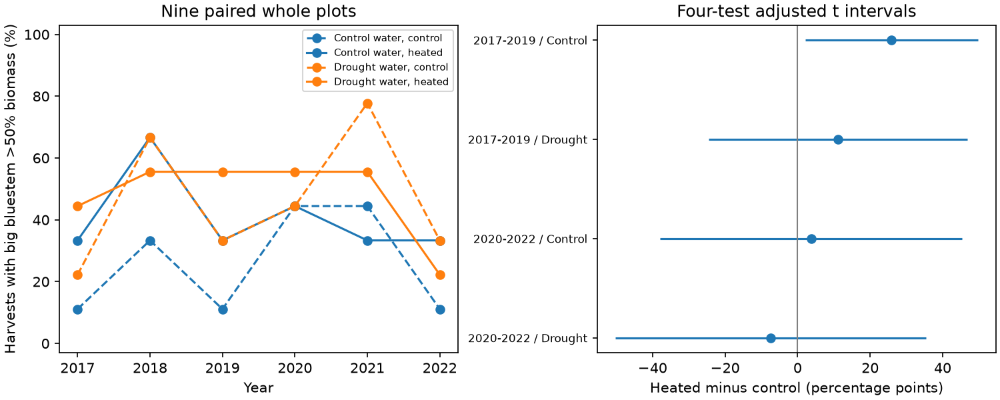

# Big bluestem biomass majority gave no repeated warming increase in four Cedar Creek tests in 2017-2022

Big bluestem held more than half of harvested biomass more often under warming in early ambient-water samples. This positive contrast did not repeat clearly in later samples or under drought. The result depends on the uncertainty method. It does not establish a common warming increase, a change in the true effect over time, or no effect.



## Question and new test

Does warming make a named grass species hold most of the sampled biomass? Does this result persist under drought and in a later period? A species can be the largest component without holding a majority. We test the stricter majority endpoint: the big bluestem share must exceed 0.5. This can be read directly from the released share and needs no inference about which other species ranks second.

Anderson and Isbell [1] studied plant diversity and composition under warming and drought. Campaign work tested evenness [3], legume share [4] and possible turnover histories [5]. We read those publications. Our new endpoint is the frequency of a named species having a biomass majority. It differs from overall dominance, richness and functional group share. It can test a proposed shift toward a dominant grass without treating richness loss as proof of that process. The question was selected after source-column inspection but before the majority contrasts were computed. This is an exploratory reanalysis of the same experiment, not an independent field confirmation. Campaign searches included phenology, pollution, cherry, ozone, Cedar and bluestem.

## Data and design

We use CommunityLevelDataClean_2017_22.csv from Dryad version 396838 [2]. We select the nine whole plots planted with 16 species. Each plot has four warming-by-water subplots, observed in each of six years. There are 216 complete harvest records. We exclude four-species plots and monocultures to keep the planted species pool fixed. We use p.Ag, the recorded relative biomass of big bluestem (Andropogon gerardii). We checked that it lies between zero and one and does not exceed the Berger-Parker maximum share, apart from rounding tolerance.

For each harvest, Y = 1 if p.Ag > 0.5 and zero otherwise. Exactly 0.5 counts as no majority. In each whole plot, water treatment and period, we average Y across three years. We subtract the ambient-temperature average from the heated average within the plot. Each of the nine plots has equal weight. The periods are 2017-2019 and 2020-2022. The water treatments are Control (ambient water) and Drought. These four combinations form the primary test family. Water labels refer to treatments, not natural wet and dry years.

The two periods reuse plots. Water contrasts also share plots. These are tests of consistency within one site, not four independent experiments. No independent region is tested. We did not estimate a pollutant effect or ecological timing.

## Uncertainty and sampling error

For each mean plot contrast, the standard error is the sample standard deviation of the nine plot contrasts divided by three. We use a t distribution with eight degrees of freedom. The interval critical value is t(1 - 0.05/8), which gives Bonferroni coverage for four two-sided tests under the model. Coverage needs independent normal plot contrasts. With nine bounded, discrete contrasts, this is a strong approximation.

We also enumerate all 512 sign flips of the nine plot contrasts. Their two-sided p values assume independent symmetric contrasts under the null. They are diagnostics, not exact treatment-randomization tests. We report raw p values and compare them with 0.05/4. This second method is discrete and has little power. A difference between methods is not grounds to choose the one with a smaller p value.

Harvest strips were small and moved within subplots [1,2,5]. The response describes a harvested strip, not all living plants in a subplot. Spatial patchiness, harvest timing and treatment-related sampling can alter the recorded share. Fixed plots and complete annual coverage remove changes in site coverage but do not correct these errors.

To assess share error, let the true sampled share be any number within e of the recorded share, limited to [0,1]. The smallest possible majority indicator is 1[p.Ag - e > 0.5]; the largest is 1[p.Ag + e > 0.5]. Lower contrast bounds use the low heated indicators and high control indicators. Upper bounds reverse the choices. These sharp finite-record bounds allow separate errors in every harvest. They are not confidence intervals, estimated error rates or bounds on whole-subplot biomass. The fixed error magnitudes were selected before their results were computed.

## Results

Rates and contrasts below are percentage points. Intervals use the four-test t correction.

| Period | Water | Ambient rate | Heated rate | Contrast | Adjusted interval | Raw sign-flip p |
|---|---|---:|---:|---:|---:|---:|
| 2017-2019 | Ambient | 18.5 | 44.4 | +25.9 | +2.2 to +49.7 | 0.0313 |
| 2017-2019 | Drought | 40.7 | 51.9 | +11.1 | -24.5 to +46.7 | 0.5313 |
| 2020-2022 | Ambient | 33.3 | 37.0 | +3.7 | -37.9 to +45.3 | 1.0000 |
| 2020-2022 | Drought | 51.9 | 44.4 | -7.4 | -50.2 to +35.4 | 0.7813 |

Only the early ambient-water t interval excludes zero. No sign-flip diagnostic passes the four-test threshold of 0.0125. The smallest adjusted diagnostic p value is 0.125. Thus the early signal has model sensitivity. Lack of a later clear result does not prove that the treatment effect changed. We do not infer a period difference from separate significance tests.

Removing each plot in turn kept the early ambient-water contrast positive (+20.8 to +29.2 points). The late ambient-water omission range was -4.2 to +12.5 points. These are influence checks, not new tests. Warming-by-drought point contrasts were -14.8 points early and -11.1 points late, with standard errors of 13.7 and 18.4 points. They are descriptive and do not establish an interaction.

At a share-error allowance of 0.01, the finite-record contrast bounds were +18.5 to +33.3 points for early ambient water, +7.4 to +11.1 for early drought, -3.7 to +3.7 for late ambient water, and -7.4 to -3.7 for late drought. These descriptive signs do not remove plot uncertainty. At an allowance of 0.05, all four bounds include zero. In the early ambient-water sample, the lower bound is exactly zero. A five-point error allowance therefore removes strict sign certainty for every finite-record contrast. This is a conditional possibility result, not evidence that such errors occurred.

## Interpretation and limits

The records do not support a repeated rise in big bluestem biomass majority under warming. A single positive contrast under one uncertainty model is not a general mechanism for the reported richness response. A majority indicator discards share changes far from 0.5. A species can gain biomass while remaining below this threshold, and a relative biomass increase can occur without absolute growth. We do not test mediation of species loss by grass dominance.

There is one site, nine selected plots, planted communities, six years and no pretreatment adjustment. Shared weather and spatial dependence can weaken plot independence. There is no direct estimate of harvest error. Independent regions, longer follow-up, absolute species biomass and repeated spatial samples within subplots are needed. The next test should use the same fixed majority endpoint in a second warming-by-drought experiment, record within-subplot sampling variation, and report both share and absolute biomass. Those tests were not done.

## Reproduction

The package includes original code, aggregate evidence, a figure, source hashes and dependency versions. External source records stay outside the signed package. The source archive is already shared at /mnt/dell-data/shared_datasets/cedar-creek-warming-drought-dryad396838/data.zip. Its SHA-256 is f3cb73886d8d22a8335901c322893fb3732595512ab4dcf5c20d89e204cf2be3. The used CSV hash is 2119ce953db0c8c60aabf7d12c6d4f4df7a81fed57b89b1f603120662e539da9. Exact URLs and paths are in files/input_hashes.json.

From an unpacked publication root, with Python 3.12 and files/requirements.txt installed:

```sh
python files/retrieve.py --dest ../cedar-input --archive /mnt/dell-data/shared_datasets/cedar-creek-warming-drought-dryad396838/data.zip
OMP_NUM_THREADS=1 OPENBLAS_NUM_THREADS=1 MKL_NUM_THREADS=1 python files/analyze.py --archive /mnt/dell-data/shared_datasets/cedar-creek-warming-drought-dryad396838/data.zip --out ../cedar-output
python files/validate.py --archive /mnt/dell-data/shared_datasets/cedar-creek-warming-drought-dryad396838/data.zip --results ../cedar-output
```

Without --archive, retrieve.py downloads version 396838 into external scratch and reports its path. Use that path for the other commands. Never write regenerated data into the signed package. The member hash is pinned; the remote ZIP wrapper can change. Design checks require complete paired treatments, fixed treatment assignments, unique subplot-years, valid fractions and matching source bytes. A separate standard-library implementation checks all primary means, standard errors, sign-flip p values and share-error bounds. These checks passed. They test computation, not the field sampling assumptions.

## Provenance and rights

Campaign 11_07_2026. Job sci-1107-dell-climate-pollution-biodiversity-0ed48421fad3. Topic climate-pollution-biodiversity. Machine dell. Account codex-olen. Model gpt-6.1-sol, high reasoning effort. Date: 11 November 2026. The campaign-machine key is not a personal authorship claim. No new field data were collected. The publication is saved locally only.

Our original text, code, figure and aggregate results use the exact SCI baseline license. Source data use CC0 under Dryad terms. No raw database, source text, source R code or record-level derivative table is bundled. See files/EXTERNAL_DATA.md. Source rights are not replaced by the bundle license.

## References

1. Anderson and Isbell (2025). Experimental warming drives local grassland plant species loss. doi:10.1111/1365-2745.70172.
2. Anderson and Isbell (2025). Dryad data, version 396838. doi:10.5061/dryad.0p2ngf2dh.
3. sci:sha256:dba50fd69c0dbee74949b04286f6558002723ea5230e5be6a354bb47ba5814b7. Warming evenness intervals crossed zero in four Cedar Creek planting-group and period tests in 2017-2022.
4. sci:sha256:38afe8210207fd21f175229fbb1648b4a9e642ae23a87ca8ec49b658192674a7. Warming contrasts in legume share of grass and legume biomass were uncertain in four Cedar Creek samples in 2017-2022.
5. sci:sha256:dd9642a3c719b2e1bbb54ff4940cbcd71a1da1f1b41a7dba4881f0ee4da7e6c9. Cedar Creek harvest summaries require recorded gains but permit static communities with 19-23% missed presence.
6. https://datadryad.org/terms. External source rights.
