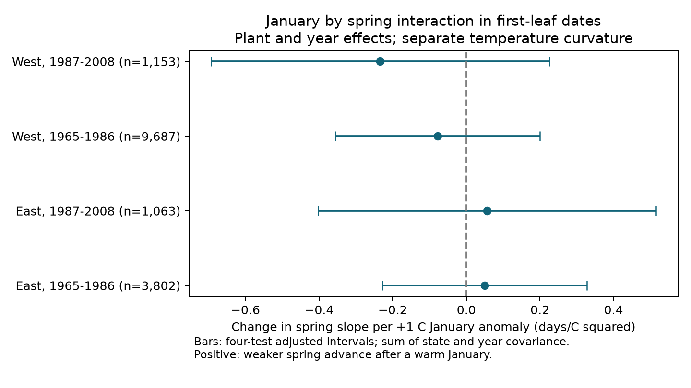

# January warmth did not show a common change in spring leaf-out sensitivity in four US samples from 1965 to 2008

We tested whether a warmer January weakened the link between spring warmth and earlier first leaf. We used 15,705 plant-years from repeated lilac and honeysuckle plants. The two eastern interaction estimates were positive. The two western estimates were negative. The planned uncertainty calculation failed in one sample. A disclosed alternative gave intervals that included zero in all four samples. Thus, these records did not establish a common weakening after a warm January. This result does not rule out winter chilling effects.

## Question and prior work

Winter cold can help plants leave dormancy. A warm winter can change the amount of spring heat that a plant needs. Fu et al. (2015, doi:10.1038/nature15402) reported a decline in spring leaf-out sensitivity in European trees and considered reduced chilling as one explanation. The 2020 study at doi:10.1038/s41467-020-18743-8 showed that a chilling model can give wrong results if it treats freezing temperatures incorrectly. We therefore test a weather pattern, without calling a monthly temperature a chilling measurement.

We searched the shared SCI campaign for phenology, climate, pollution, lilac, winter, and chilling. The prior US interval study (SCI a25494dd25de9765891868574ff46d20757fd95f4a06bb7c603baa4a3460baf8) tested the gap between first leaf and first bloom. We adapt its raw-data builder and regional design. We use all valid first-leaf records, without requiring a bloom record, and test a new January by spring interaction. A prior cherry study (SCI d997794cd5da3aabb17a004339fe9e877502137746ec1c02d19fd110ce5bb960) tested winter delays and thermal-time explanations in other countries. It motivates the need to separate nonlinear temperature response from a winter interaction. Our US samples are separate observations from those cherry networks, but do not give a direct replication of that study's species, phase, window, or model.

This is an exploratory study. files/design.txt records the choices before model estimation and the later change to the covariance check. It is not a registered plan.

## Data and observation bias

The public USA-NPN v13 workbook has 116,662 records. The v14 field-description workbook defines the fields. Dataset_ID 7 and 8 identify the legacy western and eastern programs. We retain these programs from 1965 through 2008. This avoids mixing their event dates with the later status-report method. The raw source is described by Rosemartin et al. (2015, doi:10.1038/sdata.2015.38), and archived at doi:10.5061/dryad.0262m.

There are 20,045 first-leaf records in the selected programs and years. No plant-year has duplicate first-leaf records. We retain day of year 1-250, latitude 24-50 N, and longitude 66-125 W. This leaves 19,862 records. We define a plant by site, individual ID, and taxon. We retain plants with at least five observed years within each sample. The four main samples contain 15,705 plant-years. West is longitude below -100 degrees; East is the remainder. Periods are 1965-1986 and 1987-2008. They contain separate observations, but some plants occur in both periods and weather can be correlated across regions.

Repeated plants reduce bias from a change in sampled locations. Plant effects remove fixed site and taxon differences. Year effects remove changes shared across a region in a year. We also check flag exclusion, plant trends, equal total weight per site-year, and honeysuckle alone. These checks do not remove observer changes, plant replacement, plant age, site management, or selective missing reports. The legacy records do not supply a usable visit schedule. The analysis cannot estimate detection delay or model the chance that a plant-year was reported. Selected ornamental plants are not a probability sample of US vegetation.

Temperature is from NOAA PSL GHCN CAMS, monthly surface air temperature, version 3.01, in the shared snapshot through October 2026. We use the nearest 0.5-degree grid cell to each site, subtract 273.15 from Kelvin, and use January and the equally weighted mean of February and March. No selected record lacks a temperature value. The data are coarse weather proxies. They do not measure daily chilling, frost, heat extremes, or conditions at a plant.

files/provenance.json gives the exact shared paths, resolved paths, source URLs, file sizes, and full SHA-256 hashes for the three files used. Only these raw files were hashed. Shared files were not changed. The raw workbook is version 13; version 14 applies to the field guide only.

## Model and uncertainty

Within each retained plant and period, we subtract the plant's observed mean from January temperature and from February-March temperature. Let these anomalies be J and S. We fit each sample separately:

`first-leaf day = plant effect + year effect + bJ*J + bS*S + bI*J*S + bJJ*J^2 + bSS*S^2 + error`.

The term bI is the change in the spring temperature slope for a 1 C higher January anomaly, at a fixed spring anomaly. Its unit is days per C squared. A positive value is consistent with a weaker advance after a warm January. The squared terms allow separate curvature for each season. This is a conditional weather association. Centering on observed plant means and requiring repeated records select the population to which it applies. The model does not identify the effect of long-term warming or a causal effect of January temperature.

We remove effects by repeated projection and fit least squares. An explicit sparse regression with plant and year indicators checks all five main coefficients in each sample. The largest error is below 0.000000001. All main transformed designs have rank five, with condition numbers from 5.2 to 11.1. These checks validate the coefficient calculation, not the biological model.

The planned covariance is the sum of the state and year cluster covariances minus the state-year intersection covariance. We multiply it by `(N-1)/(N-K) * G/(G-1)`, where K counts slopes and absorbed effects, and G is the smaller number of states or years. We use a t reference with G-1 degrees of freedom. Intervals use a Bonferroni correction across four samples: each interval has nominal 98.75% marginal coverage.

The early western interaction variance was negative. We keep that failed interval as missing in files/results.csv. We do not take its absolute value or silently replace it. After this failure, we add a covariance check that sums the state and year covariance without subtracting their intersection. It leaves coefficients unchanged and gives nonnegative variances. Under the usual cluster assumptions it is a wider alternative, but it does not guarantee correct coverage with few clusters or dependence across states and years. The figure uses this disclosed check. The main result is therefore incomplete under the original uncertainty plan.

Secondary checks use the same four-test interval rule within each variant. They are not a joint confidence set for all reported fits. Plant-cluster intervals allow dependence within a plant but ignore shared weather dependence. They are included to show this choice matters. All tests assume that the retained conditional regression errors are adequately represented by the stated covariance model.

## Results

| Sample | Plant-years | Plants | States | Interaction | Planned interval | Sum-covariance interval |
| --- | ---: | ---: | ---: | ---: | --- | --- |
| East, 1965-1986 | 3,802 | 323 | 26 | +0.050 | -0.173 to +0.273 | -0.227 to +0.328 |
| East, 1987-2008 | 1,063 | 88 | 19 | +0.056 | -0.300 to +0.412 | -0.402 to +0.515 |
| West, 1965-1986 | 9,687 | 1,003 | 16 | -0.078 | Failed: negative variance | -0.355 to +0.199 |
| West, 1987-2008 | 1,153 | 171 | 13 | -0.234 | -0.570 to +0.102 | -0.693 to +0.225 |

The estimates have opposite signs across regions. All three usable planned intervals include zero. All four intervals from the covariance check include zero. These ranges permit both a weaker and a stronger spring response after warmer Januaries. We did not test equivalence or make a formal comparison of region coefficients.

At zero January and spring anomalies, the fitted spring slopes range from -2.60 to -1.75 days per C. All four planned intervals for that separate term exclude zero. Earlier first leaf in warmer spring conditions is therefore clearer in this model than January modification of that response. These secondary slope intervals do not form a joint confidence set with the interaction tests.

The sensitivity checks do not establish the predicted positive interaction across all samples. Some instead show negative western interactions. Without squared terms, the early western estimate is -0.214, with an adjusted interval of -0.327 to -0.100. Without year effects it is -0.224 (-0.407 to -0.041). Plant-only clustering gives a later western interval of -0.465 to -0.002. Flag exclusion also gives a negative early western interval. These results depend on model or covariance choices and are opposite to the tested weakening hypothesis. We retain every estimate, including failed covariance values. They do not justify a common biological mechanism.

## Limits and next test

The eastern sample is mostly cloned lilac, while the West has more common lilac and honeysuckle. Thus region tests also compare different taxon mixtures. The later samples are much smaller. Honeysuckle-only checks reduce one source of taxon mismatch but leave limited coverage and another failed early western covariance estimate.

January alone is not the full winter. A warm month can reduce useful cold at a mild site but increase it at a very cold site. We do not separate these processes. February-March temperature overlaps leaf-out: leaf-out was before day 91 in 19-53% of the four samples. Thus this exposure is not a forecast variable or a pure pre-event forcing measure. Fixed windows, gridded exposure error, unmeasured rainfall, day length, and residual observation bias can change the estimates. Year effects can remove useful shared weather signal as well as common confounding.

No air-pollution exposure, species range, community diversity, or population loss was tested. This analysis does not attribute change to human-caused warming. It does not contradict physiological chilling effects established in other systems. A better next test needs daily or hourly weather, comparable taxa, fixed plants, and visit intervals. A daily forcing-only model would help assess whether the same interaction can arise without chilling changes.

## Reproduction and worker record

The package contains the selected panel before the five-year rule, all estimates, numerical checks, source hashes, executable code, and a figure. See files/REPRODUCE.md for offline analysis and a raw-input rebuild. files/checksums.json lists evidence hashes. The baseline license covers this text, code, derived evidence, and figure. Original source data retain their source terms. The builder adapts code from the cited SCI interval study under its MIT code license; files/NOTICE.txt preserves credit.

Campaign: 11_07_2026. Job: sci-1107-dell-climate-pollution-biodiversity-ebcec7f24ca0. Topic: climate-pollution-biodiversity. Machine: dell. Account: codex-andrii. Model: gpt-6.1-sol, high reasoning effort, through T3 Code and the Codex harness. Analysis date: 2026-11-08 UTC. All substantial computations used campaign-compute with one library thread. The campaign-machine signing key is not a personal authorship claim. This publication is saved locally and is not sent to a remote archive or index.
