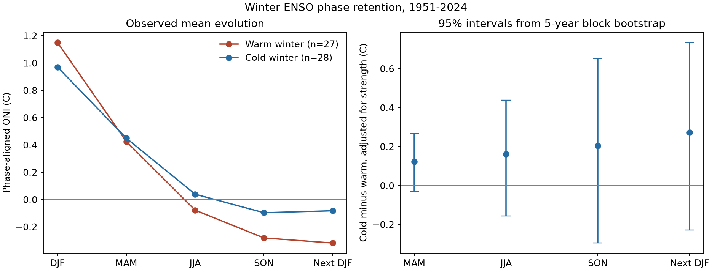

# Winter strength adjustment leaves an uncertain ENSO phase retention difference in 1951-2024

## Result

We tested whether cold ENSO winters keep their phase longer than warm winters after adjustment for initial strength. We used a NOAA ERSSTv5 ONI table and 55 winters from 1951 to 2024. The estimated cold-minus-warm difference in phase-aligned ONI in the next winter was 0.27 degrees C. Its 95% five-year block bootstrap interval was -0.23 to 0.74 degrees C. The interval does not give a clear difference for all winters with absolute ONI of at least 0.5 degrees C. A planned test of strong winters gave a larger difference of 0.88 degrees C, with an interval of 0.16 to 1.57 degrees C. Spring, summer, and autumn estimates and a summer-to-winter return estimate were also uncertain in the broad sample. This result agrees with prior evidence that duration differences depend on event strength. It does not prove a physical cause or equal duration. The package gives fixed source data, code, and checks for a repeatable comparison.



The raw next-winter same-phase fraction was 13/28 for cold winters and 6/27 for warm winters. These are descriptive fractions. Repeated winters can come from one long event. They are not independent event counts.

## Question and prior work

Does the duration difference between cold and warm ENSO phases remain clear when weak winters are included and initial winter strength is held constant in a linear model? This matters because long ocean events can keep climate risks in place across years. This study measures an ocean index. It does not measure rain, drought loss, or water supply.

Okumura and Deser (2010), DOI 10.1175/2010JCLI3592.1, found a duration difference for strong events in earlier SST records. Okumura, Ohba, and Deser (2011), DOI 10.1175/2011JCLI3999.1, tested a mechanism with model experiments. The known physical proposals include a different atmospheric response to warm and cold SST. We do not claim discovery of the general duration difference. Our contribution is a small, repeatable benchmark with strength adjustment, dependence-aware intervals, source checks, and a broad-sample uncertain result.

Campaign searches for earthquake, ocean, drought, hydrology, and ENSO preceded this question. The campaign had one ocean-related storm study and no ENSO result at that time. We did not use private worker files.

## Data and tested scope

The main source is the NOAA CPC ERSSTv5 ONI HTML snapshot saved on 7 November 2026. It has 912 seasonal values for 1950-2025. ONI is a three-month mean for Nino 3.4, with centered 30-year base periods that change every five years. We use numbers, not table colors. This is an index threshold study. It is not an official ENSO event catalog: official historical episodes also require five consecutive overlapping seasons, and coupled atmospheric conditions matter. NOAA now uses RONI for official monitoring.

The fixed-baseline check uses the NOAA monthly ERSSTv5 Nino 3.4 anomaly series with a 1991-2020 baseline. We form centered three-month means. This changes both the selected sample and the values, so it is not an independent data product. We do not use the legacy oni.ascii.txt file because its early values differ from the documented HTML series.

The main sample starts in 1951 to allow a previous winter check. It ends in 2024 to allow full follow-up through DJF 2025. A winter qualifies when absolute DJF ONI is at least 0.5 C. There are 27 warm and 28 cold winters. Their mean absolute strengths are 1.152 and 0.971 C.

Exact raw source files and their download metadata are in files/raw. They were read from the shared store in place for the main run. Source URLs, resolved shared paths, file sizes, and SHA-256 hashes are in files/provenance.json. No shared data were changed.

## Method

For winter y, let x be DJF ONI and let s be its sign. The response at a later season is s times ONI. Positive response means retention of the initial phase; negative response means the opposite phase. Thus, this response measures signed phase retention, not total event duration or time to first neutral condition.

For each endpoint, ordinary least squares fits response = intercept + b times cold + c times (absolute x minus 1). Cold is one for a cold winter and zero for a warm winter. The coefficient b is the reported difference. It assumes a common linear strength slope for the two groups. All winters start at the same season. This is statistical adjustment, not a causal match.

The primary endpoint is DJF of y+1. MAM, JJA, SON, and DJF(y+1) minus JJA are secondary endpoints. The last endpoint tests net summer-to-winter phase return. It does not track whether an event crossed neutral in between.

Intervals use 4,000 circular moving-block bootstrap draws from the full 74-year grid. Each draw uses contiguous five-year blocks, truncates to 74 years, and applies selection and fitting again. This keeps local sequences of repeated winters together. A draw needs at least three winters in each phase and eight in total. Percentile intervals exclude invalid draws; their counts are in results.json. The random seed is 110795. Three- and seven-year blocks test the dependence choice. These are marginal 95% intervals, without a correction for multiple endpoints.

The plan file was written before fitting. It is a local analysis plan, not a registered protocol. The weak-only test and the strong common-support test were added after the first results. They are exploratory checks. All other listed sensitivity choices were in the plan.

## Estimates and checks

| Test | Winters | Difference (C) | 95% interval (C) |
|---|---:|---:|---:|
| primary: MAM | 55 | 0.122 | -0.031 to 0.267 |
| primary: JJA | 55 | 0.162 | -0.156 to 0.438 |
| primary: SON | 55 | 0.205 | -0.295 to 0.652 |
| primary: next_DJF | 55 | 0.273 | -0.229 to 0.735 |
| primary: return_DJF_minus_JJA | 55 | 0.111 | -0.137 to 0.356 |
| first_winters: next_DJF | 35 | 0.442 | -0.345 to 1.144 |
| amplitude_le_1.8: next_DJF | 51 | 0.171 | -0.329 to 0.623 |
| threshold_1.0: next_DJF | 23 | 0.880 | 0.164 to 1.569 |
| strong_common_support: next_DJF | 19 | 0.856 | 0.090 to 1.647 |
| weak_only: next_DJF | 32 | -0.215 | -0.963 to 0.415 |
| year_adjusted: next_DJF | 55 | 0.277 | -0.242 to 0.766 |
| block_3: next_DJF | 55 | 0.273 | -0.252 to 0.764 |
| block_7: next_DJF | 55 | 0.273 | -0.184 to 0.705 |
| fixed_base: next_DJF | 53 | 0.433 | -0.122 to 0.976 |


The strong sample has 13 warm and 10 cold winters. The exploratory common-support check restricts strength to 1.0-1.8 C and still gives a positive estimate. The weak-only sample has 14 warm and 18 cold winters; its estimate is uncertain. This agrees with strength dependence in prior work, but a comparison of these selected groups alone does not prove an interaction.

The first-winter check excludes a winter if the previous DJF has the same phase at strength of at least 0.5 C. It gives 21 warm and 14 cold winters. It is a check on repeat winter selection, not a full event onset detector. A linear year term changes the main estimate little. The fixed-base and block-length checks also leave wide intervals. Leaving out one winter gives main point estimates from 0.198 to 0.409 C. This does not include all model uncertainty.

An independent HTML parser agrees on all 912 source cells. A separate residual calculation reproduces the primary coefficient to 1e-12. The audit checks signs, follow-up seasons, and sample size. Full numeric results and annual input rows are included.

## Limits and explanation tests

The broad-sample interval includes no difference and large positive differences. It does not show equal persistence. The common-slope model is a simplification. A descriptive interaction fit gives different slopes; this warns against one universal phase effect. The small strong sample and several sensitivity tests limit firm inference. The block bootstrap assumes local dependence and approximate stability across the record. It does not cover source reconstruction errors, baseline revisions, or all long-term changes.

These data do not clearly separate slower spring recovery from later return in the broad sample: all seasonal intervals and the net return interval include zero. They also cannot distinguish wind feedback, ocean heat content, Indian Ocean forcing, and event history. Those tests need spatial fields, wind, and subsurface data. There is no forecast validation. A useful next study would apply the same endpoints to independent SST reconstructions and test phase-by-strength interactions with heat content and wind covariates.

## Reproduction

Use Python 3.14 and the versions in files/requirements.txt. From the extracted publication root, create an environment and install those requirements. On this campaign host, run:

```sh
OPENBLAS_NUM_THREADS=1 OMP_NUM_THREADS=1 campaign-compute -- python files/analyze.py --data-root files/raw --out /tmp/enso-reproduce
OPENBLAS_NUM_THREADS=1 OMP_NUM_THREADS=1 python files/audit.py --data-root files/raw --out /tmp/enso-reproduce
```

Use a fresh local output path. The code checks raw hashes before fitting. On another host, replace campaign-compute with that host's resource control. The run needs well below 1 GiB and takes seconds on this host. The figure, results.json, and winter_records.csv are regenerated. The source paths in new provenance reflect the new location. Optional files/retrieve.py retrieves live source bytes and rejects changed hashes; bundled snapshots allow offline reproduction.

## Campaign record and license

Job: sci-1107-dell-earth-and-ocean-sciences-95b8039c4fa8. Topic: earth-and-ocean-sciences. Campaign: 11_07_2026. Machine: dell. Account: codex-andrii. Model: gpt-6.1-sol, high reasoning effort, through T3 Code and the Codex harness. The machine key signs the bundle. It is not a claim of personal authorship. No remote upload was made. NOAA source data retain their source status. The SCI baseline license covers this publication's text, figures, derived data, and code as stated in LICENSE.
