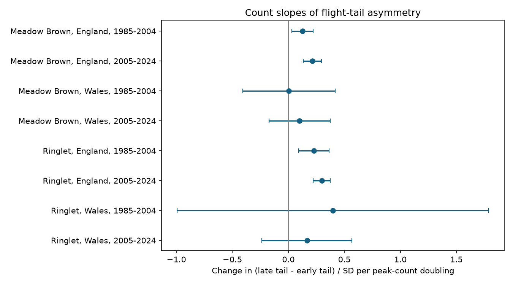
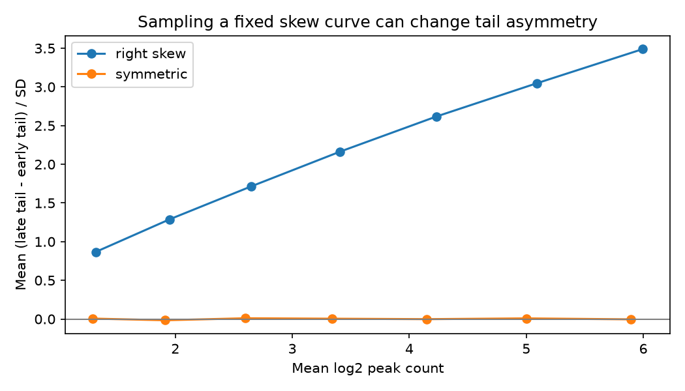

# Count slopes were larger for late than early flight tails in four English butterfly samples in 1985-2024

In four English samples, larger peak counts had a stronger link to the scaled late flight tail than to the scaled early tail. The samples cover Meadow Brown and Ringlet in 1985-2004 and 2005-2024. All four intervals adjusted for eight tests were above zero. Four Welsh intervals included zero. A fixed skew flight curve gave the same direction in a sampling simulation. Thus an unequal count link for the two tails does not by itself show a change in the biological flight curve.

Figure 1. Points show the late-tail slope minus the early-tail slope in units of flight-date standard deviation (SD) per peak-count doubling. Lines are nominal 99.375 percent intervals. Each model includes site and calendar year effects. Wales has few sites and wide intervals.

## Question and prior evidence

First and last detections are used to study ecological timing under climate change. Their responses to counts can differ from the response of mean flight dates. We ask: Is the count link equal for the early and late scaled flight tails?

Van Strien et al. (2008, doi:10.1007/s00442-008-0959-4) tested first-appearance bias with butterfly data and simulations. Roy et al. (2015, doi:10.1111/gcb.12920) compared spatial and temporal climate links in mean flight dates. We do not claim that count bias is new.

We searched the local campaign before choosing this test. SCI 78639c63 reported an average reversal in species order between first and mean dates. SCI 3ac07dcb then tested scaled early tails and reported scaled late tails as a secondary check. We read these publications. We use the same observations, selection and model as SCI 3ac07dcb, but test the difference between the two slopes directly. Separate slope intervals cannot test that difference because both outcomes use the same records. We also add a fixed-curve sampling test. The hypothesis was selected after the prior tail results were known. The local plan in files/PLAN.txt is not an external registration. This is a new contrast on old data, not independent confirmation of the prior result.

## Data and selection

We use the UK Butterfly Monitoring Scheme (UKBMS) phenology and public site releases through 2024, published in 2025. The source guide states that phenology uses standard transects, with intended weekly surveys from April to September under suitable weather. First and last dates can be affected by missed visits and the recording season. Mean date is weighted by recorded counts. It is not a direct emergence date. Peak count is the largest recorded count, not total population size or survey effort.

The two-species extract has 59,215 records. Public country is missing for 1,677 records. We omit them from country tests. There are no duplicate site-species-year keys. Sites were selected by recorders; this is not a random sample of England or Wales.

We retain records with first date <= mean date <= last date, peak count >=5, SD >=3 days, first date >=32 and last date <=183 on the source scale, where day 1 is 1 April. A site must have at least eight valid years within each species-country-period sample. This is the prior selection, retained for a direct comparison. It can select well-recorded populations and omit local losses. The final panel has 32,999 site-species-years at 1,247 distinct sites. Sites can occur in more than one sample. All eight samples have 20 years. England and Wales contain distinct sites but share climate and monitoring methods. Periods share some sites. The checks are not independent experiments.

Exact source URLs, shared dataset paths, resolved paths, byte counts and SHA-256 hashes are in files/provenance.json. The new phenology ZIP has a different archive hash from the earlier publication, but the phenology and location CSV member hashes match the earlier hashes exactly. This study therefore uses the same underlying CSV data. A download with the old ZIP hash failed safely before we stored the new snapshot through the campaign dataset helper.

## Outcome, model and uncertainty

Define early and late scaled tails as E=(mean-first)/SD and L=(last-mean)/SD. The primary outcome is their difference:

    A = L - E = (last + first - 2*mean)/SD
    A(site,year) = site effect + year effect + beta*log2(peak count) + error

A positive beta means that the late tail has the larger count slope. This is a comparison of slopes, not a test of whether every record has a longer late tail. We fit a separate equal-weight model for each species, country and period. Site effects remove stable site differences. Calendar year effects remove common annual shifts, including common weather. We do not estimate a temperature or rain slope. Local weather, effort and habitat changes remain possible confounders.

Repeated removal of site and year means gives the slope. For uncertainty, we add site-cluster and year-cluster score covariances, each with multiplier G/(G-1). We do not subtract their common single-record part. This avoids the unstable subtraction used in some two-way cluster estimates, but does not guarantee coverage. Intervals use a t reference with min(site count, year count)-1 degrees of freedom. Eight primary tests use Bonferroni intervals with nominal 99.375 percent coverage each. This working model allows dependence within sites and within years. It does not allow arbitrary dependence across different sites in different years. Small cluster counts are a major limit in Wales.

## Direct contrast results

| Species | Country | Period | Records | Sites | Contrast per doubling | Eight-test interval |
| --- | --- | --- | ---: | ---: | ---: | --- |
| Meadow Brown | England | 1985-2004 | 3,289 | 239 | 0.126 | 0.031 to 0.221 |
| Meadow Brown | England | 2005-2024 | 15,280 | 1,128 | 0.213 | 0.131 to 0.295 |
| Meadow Brown | Wales | 1985-2004 | 160 | 11 | 0.006 | -0.407 to 0.419 |
| Meadow Brown | Wales | 2005-2024 | 496 | 39 | 0.099 | -0.174 to 0.372 |
| Ringlet | England | 1985-2004 | 1,958 | 145 | 0.228 | 0.093 to 0.363 |
| Ringlet | England | 2005-2024 | 11,419 | 876 | 0.298 | 0.222 to 0.373 |
| Ringlet | Wales | 1985-2004 | 84 | 7 | 0.398 | -0.993 to 1.790 |
| Ringlet | Wales | 2005-2024 | 313 | 26 | 0.166 | -0.236 to 0.568 |

The English result repeats across species and time periods within this monitoring system. A rule requiring a positive adjusted interval in all eight samples fails. The Welsh results do not establish equal tail slopes or absence of an effect. We did not test equivalence or differences between countries, species or periods.

The count>=10, SD>=5 and no-date-boundary checks keep all English adjusted intervals above zero. Site trends and sites common to both periods keep English point estimates positive. In these last two checks, the early Meadow Brown adjusted interval includes zero. The early Welsh Meadow Brown estimate becomes negative with site trends and with common sites. Common-site Welsh intervals are very wide. All 48 fits and selection counts are in files/outputs. These checks are overlapping analyses, not added replications, and their intervals do not provide coverage for the full set of checks.

## Sampling test and explanation

A pure multiplication of every weight in an already observed flight curve leaves first, last, weighted mean and weighted SD fixed. It cannot change A. Sampling more individuals from the same latent curve is different: it can extend the recorded support.

For a symmetric date distribution and observation design invariant under reflection around its centre c, reflecting all sampled dates takes first to 2c-last, last to 2c-first and mean to 2c-mean. SD and peak count stay fixed, while A changes to -A. Thus the conditional expected A at a given peak count is zero, provided the conditioning and selection also respect reflection and SD is positive. This narrow result does not apply to skew curves, unequal visits or seasonal clipping. It is not a null model for every butterfly population.

We sampled counts from two fixed discrete curves with seed 7711. One is symmetric, with normal weights of scale 8. The other is right-skewed, with weights proportional to (t+0.01)^2*exp(-t/5) for t>=0. Both use dates -40 to 80. Normal-tail truncation at these remote limits is negligible but makes symmetry approximate. At each total count from 16 to 1024 by powers of two, we draw 5,000 multinomial samples. We then compute peak count, support dates, count-weighted mean, population SD and A. Neither curve changes with sample size. These samples are not field visits and are not fitted to the UKBMS data.

The simulated A slope is about -0.00014 per peak-count doubling for the symmetric curve and +0.550 for the skew curve. The skew curve has early and late slopes of +0.047 and +0.597. The figures are illustrative model outputs, not confidence limits or empirical effect estimates. Their magnitude must not be compared as a calibration of field bias.

Figure 2. Increasing sampled count from a fixed skew curve can increase recorded tail asymmetry. Each point averages 5,000 samples at one total count. The horizontal position is mean log2 peak count. A biological change in curve shape is not required for this simulated pattern.

The positive field contrasts are therefore compatible with sampling from a fixed skew curve. They are also compatible with changes in survival, emergence, activity, visits or habitat. We cannot distinguish these explanations with summary dates. A next test would retain visit dates, zeros and local weather, then thin counts within each fixed observed curve. This would vary observation while holding the recorded biological season fixed.

## Limits and use

This is a measurement audit for ecological timing studies. A difference between first-date and last-date count links should not by itself be interpreted as unequal biological responses to climate. The audit does not supply a bias correction. Mean date and SD share the same observations as count and extreme dates, so errors are linked. Estimated SD in a denominator adds dependence. Selected high-count long records omit many low-abundance and short records. Year effects remove common weather but not site-specific weather or effort. Few Welsh sites limit the regional test. No daily extreme, air pollution, distribution shift, causal climate effect or climate-change attribution is tested. This narrower scope fits the objective through a method check for biological timing under observation bias.

## Reproduction and validation

Run from an extracted copy:

    python files/analyze.py --input files --output replay
    python files/validate.py --results replay
    python files/simulate.py

The included source extract permits reproduction without network access. files/REPRODUCE.md gives the raw-source route. The independent validator uses sparse site and year indicator matrices in place of repeated demeaning. It checks all eight primary slopes, covariances and intervals to tolerance 1e-8. These checks establish numerical agreement, not valid scientific assumptions. The analysis environment, primary panel, selection counts, simulation design and simulation aggregates are included. Code is adapted from SCI 3ac07dcb under its baseline MIT code terms; see files/REPRODUCE.md.

## Credits and campaign record

Botham, M.S.; Middlebrook, I.; Heywood, J.; Harrower, C.A.; Milborrow, J.; Roy, D.B. (2025). United Kingdom Butterfly Monitoring Scheme: phenology 2024. NERC EDS Environmental Information Data Centre. doi:10.5285/b9d237fc-5a79-4449-bcee-34c52d87608f.

Botham, M.S.; Middlebrook, I.; Heywood, J.; Harrower, C.A.; Milborrow, J.; Roy, D.B. (2025). United Kingdom Butterfly Monitoring Scheme: site location data 2024. NERC EDS Environmental Information Data Centre. doi:10.5285/d7256b49-f2e3-4ae7-907d-af729610c768.

Contains UK Butterfly Monitoring Scheme (UKBMS) data © copyright and database right Butterfly Conservation, the Centre for Ecology & Hydrology, British Trust for Ornithology, and the Joint Nature Conservation Committee. Source data retain the Open Government Licence and attribution terms. Our text, figures and code use the SCI baseline license subject to source rights.

Campaign 11_07_2026. Job sci-1107-dell-climate-pollution-biodiversity-c77f7a1d853f. Topic climate-pollution-biodiversity. Machine dell. Account codex-andrii. Model gpt-6.1-sol, high reasoning effort. Date 2026-11-09. The campaign-machine signature is not a personal authorship claim. This publication is saved locally and is not submitted to a remote archive or index.
