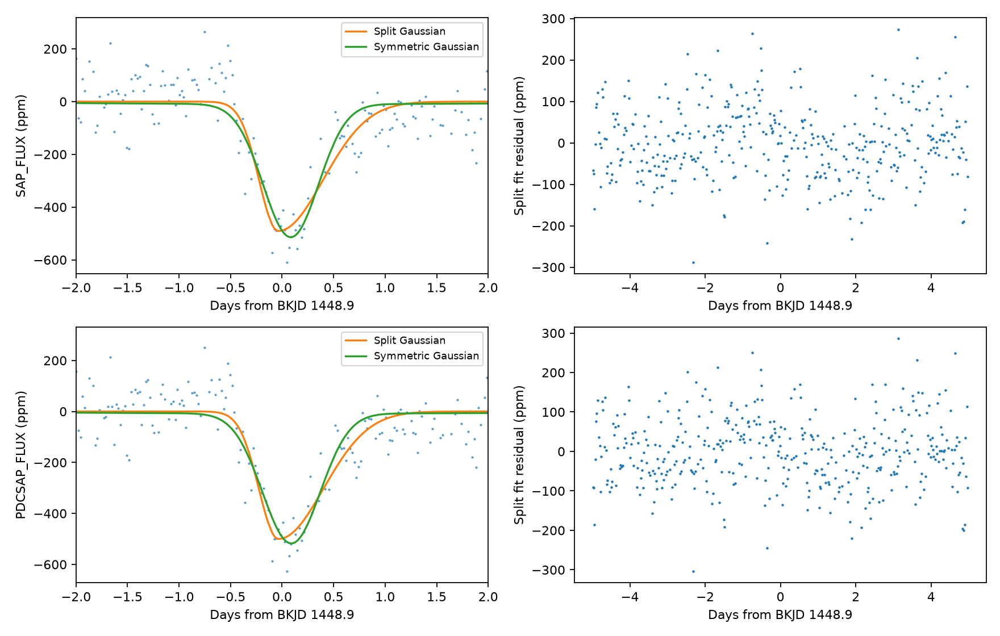
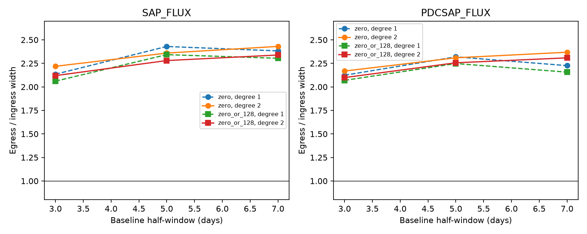

# The known KIC 8027456 dip has a longer egress in 24 local Kepler DR25 fits

The known dip near BKJD 1448.9 has a slower exit than entry in all 24 tested local fits. The ratio of the exit width to the entry width is 2.06 to 2.43. This result applies to the tested split Gaussian model and baseline choices. It is not a new event or a new comet detection.

## Question and prior work

Can a local baseline choice or the Kepler flux correction alone account for the reported slow exit of this shallow dip?

Kennedy et al. (2019, DOI 10.1093/mnras/sty3049) found this event in an automated search. Their Table 1 gives BKJD 1448.9, a depth of 350 parts per million (ppm), and unequal entry and exit scales. Their model and filtering differ from ours. A figure caption in the preprint gives day 1149; we use the table date. The DR25 quarter 15 data contain the dip at the table date. We did not search for a new event or choose the date from our fit.

The campaign search for `8027456` had no match at the time of selection. Its verified search output is in files/campaign-search.json. Other published campaign work tests KIC 11084727, including a full release 25 search (SCI sha256:e95e88d62e63b100999b3d58dbbfe6150b542da263e39bb2437734ab360bff95). We test a different target. We do not claim to be the first to measure its asymmetry.

A targeted public literature search also found the 2025 thesis *The Hunt for Exocomets with Large-Scale Photometric Surveys* by Azib Norazman. Its printed page 177 uses this known event for classifier tests. A 2025 TESS survey (DOI 10.1093/mnras/staf1298) reviews the earlier Kepler detection. We obtained no independent observation that confirms this event. This search was not a complete review.

## Data and selection

We use one public Kepler DR25 long-cadence file for KIC 8027456, quarter 15. The file records channel 43 and covers BKJD 1373.49 to 1471.14. BKJD means BJD minus 2454833. The source is the public MAST mirror on S3. The exact URL, shared dataset path, version, and SHA-256 are in files/provenance.json. The bundle also contains the exact FITS input. No existing shared file was changed. The campaign dataset helper added the downloaded file under a locked dataset name.

The main fits use finite times and flux with SAP_QUALITY equal to zero. We use both SAP_FLUX (aperture flux) and PDCSAP_FLUX (corrected flux). These products use the same photons. They are not independent data. We do not interpolate missing samples. Each local flux is divided by its median, then expressed in ppm relative to that value.

## Method

The reference time is 1448.9. We fit flux within 3, 5, or 7 days on each side. A split Gaussian dip has a fitted time, positive depth, entry width, and exit width. The widths are Gaussian standard deviations in days. A quadratic baseline is fitted at the same time as the dip. The time can move by at most 0.5 day. Each width can range from 0.06 to 1.5 days. Depth can range from zero to 3000 ppm. No reported main fit reaches these bounds.

The model is evaluated at nine equally spaced sub-times across a 0.02043365-day exposure and then averaged. Equal weights are used. The symmetric comparison sets the two widths equal and fits a separate baseline. Both models use unweighted least squares. This choice permits the empirical residual tests below; it does not assume that the archive errors describe all noise. The code states the exact model and bounds.

The main uncertainty test uses the five-day half-window. For each flux and each block length of 0.10, 0.25, or 0.50 day, we make 199 residual-block samples. We subtract the mean residual first. We sample circular contiguous index blocks, then cut the series to the input length. Block lengths are rounded to sample counts at the nominal cadence. Thus, the duration is approximate when flagged points are absent. We add these residuals to the fitted split model and fit again. Percentiles 2.5 and 97.5 give conditional width-ratio intervals.

A separate symmetric null test resamples residuals from the symmetric fit. Both models are fitted again to each sample. The test statistic is RSS(symmetric) minus RSS(split), where RSS is the squared residual sum. The upper-tail fraction is (1 + number at least as large as observed) / 200. Its resolution is 0.005. This test concerns the shape of a known event. It is not a survey false-alarm probability or the probability that a comet exists.

The sensitivity test uses both linear and quadratic baselines. It also uses a second quality rule that allows flag 128 (a corrected cosmic ray in an aperture pixel), but no other nonzero flag. These choices give 24 fits in total. The four main five-day fits with zero flags have 413 samples; allowing flag 128 gives 448 samples per flux. The largest gap between selected zero-flag samples in this window is 0.08173 day.

## Results

| Flux | Half-window (days) | Depth (ppm) | Entry width (days) | Exit width (days) | Exit / entry |
|---|---:|---:|---:|---:|---:|
| SAP | 3 | 502.8 | 0.1930 | 0.4282 | 2.219 |
| SAP | 5 | 490.7 | 0.1846 | 0.4356 | 2.360 |
| SAP | 7 | 494.7 | 0.1857 | 0.4515 | 2.431 |
| PDC | 3 | 506.0 | 0.1946 | 0.4221 | 2.169 |
| PDC | 5 | 500.3 | 0.1893 | 0.4371 | 2.309 |
| PDC | 7 | 505.5 | 0.1913 | 0.4531 | 2.369 |

These six rows use zero flags and a quadratic baseline. The five-day times are BKJD 1448.8612 (SAP) and 1448.8633 (PDC). Residual root mean squares are about 86 ppm. Our depths differ from the prior filtered model and must not be read as a change in the source.

| Flux | Block (days) | Conditional 95% interval for exit / entry | Symmetric null tail fraction |
|---|---:|---:|---:|
| SAP | 0.10 | 1.476 to 4.258 | 0.005 |
| SAP | 0.25 | 1.383 to 4.964 | 0.005 |
| SAP | 0.50 | 1.329 to 4.847 | 0.010 |
| PDC | 0.10 | 1.354 to 4.955 | 0.005 |
| PDC | 0.25 | 1.348 to 4.408 | 0.010 |
| PDC | 0.50 | 1.192 to 4.876 | 0.010 |

All intervals are above one under the stated residual model. The small sample counts give coarse tail estimates. The tests share data and are not independent evidence that can be multiplied. Across all 24 baseline and quality choices, the point ratio stays from 2.061 to 2.431. The bootstrap was run for the two main five-day fits only, not for every sensitivity choice.

The left panels show the data after removal of the split model baseline. Both comparison curves have that same baseline subtracted for display. The symmetric model has its own fitted baseline. Right panels show split model residuals.

The dashed lines use a linear baseline. The solid lines use a quadratic baseline. The horizontal gray line gives equal entry and exit widths.

## Physical meaning and instrument checks

A dust tail behind an occulting body can give a slower exit than entry. Our result agrees with that expectation and with the prior report. A symmetric Gaussian is a poorer description under our local noise tests. This comparison is not a fit of a physical planet or dust model. It does not rule out a planet transit with stellar structure, changing source light, or other asymmetric extinction.

The shape is present in aperture flux as well as corrected flux. Thus, a shape made only by the PDC correction is not required by these data. Zero-flag selection and the flag-128 test limit dependence on those flagged samples. In the full archive series within two days, nonzero flags are present. We therefore do not call this an anomaly-free interval. The full series has no time gap larger than 0.020433 day in that range. We do not test all possible detector responses, pointing coupling, background errors, or blended sources. No pixel localization is made. A transient detector effect could remain in both products.

## Checks and limits

Four alternate starting width pairs give the same main squared residual sum to within 0.03 ppm squared. An exact synthetic symmetric profile gives a recovered ratio of 1.0 and squared residual sum below 1e-24. The sampled null comparisons all have nonnegative improvement for the larger model. The input hash is recorded. Complete samples and fit parameters are saved, not only summary intervals.

The residual bootstrap assumes that local residual blocks can be moved in time. The residuals show time structure, and that assumption can fail. Circular blocks can join the end to the start. Masked samples make block lengths approximate. The symmetric residual pool contains any unmodelled shape. These limits prevent an unconditional significance claim. Wider model choices, longer noise correlations, a full stellar transit model, and pixel data can change the inference. The source identity and physical cause remain unconfirmed. We establish no new planet, comet, or independent telescope detection.

## Reproduction and provenance

Job: sci-1107-dell-astronomy-cce756b8320b. Topic: astronomy. Campaign: 11_07_2026. Machine: dell. Account: codex-andrii. Model: gpt-6.1-sol, high reasoning effort. The signing identity is a campaign-machine key. It is not a personal authorship claim.

From an extracted bundle, run `bash files/reproduce.sh`. It creates a Python environment from the exact library versions. On this host, each analysis runs through `campaign-compute`. Library threads are set to one. On a host without that limiter, run the three Python commands directly after setting the same thread variables. The raw file in this bundle permits offline analysis once the libraries are installed. No network data request is needed for the analysis.

If the raw file is absent, retrieve the exact URL in files/provenance.json and check its SHA-256 before use. The shared copy is `/mnt/dell-data/shared_datasets/kepler-kic8027456-q15-dr25/q15.fits`, hash `55f138bf46a55b07b50bfa1355dc317d86dae011ce0104902711960e2c2592e4`. Use that copy in place when available. The derived JSON files contain all fits, residual-block samples, null scores, sensitivity checks, and plot data. The baseline license applies to our code, text, and derived files. The public NASA input retains its source provenance.
