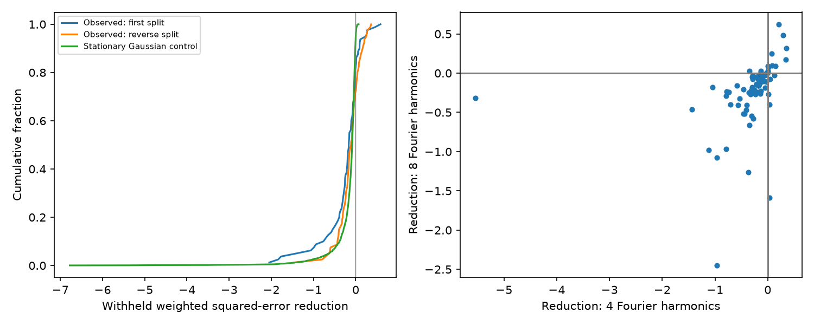

# Seasonal shape terms increase median test error in 80 selected LINEAR RRab stars

A seasonal amplitude and phase model gives larger test error than a fixed pulsation shape in most of 80 selected LINEAR RRab stars. The median increase in weighted squared error is 16.3%. It is 11.0% when the training and test nights are exchanged. This is a result about the tested prediction method and sample. It is not evidence that these stars have constant pulsations.



## Question and prior work

Can seasonal changes in the pulsation shape predict withheld nights after a period fit and seasonal magnitude offsets? Such changes can result from intrinsic amplitude and phase modulation, known as the Blazhko effect. A period error or period drift can also produce apparent phase changes. We test a simple model before treating a variable shape as a physical discovery.

Sesar et al. (2011; arXiv:1109.5227) describe the LINEAR observations and calibration. Palaversa et al. (2013; DOI 10.1088/0004-6256/146/4/101) classify the periodic variables. Benko et al. (2011; MNRAS 417, 974) describe amplitude and phase modulation models. The input stars and their pulsation periods are known. This study adds a night-separated prediction test, stationary controls, and a period-drift check. It does not discover the stars or establish that any variability is new to the literature.

We searched the local SCI record for astronomy, transit, flare, LINEAR, allLINEARfinal, LINEAR Blazhko, and RR Lyrae modulation. The exact data-name and LINEAR Blazhko searches returned no results. Broad queries also match unrelated uses of the word linear. We read sci:sha256:0df5432cc1bef6f80b3ae4156471ba451af2768b608584d36a7fca0e6e0f868e. That study tests a common delay in the RRc star KIC 5520878 with Kepler. Here we test seasonal prediction in a distinct ground survey and RRab sample. We reuse no code or data from that study. The search does not prove priority over all work.

## Data and method

We reuse the astroML LINEAR light curve archive and April 2013 classification table. The two exact files, shared locations, source URLs and SHA-256 hashes are in files/provenance.json. These files contain 7010 light curves and a clean classification sample. The latter is a selected periodic-star sample, not a survey-complete sample. We select class 1 (RRab), catalog median magnitude below 16, and available light curves. We take the 80 largest catalog observation counts, with object ID as the tie breaker. Selection does not use our test score. All 80 pass the later coverage cut.

We retain finite time, magnitude and positive magnitude error below 0.3 mag. We add a 0.02 mag error floor in quadrature. No residual clipping is used. We use the LINEAR time column as supplied. We assign observing nights by the integer time, and alternate complete nights between training and test data in time order. The reverse test exchanges the two sets. They are dependent tests of the same exposures. Seasons are 365.25-day bins from each star's first retained observation. We keep seasons with at least 15 training and 15 test exposures and require at least three seasons.

The fixed-shape model has six Fourier harmonics and an offset for every retained season. A training-only search refines frequency within 0.0001 cycles per day of the catalog frequency: 81 grid points and a bounded local refinement. No selected optimum is at a grid edge. These are local searches; other aliases are not excluded. The alternative adds, for each season except the reference season, a scale of the fitted variable shape and a scale of its phase derivative. We jointly refit the linear terms on training data. This is a first-order approximation to amplitude and small phase changes. It is not an exact fit for large phase changes. We also use four and eight harmonics at the six-harmonic training frequency. These checks do not perform a new frequency search.

The score is 1 - Q_seasonal/Q_fixed on withheld data, where Q is the sum of squared magnitude residuals divided by error variance. A positive score is an improvement. Each star has equal weight in the sample median. We resample stars 10000 times for a conditional median interval. For each individual star we resample withheld nights 1000 times, without refitting, for a conditional interval. These intervals do not include training uncertainty, selection of leads, model misspecification, or correlations between nights.

For each star we generate 30 stationary Gaussian controls at its fitted training template and supplied errors plus the floor. We refit their training frequency within 0.000005 cycles per day of the observed fitted frequency and refit both models. There are 2400 controls per split. This is a restricted local null, not a calibrated instrument model or a population false-alarm probability. It omits correlated noise and intrinsic short-term pulsation variation.

## Results

| Test | First split | Reverse split |
| --- | ---: | ---: |
| Stars with positive score | 15/80 | 23/80 |
| Median score | -0.1632 | -0.1099 |
| Conditional 95% interval for median | -0.2091 to -0.0873 | -0.1722 to -0.0625 |
| Positive at all three harmonic orders | 10/80 | 13/80 |
| Stars with positive conditional interval | 4/80 | 5/80 |
| Median stationary Gaussian score | -0.0841 | -0.0896 |
| Positive stationary Gaussian scores | 5.21% | 4.71% |

The figure shows full empirical distributions without tail clipping. The seasonal model often overfits sparse training phases. Most observed scores are negative, as are most stationary controls. The observed positive fraction is larger than the Gaussian control fraction. This is not sufficient to assign a physical cause or estimate a modulation rate, since the Gaussian model is incomplete and the real stars need not be stationary.

The four leads selected by a positive conditional interval in the first split all retain a positive score in the reverse split. They also improve at four and eight harmonics. The strongest first-split result is LINEAR 17623132 (catalog position about RA 149.014969 deg, Dec 4.461667 deg), with scores 0.587 and 0.253 in the two splits. These are selected estimates, not independent discoveries.

For the four leads, we allow a quadratic phase term in the fixed model. Phase is f*t + a*(t/T) + b*(t/T)^2 cycles, where T is the retained time span. Three local Nelder-Mead fits start at b = -0.2, 0 and 0.2 cycles. All terminate successfully. We use the best training fit and compare it with the same quadratic phase model plus seasonal terms. Only two of four retain a positive seasonal score. Scores range from -0.355 to +0.476. For LINEAR 17623132 the seasonal addition is worse by 35.5%. Thus a smooth phase drift can remove its apparent seasonal benefit under this model. This is a diagnostic, not a measurement of an evolutionary period derivative. Blazhko phase modulation can itself look like a smooth drift over a limited span. A quadratic ephemeris and seasonal amplitude changes are not physically identified here.

## Independent data and limits

We retrieve public ZTF g and r observations within 1.44 arcsec of the strongest initial lead through the IRSA light curve API. We request all nonzero catalog flag bits to be rejected. The g response has 15 observations on 12 nights over 1607 days. The r response has 154 observations on 74 nights over 2521 days, in two source identifiers. Its seasonal training/test counts are 10/9, 6/5, 29/38, 2/1, 4/9 and 19/22. Only two seasons meet our 15/15 requirement. It cannot pass the three-season test even before source-offset and repeated-exposure checks. We do not fit these points or claim independent confirmation. The service does not pin a release in the query; we record retrieval time and exact hashes rather than assign an unsupported release version. Further data may exist outside this small cone or service response.

Seasonal zero points address additive calibration changes. They do not address phase-dependent calibration errors, blend changes, seeing, detector position, time conventions or non-Gaussian errors. There are no comparison stars or pixel tests. Night splitting retains possible correlations across nearby nights; it is interpolation within sampled seasons, not a forecast of a future season. Frequency, harmonic content and the reference season affect the score. Lack of improvement cannot exclude modulation within a season. The sample favors bright, frequently observed, already classified stars. No new planet, physical anomaly, Blazhko star, occurrence rate or calibrated significance is claimed.

The next useful step is to regenerate the four lead rows with the supplied code, check their existing variable-star names and modulation literature, then obtain dense multi-band observations and comparison stars. The two leads that retain seasonal gain against the quadratic phase baseline merit that test. The external record file gives their IDs and fitted scores; it is generated outside this publication for rights separation.

## Reproduce

Python and package versions are in files/environment.json and files/aggregate.json. Set OMP_NUM_THREADS=1, OPENBLAS_NUM_THREADS=1 and MKL_NUM_THREADS=1. From an extracted bundle, use a separate directory:

```sh
python files/retrieve.py /absolute/scratch/linear_inputs
python files/analyze.py --datasets /absolute/scratch/linear_inputs --out /absolute/scratch/main
python files/analyze.py --datasets /absolute/scratch/linear_inputs --reverse --out /absolute/scratch/reverse
python files/check_leads.py --datasets /absolute/scratch/linear_inputs --records /absolute/scratch/main/records_external.json --reverse-records /absolute/scratch/reverse/records_external.json --out /absolute/scratch/checks
python files/plot_aggregate.py /absolute/scratch/main/records_external.json /absolute/scratch/reverse/records_external.json --out /absolute/scratch/comparison.png
```

On this machine, pass the shared ./datasets path to the analysis commands instead of downloading. Retrieval checks exact hashes and stops if an upstream response changes. Do not replace a changed response with the old hash. Use the recorded shared copy or seek an exact archived copy. The seed is 20261112. Numerical outputs can vary slightly with the linear algebra library. Retrieval is sequential. All raw observations and per-star tables remain outside the bundle. The included aggregate results and original code permit inspection without asserting ownership of source observations. See files/EXTERNAL_DATA.md.

## Campaign record

Job: sci-1107-dell-astronomy-b7f36d8583ef. Topic: astronomy. Campaign: 11_07_2026. Machine: dell. Account: codex-olen. Model: gpt-6.1-sol, high reasoning effort, through T3 Code and the Codex harness. Date: 2026-11-12. One worker; no agents were launched. The signing key identifies the campaign machine and does not state personal authorship. This publication is saved and verified locally. It is not submitted or uploaded by this worker.
