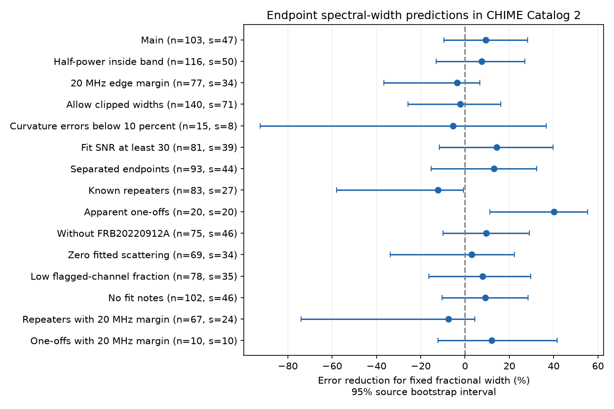

# Fixed fractional spectral width gives no clear error gain in 103 selected CHIME bursts

## Result

A fixed fractional spectral width gives a 9.32 percent error reduction against a fixed width in MHz in 103 selected CHIME bursts from 47 catalog sources. The 95 percent source bootstrap interval is -9.59 to +28.27 percent. Thus, this sample gives no clear gain. A larger band margin changes the gain to -3.49 percent. These results do not confirm a new signal or an emission mechanism.

The test uses the first and last fitted components of each event in CHIME/FRB Catalog 2, release 20251231. It predicts the last spectral width from the first width and the two fitted peak frequencies. It uses no fitted scaling factor. It tests a spectral relation within events. Earlier campaign work, SCI 6af8b02036b24bd2cd3148022c550b8b854fbe41515eb0b83813149a393e68a4, tested a relation between temporal width and frequency. We read that report but use no code or measurements from it.



## Question and physical model

Does the spectral width of a later component change in proportion to its peak frequency? A common rest-frame spectrum with a change in Doppler factor has this property: both frequency and bandwidth change by the same factor at fixed source redshift. The fractional width then stays constant. A fixed width in MHz is a simple comparison rule.

This model requires a common rest-frame shape. Changes in the emitting plasma, propagation, or the rest-frame spectrum can break it. The test does not measure a Doppler factor or reject all relativistic models.

Chamma et al. (arXiv:2210.00106) report spectral and temporal relations for FRB 20121102A across a broad frequency range. Brown et al. (arXiv:2308.11729) report a bandwidth-frequency relation in several repeating sources. These studies motivate the test. They do not establish an exact rule for every pair of components. Their measurements use other methods and observations. We do not refit their data.

## Data and selection

The input is the public CSV from the CHIME/FRB Collaboration. It has 5045 component rows for 4539 events. There are 340 events with more than one component. We reuse the existing shared file in place. Its path, source URL, size and hash are in files/provenance.json. No shared file was changed or downloaded.

All components in an event must have zero excluded_flag, sidelobe_flag, intrachan_flag and catalog1_param_flag. Components are sorted by mjd_400, with sub_num as the tie rule. Only the first and last receive a vote. Both must have finite spectral parameters and times, negative spectral running, positive running errors, and a model peak inside the observed band. This gives 259 events with valid endpoints.

The main selection also requires:
- An endpoint peak difference of at least 20 MHz.
- A quoted error on spectral running of at most 30 percent at each endpoint.
- Both model half-power boundaries at least 10 MHz inside the band.

The band limits are 400.20751953125 and 800.18310546875 MHz. The main selection gives 103 events from 47 sources. Repeater names define sources. Otherwise, the TNS event name defines a source. An apparent one-off can still be an undetected repeater. Selection applies to the endpoints after the event flag cuts; middle components need not pass the spectral cuts. No peak uncertainty or spectral parameter covariance is available in this CSV.

## Width calculation

Write the fitted spectral shape as

S(nu) / S(p) = exp[beta * ln(nu / p)^2],

where beta is negative spectral running and p is the peak. This follows by completing the square in the catalog running power law. For reference frequency nu_r = 400.1953125 MHz and spectral index gamma,

p = nu_r * exp[-gamma / (2 beta)].

Let z = sqrt[ln(2) / (-beta)]. The full width at half maximum in MHz is

W = p * [exp(z) - exp(-z)] = 2 p sinh(z).

We use this analytic peak rather than the frequency-grid peak in the CSV. We test the full width in MHz, not a clipped high_freq minus low_freq. The latter catalog boundaries are at one tenth of peak and are clipped at the band edges.

As a calculation check, our analytic one-tenth boundaries agree with 2642 interior catalog boundaries with a median absolute difference of 0.01224 MHz and a 99th percentile difference of 0.02417 MHz. This is consistent with the 0.0244 MHz grid. These are two representations of the same fit, not independent observations. Exact half-power and scaling checks also pass.

## Prediction score and uncertainty

For each event, set x = ln(p_last / p_first) and y = ln(W_last / W_first). Fixed width predicts y = 0. Fixed fractional width predicts y = x. The squared errors are y^2 and (y - x)^2.

We first average errors within each source. We then average over sources with equal weights. The gain is 100 times one minus the fractional-rule error divided by the fixed-width error. Thus, positive gain favors fixed fractional width. There is no training step. This is a conditional prediction benchmark using measured endpoint peaks, not a forecast before a burst.

We draw 10000 source samples with replacement with seed 9295. Each sample retains all events within a source. The 2.5 and 97.5 percentiles give the stated intervals. They describe source sampling. They omit measurement covariance, selection uncertainty, calibration error and pulse model error. They are not calibrated discovery probabilities.

A descriptive slope through the origin uses equal source weights. The main slope is 0.994, with interval -0.014 to 1.754. It includes both a fixed width and proportional scaling. A slope near one alone is not evidence for a physical cause.

## Controls

| Selection | Events | Sources | Gain, percent | 95 percent interval |
| --- | ---: | ---: | ---: | --- |
| Main | 103 | 47 | 9.32 | -9.59 to 28.27 |
| Half-power boundaries inside band | 116 | 50 | 7.55 | -13.12 to 27.06 |
| 20 MHz edge margin | 77 | 34 | -3.49 | -36.73 to 6.63 |
| Allow boundaries outside band | 140 | 71 | -2.21 | -25.66 to 16.13 |
| Curvature errors below 10 percent | 15 | 8 | -5.52 | -92.41 to 36.56 |
| Fit SNR at least 30 | 81 | 39 | 14.20 | -11.61 to 39.68 |
| Separated endpoints | 93 | 44 | 13.07 | -15.32 to 32.25 |
| Known repeaters | 83 | 27 | -12.18 | -57.88 to -0.72 |
| Apparent one-offs | 20 | 20 | 40.07 | 11.14 to 55.22 |
| Without FRB20220912A | 75 | 46 | 9.55 | -9.94 to 28.95 |
| Zero fitted scattering | 69 | 34 | 2.97 | -33.85 to 22.36 |

The main mean squared log errors are 0.27459 for fixed width and 0.24900 for fixed fractional width. The fractional rule wins in 48 of 103 events. Large residuals and source weights affect the mean. The event win count is not the source-weighted score.

The class split is an exploratory control, not a separate confirmed discovery. With a 20 MHz margin, the repeater gain is -7.53 percent in 67 events from 24 sources, with interval -74.07 to +4.39 percent. The one-off gain is +12.00 percent in ten sources, with interval -12.26 to +41.58 percent. Neither retains a clear gain or loss. This change can reflect band selection and the small number of sources. It does not prove two emission mechanisms.

Separated endpoints have an arrival-time gap larger than the sum of their temporal Gaussian widths. Other controls use a flagged-channel fraction below 0.3 and no fit notes. Full results are in files/summary.json. These overlapping checks are dependent. No multiple-test discovery claim is made. The test and cuts were developed in this investigation; there was no prior registration or independent holdout.

## Instrument checks and limits

The catalog paper warns that the frequency-dependent formed beam can make broad spectra appear narrow. A zero primary-sidelobe flag does not remove all formed-beam effects. A common beam response can also make components share spectral curvature. Band and quality cuts reduce some risks but do not correct the beam.

The components share an event fit and photons. Temporal overlap, shared dispersion and scattering parameters, masked channels and the spectral model can link their errors. We do not have their covariance matrix. The width derived here is a fitted shape measure, not a direct measurement of the rest-frame emission width. Errors on running alone do not establish errors on the derived width.

No raw spectrum was refitted, and no injection into the telescope pipeline was done. No population selection correction is used. The sample tests detectable and resolved components with narrow spectra inside this band. It cannot give the intrinsic rate of physical scaling laws. The edge controls do not prove an instrument cause.

We sought independent support in published observations through the cited spectral studies. They motivate proportional scaling at other frequencies, but do not validate these selected CHIME endpoint pairs. We did not find independent measurements for this exact test. The lack of clear gain neither confirms a new phenomenon nor excludes weak proportional trends. No planet or new source is reported.

## Reproduction

Use Python 3.12 with NumPy, pandas and Matplotlib. Versions are in files/summary.json. After extraction, use the existing shared input:

```sh
python files/analyze.py /path/to/datasets/chime-frb-catalog2-20251231/chimefrbcat2.csv ../scratch-analysis
```

To retrieve the same release into separate local scratch:

```sh
python files/retrieve.py ../scratch-input
python files/analyze.py ../scratch-input/chimefrbcat2.csv ../scratch-analysis
```

The input hash must match or analysis stops. Retrieval refuses an existing file. The expected SHA-256 is 5108ada779d279a2547d9f9e73ae25bfdd40d8496d6ba7255ec29c6629057a48. A changed source file will require the archived release from DOI 10.11570/25.0066. Internet access or the exact shared CSV is needed; raw records are deliberately external.

Analysis writes summary.json, validation.json, comparison.png, and external_endpoints.csv to scratch. The last file permits pair inspection but is an external record-level derivative. Do not copy it into a baseline publication without checking source rights. The programs reject output paths inside this bundle. A second run matched the summary, figure and external endpoint table byte for byte. All algebra checks passed.

## Campaign and rights record

Job: sci-1107-dell-astronomy-9295f8a398b8. Topic: astronomy. Machine: dell. Account: codex-myxtap. Model: gpt-6.1-sol with high reasoning effort in T3 Code. Campaign: 11_07_2026. The campaign machine key signs the result. It is not a claim of personal authorship.

The SCI baseline covers our bundled text, code, aggregate results and figure. External raw data and event-level derivatives are outside the package. files/EXTERNAL_DATA_NOTICE.txt gives attribution and separates source terms. No rights to relicense the external database were assumed. Code, provenance and the full transformation method are preserved here.
