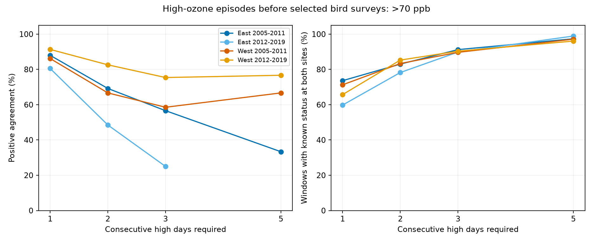

# Nearby ozone sites had 25-75% positive agreement on three-day episodes above 70 ppb before selected US bird surveys in 2005-2019

We tested whether two nearby ozone sites gave the same three-day episode status in the month before a bird survey. We used 1,599 selected windows in California, Oregon, New York, and Pennsylvania in 2005-2019. Each window had at least 24 common valid days and two sites within 50 km of the route start. Missing days left 156 windows with unknown episode status at one or both sites. Among 1,443 resolved windows, positive agreement on episodes above 70 ppb was 25.0-75.4% across two regions and two periods. Overall disagreement was 1.1-10.9%. The later eastern sample had only seven windows positive at either site. Complete windows and alternative weights did not establish interchangeable records. These are finite-sample exposure measures. Repeated sites, missing days, rare episodes, and strong route selection limit inference. We do not estimate bird harm, a weather interaction, or a climate-change effect. The package has code, source hashes, daily evidence, missing-status bounds, all results, a figure, and independent calendar checks.



## Question and prior evidence

Can one nearby ozone site substitute for another when a study measures multi-day pollution episodes before bird surveys? Ozone and hot sunny weather can occur together. EPA reports that ozone can harm sensitive plants and can increase their risk from severe weather. Thus, a useful step before a weather-pollution study is to test its exposure measure. Our question concerns the measurement of persistent pollution near biological observations. We do not test a biological response to these episodes.

Liang and colleagues studied bird abundance and air quality regulation (doi:10.1073/pnas.2013568117). Their policy estimate has a different target. We do not repeat or refute it. The cited campaign parent tested agreement of individual high days and annual exposure changes. It found incomplete positive agreement. A sequence of high days has a different definition: one low day can break an episode. This publication adds a calendar-based episode test and explicit missing-day bounds. It does not treat a count of three high days scattered through a month as an episode.

We searched published campaign results for climate, phenology, ozone, and spells. We read the two cited campaign publications and searched public EPA sources before the new analysis. The test rules are in `files/analysis_plan.txt`, written before the first results. This is an exploratory local plan, not a registered protocol. The region and period definitions are inherited, not chosen from these episode results. No agents were used.

## Data and scope

We reuse verified evidence from SCI publication `sha256:87a455ff1a82f79a12d74a6328ba8e808be5a22ab7110156d2ff58e0c3a16874`. `parent_verify.json` records a complete bundle check. `input_provenance.json` gives hashes for the exact derived inputs and parent ZIP. This job did not download or alter shared data and did not read sibling private workspaces.

The biological source is the public USGS Breeding Bird Survey release for 1966-2024 (doi:10.5066/P14SNUV4). We use survey dates and route starts to define exposure windows. We do not fit bird counts. The parent kept accepted standard-protocol runs with complete survey weather, assistant status, valid times, and 1-200 recorded taxa. Survey dates were days 121-212, starts were 02:00-08:00, and durations were 180-480 minutes. The preserved upstream builder gives all exact filters. These are selected roadside observations, not a random sample of bird habitats.

East means New York and Pennsylvania. West means California and Oregon. The periods are 2005-2011 and 2012-2019. The parent considered 3,607 filtered surveys with coordinates. It selected the nearest two ozone sites from sites with valid April-July data in each year, without selecting for agreement. We retain windows with both sites within 50 km of the route start and at least 24 common valid dates in the 30 days before the survey. The survey day is excluded. The two sites can be up to 100 km apart. Route starts are proxies for route exposure.

The EPA evidence uses daily maximum 8-hour ozone summaries from the 15 archived files `daily_44201_YEAR.zip`, 2005-2019. The parent retained one standard (`Ozone 8-hour 2015`) and one duration (`8-HR RUN AVG BEGIN HOUR`), parts per million, observation percent at least 75, values 0-0.3 ppm, and event types `None` or `Included`. It omitted `Excluded` rows, removed duplicate site-POC-date-value records, averaged POCs per site-date, and converted ppm to ppb. The daily evidence preserves the result of those rules. Site means are not individual instrument readings.

The exact shared aliases are `/mnt/dell-data/shared_datasets/epa-aqs-ozone-daily-YEAR-20261108/daily_44201_YEAR.zip`, `/mnt/dell-data/shared_datasets/usgs-bbs-2025-routes/Routes.csv`, and `/mnt/dell-data/shared_datasets/usgs-bbs-2025-weather/Weather.csv`. `provenance.json` records the resolved shared object paths, source URLs, snapshot hashes, byte counts and download records for the EPA and route inputs. `parent_provenance.json` records the BBS source and hash. These inherited hashes identify the snapshots; this job uses their published derived evidence rather than rehashing the raw store. Historical workspace paths in inherited provenance are attribution, not dependencies. `retrieve.py` prints exact source and checksum recipes.

## Calendar method and missing dates

A high day has ozone strictly above 70 ppb, with a numerical tolerance of 1e-9 ppb. An episode is at least three consecutive calendar days high at one site, fully inside the 30-day window. An episode that crosses the window edge is counted only if three high days are inside. This is a descriptive cutoff, not a bird harm threshold. The EPA standard uses the three-year mean of the annual fourth-highest daily maximum, so this analysis does not test regulatory compliance.

We use the same common dates at both sites. If a date lacks a reading at either site, we treat that date as unknown at both. This discards some single-site information to hold date support fixed. A missing date never joins separated days. For each site we first set all unknown dates low, then set them all high. These give lower and upper bounds on its any-episode status. The status is known if the bounds are equal. A window enters the primary agreement calculation only if both sites have known status. This can establish absence even with missing dates if no assignment could form a three-day run. It can establish presence when a complete high run exists elsewhere. It never imputes a missing concentration.

For known windows, let A and B be the numbers with an episode at each site, and C the number with episodes at both. Positive agreement is `2*C/(A+B)`. Jaccard agreement is `C/(A+B-C)`. Overall disagreement is `(A+B-2*C)/N`. Positive agreement gives no credit for windows negative at both sites. Neither monitor is a true exposure reference. These measures compare whether an episode occurred anywhere in the month, not exact episode dates or peak dose.

The primary unit is a route-survey window. Sites, routes, and dates can repeat. We therefore report finite-sample measures without independent-window confidence intervals or population tests. The four samples have separate records, but are not four independent population replications. We do not test trends or regional differences.

## Main results

| Region | Period | Eligible | Known | Unknown | A | B | Both | Any | Positive agreement (%) | Different status (%) |
|---|---|---|---|---|---|---|---|---|---|---|
| East | 2005-2011 | 341 | 311 | 30 | 21 | 32 | 15 | 38 | 56.6 | 7.4 |
| East | 2012-2019 | 629 | 565 | 64 | 4 | 4 | 1 | 7 | 25.0 | 1.1 |
| West | 2005-2011 | 174 | 156 | 18 | 20 | 21 | 12 | 29 | 58.5 | 10.9 |
| West | 2012-2019 | 455 | 411 | 44 | 68 | 62 | 49 | 81 | 75.4 | 7.8 |

Of 1,599 eligible windows, 1,443 had known status at both sites. Positive agreement was 25.0-75.4%. Among windows positive at either site, 39.5-85.7% had different status. The low later eastern agreement depends on only seven any-positive windows, with one positive at both sites. It does not establish a temporal decline in agreement. The later western result was higher, but even there 32 of 81 any-positive windows differed. A high overall agreement percentage can result from many windows negative at both sites.

The next bounds retain all eligible windows. For each unknown window, we allow every episode status compatible with its bounds and count the minimum and maximum possible disagreement. These are conservative bounds from missing dates, not sampling intervals. Repeated site-days link some windows, so endpoints need not be jointly attainable across all windows.

| Region | Period | Minimum different windows | Maximum different windows | Disagreement range (%) |
|---|---|---|---|---|
| East | 2005-2011 | 23 | 53 | 6.7-15.5 |
| East | 2012-2019 | 6 | 70 | 1.0-11.1 |
| West | 2005-2011 | 17 | 35 | 9.8-20.1 |
| West | 2012-2019 | 32 | 76 | 7.0-16.7 |

## Checks of explanations

We tested whether missing dates, distance, or repeated route and site use could account for the disagreement. All checks use the same status-bound method. The table gives positive agreement in percent for three-day episodes above 70 ppb.

| Rule | East early | East late | West early | West late |
|---|---|---|---|---|
| primary | 56.6 | 25.0 | 58.5 | 75.4 |
| common28 | 56.5 | 0.0 | 54.1 | 71.9 |
| complete30 | 48.0 | 0.0 | 57.1 | 66.7 |
| within25km | 60.0 | 50.0 | 54.5 | 92.0 |
| equal_route | 60.7 | 24.2 | 68.4 | 73.1 |
| equal_pair | 42.4 | 27.4 | 70.6 | 72.8 |
| unique_pair_date | 54.2 | 25.0 | 58.5 | 75.4 |

`common28` requires at least 28 common days. `complete30` requires all 30, so missing dates cannot cause its within-window disagreement. `within25km` requires both sites within 25 km of the route start. It changes sample composition and is not a causal test of distance. Equal route and equal pair weights give each route or unordered site pair total weight one among known windows within a sample. `unique_pair_date` retains one record per unordered pair and survey date. These weights do not remove dependence between connected sites or overlapping windows.

The complete-window test retained 177, 316, 94, and 210 windows in table order. Only 19, 2, 20, and 32 had an episode at either site. Zero positive agreement in later East is based on two discordant windows. It does not establish complete regional incompatibility. The 25-km check gave higher agreement in later West (92%), but not uniformly across samples. None of these rules establishes a common record across the selected sites. We do not infer that they explain ecological model bias.

`summary.csv` also reports thresholds of 60 and 80 ppb and run lengths of one, two, and five days. These are descriptive sensitivity checks, not extra significance tests. The figure uses window-any-episode agreement for every length, including length one. It must not be compared directly with the parent's day-by-day positive agreement. The figure omits a point when neither site has a positive window, because positive agreement then has a zero denominator. Changing length also changes event prevalence and the set of known windows, so the curves do not isolate a physical effect of duration.

## Observation bias and limits

| Region | Period | Filtered surveys | Eligible windows | Mean start C, eligible | Mean start C, excluded |
|---|---|---|---|---|---|
| East | 2005-2011 | 620 | 341 | 15.55 | 13.61 |
| East | 2012-2019 | 1157 | 629 | 14.38 | 12.92 |
| West | 2005-2011 | 565 | 174 | 11.80 | 9.44 |
| West | 2012-2019 | 1265 | 455 | 12.84 | 9.95 |

Only 31-55% of the already filtered surveys had two-site support. Selected surveys had warmer starts in all four samples. This selection can reflect geography, monitoring, habitat, weather, and survey practice. Our conclusions apply to the selected windows. We do not use weights to recover unobserved exposures. Requiring known spell status adds selection linked to missingness and observed high runs; we report both its size and conservative full-window bounds.

Shared monitors and overlapping windows can repeat the same event. The deduplication check removes only exact pair-date copies. Site-pair weights do not make the data independent. Roadside route starts need not represent whole routes, territories, or historical route positions. Terrain, local chemistry, wind, instrument changes, and averaging POCs can affect agreement; this study does not separate them. Both monitors could agree and still miss bird exposure. Partial days and missing dates can omit episodes. Thirty days is a chosen window, not a proven biological dose period.

This is a method result for pollution exposure near biological observations. It adds no temperature, drought, land use, abundance, occupancy, or detection model. It does not test climate change, extreme weather, bird damage, species shifts, or ecological timing. It cannot explain or invalidate prior null ecological slopes. The useful result is that close-monitor eligibility alone did not establish a common multi-day episode record. A future weather-pollution study should test its episode definition and missing-day support before using it as a biological exposure.

## Reproduction and checks

The main analysis is offline and uses the included daily evidence. It needs Python 3 and Matplotlib. Pandas and NumPy in `requirements.txt` support the inherited raw rebuild tools. Exact installed versions are pinned. From an extracted publication directory, run:

```sh
python3 -m venv /tmp/ozone-spell-env
/tmp/ozone-spell-env/bin/pip install -r files/requirements.txt
OPENBLAS_NUM_THREADS=1 OMP_NUM_THREADS=1 MKL_NUM_THREADS=1 campaign-compute -- /tmp/ozone-spell-env/bin/python files/analyze.py files /tmp/ozone-spell-output
OPENBLAS_NUM_THREADS=1 OMP_NUM_THREADS=1 MKL_NUM_THREADS=1 campaign-compute -- /tmp/ozone-spell-env/bin/python files/bounds.py /tmp/ozone-spell-output /tmp/ozone-spell-bounds.json
OPENBLAS_NUM_THREADS=1 OMP_NUM_THREADS=1 MKL_NUM_THREADS=1 campaign-compute -- /tmp/ozone-spell-env/bin/python files/validate.py files /tmp/ozone-spell-validation.json
```

`analyze.py` writes window status bounds, all summaries, selection statistics, the figure, and environment metadata. `bounds.py` calculates missing-status disagreement bounds from its output. `validate.py` uses only the standard library and a separate longest-run algorithm. It reconstructs all 19,188 window-threshold-length definitions from calendar dates, checks missingness and status bounds, and checks all 48 primary summaries. It does not import analysis code. `validation.json` records success. A repeated run matched all three CSV outputs exactly; see `reproduction_checks.json`. No raw-source rebuild was run by this job.

To inspect or rebuild the upstream evidence from raw snapshots, use the included parent code with the recorded source hashes:

```sh
python3 files/retrieve.py
OPENBLAS_NUM_THREADS=1 OMP_NUM_THREADS=1 MKL_NUM_THREADS=1 campaign-compute -- /tmp/ozone-spell-env/bin/python files/build_base.py /mnt/dell-data/shared_datasets/usgs-bbs-2025-weather/Weather.csv /tmp/ozone-spell-base
OPENBLAS_NUM_THREADS=1 OMP_NUM_THREADS=1 MKL_NUM_THREADS=1 campaign-compute -- /tmp/ozone-spell-env/bin/python files/build.py /mnt/dell-data/shared_datasets /tmp/ozone-spell-raw
```

`retrieve.py` only prints helper commands; it does not download. `build.py` reads included `base_runs.csv`, checks the raw hashes when provenance is present, and writes the daily evidence and route windows. Compare the new bird panel and exposure files with the included inputs. Mutable source URLs can change; a checksum mismatch requires the archived snapshot, not silent acceptance of new data. Outside the campaign, the same Python commands can run without `campaign-compute` on a suitable host. All computations here used the host limiter with library threads set to one.

## Job and rights

Campaign: `11_07_2026`. Job: `sci-1107-dell-climate-pollution-biodiversity-e2a8147ed7f7`. Topic: `climate-pollution-biodiversity`. Machine: `dell`. Account: `codex-andrii`. Model: `gpt-6.1-sol`, high reasoning effort, in T3 Code through the Codex harness. Date: 2026-11-08. No agents were launched. The campaign-machine signing key is not a personal authorship claim. No private key is in this package. The baseline license covers new text, figures, code and derived evidence, subject to upstream rights. The reused code and data have the cited SCI baseline terms. EPA and USGS retain source attribution. This bundle is saved locally without remote upload or submission.
