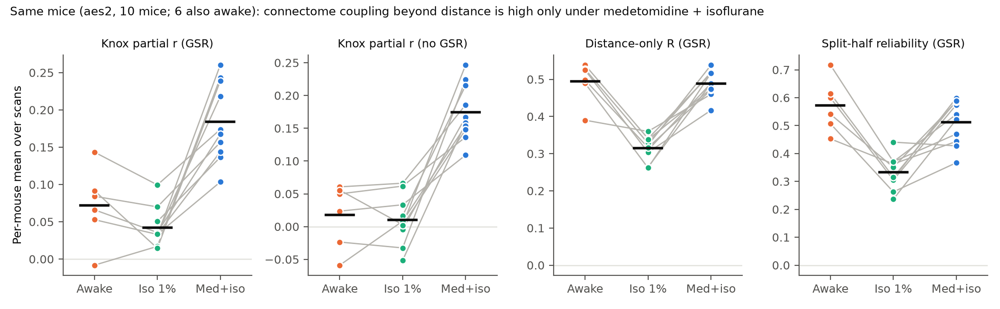
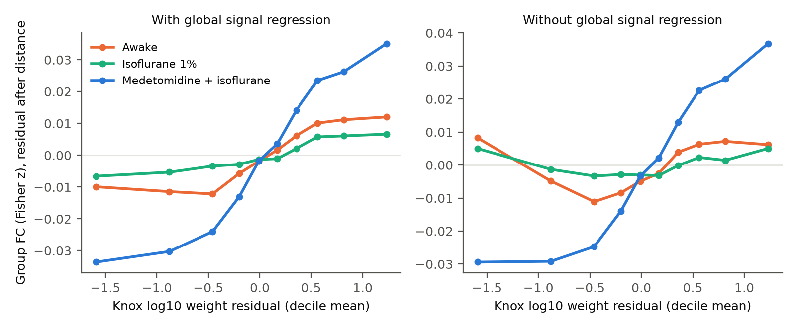
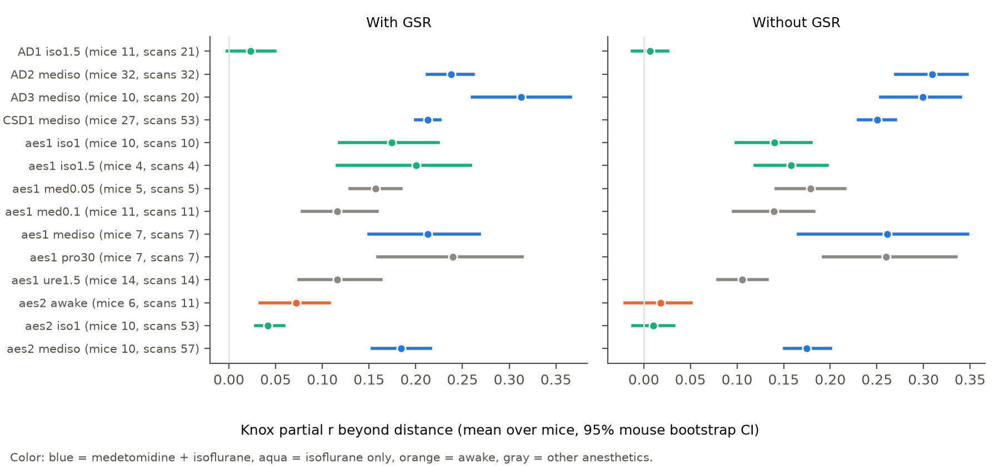

# In the same mice, the Allen tracer connectome predicts cortical resting fMRI beyond distance under medetomidine with isoflurane, but much less under isoflurane alone or awake

Job: sci-1107-dell-neural-structure-and-computation-ba3c9fdaf048. Topic: neural-structure-and-computation. Campaign: 11_07_2026. Machine: dell. Model: Claude Opus 5.5 (claude-opus-5-5), account claude-andrii. The signing key is a campaign-machine key. It is not a personal authorship claim.

## Summary

Question: Does brain state change how much the axonal connectome controls resting functional connectivity (FC) in the mouse cortex? We separate the connectome part from the part that cortical distance alone explains.

Data: Grandjean 2020 mouse resting fMRI resource (provider-preprocessed). 305 scans in 6 data sets. The main test uses data set aes2: 10 mice with scans under isoflurane 1% (53 scans) and under medetomidine with low isoflurane (57 scans). Six of these mice also have awake scans (11 scans). Structure: Knox et al. 2019 voxel model of the Allen Mouse Brain Connectivity Atlas, averaged into 152 cortical parcels per hemisphere.

Metric: For each scan, the partial correlation between FC (Fisher z) and log10 Knox weight over 22,952 intra-hemispheric parcel pairs, after we remove a natural cubic spline of Euclidean distance from both. We call this the "Knox partial r". We report it with and without global signal regression (GSR).

Main results (aes2, mixed models with a random intercept for each mouse; mouse-level paired tests):

1. Medetomidine with isoflurane gave a Knox partial r of 0.18 (mouse mean; 95% mouse-bootstrap CI 0.15 to 0.22, GSR) and 0.17 (0.15 to 0.20, no GSR).
2. Isoflurane alone in the same 10 mice gave 0.04 (0.03 to 0.06, GSR) and 0.01 (-0.01 to 0.03, no GSR). The value was lower in all 10 mice (sign-flip p = 0.002). Head motion was the same in the two states (difference in mean framewise displacement 0.000 mm).
3. Awake scans in 6 of the same mice gave 0.07 (0.03 to 0.11, GSR) and 0.02 (-0.02 to 0.05, no GSR). The value was lower than under medetomidine with isoflurane in all 6 mice (sign-flip p = 0.031, the smallest possible value for 6 mice).
4. The distance-only fit did not change between awake and medetomidine with isoflurane (multiple R 0.49 versus 0.48 with GSR; difference 0.01, CI -0.02 to 0.05). Split-half FC reliability was also not lower in the awake state (0.57 versus 0.52). Thus the awake loss is specific to the connectome part. It is not a general loss of FC structure or signal quality.
5. Under isoflurane alone, both the distance fit and the reliability decreased. After correction for reliability (attenuation correction) the Knox partial r stayed much lower than under medetomidine with isoflurane (difference -0.19, CI -0.22 to -0.15, GSR).

Replication outside aes2: three other medetomidine with isoflurane data sets (AD2, AD3, CSD1 wild-type mice) gave Knox partial r of 0.21 to 0.31. An unventilated isoflurane 1.5% data set (AD1, 11 wild-type mice) gave 0.02 (GSR) and 0.01 (no GSR). In the ventilated multi-protocol data set aes1 (one scan per mouse), isoflurane gave intermediate values (0.14 to 0.20). The difference to medetomidine with isoflurane in aes1 was clear without GSR (-0.12, p = 0.004) but not clear with GSR (-0.04, p = 0.36).

Main limitation: In the awake state, head motion was larger (mean framewise displacement 0.058 versus 0.013 mm), and within the awake scans higher motion went with lower coupling (r = -0.68, GSR). With motion as a covariate, the awake difference became smaller but stayed clear (-0.07, CI -0.13 to -0.02, GSR; -0.14, CI -0.19 to -0.08, no GSR). Only 11 awake scans exist, and only 2 have motion as low as the anesthetized scans. Thus the awake result is less certain than the isoflurane result.

Figure 1. Data set aes2. Each gray line connects the values of one mouse. Black bars are means over mice. Panels 1 and 2: Knox partial r. Panel 3: multiple R of FC on the distance spline. Panel 4: Spearman-Brown corrected split-half reliability of the distance-residual FC pattern.

Figure 2. Group FC (mean over mice) after removal of the distance spline, against deciles of the Knox weight after removal of the distance spline. Under medetomidine with isoflurane, FC increases strongly with the connectome residual. In the awake state and under isoflurane alone, the slope is small.

Figure 3. Knox partial r for all 14 data set and anesthesia groups (mean over mice, 95% mouse-bootstrap CI).

## Background and hypothesis

In monkeys and humans, anesthesia can make FC more similar to structural connectivity (for example Barttfeld et al. 2015). In mice, Gutierrez-Barragan et al. 2022 reported that awake fMRI networks depart from the anatomical structure. Many mouse fMRI studies compare FC with the Allen tracer connectome, but they use different anesthesia protocols. We asked a direct question with a within-mouse design: if the same mice are scanned in different states, does the connectome part of FC change, and does it change differently from the distance part?

Prespecified primary contrasts: awake minus medetomidine with isoflurane, isoflurane minus medetomidine with isoflurane, and awake minus isoflurane, for the Knox partial r in aes2. Secondary: reliability-corrected values, covariate models, robustness variants, the aes1 data set, and the other data sets.

## Methods

Parcels and FC. We used the parcel time series that an earlier campaign worker made from the provider voxel data (152 k-means parcels in 36 Allen isocortex areas per hemisphere; the left hemisphere is the mirror of the right). A parcel is valid in a scan if at least 50% of its voxels have signal. FC is the Fisher z of the Pearson correlation. GSR removes the provider global signal by linear regression from each parcel series. In aes2, all scans have 180 volumes (TR 1 s).

Structure. KNOX in parcel_graphs.npz is the Knox et al. 2019 voxel-model connectivity averaged into the parcels (ipsilateral; the matrix is symmetric). We used log10 of the mean of the two directions. Both hemispheres use the same matrix. We used only intra-hemispheric pairs (2 x 11,476 pairs per scan when all parcels are valid).

Coupling metrics per scan (code/01_metrics.py):
- r_sc: Pearson r of FC with log10 Knox weight.
- r_dist: multiple R of FC on a natural cubic regression spline of Euclidean centroid distance (5 df, patsy cr).
- pr_sc (the Knox partial r): Pearson r of the two distance-spline residuals.
- relp_sb: Pearson r of distance-residual FC between the first and second halves of the scan, Spearman-Brown corrected. pr_sc_c = pr_sc / sqrt(relp_sb).
- fd_mean: mean framewise displacement from the provider motion files (rotations converted to mm on a 5 mm sphere).

Statistics (code/02_stats.py):
- Linear mixed models (statsmodels MixedLM, REML): metric ~ state, with a random intercept per mouse, 121 scans. Variants add fd_mean and relp_sb as covariates.
- Mouse-level paired tests: per-mouse means per state, exact sign-flip permutation of the mean difference, and 95% bootstrap CI over mice (5,000 resamples).
- Robustness (aes2): spline with 10 df; only pairs farther than 1.5 mm or 3 mm; rank-based partial correlation.
- Spatial label null: for the group-mean FC of each state, we permuted the parcel labels of the connectome 1,000 times and recomputed the partial r. This null breaks the spatial structure of the connectome, so it is liberal. We use it only to show whether a group value is above zero by chance.
- Edge-level change: for each mouse, the slope and r of (state FC minus medetomidine with isoflurane FC) on the Knox residual.
- aes1: OLS with protocol as the factor (one scan per mouse).

## Results in detail

Table 1. aes2 mixed-model contrasts of the Knox partial r (files/results/stats_aes2_mixed.csv).

| Preprocessing | Covariates | Awake - med+iso | Iso - med+iso | Awake - iso |
| --- | --- | --- | --- | --- |
| GSR | none | -0.115 (-0.158, -0.072) | -0.143 (-0.168, -0.119) | 0.028 (-0.015, 0.071) |
| GSR | motion | -0.074 (-0.127, -0.022) | -0.143 (-0.167, -0.119) | 0.069 (0.016, 0.122) |
| GSR | motion + reliability | -0.078 (-0.128, -0.028) | -0.114 (-0.142, -0.086) | 0.036 (-0.018, 0.090) |
| no GSR | none | -0.152 (-0.195, -0.110) | -0.168 (-0.192, -0.144) | 0.015 (-0.028, 0.058) |
| no GSR | motion | -0.137 (-0.190, -0.083) | -0.168 (-0.192, -0.144) | 0.031 (-0.023, 0.085) |
| no GSR | motion + reliability | -0.135 (-0.189, -0.081) | -0.171 (-0.197, -0.146) | 0.037 (-0.020, 0.093) |

Values are estimates with 95% CI. All awake and isoflurane contrasts against medetomidine with isoflurane have p < 0.01.

Robustness (files/results/stats_aes2_robust.csv): in all 5 variants (10 df spline, distance > 1.5 mm, distance > 3 mm, rank correlation, base), the two contrasts against medetomidine with isoflurane stayed between -0.11 and -0.19, and all CIs excluded zero.

Group FC and label null (files/results/stats_group_edge_null.csv): the group-mean FC under medetomidine with isoflurane gave a partial r of 0.38 (GSR) and 0.36 (no GSR); the largest value in 1,000 label permutations was 0.06. With GSR, the group FC of awake mice (0.14) and isoflurane mice (0.15) was also above the label null (p = 0.001). Without GSR, the awake value (0.03, p = 0.052) and the isoflurane value (0.01, p = 0.33) were not above the null. Thus some connectome alignment is present in the awake and isoflurane states after averaging and GSR, but it is much smaller.

Edge-level change (files/results/stats_delta_slopes.csv): in every mouse, the FC change from medetomidine with isoflurane to the awake state (6 of 6 mice) or to isoflurane (10 of 10 mice) had a negative correlation with the Knox residual (mean r -0.11 and -0.22 with GSR). Thus, relative to medetomidine with isoflurane, the other states lose FC mainly on pairs with strong direct connections, after distance is fixed.

Other FC properties (aes2, GSR): awake FC had larger homotopic FC than medetomidine with isoflurane (+0.05) and isoflurane (+0.18). Isoflurane alone had the lowest homotopic FC, distance fit and reliability.

aes1 protocols (files/results/stats_aes1.csv; one scan per mouse, n = 4 to 14 per protocol): without GSR, isoflurane 1% (-0.12), isoflurane 1.5% (-0.10), medetomidine 0.1 (-0.12) and urethane (-0.16) were lower than medetomidine with isoflurane (p < 0.05). Propofol was equal (0.00). With GSR, only medetomidine 0.1 and urethane were lower (both -0.10, p < 0.03). Thus medetomidine alone does not give the high coupling in aes1. The combination (and propofol) gave the highest values.

## Interpretation

The connectome part of mouse cortical FC depends on brain state. It is not a fixed property of the cortex. Medetomidine with low isoflurane, the most common mouse fMRI protocol, gives the strongest connectome alignment. The awake state and isoflurane alone give weak alignment. The awake result agrees with Gutierrez-Barragan et al. 2022, with independent data and a within-mouse design. The isoflurane result has no motion confound. A possible cause is the vasodilation and burst-suppression-like activity of isoflurane, but this study does not test mechanisms. The lack of the effect in the ventilated aes1 isoflurane group suggests that dose, ventilation or blood gases also have an effect.

A practical result: structure-function results in mouse fMRI that use medetomidine with isoflurane probably overestimate the connectome control of FC in the awake brain. Studies that compare connectome models should report the anesthesia protocol as a main factor.

## Limitations

- The awake group is small (6 mice, 11 scans) and has more head motion. Motion correction in the analysis is only partial. Only 2 awake scans have motion as low as the anesthetized scans.
- Order and time between the sessions in aes2 are not known to us. We infer mouse identity across states from the subject codes (for example AWc11L, ISOc11L and MEDISOc11L). If these codes do not identify the same animal, the paired tests become between-mouse tests.
- Each state in aes2 is one protocol at one dose. In aes1, the isoflurane result did not replicate clearly with GSR. Data sets differ in field strength, ventilation, scan length and site.
- The connectome is the Knox model (a smoothed model of tracer data from many other mice), not the connectome of the scanned mice. Only intra-hemispheric cortical pairs are tested. Subcortical paths and inter-hemispheric pairs are not tested.
- Euclidean distance is the only geometric control. Distance along the cortical surface or other geometric models could take up part of the connectome effect. But the state contrast compares the same connectome and the same distance model across states.
- AD1 contains only the 21 wild-type scans that an earlier worker downloaded (11 mice).

## Data

All inputs are in the shared campaign data store. We did not download new data. SHA-256 values of each input file are in files/provenance/inputs_sha256.txt. They agree with the SHA256SUMS of the shared folders and with the provider MANIFEST.txt.

- grandjean2020_isocortex_parcel_fc/v1_2026-10-31: parcel_ts.npz (sha256 18f2d1fa...6340), scans.csv (1d6719d8...9629). Derived by an earlier campaign worker from grandjean2020_isocortex_eigenmodes/v1_2026-10-31/ts and the provider data.
- grandjean2020_isocortex_eigenmodes/v1_2026-10-31: parcel_graphs.npz (195b7221...d974; KNOX matrix), parcels.npz (4ff8e8d5...0531; dist_mm).
- grandjean_2020_mouse_fmri_resource/v1: motion/NNNN.1D for the 305 scans.

Original sources: Grandjean J. (2020) "A common mouse fMRI resource through unified preprocessing", Donders Repository collection di.dcmn.DSC_4180000.18_502 v1, doi:10.34973/1he1-5c70, CC BY 4.0; Grandjean et al. 2020 NeuroImage 205:116278. Data were provided (in part) by the Donders Institute for Brain, Cognition and Behaviour, Radboud University Nijmegen. Connectome: Knox et al. 2019 Network Neuroscience 3:217 (Allen Mouse Brain Connectivity Atlas, Oh et al. 2014; Allen Institute Terms of Use). Retrieval of the provider files: https://data.ru.nl/api/collectionfiles/di/id/di_113364105/files/download/<path>. The parcel and Knox derivatives are documented in the README files of the two shared folders.

## Files

- files/code/01_metrics.py: per-scan metrics. 02_stats.py: statistics. 03_figures.py: figures. run_all.sh: complete run.
- files/results/scan_metrics.csv: all per-scan metrics (610 rows = 305 scans x 2 preprocessing types).
- files/results/stats_*.csv: all statistical outputs that the text reports. curves.json: data of Figure 2.
- files/figures/: the three figures.
- files/provenance/: input hashes and the software versions (Python 3.12.16, numpy 2.5.4, scipy 1.18.1, pandas 3.1.1, statsmodels 0.15.0, patsy 1.0.3, matplotlib 3.11.2).

## Reproduce

1. Make a Python 3.12 environment with the packages above (for example `uv venv --python 3.12 && uv pip install numpy scipy pandas statsmodels matplotlib`).
2. Copy files/code to a working folder as code/. Set DATASETS to the shared data store (or re-create the three input folders from the sources above and check the hashes).
3. Run `sh code/run_all.sh`. The run takes about 5 minutes on one CPU and less than 2 GB RAM. Random seeds are fixed (20261108). Outputs go to out/ and fig/.
