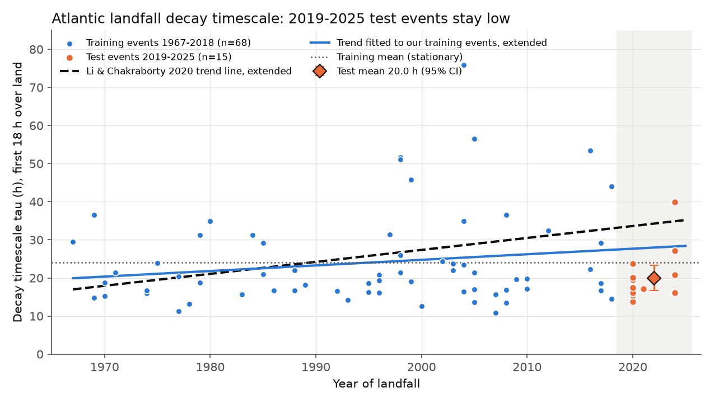
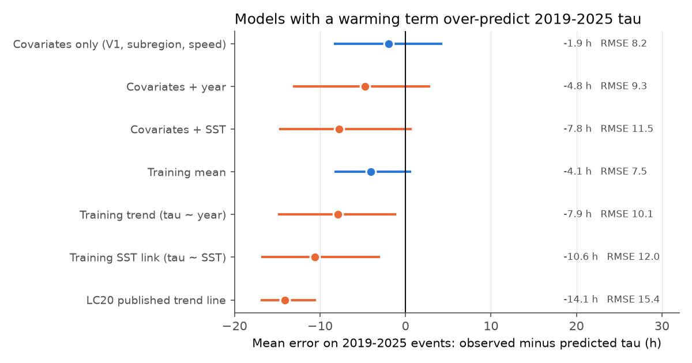
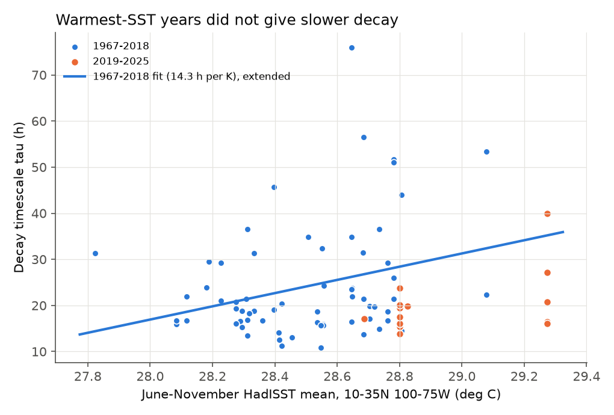

# Atlantic hurricane landfalls in 2019-2025 did not continue the reported slower-decay trend

## Summary

Li and Chakraborty (2020, Nature 587:230; "LC20") reported that North Atlantic hurricanes decay more slowly after landfall. They found that the decay timescale tau increased from about 17 h in 1967 to 33 h in 2018, and that tau followed the June-November sea surface temperature (SST) near the landfall coasts (r = 0.73 for smoothed series). They used HURDAT2 data to 2018.

We did an out-of-sample test. We used the LC20 event rule and tau fit on HURDAT2. We fitted models to 1967-2018 events only. Then we predicted tau for the landfall events of 2019-2025, which LC20 did not see.

Main results:

1. **Partial replication of LC20 (1967-2018).** With the 2019 HURDAT2 release, our rule gave 71 raw events (LC20: 75) and 67 events after the LC20 exclusions (LC20: 71). Mean tau was 21.4 h in 1967-1992 (LC20: 21.2 h) and 26.0 h in 1993-2018 (LC20: 28.4 h). The smoothed annual series went from 19.1 h to 27.2 h on a linear fit (LC20: 17 h to 33 h). Its correlation with smoothed SST was r = 0.69 (LC20: 0.73). The event-level trend was +1.2 h per decade, but the 95% interval with year clusters included zero (-0.7 to +3.1 h per decade).
2. **The 2019-2025 events decayed fast.** There were 15 test events. Their mean tau was 20.0 h (standard error 1.7 h; median 17.5 h). This is lower than the 1993-2018 mean (26.0 h; Welch p = 0.036; Mann-Whitney p = 0.21) and near the 1967-1992 mean. The test years had the warmest SST of the record (box mean 28.95 C against 28.50 C in training).
3. **The warming models over-predicted.** The extended LC20 trend line predicted 34.1 h (mean error -14.1 h, 95% bootstrap interval -16.8 to -10.6 h). Our training trend predicted 27.9 h (error -7.9 h, -14.8 to -1.2 h). The training SST link (14.3 h per K, p = 0.004 in training) predicted 30.6 h (error -10.6 h, -16.8 to -3.1 h). The stationary training mean (24.0 h) had the smallest root-mean-square error of the simple models (7.5 h against 10.1-15.4 h).
4. **Storm mix explains most of the low 2019-2025 values.** A model with landfall intensity, subregion and translation speed only (no year, no SST) predicted 21.9 h (error -1.9 h, -8.3 to +4.2 h). When we added year or SST to this model, the test error increased (MSE +18.6 and +65.0 h squared). The 95% intervals of these MSE changes included zero.
5. **With 2019-2025 included, there is no clear trend.** For 1967-2025, the event-level trend was +0.04 h per year (95% interval -0.09 to +0.16), and +0.05 h per year with the covariates. The SST coefficient decreased from 14.3 to 6.2 h per K (95% interval -1.1 to +13.5).
6. **The decay of central pressure deficit had no trend.** With a covariate model, the trend in pressure-deficit tau was -0.05 h per year in 1979-2018 and -0.15 h per year in 1979-2025. Both intervals included zero. Its 2019-2025 mean (16.7 h) was the lowest of the three periods.

The over-prediction by the trend and SST models stayed in all ten analysis variants (Figure 5). These variants changed the land mask, fit form, outlier rule, transition events, country set, and SST product.

**Interpretation, with limits.** The 2019-2025 data do not support a continuing climate-driven slowdown of landfall decay at the rate that LC20 reported. They do not prove that SST has no effect. The test has only 15 events from 4 seasons. Thirteen of them are from 2020 and 2024, and none are on the US East Coast (where LC20 found slower decay). The covariate model removes most of the gap, so a change in storm mix (more intense landfalls, more Gulf and Central America landfalls) can explain the low 2019-2025 values. A small SST effect inside the wide intervals is possible.

## Question

Does the slower decay of landfalling North Atlantic hurricanes that LC20 found for 1967-2018 continue in 2019-2025 landfalls? If a warmer ocean causes slower decay, the record-warm years 2019-2025 should give the longest tau of the record.

## Data

All inputs are public. They are in the shared campaign dataset store. Their source URLs and SHA-256 values are in `files/data/input_provenance.json`.

| Input | Shared path (/mnt/dell-data/shared_datasets/...) | Source | SHA-256 (first 16) |
| --- | --- | --- | --- |
| HURDAT2, 2026 release (1851-2025) | nhc-hurdat2-atl-1851-2025-092326 | https://www.nhc.noaa.gov/data/hurdat/hurdat2-1851-2025-092326.txt | 75202780ce56c845 |
| HURDAT2, 2019 release (1851-2018, near the LC20 version) | nhc-hurdat2-atl-1851-2018-051019 | https://www.nhc.noaa.gov/data/hurdat/hurdat2-1851-2018-051019.txt | b02a00e6b39d80e3 |
| Natural Earth 10 m land polygons | naturalearth-10m-land-v5 | https://naciscdn.org/naturalearth/10m/physical/ne_10m_land.zip | e547d749445eaa09 |
| Natural Earth 10 m countries | naturalearth-10m-admin0-countries-v5 | https://naciscdn.org/naturalearth/10m/cultural/ne_10m_admin_0_countries.zip | ce1ac7036499a0ed |
| HadISST1 monthly SST | hadisst1-sst-nc-20261108-olen | https://www.metoffice.gov.uk/hadobs/hadisst/data/HadISST_sst.nc.gz | eb0a402520ec4a9f |
| ERSST v5 monthly SST (check) | ersst-v5-psl-sst-mnmean-20261108-olen | https://downloads.psl.noaa.gov/Datasets/noaa.ersst.v5/sst.mnmean.nc | 952fad739abab3e3 |

We added the four HURDAT2 and Natural Earth datasets to the shared store for this study. The two SST files were already in the store.

## Methods

**Events (LC20 rule).** We used only synoptic HURDAT2 points (00, 06, 12 and 18 UTC). A landfall event starts at the first synoptic point over land after a point over the ocean. We kept an event if the wind at this first inland point V(t1) was 33 m/s or more (65 kt or more, because HURDAT2 uses 5-kt steps), and if the next three synoptic points were also over land (18 h, four points). One storm can give more than one event.

**Land mask.** LC20 used a MATLAB land-or-ocean function. We used Natural Earth 10 m land with a 0.05 degree buffer. With this buffer, the 1967-2018 event count (71 raw events) was nearest to the LC20 count (75). Variants with no buffer and with a 0.1 degree buffer are in the sensitivity tests.

**Decay timescale.** For the four inland points, tau = -1/s, where s is the least-squares slope of ln(V(t)/V(t1)) against t - t1, with the line through the origin (the model V(t) = V(t1) exp(-(t - t1)/tau)). A fit with a free intercept is a sensitivity test. As in LC20, we removed events without decay and events with tau more than 2 standard deviations above the mean. We calculated the thresholds from the training events only (1967-2018) and applied the same thresholds to the test events. No test event was removed.

**SST.** For each year, we used the June-November mean of HadISST over the ocean cells in the LC20 box (10-35 N, 100-75 W). ERSST v5 is a sensitivity test.

**Covariates.** The covariates are landfall intensity V(t1), mean translation speed over the four inland points, and subregion. To find the subregion, we used the country at the first inland point: US Gulf (including the Florida Gulf side), US Atlantic (the pre-landfall point is east of 81 W and north of 24.5 N), Mexico, Central America, and Caribbean islands.

**Out-of-sample test.** Training: events in 1967-2018 from the 2026 HURDAT2 release (68 events). Test: events in 2019-2025 (15 events). Models: M0 training mean; M1 tau ~ year; M2 tau ~ SST; M3 the LC20 published line (17 h in 1967 to 33 h in 2018, extended); M4 covariates only; M5 covariates + year; M6 covariates + SST. All models are ordinary least squares fitted on the training events. Scores are the mean error (observed minus predicted), the RMSE, and the change in MSE against M0 (for M1-M3) or M4 (for M5-M6). For the 95% intervals, we used 10,000 bootstrap draws. Each draw resampled the training years (clusters) and the test events.

**Other checks.** We fitted full-period regressions with standard errors clustered by year. We used tau, log tau, and the ratio V(t4)/V(t1) as dependent variables. We also calculated a pressure-deficit decay timescale, from (1013 hPa - central pressure), with the same fit, for events with pressure data (1979 and later). We compared the 2019 and 2026 HURDAT2 releases for 1967-2018.

## Results

### Replication on the 2019 HURDAT2 release

| Quantity | LC20 | This study |
| --- | --- | --- |
| Raw events 1967-2018 | 75 | 71 |
| Events kept | 71 | 67 |
| Removed | Georges 1998 (no decay) + 3 large-tau events | Georges 1998 (no decay), Juan 1985, Bertha 1996, Isaac 2012 |
| Mean tau 1967-1992 | 21.2 h (n = 26) | 21.4 h (n = 25) |
| Mean tau 1993-2018 | 28.4 h (n = 45) | 26.0 h (n = 42) |
| Smoothed linear trend 1967 to 2018 | 17 to 33 h | 19.1 to 27.2 h |
| r(smoothed tau, smoothed SST) | 0.73 | 0.69 |
| Region E mean, 1967-1992 / 1993-2018 | 28.4 / 36.2 h | 27.0 / 34.2 h (n = 3 / 8) |
| Region W mean, 1967-1992 / 1993-2018 | 19.9 / 25.2 h | 20.7 / 24.1 h (n = 22 / 34) |

The replication is near LC20 but not exact. Our increase between the two periods is smaller (+4.6 h against +7.2 h). The event-level trend has a 95% interval that includes zero when the standard errors are clustered by year.

The 2026 release changed tau for 7 of the 71 shared 1967-2018 events. It also added two 1971 events (Edith and Fern), because NHC changed the track data.

### Out-of-sample test (2019-2025)



**Figure 1.** Tau for each event. Blue: training events 1967-2018. Orange: test events 2019-2025 (grey band). Dashed: the LC20 trend line, extended. Blue line: the trend that we fitted to the training events, extended. Diamond: test mean with 95% interval.

| Model (fitted on 1967-2018) | Mean prediction (h) | Mean error (h) [95% CI] | RMSE (h) | MSE change against reference (h^2) [95% CI] |
| --- | --- | --- | --- | --- |
| M0 training mean | 24.0 | -4.1 [-8.2, +0.5] | 7.5 | reference |
| M1 tau ~ year | 27.9 | -7.9 [-14.8, -1.2] | 10.1 | +44.9 [-1.8, +168] vs M0 |
| M2 tau ~ SST | 30.6 | -10.6 [-16.8, -3.1] | 12.0 | +88.0 [-0.6, +243] vs M0 |
| M3 LC20 line | 34.1 | -14.1 [-16.8, -10.6] | 15.4 | +180 [+103, +245] vs M0 |
| M4 covariates only | 21.9 | -1.9 [-8.3, +4.2] | 8.2 | reference |
| M5 covariates + year | 24.7 | -4.8 [-13.0, +2.8] | 9.3 | +18.6 [-13.8, +130] vs M4 |
| M6 covariates + SST | 27.7 | -7.8 [-14.7, +0.6] | 11.5 | +65.0 [-24.7, +213] vs M4 |



**Figure 2.** Mean error of each model on the 15 test events, with 95% bootstrap intervals. Orange: models with a year or SST term.

The 15 test events:

| Storm | Year | Country | Subregion | V(t1) kt | V(t4) kt | Speed km/h | tau (h) | LC20 line (h) | M4 covariates (h) |
| --- | --- | --- | --- | --- | --- | --- | --- | --- | --- |
| Beryl | 2024 | USA | US Gulf | 70 | 25 | 27 | 16.4 | 34.9 | 21.5 |
| Debby | 2024 | USA | US Gulf | 65 | 45 | 12 | 40.0 | 34.9 | 25.9 |
| Francine | 2024 | USA | US Gulf | 70 | 25 | 25 | 16.1 | 34.9 | 22.2 |
| Hanna | 2020 | USA | US Gulf | 75 | 30 | 16 | 19.5 | 33.6 | 24.0 |
| Ida | 2021 | USA | US Gulf | 125 | 40 | 14 | 17.1 | 33.9 | 20.0 |
| Helene | 2024 | USA | US Gulf | 80 | 40 | 48 | 20.8 | 34.9 | 15.3 |
| Laura | 2020 | USA | US Gulf | 130 | 35 | 29 | 13.8 | 33.6 | 15.8 |
| Lisa | 2022 | BLZ | Central America | 65 | 30 | 19 | 19.8 | 34.3 | 23.0 |
| Nana | 2020 | BLZ | Central America | 65 | 20 | 19 | 15.4 | 33.6 | 22.7 |
| Oscar | 2024 | CUB | Caribbean | 65 | 35 | 9 | 27.2 | 34.9 | 43.1 |
| Sally | 2020 | USA | US Gulf | 85 | 30 | 13 | 16.0 | 33.6 | 24.0 |
| Delta | 2020 | USA | US Gulf | 75 | 25 | 23 | 16.1 | 33.6 | 22.1 |
| Zeta | 2020 | USA | US Gulf | 85 | 45 | 77 | 23.8 | 33.6 | 7.4 |
| Eta | 2020 | NIC | Central America | 95 | 40 | 10 | 20.1 | 33.6 | 22.4 |
| Iota | 2020 | NIC | Central America | 110 | 40 | 17 | 17.5 | 33.6 | 19.2 |

Only Debby (2024) had a tau above the LC20 line. In the same subregion, the test means were lower than the training means: US Gulf 20.0 h (n = 10) against 21.8 h for 1967-2018 (n = 31) and 22.6 h for 1993-2018; Central America 18.2 h (n = 4) against 21.5 h (n = 7). The Zeta covariate prediction (7.4 h) is an extrapolation, because Zeta moved at 77 km/h.



**Figure 3.** Tau against the June-November box SST of the landfall year. The 2024 events had the warmest SST of the record but most had a short tau.


**Figure 4.** The annual series smoothed as in LC20 (3-year mean applied two times). When we add 2019-2025, the smoothed tau decreases after 2016 while SST continues to increase.

### Full-period regressions (event level, standard errors clustered by year)

| Dependent variable ~ terms | 1967-2018 coefficient [95% CI] | 1967-2025 coefficient [95% CI] |
| --- | --- | --- |
| tau ~ year (h per year) | +0.146 [-0.009, +0.301] | +0.036 [-0.090, +0.162] |
| tau ~ year + covariates | +0.115 [-0.047, +0.277] | +0.047 [-0.063, +0.156] |
| log tau ~ year + covariates (per year) | +0.0027 [-0.0029, +0.0083] | +0.0011 [-0.0027, +0.0050] |
| V(t4)/V(t1) ~ year + covariates (per year) | +0.0009 [-0.0009, +0.0027] | +0.0004 [-0.0009, +0.0017] |
| tau ~ SST (h per K) | +14.3 [+4.5, +24.2] | +6.2 [-1.1, +13.5] |
| tau ~ SST + covariates (h per K) | +14.7 [+5.4, +24.1] | +7.7 [-0.9, +16.3] |
| landfall intensity V(t1) ~ year (kt per year) | -0.13 [-0.46, +0.19] | -0.10 [-0.37, +0.17] |
| pressure-deficit tau ~ year + covariates (1979 start) | -0.05 [-0.49, +0.39] | -0.15 [-0.44, +0.14] |

### Sensitivity


**Figure 5.** Mean test error against the LC20 line, the training trend and the covariate-only model, for each variant: land buffer 0, 0.05 and 0.1 degree; through-origin or free-intercept fit; no outlier rule; no extratropical transition in the first 18 h; US landfalls only; ERSST v5 instead of HadISST. The mean error against the LC20 line was from -12.4 to -14.6 h. The mean error against the training trend was from -6.6 to -10.9 h. The mean error against the covariate-only model was from -0.6 to -5.4 h. All values are in `files/results/summary.json`.

## Limitations

- **Small test sample.** There are 15 test events from only 4 of the 7 seasons, and 13 of them are from 2020 and 2024. The events in one season are not independent. The bootstrap resampled test events, not seasons, so the test intervals can be too narrow. As a season-level check, each of the four season means (2020: 17.8 h, 2021: 17.1 h, 2022: 19.8 h, 2024: 24.1 h) was below the LC20 line (33.6-34.9 h), the training trend (27.7-28.3 h) and the training SST model (26.8-35.2 h). The difference against the LC20 line (-14.1 h) is large compared with this problem. The differences against our own training trend and SST models are less sure.
- **No US East Coast test events.** LC20 found the slowest decay in region E (US East Coast). No 2019-2025 event in region E passed the rule (Isaias 2020 had 60 kt at the first inland point, and Ian 2022 had only three inland points after each landfall). Also, 2019, 2023 and 2025 gave no events (for example, Idalia 2023 had three inland points and Melissa 2025 had two). This mix change is one cause of the low test mean, and the covariate model handles it only partly.
- **Not an exact LC20 copy.** We do not have the LC20 event list or land mask. Our 1967-2018 sample has 71 raw events, not 75, and our 1967-2018 increase is smaller than in LC20.
- **Best-track data quality.** HURDAT2 winds over land come from sparse observations and analyst judgment. They can change with observing methods (LC20 also discuss this). NHC revised 7 of the 71 shared events between 2019 and 2026. A trend in data practice can make or hide a trend in tau.
- **Short window.** We fit tau over only the first 18 h over land, with four points of 5-kt resolution. Tau is very sensitive to small wind changes for weak landfalls.
- **Scope.** This is a test of the LC20 statistical claims for North Atlantic best-track data. It does not test the LC20 model simulations or the storm-moisture mechanism. It does not test other basins.

## Reproduce

Software: Python 3.12 with numpy, pandas, xarray, netCDF4, shapely 2.x, geopandas, statsmodels, scipy and matplotlib.

```
cd files
python code/analysis.py --datasets /mnt/dell-data/shared_datasets --scratch /tmp/lcdecay_scratch --out .
python code/figures.py --out .
```

`analysis.py` takes about 10 minutes (10,000 bootstrap draws; set the environment variable NBOOT for fewer). It writes the event tables in `files/data/` and all numbers in `files/results/summary.json`. To get the inputs from the original sources, download the URLs in the data table. Then put each file in a folder with the dataset name, under one parent folder, and give this parent folder as `--datasets`. HadISST and ERSST are updated monthly at the source, so the newest files can give small differences. The SHA-256 values identify the files that we used.

Files:

- `files/code/lcdecay.py`: HURDAT2 parser, land mask, LC20 event rule, tau fit, SST box means, smoothing, Kaplan-DeMaria helper.
- `files/code/analysis.py`: replication, out-of-sample test, regressions, sensitivity, release comparison.
- `files/code/figures.py`: the five figures.
- `files/data/landfall_events_primary.csv`: all primary events 1967-2025 with tau, covariates, SST and keep flags.
- `files/data/landfall_events_all_variants.csv`: events for all land-mask and release variants.
- `files/data/oos_test_events_predictions.csv`: test events with the prediction of each model.
- `files/data/annual_series.csv`, `files/data/sst_box_jun_nov.csv`: annual series.
- `files/data/input_provenance.json`: shared paths, source URLs and SHA-256 of the inputs.
- `files/results/summary.json`: all results.

## Provenance

- Job: sci-1107-dell-earth-and-ocean-sciences-afe4c83c0b94; campaign 11_07_2026; topic earth-and-ocean-sciences; machine dell; account claude-andrii.
- Model: Claude Opus 5.5 (claude-opus-5-5), an AI agent, did the design, code, analysis and text. The signing key is a campaign-machine key. It is not a personal authorship claim.
- Date of analysis: 2026-11-09.
- LC20 text: we read the accepted manuscript (OIST repository copy, from the Internet Archive). We did not read the full text of the Matters Arising by Chan et al. (2022) or the reply.

## References

- Li, L. and Chakraborty, P. (2020). Slower decay of landfalling hurricanes in a warming world. Nature 587, 230-234. doi:10.1038/s41586-020-2867-7
- Chan, K. T. F. et al. (2022). Landfalling hurricane track modes and decay. Nature 606, E7-E11. doi:10.1038/s41586-022-04791-1
- Li, L. and Chakraborty, P. (2022). Reply to: Landfalling hurricane track modes and decay. Nature 606, E12-E15. doi:10.1038/s41586-022-04792-0
- Chan, K. T. F., Chan, J. C. L., Zhang, K. and Wu, Y. (2022). Uncertainties in tropical cyclone landfall decay. npj Climate and Atmospheric Science 5, 93. doi:10.1038/s41612-022-00320-z
- Landsea, C. W. and Franklin, J. L. (2013). Atlantic hurricane database uncertainty and presentation of a new database format. Monthly Weather Review 141, 3576-3592. doi:10.1175/MWR-D-12-00254.1
- Kaplan, J. and DeMaria, M. (1995). A simple empirical model for predicting the decay of tropical cyclone winds after landfall. Journal of Applied Meteorology 34, 2499-2512. doi:10.1175/1520-0450(1995)034<2499:ASEMFP>2.0.CO;2
- Rayner, N. A. et al. (2003). Global analyses of sea surface temperature, sea ice, and night marine air temperature since the late nineteenth century. JGR 108, 4407. doi:10.1029/2002JD002670
- Huang, B. et al. (2017). Extended Reconstructed Sea Surface Temperature, Version 5 (ERSSTv5). Journal of Climate 30, 8179-8205. doi:10.1175/JCLI-D-16-0836.1
