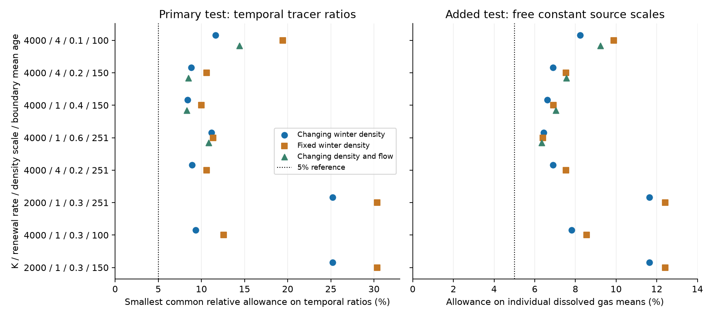
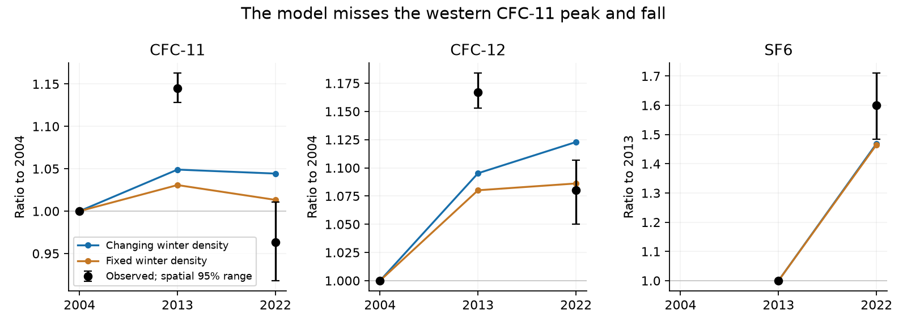
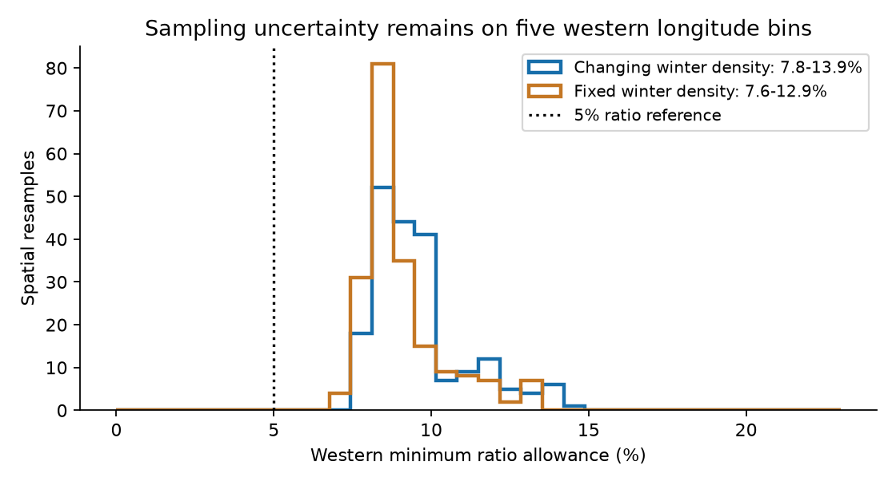

# P02 gas ratios need at least 8.4 percent error in eight North Pacific ventilation cases under fixed source factors

## Result

We tested the published spatial ventilation model with measured gases instead of inferred water ages. We kept its transport, winter density fields and renewal parameters. We used CFC-11, CFC-12 and SF6 on density sigma0 26.5 along P02 at 28-32 N in 2004, 2013 and 2022. There are 264 casts in 20 matched longitude bins from 160 E to 120 W. The later gas data were not used in the model's early-occupation age calibration. This is a retrospective consistency test, not a blind forecast.

All eight published parameter cases need a common relative allowance of **at least 8.40 percent on the planned temporal tracer ratios**. Individual cases need 8.40-25.22 percent. A flexible, unchanged southern-boundary age distribution cannot remove this mismatch. The smallest allowance remains 8.40 percent when its mean-age constraint is removed. The test permits any nonnegative boundary spectrum, not just an inverse-Gaussian form. It also removes one constant source scale for each gas and region through the temporal ratios.

A ratio allowance is not an error allowance on each measured mean. We therefore added an exact check on individual epoch means. With one free constant source scale per gas and region, all eight changing-density cases still need at least **6.44 percent on dissolved gas means**. The best fixed-density control needs **6.40 percent**. Four published flow-change cases give a minimum of **6.35 percent**. Thus the direct gas means do not select the winter-density forcing. They also do not support a five percent fit of this model under the tested source and boundary assumptions. These percentages are deterministic error allowances, not confidence levels or estimates of instrument error.



Figure 1. The same eight cases that passed the parent's age-calibration rule do not pass the direct gas test at the five percent reference. Left: the planned temporal-ratio test. Right: the added test on individual dissolved gas means, with fitted constant source scales. Source scales and boundary spectra are optimized separately in the two tests. The rows give K in m2/s, maximum renewal in 1/yr, density scale in kg/m3, and mean boundary age in years. The flow symbols use the four published flow-change combinations. An extra boundary-age case for one of those transport triples is in the tables; it does not change any minimum.

The main new evidence is the direct mismatch of transient gas histories in a specific oxygen model. The main new tool is an adjoint calculation that gives exact surface-input and boundary-input kernels for the model and the sampling dates. The bundle includes the kernels, positive mixtures, linear-program dual evidence, aggregate gas means and code. A mean-age fit does not test these full histories. This result does not disprove an outcrop contribution to oxygen loss. It identifies a missing quantitative validation before this model can support that attribution or a projection.

## The measured pattern and the model mismatch

The regional gas means below are sample-normalized partial-pressure equivalents in ppt. They are not raw dissolved concentrations. SF6 was not used in 2004.

| Region and gas | 2004 | 2013 | 2022 |
|---|---:|---:|---:|
| West, CFC-11 | 173.0 | 198.1 | 166.7 |
| West, CFC-12 | 355.1 | 414.4 | 383.6 |
| West, SF6 | not used | 3.576 | 5.721 |
| Central, CFC-11 | 176.7 | 192.4 | 162.2 |
| Central, CFC-12 | 357.0 | 399.4 | 382.7 |
| Central, SF6 | not used | 3.366 | 5.126 |
| East, CFC-11 | 175.9 | 177.1 | 168.0 |
| East, CFC-12 | 349.8 | 362.8 | 382.3 |
| East, SF6 | not used | 3.251 | 4.326 |

West is 160-180 E, central is 180-160 W, and east is 160-120 W. The western CFC-11 maximum in 2013 is a main constraint. In the minimum-error primary case, the model's fitted CFC-11 ratios to 2004 are 1.049 in 2013 and 1.044 in 2022. The observed ratios are 1.145 and 0.963. The model also gives a western SF6 ratio of 1.469 in 2022 relative to 2013, compared with 1.600 observed. A boundary spectrum can trade these errors against one another but cannot fit all of them. The minimum-error primary case has K = 4000, renewal = 1/yr, density scale = 0.4, and boundary mean = 150 years. The minimum-error individual-mean case has density scale = 0.6 and boundary mean = 251.1 years. The two error definitions therefore rank the cases differently.



Figure 2. Western ratios for the minimum-error primary case and its fixed-density control. Each curve uses a boundary spectrum fitted to all three regions and all gases. The curves are retrospective fits, not unused-data predictions. Error bars are conditional spatial ranges from resampling five matched longitude bins. The 2004 CFC baseline and 2013 SF6 baseline have ratio one by definition.

The joint oxygen data remain an important context. AOU, or apparent oxygen utilization, rose from 2004 to 2022 by 5.83 umol/kg in the west, 15.46 in the centre and 8.89 in the east. Western AOU rose to 2013 and then fell by 1.88 umol/kg. These concentration changes use the gas-support casts. They are not a new basin oxygen stock estimate, and the P02 latitude band is south of the main winter formation region.

## Why this test is different

SCI 4525c37f calibrated a two-dimensional model with CFC-12/SF6 transit-time mean ages from early P01, P02, P03 and P16N occupations. Eight parameter cases had similar age scores but oxygen sensitivities that differed by about a factor of three. Later oxygen predictions succeeded at ALOHA and 137 E, while a basin tile test found a weak spatial pattern. A perfect-model study had already shown that inferred tracer ages can give unreliable oxygen attributions.

Those results did not test the spatial model against the measured, time-varying gas concentrations used here. A model can fit a tracer-age summary while missing the shape of its source-to-receiver response. Repeated gas observations test that response directly. Sonnerup et al. (2015), DOI 10.1002/2015JC010781, used repeat CFC observations to distinguish transit-time shapes. The annual tracer reconstruction of DOI 10.1029/2022JC019337 also shows the value of the full input histories. We do not claim that transient-tracer validation or adjoint transport methods are new in general.

SCI b842a6ee tested any fixed local transit-age spectrum on P02. Such a local spectrum can be much more flexible than the response of this specific spatial model. Its compatibility result is not a validation of this spatial operator. Here the transport and the winter-density dependence are fixed, while the poorly specified southern-boundary spectrum is treated as a nuisance parameter.

We first considered a radiocarbon source-history test. We inspected the new compilation of Mamnun et al., DOI 10.5281/zenodo.22100029. We did not construct a defensible winter formation-region history from its sparse coverage. Those observations are not numerical inputs to the gas test. Their paths, hashes and license are recorded separately. We then chose gases with published atmospheric histories.

## Data and fixed model

We read the four pinned CCHDO Exchange files for P02 2004, P02 2013 and the two 2022 legs. We require flag 2 for CTD salinity, bottle oxygen, CFC-11 and CFC-12. We also require flag 2 for SF6 in 2013 and 2022. Temperature and pressure must be present. We calculate TEOS-10 density and potential temperature with GSW. We retain increasing density nodes in pressure order and linearly interpolate to 26.5 without extrapolation. The primary maximum gaps are 0.30 kg/m3 and 250 dbar. Gas partial-pressure equivalents use the Warner-Weiss and Bullister solubility equations, including the CFC volume-to-mass conversion. AOU uses potential-temperature oxygen solubility minus bottle oxygen.

We keep only 4-degree longitude bins present in every occupation. We average casts within a bin, then give each retained bin equal weight. There are five western bins, five central bins and ten eastern bins. Cast counts by occupation are 22/7/26 in the west, 26/12/28 in the centre and 43/32/68 in the east. The model uses the nearest accepted ocean cell and the step endpoint nearest each cast date. No accepted cast is more than 1.5 degrees in the model's distance metric from its cell. This test retains sampling differences within matched bins.

The atmospheric input is the Northern Hemisphere CFC-11, CFC-12 and SF6 history of Bullister and Warner, NCEI accession 0164584, version 2.2, revised in 2023. These histories are zero before 1900 in the table. We start each gas at zero in 1900. We hold the last atmospheric value after 2022.5 for the few later sample steps. We use the published WOA23-derived fields and the unchanged spatial model code from SCI 4525c37f. The six distinct transport/renewal triples represent eight cases because two triples have two accepted boundary mean ages.

The renewal rate is

    lambda = lambda0 exp[-max(26.5 - winter_sigma0, 0) / delta].

The primary case changes the winter-density maps and holds the flow at its published climatology. The control holds winter density at the mean 1965-2004 map. The flow test also changes the published decadal flow. All use the same implicit advection-diffusion operator, added diffusivity K, near-outcrop law and 36 steps/year. We do not fit a new renewal law, flow field or respiration rate to the gas changes.

## Response kernels and nuisance constraints

The primary test uses five ratios per region: CFC-11 and CFC-12 in 2013 and 2022 relative to 2004, and SF6 in 2022 relative to 2013. A constant factor for a gas and region cancels from a ratio. This permits an unknown constant saturation or source-solubility scale. It does not remove changing source factors or differences between the local and southern source pathways.

For each actual sampling mean, the adjoint model gives weights on local surface input and on southern-boundary input at each past step. For a boundary age spectrum G, the gas prediction has the form

    prediction_i = local_i + integral boundary_kernel_i(a) dG(a).

We permit any nonnegative, unchanged G with unit mass, the parent's mean boundary age, and an age cap of 2000 years. It is common to all gases, occupations and regions in the main all-region test. Separate regional tests relax its spatial sharing. This broad nuisance class is deliberately generous. Discrete mixtures from the fit need not be physically likely.

At a fixed ratio allowance, the constraints are linear in G. Bisection finds the smallest allowance. The atmospheric knots lie on the model step-size age mesh. Moving continuous age mass to the adjacent mesh endpoints preserves the gas moments and mean age. Thus the finite optimization covers continuous spectra under the stated cap for this numerical model. The extra old node accounts for ages with zero gas signal. METHOD.md gives the derivation and the added individual-mean test. The latter uses all epoch pairs and is equivalent to the existence of one constant source scale that fits each individual mean within its allowance.

## Uncertainty and checks

The primary results by forcing case are:

| Model forcing | Best ratio allowance | Best individual dissolved-mean allowance |
|---|---:|---:|
| Changing winter density | 8.397 percent | 6.444 percent |
| Fixed winter density | 9.990 percent | 6.399 percent |
| Changing density and flow | 8.300 percent | 6.349 percent |

The planned ratio metric favors the changing-density cases over the best fixed-density case. The added individual-mean metric gives nearly equal best fits. This difference is evidence that a conclusion about forcing depends on how uncertainty in the baseline means is represented. Neither metric establishes a ventilation cause for oxygen loss.

For the selected primary case, we calculated separate kernels for each western longitude bin. We resampled circular blocks of two bins, with the same draw in all occupations and both forcing cases, for 199 draws. Both model and observed means were recomputed. The western ratio allowance has a conditional 95 percent range of **7.85-13.87 percent** with changing density and **7.59-12.94 percent** with fixed density. All draws exceed five percent. The changing-density error exceeds the fixed-density error in all paired draws, by 0.22-0.99 percentage point over the central 95 percent range. This is conditional on the post hoc selected primary case. It is not an ensemble-wide confidence test or an uncertainty interval for the best individual-mean case.



Figure 3. Conditional western sampling distributions for the selected primary case. The bootstrap uses only five bins from three occupations. It omits temporal variability, cruise calibration error and source-history error.

Other checks give these results:

- Removing the boundary mean-age restriction from all primary cases leaves the best ratio allowance at 8.40 percent. A cap of 10000 years gives the same minimum. A 300-year cap gives 8.66 percent. Thus an unconstrained old boundary tail does not remove the primary mismatch.
- For the parent's best age-score case, changing longitude bins from 4 degrees to 2 or 6 degrees changes its all-region ratio allowance from 11.65 percent to 13.18 or 14.23 percent. These checks also change the retained sampling support. They do not test all eight cases.
- Doubling time resolution from 36 to 72 steps/year changes that case's allowance from 11.6468 to 11.6683 percent. Numerical time resolution is too small an effect to explain the mismatch.
- A stricter interpolation rule, 0.20 kg/m3 and 150 dbar, leaves zero common western or central bins. It cannot verify the main western result. Six eastern bins remain. The selected case then needs 11.33 percent on eastern ratios, compared with 6.53 percent on the primary eastern support. This is a sampling sensitivity and a coverage failure in the west, not a strict western replication.
- A direct forward gas integration agrees with the adjoint calculation to 1.01e-14 relative error for the tested boundary histories. Explicit fractional-age convolution agrees with the FFT calculation to 3.02e-10 ppt. Kernel mass error is at most 2.54e-14 in that audit. The initial-condition coefficient is retained in the mass check; the initial gas is zero.
- A second preparation from the pinned raw files gives identical common cast columns. A fresh run with the final code gives bitwise-identical arrays for the audited primary kernel case.
- Forty-two ratio certificates and 32 individual-mean certificates have independent primal-dual checks. The latter certify all eight changing-density cases at the five percent reference and just below their reported minima, for both gas normalizations. The saved dual evidence can be checked without solving an optimization problem.

## Meaning and limits

The result challenges the sufficiency of the published tracer-age calibration as evidence for the quantitative spatial model. Its successful oxygen predictions remain observations that require explanation. They do not show that this model has the correct transient transport response. Direct gas histories add a constraint that a mean-age score can miss.

The result does not reject the observed oxygen loss, within-type loss, the outcrop change, or all ventilation mechanisms. It tests a specific model, forcing fields and source assumptions. The mismatch can come from missing transport or renewal physics, the smoothed winter forcing, source-gas disequilibrium, different source solubilities, boundary conditions, cruise offsets, sampling or interpolation. The partial-pressure formulation is an approximate mixing tracer. The added dissolved-concentration check removes that normalization but still assumes constant effective source solubility. We do not measure a winter source history, fit variable source factors or allow a time-varying boundary spectrum.

The source scales are fitted separately by gas and region. Their freedom weakens the absolute concentration test. They are not measured saturations. The near-outcrop law represents several physical processes through one relaxation rate. Treating that relaxation as a gas renewal operator is itself a tested assumption. Decadal fields, annual renewal rates, first-order upwind numerical diffusion, one isopycnal and a fixed southern boundary structure limit physical interpretation. The 2004, 2013 and 2022 samples occur in different seasons. The model uses their dates but does not resolve seasonal ventilation.

There are only three occupations. The seven western casts in 2013 and the failure of strict western support are material limits. The bootstrap describes spatial variation conditional on these occupations. It is not an estimate of all ocean or measurement uncertainty. Five percent is a descriptive reference, not a justified error distribution or significance threshold. We do not infer a causal oxygen share, a respiration trend or a projection date. The next quantitative model should reproduce the full gas histories with independently constrained source conditions before its oxygen sensitivity is carried into a projection.

## Reproduce and inspect

Use Python 3.12 in a private environment with files/requirements.txt. Keep all external and derived record data outside this publication. No private worktree or sibling workspace is needed. The bundled fields and model kernels are sufficient for the fast checks after retrieval of the atmospheric history.

Full run, with at most two numerical processes:

```bash
python -m venv /local/scratch/p02-env
/local/scratch/p02-env/bin/pip install -r files/requirements.txt
export PATH=/local/scratch/p02-env/bin:$PATH
export PYTHONDONTWRITEBYTECODE=1
python files/code/retrieve.py /local/scratch/p02-inputs
python files/code/run_all.py /local/scratch/p02-inputs /local/scratch/p02-output --jobs 2
```

On this host the retrieval step can be omitted. Use `/mnt/dell-data/shared_datasets` as the first run_all.py argument. This compatibility path resolves to the HP SSD store. Exact logical paths, resolved paths, source URLs, release stamps, bytes and hashes for the five input files are in files/provenance.json. Raw data are reused in place. A changed upstream file stops retrieval rather than silently changing the test.

Fast independent certificate and figure checks:

```bash
python files/code/prepare.py /local/scratch/p02-inputs /local/scratch/p02-prepared
python files/code/verify_certificates.py files/results files/kernels \
  /local/scratch/p02-prepared/history_external.npz --output /local/scratch/p02-audit
python files/code/figures.py files/results /local/scratch/p02-figures
```

The fast verifier checks both sets of certificates without an optimizer. The full pipeline prepares raw casts, builds kernels, tests ratios and individual means, checks boundary assumptions, resamples the western bins, audits the numerics and makes figures. Strict support and the strict eastern test are included. Runtime depends on the host; the completed investigation used no more than two numerical processes and one numerical thread per process. The main all-region kernel set occupies about 12 MB. No raw bottle, cast, longitude-bin observation table or atmospheric-history database is in the signed bundle.

files/PLAN.md and PLAN.lock.json record the plan before new cast values were prepared. files/AMENDMENT.md records added checks and post hoc selection. Prior campaign gas summaries had already been read. The local plan hash is not an independent preregistration. files/NOTICE_external_data.md gives source terms, credits and code reuse. The exact SCI baseline LICENSE applies to the bundled material and does not replace external data terms.

## Job record and references

Job sci-1107-hp-earth-and-ocean-sciences-8021a9e63a82. Topic earth-and-ocean-sciences. Campaign 11_07_2026. Machine hp. Account codex-olen. Model gpt-6.1-sol, high reasoning effort, through Codex in T3 Code. Analysis date 11 November 2026 local / 12 November 2026 UTC. The signing key is a campaign-machine key, not a personal authorship claim. No agents were launched. No service, account or Fleet controller was changed. The signed bundle is saved locally; no remote archive or index submission was made.

The signed citation list identifies the parent model, its age calibration and oxygen tests, prior P02 gas tests, the tracer-input and solubility methods, WOA23, and all four cruise files. Core external references are Bullister and Warner (NCEI 0164584, DOI 10.3334/cdiac/otg.cfc_atm_hist_2015); Sonnerup et al. (2015), DOI 10.1002/2015JC010781; the annual tracer propagation study, DOI 10.1029/2022JC019337; Warner and Weiss (1985), DOI 10.1016/0198-0149(85)90099-8; and Bullister et al. (2002), DOI 10.1016/S0967-0637(01)00051-6.
