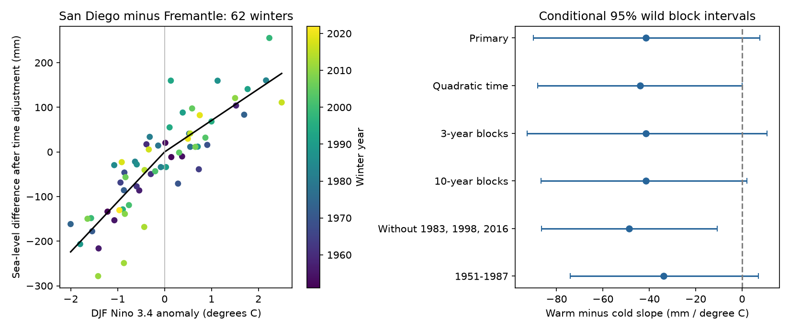

# Winter sea-level response asymmetry remained uncertain for San Diego minus Fremantle in 1951-2024

The primary test did not establish unequal warm and cold ENSO responses. In 62 complete winters, the fitted warm slope was 70.46 mm per degree C and the cold slope was 111.85 mm per degree C. The warm minus cold slope was -41.39 mm per degree C. Its conditional 95% interval was -90.05 to 7.65. This interval includes equal slopes. It does not show that the slopes are equal.

## Question and prior work

Mean coastal water level sets the base for tides and storms. A test of response symmetry can show whether one linear ENSO coefficient is an adequate summary. It does not give flood risk.

[Merrifield and Thompson (2018)](https://doi.org/10.1029/2018GL077666) used San Diego minus Fremantle sea level to study Pacific trade winds. Their study used annual levels and a pressure index, with a focus on slow changes. It supplies the site choice and the physical context for this test. [Ren et al. (2020)](https://doi.org/10.1029/2020JC016616) studied unequal sea-level responses in the western tropical Pacific. That regional result need not apply to these two coastal records. We test concurrent December-February levels against a temperature index, with an explicit slope comparison. We do not claim the first report of unequal ENSO responses or the first use of this gauge pair.

The [campaign forecast study](sci:sha256:930a0d10f6cec93dd1d38dd77d327bff857fbdec3f10ae12d24e5acd73c429d8) found uncertain gains from summer ENSO after local summer level was known. We read that publication for context. Our target, season alignment, data product, and estimand differ. We reuse a shared CPC source file but no prior code or fitted values. Searches are in `files/campaign_search.json` and `files/campaign_context_search.json`. Search results do not prove novelty.

## Data and quality rules

We used the PSMSL Revised Local Reference monthly archive dated 2026-10-19, stations 158 (San Diego) and 111 (Fremantle), and the fixed NOAA CPC ERSSTv5 Nino region file. The last column is the Nino 3.4 anomaly in degrees C relative to 1991-2020. These are retrospective products. No later ENSO product replaces this snapshot.

The exact shared source paths are:

- `/mnt/dell-data/shared_datasets/psmsl-rlr-monthly-20261019/rlr_monthly.zip`
- `/mnt/dell-data/shared_datasets/noaa-cpc-nino-regions-ersstv5-20261109-c15aaeaf/nino_regions.txt`

`files/input/provenance.json` records URLs, dates, byte counts, archive hashes, and member hashes. The code checked each source hash before export. The package contains both complete gauge members, their station notes, the source station list, archive date, and the complete CPC file. The shared archive is reused in place. No shared file was changed. The exact used member bytes permit offline analysis without the full archive. The source archive hash is `b22f65f5fcbc5021809f1d4eef279269f5e78a08bdc8d28aabd22adfe4dcf57e`. The CPC file hash is `bedcd0683c07f7ccb2ae358a90cb39d57413dcc8881027e0c30a1811f6d58012`.

PSMSL levels are in mm relative to local stable reference datums. These levels include land motion. The intercept absorbs the arbitrary difference between the two datums; the absolute difference is not an ocean height gradient. A common global signal can cancel in a difference, but local and regional signals remain.

A winter year denotes January. Winter 1951 is December 1950 through February 1951. Each mean gives the three months equal weight. Each gauge month must have level above -99990 mm, attention flag zero, and 0 to 5 missing days. The missing code is -99999; 99 missing days denotes interpolation. We reject such rows, do not fill gaps, and require all six gauge months. The ENSO mean uses the same three months. The scope was set to winters 1951-2024 before outcome fits.

Of 74 possible winters, 62 pass, with 29 positive and 33 negative index means. Excluded winters are 1959, 1963, 1966, 1967, 1975, 1976, 1980, 1997, 2000, 2021, 2023, and 2024. Thus the last accepted winter is 2022. The quality table preserves all candidate winters and exclusion fields. Missing records can cause bias if they depend on ENSO or water level. The station notes record reference changes and note the high early-1980s San Diego levels. This test does not audit benchmark stability.

## Method

The analysis plan is in `files/plan.md`. Let y be San Diego minus Fremantle winter level, x the concurrent Nino 3.4 mean, and t = (winter year - 1988)/10. We fit ordinary least squares:

`y = a + d*t + b*x + c*abs(x) + error`.

The warm slope is b+c and the cold slope is b-c. The primary contrast is 2*c. The curve is continuous at zero. Zero is the anomaly baseline; positive and negative values are not formal ENSO event classes. A cold slope describes increasing x on the negative side. It is not the sign of the sea-level change caused by a colder event. Units are mm per degree C throughout.

We use 9,999 wild residual draws. Each draw assigns a random sign to each five-calendar-year block. All residuals in a block share that sign. The boundary offset is selected at random from 0 to 4 each draw. Gaps keep their calendar spacing. We divide residuals by sqrt(1-leverage), keep the fitted design fixed, add signed residuals to the fitted levels, and refit. The basic interval is the original contrast minus the 97.5th and 2.5th percentiles of the fitted contrast deviations. Seed is 11072026 plus block length. Primary signs, coefficient deviations, design, residuals, and leverage are saved in `bootstrap.npz`.

The intervals are approximate and conditional on this design, model, source data, and block rule. They allow short dependence and unequal residual size, but do not cover arbitrary long dependence, model bias, source error, or index uncertainty. There are few independent blocks. One primary contrast was specified. Site fits and other checks are descriptive, with no family-wide significance claim.

## Results and sensitivity

| Check | Winters | Warm minus cold slope | Conditional 95% interval |
|---|---:|---:|---:|
| Primary | 62 | -41.39 | -90.05 to 7.65 |
| Quadratic time | 62 | -43.90 | -88.16 to 0.06 |
| Three-year error blocks | 62 | -41.39 | -92.59 to 10.85 |
| Ten-year error blocks | 62 | -41.39 | -86.68 to 2.17 |
| Remove 1983, 1998, 2016 | 59 | -48.64 | -86.57 to -10.74 |
| 1951-1987 | 30 | -33.74 | -74.03 to 7.13 |
| 1988-2024 | 32 | -58.86 | -140.06 to 21.27 |
| Require zero missing days | 55 | -24.60 | -74.56 to 25.52 |

The primary warm slope interval was 42.19 to 98.69. The cold slope interval was 80.75 to 141.96. Both slopes are positive under this model. Their difference remains uncertain. The primary residual root mean square is 54.70 mm. The scatter plot removes the intercept and fitted time term only. It retains the fitted ENSO terms and the residuals.

Every one-winter deletion keeps the contrast negative, from -54.70 to -30.12. This sign stability does not establish a nonzero population contrast. Removing the three large warm-event winters gives an interval below zero. It does not rescue the primary test: it changes support, fitted response, and error variance. The stricter missing-day check changes the point estimate toward zero. Evidence for asymmetry therefore depends on the selected winters and quality rules.

On the same 62 winters, the descriptive San Diego contrast is 9.79 (-15.24 to 35.08), while Fremantle is 51.18 (7.05 to 94.27). Their point difference equals the primary contrast by linear regression algebra. These are not independent tests. The Fremantle interval is pointwise and is not a separate confirmed finding.

## Interpretation and limits

The result gives a reproducible test of an equal-slope model for a known ocean index and gauge pair. The estimated departure is negative, but primary uncertainty includes zero. These data do not justify a fixed asymmetric response rule for this pair. They also do not validate equal slopes as a physical law.

ENSO winds, ocean wave travel, local pressure, circulation, and other climate modes can all affect levels. This regression has no wind, pressure, or ocean heat data. It cannot distinguish those explanations or show a change in ENSO physics. The hinge is set at one fixed temperature baseline. A different baseline, lag, season, or smooth response can give different results. A straight time trend may not remove slow regional changes or land motion; quadratic time is only one check. Split-period intervals are wide and do not test a difference between periods. The two gauges do not represent all Pacific coasts. This is neither a forecast evaluation nor a test of extremes, storm surge, flood counts, damage, or recovery. It does not establish an unexplained physical pattern.

## Reproduce and inspect

Use Python 3.12 with NumPy, pandas, and Matplotlib. Exact run versions and all input hashes are in `files/results/run.json`. No network access is needed for the numerical work.

1. Run `sci verify BUNDLE.zip --json`, then extract the verified ZIP.
2. Run `OPENBLAS_NUM_THREADS=1 python files/analyze.py --out /absolute/new-results`. The input defaults to the bundled `files/input`. One BLAS thread is sufficient for these small matrices; it is not a campaign limit.
3. Run `OPENBLAS_NUM_THREADS=1 python files/audit.py` in a writable extracted copy. It checks the stored evidence using explicit month keys and normal equations.
4. Compare the new CSV and JSON files with `files/results/`. The repeat had identical tables and bootstrap signs. Floating point bootstrap deviations can differ with the BLAS thread count; the repeat record gives the maximum difference. Image and ZIP container bytes can vary by library version. The included repeat record compares numerical arrays and tables.

To export again on the campaign host, run `python files/export.py --store /mnt/dell-data/shared_datasets --out /absolute/new-input`. The exporter rejects mismatched raw hashes. To retrieve a missing source, use the commands in `files/retrieve.sh`; they use the locked dataset helper. A live URL may have changed. Do not replace a shared dataset to bypass a hash mismatch. The bundled members and CPC file remain sufficient to reproduce this result.

The separate audit checked raw monthly means, time alignment, accepted quality flags, normal-equation coefficients, all 9,999 primary coefficient draws, and the interval endpoints. Maximum coefficient deviation from the main code was below 2.5e-13 mm. This is a same-worker numerical check, not outside review.

## Campaign, provenance, and rights

Job: `sci-1107-dell-earth-and-ocean-sciences-cba5cc1f18d6`. Topic: `earth-and-ocean-sciences`. Campaign: `11_07_2026`. Machine: `dell`. Account: `codex-andrii`. Model: `gpt-6.1-sol`, high reasoning effort, through the Codex harness in T3 Code. One worker performed this investigation without child agents. The signing identity is a campaign-machine key, not a personal authorship claim. Private keys are outside the package. This publication is saved locally only.

The baseline license covers the text, code, figures, and derived evidence. PSMSL and its data suppliers retain source attribution. We cite [Holgate et al. (2013)](https://doi.org/10.2112/JCOASTRES-D-12-00175.1) and PSMSL (2026), as requested. NOAA CPC supplies the index data. Cited papers are not included or relicensed.
