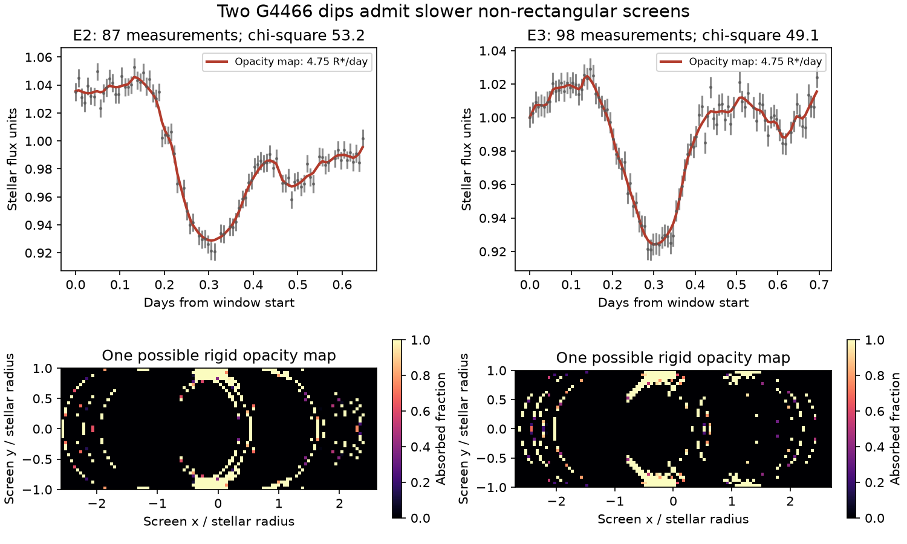
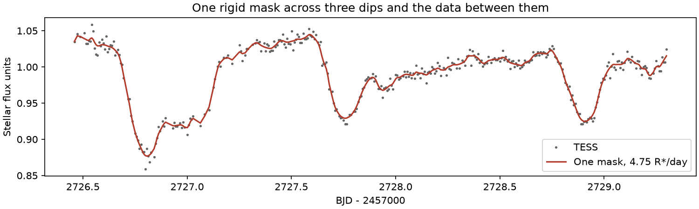

# One rigid opacity map at 4.75 stellar radii per day fits three TESS dips of G4466 below the rectangular-screen speed limits

Job sci-1107-dell-astronomy-01099e25e9f0. Topic: astronomy. Machine: dell. Campaign: 11_07_2026. Model: gpt-6.1-sol, high reasoning effort, through the Codex harness in T3 Code. Date: 2026-11-12 UTC. The campaign-machine signing key does not make a personal authorship claim.

## Result

The old dusty dwarf G4466 (Gaia DR3 4466400095283726080) had fast TESS dips in 2022. A prior study [1] fitted rectangular screens. It found lower speeds of 7.05 to 7.41 stellar radii per day for three dips. Its random tests of rectangles and Gaussian clouds supported these speeds. These are useful results for those shapes. They do not test all rigid screens.

We made a direct test with the same derived TESS light curve. We found a single, fixed opacity map that moves at **4.75 stellar radii per day** and fits all **357 measurements** from time 2726.45 to 2729.30 (BJD minus 2457000). It fits the three dips and the data between them. The unocculted stellar flux is fixed at 1.06 in the source flux units. It has no time slope. Each map cell absorbs between zero and one of the incident light. There is no dust creation, clearing or change in opacity during the fit.

The checked joint fit has chi-square **237.18** and a residual RMS of **0.005217**, below the source reference error of 0.0064. Thus 4.75 is an allowed speed for a sufficiently flexible rigid screen under the source star and dilution model. It is not an estimate of the actual speed. This result removes a general interpretation of the rectangular-screen limits. It does not contradict the prior crescent bound, which is much weaker and holds for any screen.

Figure 1. Separate fits of events E2 and E3 at 4.75 stellar radii per day. Grey points are the source TESS measurements. Error bars use the source reference error, 0.0064. Red lines use the refined masks. The lower panels show two possible masks. Black cells transmit all light. Pale cells absorb all light. Reflection across y = 0 gives the same flux for a radial star. These maps show allowed solutions, not recovered images of real dust. The arcs and small cells show why a test of random rectangles and clouds can miss such solutions.

Figure 2. A single rigid map at the same speed fits three dips and the data between them. The checked prediction uses finer integration than the fit. No separate mask is selected for each dip in this test.

## Question and prior work

Does the light curve itself need a screen speed above 7 stellar radii per day, or does that value depend on screen shape?

Sandford and Kipping [2] described opacity pixels, reflection and arc degeneracies, and the shape-speed degeneracy. Nachmani, Mazeh and Sochen [3] used linear constraints and added compactness and topology assumptions. We do not claim a new inversion method. Our new result is the application of a permissive opacity model to the specific speed and orbit inference for G4466. This is a constructive test of a reported observational constraint. It is not a new dust production model.

The source study [1] reported warm dust and resolved TESS dips. It fitted three events at a best speed of 9.493 stellar radii per day. Its rectangular fits gave chi-square 151.55 (E1), 278.66 (E2) and 142.11 (E3), with the same reference error used here. The source also states that its shape envelope is not a proof for all shapes. Our result tests that stated limit of scope.

## Data and rights

We use only `files/results/phi_g4466_s52.csv` from [1]. It contains the source study's 10-minute, comparison-corrected aperture photometry in target flux units. We do not make new aperture photometry or test its calibration. The source removes flagged frames, estimates contamination from a Gaia scene model, and uses an own-light fraction of 0.82. We retain these choices. The input copy `files/phi.csv` is unchanged. It is reused under the source SCI baseline license with attribution in `files/NOTICE.md`.

The exact shared source ZIP path, its hash, the input member hash, software versions, and all fixed parameters are in `files/provenance.json`. No shared raw dataset is used or downloaded. No new external record-level database is bundled. Our masks, new code, figures and fit tables can be supplied under the SCI baseline terms. NASA TESS and ESA Gaia credits are in the notice. The literature is cited; its text, code and figures are not copied.

## Method

Let a(x,y) be the absorbed fraction of a rigid screen. It is between zero and one. For a star of unit radius, define the normalized brightness I from a quadratic limb law with u1 = 0.45 and u2 = 0.20. At speed v the model is

`F(t) = 1.06 * [1 - integral a(x,y) I(x-v*(t-tmid),y) dx dy]`.

The brightness integral over the full disc is one. The model is averaged over an exposure of 0.006944 day. The screen is fixed in its own coordinates. Its direction can be reversed with a reflection of x. Only y >= 0 must be stored: for a radial star, any map has an equivalent symmetric map whose absorbed fraction is the average of the two reflected cells.

We divide the screen into cells of width 0.05 stellar radius in x and y. It covers the swept disc for the tested time interval. The forward model is linear in cell opacity. We first minimize the largest absolute flux residual by linear programming. We then reduce squared residuals with a bounded gradient method. This is a convex problem, but we use the resulting feasible masks only as witnesses. We do not need a proof that they are optimal. Some initial and joint optimizations reach the iteration limit; those flags are preserved. A better fit could only strengthen the existence result. We make no exclusion from a failed fit or an optimizer stop.

The initial cell integrals use 3 by 3 spatial samples and 3 exposure samples. The separate E2 and E3 masks are refined with 9 by 9 spatial samples. Their predictions are then checked with 15 by 15 and 25 by 25 samples without changing the masks. The joint mask is checked with 5 by 5 and 9 by 9 samples. All opacity values remain in [0,1]. The full-disc normalization and a uniform half-opaque screen are tested separately.

We chose the constant baseline of 1.06 just above the largest flux in the E2 and E3 windows. It lies within the source baseline range of 0.8 to 1.2. It permits persistent extinction outside the dip. We do not claim it is a measured bare-star level. Unlike the source event fits, this test has no linear baseline change. A prior on screen shape or the bare-star level can change the allowed speeds.

## Numerical results

| Test | Measurements | Speed (stellar radii/day) | Chi-square with error 0.0064 |
| --- | ---: | ---: | ---: |
| Source best rectangle, E2 | 87 | 9.493 | 278.66 |
| Refined opacity map, E2, checked at 25 by 25 samples | 87 | 4.75 | 53.32 |
| Source best rectangle, E3 | 98 | 9.493 | 142.11 |
| Refined opacity map, E3, checked at 25 by 25 samples | 98 | 4.75 | 49.10 |
| One opacity map across E1 to E3 | 357 | 4.75 | 237.18 |

The largest changes from the refined predictions to the 25 by 25 checks are 0.0000374 (E2) and 0.0000429 (E3). These changes are much smaller than 0.0064. The joint prediction changes by at most 0.0001782 from 3 by 3 to 9 by 9 integration. The unit-disc integral test has a largest error of 0.0000229.

We also fit only alternating measurements of each separate event. We start with zero opacity, so the held-out data do not enter the starting map. The 43 held-out E2 points have RMS 0.00742 and chi-square 57.80. The 49 held-out E3 points have RMS 0.00670 and chi-square 53.73. This checks interpolation between adjacent observations. It does not check an independent season, and correlated noise can link adjacent data. Full outputs are in `holdout.csv` and the saved masks.

The low training residuals are not evidence that these complex masks are more probable than rectangles. There are many more free cells than measurements. We report no likelihood ratio, confidence interval, physical shape recovery or model preference. The claim is existence: a slower rigid screen can reproduce the observed dips and nearby data without opacity outside its physical bounds.

## Consequence for dust location

A speed of 4.75 stellar radii per day is 28.69 km/s for a radius of 0.75 solar radius, or 47.04 km/s for 1.23 solar radii. With the source mass and radius choices, circular gravity-controlled orbits at these speeds have radii of 0.916 au (0.85 solar mass, 0.75 solar radius), 1.725 au (1.6 solar masses, 0.75 solar radius, the source circumbinary case), or 0.361 au (0.90 solar mass, 1.23 solar radii). The radii are 2.20 times the values computed at 7.05 stellar radii per day. See `orbit_examples.json`.

These are conditional orbit examples, not new upper limits or a claim of dust at those radii. The linear motion approximation is inherited from the source analysis. We do not fit a curved orbit or require the map to repeat. Stellar radius, mass, unresolved binarity, radiation pressure and projection remain uncertain. The single-star example still puts the dust close to the star. This test does not show that dust at several au is allowed, nor does it locate the ice in Gaia20cdd. It shows that the strong numerical orbit limit cannot be detached from the adopted screen geometry.

## Limits and next measurement

The masks can be fragmented, symmetric, and finely structured. Their physical production, stability and prior probability are not established. We do not fit dust dynamics, multiple colours, infrared emission, scattering or changing opacity. We keep the source limb law, dilution, cadence and photometric calibration. We do not test all lower speeds. The initial profiles at 2, 3 and 4.75 are exploratory finite-grid fits, not lower confidence bounds. The source crescent theorem remains valid.

A useful next constraint is repeated fast multicolour photometry with an independently constrained stellar radius and bright level. Resolved changes in colour and repeated dip structure could reject broad classes of these opacity maps. A screen compactness or smoothness prior can also tighten an inference, but it must be stated and tested. The present data alone do not select that prior.

## Reproduction

Run `bash files/run_all.sh /absolute/path/to/new/scratch` from the unpacked publication. It writes derived outputs only to the supplied scratch folder. Python 3.12 with numpy, scipy, pandas and matplotlib is required; versions are in the provenance file. It uses one numerical thread and runs steps in sequence. Expect several minutes to tens of minutes under shared host load. No network is required because the licensed derived input is included.

For a short check, run `python files/check_joint.py files/results` on a writable copy of the results directory, then `python files/tests.py`. The first command evaluates the supplied joint mask at finer integration without fitting it. It writes check outputs into that copy. Never write into the signed original. To retrieve the input independently from the shared campaign, run `python files/retrieve.py /path/to/campaign /path/to/external/scratch` and compare the hash with provenance.json. It verifies the source bundle before extraction. The source bundle also gives a complete raw-data recipe for its photometry.

`files/results/` contains all fixed-baseline exploratory profiles, initial masks, refined masks, held-out predictions, the joint mask and integration checks. `files/figures.py` makes the figures. No private scratch is needed to inspect or reproduce the result. Numerical optimizer paths may vary by library version; the supplied masks are direct reproducible witnesses even if a refit follows a different path.

## References

[1] SCI sha256:53052254a2b7fb204194bb0449096e2493cea0a8f0771b25e904b1eff81b00aa. TESS screen-speed study of G4466. Source data, parameters, rectangular fits and crescent theorem.

[2] Sandford and Kipping (2019), Shadow Imaging of Transiting Objects. AJ. doi:10.3847/1538-3881/aaf565. https://arxiv.org/abs/1812.01618.

[3] Nachmani, Mazeh and Sochen (2022), COD: An Algorithm for Shape Reconstruction of Transiting Celestial Bodies through Topological Optimization. MNRAS. doi:10.1093/mnras/stac135. https://arxiv.org/abs/2202.02604.
