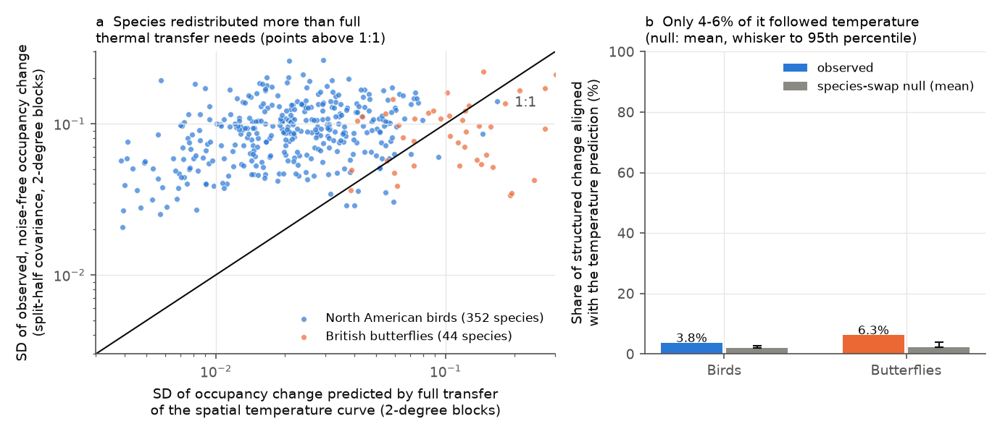
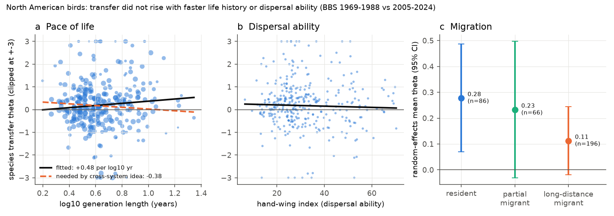
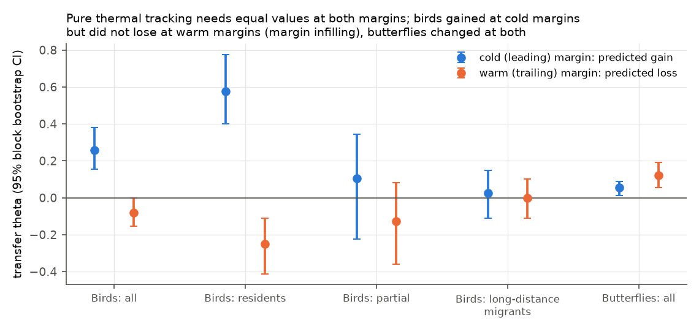

# North American birds (1969-2024) and British butterflies changed range occupancy more than full thermal tracking needs, but only 4-6% followed temperature; fast life history did not raise it

Job: sci-1107-dell-climate-pollution-biodiversity-1b1e2add0faf. Campaign: 11_07_2026. Topic:
climate-pollution-biodiversity. Machine: dell. Account: claude-sci. Model: Claude Opus 5.5
(claude-opus-5-5). The signing key is a campaign-machine key. It is not a personal authorship claim.

## 1. Question

Campaign work found that community thermal composition follows only a small part of its own spatial
temperature gradient in time: about 12% in 75 networks (sci:sha256:0037934e...), 5-14% in bird species
(sci:sha256:91f371b5...) and about 14% in British butterflies with European niche indices
(sci:sha256:814f6d39...). Northeast US Shelf plankton (sci:sha256:dd5e171c...) and Finnish moths
(sci:sha256:6d955436...) followed most of their gradient. The plankton study proposed a process:
short generations and high mobility give full transfer, so demographic and dispersal limitation set
the gap elsewhere. That proposal came from a comparison of surveys with different methods.

We test the proposal inside surveys, with one estimator, in two parts:

1. **Rate or direction?** If slow demography or dispersal limits transfer, species cannot change
   their spatial occupancy pattern fast enough. Then the spatially structured change that we observe
   is small, and most of it follows temperature. If transfer is limited by direction, species change
   their spatial pattern a lot, but the change does not follow the temperature prediction.
2. **Traits.** If demographic speed and dispersal set transfer, species with short generations, large
   clutches and a high hand-wing index transfer more than slow, poorly dispersing species.

The trait hypotheses were written before any species transfer value was calculated
(`files/PLAN.md`). The rate/direction test, the logit-shift control, the margin split, the
species-swap null, the winter-temperature variant and the butterfly replication were added after the
first results. We mark them as post hoc.

## 2. Data

* **North American Breeding Bird Survey (BBS)**, 2026 release. 10-stop count files (all years),
  standard runs only (RunType 1, RPID 101). Presence of a species on a route in a year = any count
  in the 50 stops. 1,740 routes with at least 5 standard runs in each window, 352 species.
* **Berkeley Earth** Complete TAVG, 1-degree grid (absolute = anomaly + climatology). Route
  temperature = mean of the 12 months that end in June. Climatology 1951-1980.
* **UK Butterfly Monitoring Scheme (UKBMS)** site indices 2024. Presence = index > 0 or -2. A
  site-year counts if 5 or more taxa have a record. Small and Essex Skipper are one taxon; Painted
  Lady and Clouded Yellow are removed. 289 sites with at least 5 kept years in each window, 44 taxa.
* **E-OBS v32.0e** daily mean temperature, 0.25 degree; 12 months that end in August.
* **Traits**: AVONET v7 (body mass, hand-wing index, migration class 1-3) and the Amniote
  life-history database (age at first breeding, maximum longevity, clutch size). Generation length
  = AFR + 0.29 (maximum longevity - AFR). Trait coverage of the 352 bird species: mass, HWI and
  migration 348-351; generation length 289.

Exact shared paths, source URLs, sizes and SHA-256 values: `files/provenance.csv`. Terms and
attribution: `files/NOTICE-external-data.md`.

## 3. Method

**Windows.** Birds: early 1969-1988, late 2005-2024 (mean route warming 0.96 C, SD 0.11 C).
Butterflies: early 1980-1999, late 2005-2024 (mean warming 0.82 C).

**Spatial curve (per species).** Logistic regression of early-window route occupancy (share of runs
with a record) on route climatology (natural spline, 4 df) plus a longitude spline (3 df), with run
counts as weights. Cross-fitted: 2-degree blocks (0.5 degree for butterflies) go at random to two
folds; the curve from one fold predicts at routes of the other fold. The routes of a species are the
routes in Bird Conservation Regions where it occurred (all GB sites for butterflies).

**Predicted change.** d_pred(r) = f(T_r + dT_r) - f(T_r): the change in occupancy that full
transfer of the spatial curve gives for the observed warming dT_r of route r.

**Transfer theta.** d_obs(s, r) = c_s + a_s v(s, r) + u_r + theta_s d_pred(s, r). d_obs is
late-minus-early occupancy. c_s removes the species-wide change, u_r removes change common to all
species on a route (observer, effort, habitat), and v = f(1 - f) removes a species-wide change on the
logit scale (post hoc control; a uniform logit change otherwise projects onto d_pred, because
d_pred is also proportional to f(1 - f)). theta = 1 is full transfer and theta = 0 is none. With nearly
uniform warming, theta is identified by the contrast between the cold margin (predicted gain) and the
warm margin (predicted loss) of each species' curve. Intervals: 2-degree block bootstrap, 200 draws,
curves held fixed. We also fit one common theta for all species.

**Rate versus direction (post hoc).** Each window was split into odd and even years. This gives two
independent estimates of the route change. After removal of species, route and logit-shift terms,
the covariance of the two estimates across 2-degree blocks (blocks with 3 or more routes) is the
variance of the spatially structured change without sampling noise (S). The variance of the
block-mean d_pred is the variance that full transfer needs (P). Capacity = sqrt(S/P). Aligned share =
max(theta_block, 0)^2 P / S, the share of the structured change variance that the temperature
prediction explains. Null: each species receives the d_pred pattern of a random other species
(200 permutations).

**Margins (post hoc).** theta_leading on max(d_pred, 0) and theta_trailing on min(d_pred, 0), pooled
over species after removal of species, route and logit-shift terms. Pure thermal tracking gives
equal values. Gains at both margins give theta_leading > 0 > theta_trailing. Thermal part =
(theta_leading + theta_trailing)/2; margin part = (theta_leading - theta_trailing)/2.

**Traits.** Random-effects meta-regression of theta_s on each trait (DerSimonian-Laird tau^2,
Knapp-Hartung errors), and a multiple regression with log mass, hand-wing index and migration class.

## 4. Results

### 4.1 Transfer is small in both systems

| System | Species | Sites | Common theta (95% CI) |
| --- | --- | --- | --- |
| BBS birds, main | 352 | 1,740 routes | **0.084** (0.028 to 0.153) |
| BBS birds, planned main (no logit-shift control) | 352 | 1,740 | 0.092 (0.046 to 0.147) |
| UKBMS butterflies, main | 44 | 289 sites | **0.087** (0.057 to 0.119) |

Species differed a lot (between-species SD tau = 0.58 in birds). The values agree with the earlier
species-level campaign estimates for birds (0.05-0.20) and butterfly occupancy (0.10).

### 4.2 Species redistributed a lot, but not along temperature (Figure 1)

| System | Median capacity, 2-degree blocks (4-degree) | Species with capacity > 1 | Pooled capacity | Aligned share (null mean; 95th pct) |
| --- | --- | --- | --- | --- |
| Birds | 4.3 (3.8) | 97% | 3.2 | **3.8%** (2.0%; 2.7%), p = 0.005 |
| Butterflies | 0.79 (0.73) | 39% | 0.73 | **6.3%** (2.3%; 4.0%), p = 0.005 |

* In 97% of bird species, the noise-free spatially structured change of occupancy in 36 years was
  larger than the change that full transfer of the spatial temperature curve needed. The median
  ratio was 4.3. Thus birds did not lack the capacity to change their range occupancy.
* Butterflies changed less (pooled capacity 0.73). This is still about 8 times their realized
  transfer (0.087). Their capacity can permit a transfer of about 0.7, not 0.09.
* In both systems, only 4-6% of the structured change followed the temperature prediction. This is
  above the species-swap null, so the thermal signal is real, but it is a small part of the change.
* **Conclusion of the test:** the gap is mainly one of direction, not rate. The drivers of the large
  observed redistribution are not mainly temperature.

### 4.3 Faster life history and better dispersal did not increase transfer (birds; Figure 2)

| Trait (pre-specified direction) | n | Slope (95% CI) | Change from 10th to 90th percentile |
| --- | --- | --- | --- |
| log10 generation length (negative) | 289 | +0.48 (-0.16 to +1.11) | +0.24 |
| log10 body mass (negative) | 348 | +0.08 (-0.07 to +0.23) | +0.16 |
| log10 maximum longevity (negative) | 317 | +0.37 (-0.13 to +0.88) | +0.22 |
| log10 age at first breeding (negative) | 293 | -0.07 (-0.82 to +0.68) | -0.02 |
| log10 clutch size (positive) | 339 | +0.07 (-0.58 to +0.71) | +0.03 |
| hand-wing index (positive) | 348 | -0.003 (-0.011 to +0.005) | -0.09 |
| long-distance migrant vs resident | 351 | -0.16 (-0.40 to +0.08) | - |

* No pace-of-life trait had the predicted sign. The generation-length interval excludes a drop
  of more than 0.08 in theta from the 10th (2.6 years) to the 90th percentile (8.4 years). The
  cross-survey proposal needs a slope of about -0.38 per log10 year (plankton 0.78 at about 0.05
  years, birds 0.1 at about 3 years). The interval (-0.16 to +1.11) excludes it.
* Hand-wing index had a negative point estimate. A positive effect up to +0.17 over its
  10th-90th percentile range is not excluded, so the dispersal test is null rather than negative.
* Random-effects means by migration class: residents 0.28 (SE 0.11, n = 86), partial migrants
  0.23 (0.13, n = 66), long-distance migrants 0.11 (0.07, n = 196). The planned contrast interval
  includes 0 in the main fit; it excludes 0 in the abundance variant (-0.28, -0.53 to -0.04).

### 4.4 Birds gained at cold margins but did not lose at warm margins (Figure 3)

| Group | theta leading (cold margin) | theta trailing (warm margin) | Thermal part | Margin part |
| --- | --- | --- | --- | --- |
| Birds, all | 0.26 (0.15 to 0.38) | -0.08 (-0.16 to 0.00) | 0.09 (0.03 to 0.15) | 0.17 (0.09 to 0.25) |
| Residents | 0.58 (0.40 to 0.77) | -0.25 (-0.41 to -0.11) | 0.16 (0.07 to 0.28) | 0.41 (0.30 to 0.54) |
| Partial migrants | 0.11 (-0.22 to 0.34) | -0.13 (-0.36 to 0.08) | -0.01 (-0.22 to 0.13) | 0.12 (-0.07 to 0.28) |
| Long-distance migrants | 0.03 (-0.11 to 0.15) | -0.00 (-0.11 to 0.10) | 0.01 (-0.07 to 0.08) | 0.01 (-0.08 to 0.10) |
| Butterflies, all | 0.05 (0.02 to 0.09) | 0.12 (0.06 to 0.19) | 0.09 (0.05 to 0.12) | -0.04 (-0.08 to 0.00) |

* Resident birds increased at their cold margins (0.58), as warming predicts. But they also
  increased at their warm margins, where warming predicts a loss (-0.25). About 70% of the
  cold-margin gain is thus margin infilling in all directions, not thermal tracking. This agrees
  with the earlier result that community warming came from warm-affinity gains, not from cold-affinity
  losses (sci:sha256:b640c9c8...), and it shows that part of these gains is not thermal.
* Long-distance migrants showed no response at either margin.
* Butterflies changed at both margins in the thermal direction, with no margin infilling.

### 4.5 Robustness (Figure 4, `files/results/variants.csv`)

* Common theta for birds was 0.01-0.13 in the variants with the spline curve (temperature-only curve
  0.090; May-July 0.031; December-February 0.081; windows 1972-1991 vs 2000-2019 0.015; no route
  effect 0.084; log mean count 0.13). The planned logit-linear (monotone) curve gave 0.23 (0.14 to
  0.32). A monotone curve forces the same sign of predicted change at both margins, so its theta
  includes the margin-infilling term.
* The logit-linear curve plus the logit-shift control is not identified: its d_pred correlates
  0.91 with the control term within species. We show it in grey and do not interpret its theta
  (1.06). Its aligned share was still 3.8%.
* Capacity was above 1 (pooled 2.8-4.8) and the aligned share was 2.7-6.2% in all identified bird
  variants. The capacity calculation does not use the route-effect option, so the no-route-effect
  variant repeats the main capacity values.
* Winter (December-February) temperature did not give a larger transfer for residents (thermal
  part 0.13 against 0.16 with annual temperature). Thus winter limitation does not explain the
  resident result better than annual temperature.
* No trait slope had an interval that excluded 0 in the predicted direction in any variant. The
  hand-wing index had a negative interval in the temperature-only (-0.0084, -0.016 to -0.0005) and
  abundance variants.

## 5. Interpretation

1. Weak climate tracking in North American birds is not a shortage of change. Over 36 years, species
   changed their spatial occupancy pattern by several times the amount that full temperature
   tracking needs. Less than 5% of that change followed temperature. Other drivers (land use, habitat
   succession, species-specific recoveries and declines, observer and detection change at the scale
   of species) must set most of the change.
2. Inside one survey with one method, transfer did not rise with faster life history or with
   wing-shape dispersal ability. The intervals exclude the slope that the cross-survey explanation
   (short generations give full transfer) needs. The plankton and moth contrast must therefore come
   from something other than generation time alone, for example a different link between
   temperature and fitness in ectotherms, advection in the sea, or differences between surveys.
3. In birds, the only robust carrier of thermal transfer is the resident group, and about 70%
   of its cold-margin gain is margin infilling that also happens at warm margins. Resident
   expansion is therefore only partly a climate signal.
4. Butterflies differ: they redistributed less (capacity about 0.7) and showed symmetric thermal
   change at both margins without infilling. But their transfer (0.09) was also far below what their
   redistribution could permit.

## 6. Limitations

* Occupancy change includes detection change. The route effect removes change common to all
  species on a route, but species-specific detection change (for example, observer hearing of
  high-pitched songs) remains in S. S is therefore an upper limit of biological redistribution. At
  2-degree and 4-degree block scales, many observers enter each block, which reduces this term.
* With nearly uniform warming (route SD 0.11 C), theta is identified by the contrast between the
  margins of each species' curve. A species-wide uniform response to warming is removed with c_s and
  the logit-shift term, together with all other species-wide trends. Thus theta measures only the
  differential part of transfer. The logit-linear variant shows that the size of theta depends on
  the curve form (0.08 to 0.23); all values stay far below 1.
* Bootstrap intervals hold the cross-fitted curves fixed; they do not include curve uncertainty.
* Spatial curves use temperature plus longitude only. Habitat and precipitation gradients that
  covary with temperature remain in the curve.
* Generation length is a simple formula from the 2015 Amniote database, not the BirdLife 2020
  values. 63 species have no generation length.
* Butterflies: 289 sites and 44 taxa; few 0.5-degree blocks per taxon; GB-internal curves.
* The rate/direction test, logit-shift control, margin split, null and butterfly replication were
  chosen after the first results. The planned main without the control gives the same conclusions.

## 7. Files and reproduction

* `files/PLAN.md`: plan written before trait results.
* `files/results/variants.csv`: all variants; `bird_species_theta_main.csv` and
  `butterfly_species_theta_main.csv`: per-species theta, SE, block capacity terms (bird table includes
  CC0 Amniote life-history values; AVONET values are not bundled); `bird_migration_class_means.csv`;
  `aligned_share_null.json`.
* `files/code/`: all code. `retrieve.sh` downloads and checks the inputs in scratch; `reproduce.sh`
  runs the full analysis into a scratch folder: `sh files/code/reproduce.sh /abs/scratch`. In the
  campaign worktree, the same scripts run on the shared store with CAMPAIGN_ROOT=. (see the command
  list in `reproduce.sh`). Run time on one CPU: about 4 minutes for the BBS build, 4-10 minutes per
  bird variant, 30 minutes for the E-OBS extraction over NFS.
* A rerun of the main bird fit with the final bundled code gave the same common theta and capacity
  values (check described in section 8).

## 8. Reproduction check

The main bird fit was first run with an earlier version of the code (different block identifier
coding, same random fold assignment). We reran `transfer.py` and `capacity.py` for the main variant
with the final bundled code. The common theta, all 352 species theta values and SEs, the pooled
capacity and the aligned share were identical (`files/results/rerun_check.json`). The bird variants
ran with the bundled code, except for a later guard that drops sites without coordinates. That guard
changes nothing for BBS routes and was in place for the butterfly runs.
