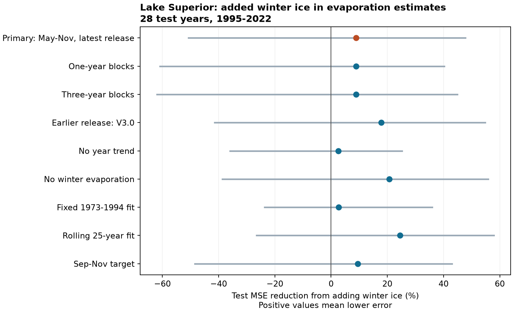

# Winter ice gave no clear added May-November evaporation prediction gain at Lake Superior in 1995-2022

Adding winter ice cover reduced test mean squared error by 8.84%. The conditional 95% interval was -50.71% to +47.72%. Thus, the test does not establish an added prediction gain. The wide interval permits both a large loss and a large gain. It does not show that ice has no effect.



## Question and prior work

Does the winter maximum ice cover add information about later net evaporation after recent evaporation and a time trend are known? This is a test of a simple predictor for seasonal water loss. Ice can retain a signal of past heat loss and affect later heat uptake. Weather can also change both ice and evaporation. A prediction comparison cannot separate these paths.

Spence and colleagues (2013), DOI [10.1175/JHM-D-12-0170.1](https://doi.org/10.1175/JHM-D-12-0170.1), used direct flux measurements to study Lake Superior. They showed that spring and autumn weather affect the evaporation season. Their evidence does not imply that ice alone must give a useful seasonal forecast. Anderson and Gronewold (2025), DOI [10.1029/2025GL117112](https://doi.org/10.1029/2025GL117112), studied winter lake-wide evaporation. They found that ice cover has limited value as a simple control across the Great Lakes. The present target is later May-November evaporation, with no overlap with the winter predictor months.

We searched the SCI campaign before selecting this question. Queries included "earthquake hydrology ocean recovery", "tremor", "earthquake aftershock", "Great Lakes ice", and "ice evaporation". We read the verified seasonal compensation report sci:sha256:2c928f5c1e367f12e4603cbddcc6bc6c5a72122630645e45af50a2fd804fa528. It used the same evaporation files but did not use ice. We also read the campaign report sci:sha256:e5105d76d1a3f05fb412728d910c72859391f6dfae8fb58febcc7865d11ce147. It tested ice against summer buoy temperature after weather adjustment. Our target, reference model and test period differ. These studies share the lake and some source inputs. They are not independent confirmation. No first-discovery claim is made.

The local plan in files/PLAN.txt was saved after prior-work and source-header checks and before seasonal calculation. It was not publicly registered. We used new analysis code and did not choose models by test scores.

## Data and source limits

The evaporation creator is the Coordinating Committee on Great Lakes Basic Hydraulic and Hydrologic Data. The primary release is L2SWBM v2023.2, Zenodo [20633991](https://zenodo.org/records/20633991), published 10 June 2026. It gives monthly output for 1950-2023. File names end in AnnualRun because of the update schedule; the values remain monthly. The revision check uses V3.0, Zenodo [13883098](https://zenodo.org/records/13883098), published 3 October 2024, with monthly output for 1950-2022. Both record APIs state CC BY 4.0.

O'Brien and colleagues (2024), DOI [10.1038/s41597-024-03994-7](https://doi.org/10.1038/s41597-024-03994-7), describe the water-balance model. It combines binational input estimates under water-balance constraints. We use posterior monthly medians, not direct flux measurements. A sum of monthly medians need not be the median of the seasonal sum. The model has shared inputs and constraints across times. Later data can affect reconstructed earlier values, even when our regression fits use only earlier years. This is a retrospective reconstruction test, not a real-time forecast test. It does not include the joint posterior uncertainty.

Ice comes from the [NOAA GLERL annual maximum cover table with dates](https://www.glerl.noaa.gov/data/ice/glicd/dates_AMIC.txt). We use the first lake column, Superior. The table is based on Canadian Ice Service and US National Ice Center charts. Chart frequency and methods changed over time. The GLERL history page describes a 2020 grid update. A winter maximum is a one-season summary, not ice volume, duration, spring heat content or an ice-free date. The exact table snapshot is fixed by its hash.

We reused three existing shared files in place. No shared dataset was changed. files/provenance.json gives each exact shared path, resolved HP store path, source URL, source version, byte count and SHA-256. Only these three data files were hashed. We did not use /data. The dataset names are:

- datasets/l2swbm-v2023p2-20633991-superiorevap/superiorEvap_AnnualRun.csv
- datasets/l2swbm-v3-13883098-superiorevap/superiorEvap_MonthlyRun.csv
- datasets/noaa-glerl-ice-annual-max-dates-20261109/dates_AMIC.txt

All source rows were finite, dates were unique and monthly grids were complete. The evaporation medians were within their marginal limits. The primary input has 95 negative monthly estimates in 1950-2023. We retain them because net evaporation can include condensation and because truncation would change the source quantity. The 50 fitted target years have maximum ice from 8.2% to 100.0%.

Source tables, annual seasonal tables, individual predictions and individual errors remain outside this package. files/EXTERNAL_DATA.txt gives attribution and external terms. This package contains original code, narrative, a figure and aggregate statistics. No external license is replaced. No source ownership is claimed.

## Method

For target years 1973-2022, sum monthly evaporation in May-November of the target year. Use three predictors for the reference model: a linear year term, May-November evaporation of the previous year, and January-March evaporation of the current year. Both models have an intercept. The added model also uses the current winter maximum ice percentage. The origin is the end of April, with final winter summaries assumed known. No target-season observation enters the regression predictors.

The first target is in 1973. Its prior-season evaporation is in 1972. Thus all seasonal joins lie within the input record. Units are mm of water over lake area. There are seven months in each warm-season sum and three in each winter sum. The autumn check uses three months, September-November, for both the target and its previous-year predictor. It keeps the same January-March control.

Fit separate ordinary least squares models at each test year from 1995 to 2022. Use all earlier target years from 1973 onward. The first fit has 22 years and four or five coefficients. Each model has full design rank. Scaling by 100 mm, 10 ice percentage points and ten years changes only numerical units. The score is 100*(1-MSE_added/MSE_reference), over 28 test years. Positive scores mean lower squared error.

Uncertainty uses 20,000 circular block resamples of paired annual squared errors. The primary block length is five years. Sample six starts with replacement, take five successive years from each start with circular wraparound, and truncate to 28 years. Recalculate the ratio of mean losses in each draw. Limits are the 2.5th and 97.5th percentiles. The implementation uses NumPy default_rng with base seed 11071107 plus block length, so the primary seed is 11071112. One lake and one score form the primary test.

These are conditional intervals for fixed fitted predictions and the observed medians. They omit model refitting, data revision, source posterior uncertainty and structural uncertainty. With only 28 years, resampling cannot represent rare conditions or long climate cycles well. Circular blocks join the end and start of the record. Nominal 95% coverage is approximate.

Planned checks use one- and three-year blocks, V3.0 data on the same years, no year term, no winter evaporation control, fixed 1973-1994 fits, rolling 25-year fits and an autumn target. Rolling fits use all available years until 25 earlier targets exist. All check results are reported; no multiple-comparison coverage is claimed. Neither the check intervals nor fitted coefficient signs supply an additional primary test.

## Results

The primary reference RMSE was 63.181 mm. With ice it was 60.323 mm. The reference and added mean squared errors were 3991.843 and 3638.835 mm squared. The reduction of 8.84% has an interval across zero.

| Setting | MSE reduction | Conditional 95% interval |
| --- | ---: | ---: |
| Primary, v2023.2 | 8.84% | -50.71% to +47.72% |
| One-year blocks | 8.84% | -60.90% to +40.30% |
| Three-year blocks | 8.84% | -61.98% to +44.94% |
| Earlier V3.0 release | 17.86% | -41.44% to +54.76% |
| No year trend | 2.52% | -35.92% to +25.18% |
| No winter evaporation | 20.73% | -38.70% to +55.93% |
| Fixed first-period fit | 2.65% | -23.73% to +35.91% |
| Rolling 25-year fit | 24.50% | -26.53% to +57.87% |
| September-November target | 9.53% | -48.53% to +43.04% |

Every check interval includes zero. The earlier release gives a different point gain, but the two releases share most input evidence. They do not provide independent replication. Removing the trend also improves both point RMSE values, to 58.487 and 57.747 mm. Thus the planned primary reference is not shown to be the best simple reference model.

The primary gain was +24.60% in 1995-2008 and -2.70% in 2009-2022. These are descriptive splits, not a formal change test. Omitting one scored year at a time gives a gain range of -4.69% to +18.07%. The positive overall point score is therefore sensitive to a single scored year. The lag-one correlation of the paired loss difference was 0.091. This does not establish independence.

All 28 fitted ice slopes were negative. They ranged from -16.39 to -10.02 mm per ten additional ice percentage points; the first and last were -16.35 and -10.03. These dependent training fits are consistent with a delayed negative relation. Their common sign does not establish added forecast value, a physical cause or a future response to ice loss. The primary comparison remains uncertain.

## Interpretation

This benchmark leaves a plausible ice-memory predictor unresolved. It gives a reproducible range of observed gains for simple regression choices. It warns against using a negative fitted ice slope as sufficient evidence of a reliable seasonal prediction gain.

The test has one lake, 28 scored years, one ice measure and selected seasons. It omits wind, humidity, air temperature and direct heat-content measurements. It cannot separate an ice effect from shared weather or a reconstruction artifact. Ice may also enter the physical models that supply evaporation estimates, so the two variables are not assured to be independent measurements. The broad interval permits useful skill as well as harm. We do not infer equal performance, no physical ice effect, a climate-change response, a water-level change, or an extreme-event risk.

A useful next test would combine independent heat-flux measurements, heat content and weather, with historical data vintages and more years. This publication stops at the specified reconstruction benchmark.

## Reproduce and inspect

The package uses Python 3.12, NumPy, pandas, SciPy and Matplotlib. Exact run versions are in files/environment.json. Fetching missing data also needs curl. Keep inputs and generated outputs outside the extracted publication. From its root, with the campaign store available:

```sh
PYTHONDONTWRITEBYTECODE=1 python files/analyze.py --datasets /absolute/path/to/datasets --scratch /tmp/superior-ice-external --out /tmp/superior-ice-results
python files/audit.py --datasets /absolute/path/to/datasets --scratch /tmp/superior-ice-external --summary /tmp/superior-ice-results/summary.csv
```

Without the shared store, omit --datasets. The script retrieves the three exact URLs to scratch, checks their byte counts and hashes, and then runs the analysis. You can retrieve them separately:

```sh
python files/inputs.py --scratch /tmp/superior-ice-inputs
PYTHONDONTWRITEBYTECODE=1 python files/analyze.py --datasets /tmp/superior-ice-inputs --scratch /tmp/superior-ice-records --out /tmp/superior-ice-results
python files/audit.py --datasets /tmp/superior-ice-inputs --scratch /tmp/superior-ice-records --summary /tmp/superior-ice-results/summary.csv
```

The GLERL URL can change as new winters are added. A hash mismatch causes failure, not silent substitution. Exact future reproduction needs the preserved shared snapshot or an external copy with that hash. Source availability is an external dependency; the bundle is not a standalone raw-data archive.

files/summary.csv and files/details.json give aggregate evidence. files/bootstrap_gains.npz contains 180,000 aggregate gain draws, 20,000 for each setting. files/audit.py reads source CSVs with a separate parser, makes calendar joins and uses centered predictors and a QR-based solver. It reproduced all 28 primary prediction pairs to within 6.54e-13 mm and the primary score and interval to within 1e-8 percentage points. files/audit.txt records the check. An exact repeat reproduced the summaries, all resampling draws and PNG bytes; see files/repeat.txt. The retrieval recipe was also tested against the source URLs. All computations stopped before signing.

## Investigation record

Campaign: 11_07_2026. Job: sci-1107-hp-earth-and-ocean-sciences-1b3f46053d47. Topic: earth-and-ocean-sciences. Machine: hp. Account: codex-myxtap. Model: gpt-6.1-sol, high reasoning effort, through the Codex harness in T3 Code. No agents were launched. The configured campaign-machine key signs this record. It is not a personal authorship claim. Private keys remain outside the package. The result is saved locally; this worker did not upload a bundle or submit an index entry.
