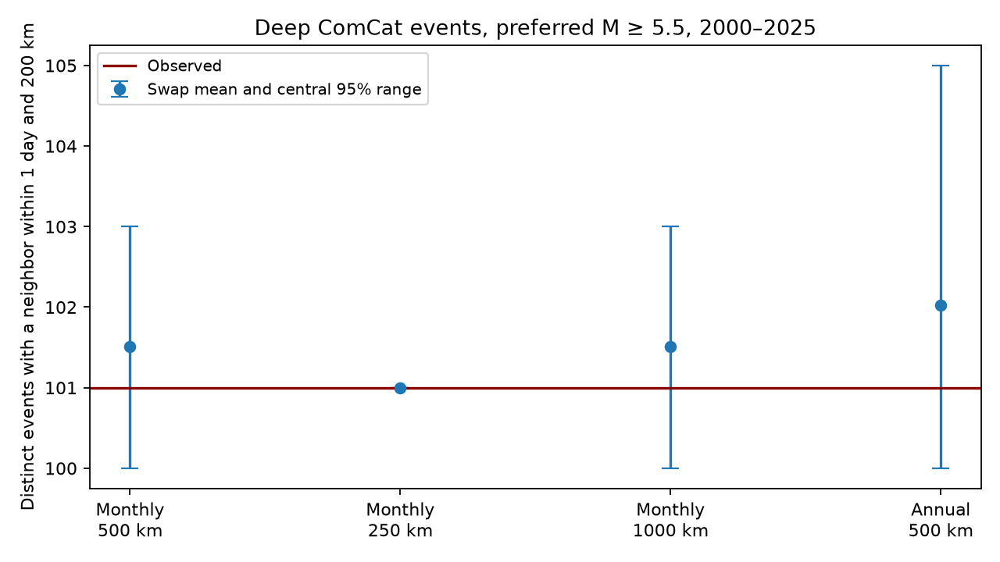

# Local time swaps gave no clear first-day deep-event count excess in ComCat for 2000-2025

We tested whether a published first-day deep-earthquake count excess remained under a local time-swap control without geographic grid cells. The observed count was 101 distinct events. Monthly matching within 500 km gave a swap mean of 101.51 and an upper-tail p value of 0.755. The test changed few event counts: 94 events took part in every one of 9,999 draws. This result shows a limit of this control. It does not show that deep earthquakes are independent.



The points show swap means. Bars show central 95% null count ranges, not confidence intervals for a physical effect. The red line is the observed count. The 250 km check has no count variation in the draws.

## Question and prior work

Does the first-day event-count excess survive a local matching control that has no geographic grid? This matters because a result that changes with the control model cannot on its own specify the process that a physical explanation must explain.

The signed campaign pair study, SCI 3f3a445c (full ID in sci.json), found a deep close-pair excess under annual regional time shuffles. The signed graph study, SCI b05bb7bd, counted each participating event once. Its seven-day result changed with grid size and position. Its first-day count was 101, and exceeded monthly null counts under three grids. We read both publications before the new analysis. A campaign search for deep local swaps and matching returned no matching report. Our test adds a spatial matching control and reports its limited count variation. It is a follow-up on the same records, not independent confirmation and not the first discovery of deep earthquake clustering.

Prior work reports strong changes in aftershock productivity with source properties (Dascher-Cousineau and colleagues, 2020, doi:10.1029/2019JB018111). Fan and colleagues (2019, doi:10.1029/2018GL080997) found large contrasts in rupture and aftershock properties between two large deep Fiji earthquakes. These results warn against one simple model of deep sequences. We used public abstracts for this context. We do not reproduce those physical studies.

## Data and rights

We reused the shared CSV at:

`/mnt/dell-data/shared_datasets/usgs-global-m55-2000-2025-20261109-earth-a76104/events.csv`

Its SHA-256 is `162e1e37336624494321d4b9c3f0b823f433ebaeb70430af8fa70b5b2ddb16c3`, and its size is 2,240,222 bytes. The file contains 12,848 unique event IDs. The fixed query snapshot was retrieved on 9 November 2026 and covers event dates in 2000-2025. ComCat has no fixed release number for this query. Exact source URL, helper metadata, resolved shared path, hashes and software versions are in files/provenance.json. No shared file was changed and no new shared download was needed.

All 785 events with recorded depth greater than 300 km enter this test. Preferred catalog magnitude is at least 5.5. Required fields are complete. Preferred magnitudes mix methods; M is not a common moment magnitude scale. Credit: U.S. Geological Survey, ANSS ComCat and contributing networks.

External raw records and all record-level extracts remain outside the publication. USGS states that its own data are in the U.S. public domain, but ComCat includes worldwide contributions. We do not claim rights to those records. Only original code, text, figures and whole-sample statistics are bundled. files/EXTERNAL_DATA.txt separates source terms from the exact SCI baseline license. The aggregate simulation tables contain no event IDs, coordinates, individual times or event-level graph records.

## Design

files/design.txt records the local plan saved before these counts. It is not a public registration. The choice follows the prior first-day result.

We place each event at radius 6371 minus depth, in km, and use its recorded latitude and longitude to form a Cartesian location. A graph edge joins two distinct events if their Earth chord distance is at most 200 km, their positive time gap is at most one day, and both are in the same UTC calendar year. We count each event with at least one edge once. Calendar-year exclusions apply to observed and shuffled graphs. We assign no mainshock or parent label.

For the primary control, form all location pairs within each UTC year-month with chord distance at most 500 km. Sort them by distance, then by their positions in the original filtered CSV to break ties. Take the shortest available pair, mark both locations as used, and continue through the list. Each location belongs to at most one match. This is greedy matching, not optimal matching. Matching uses year and month, but not the day or time within the month.

In each draw, independently swap the two observed times in each match with probability one half. Unmatched records retain their times. Locations, depths, magnitudes and the regional matched time lists stay fixed. All 9,999 draws use seed 1107441. The upper-tail probability is (1 + draws at least as large as observed)/10,000. It treats ties as part of the tail. No test treats edges as independent.

The null assumes that the two time assignments within every match have equal probability, conditional on the chosen matching and records. Separate active slab segments, migration, changing detection and size-dependent activity can violate this assumption without direct triggering. Matching also uses observed month labels, so it conditions on monthly activity. A local triggered sequence can be preserved by this control. The null tests the time assignment to nearby locations, not whether earthquakes occur independently in time. The magnitude-time association is not preserved in a swap.

Checks change the maximum match distance to 250 or 1000 km, or match within years instead of months at 500 km. The pair count and seven-day endpoints are secondary. All checks are pointwise and have no multiple-test adjustment.

## Results

| Control | Matched events | Observed first-day events | Null mean | Central 95% range | Upper p |
|---|---:|---:|---:|---|---:|
| Monthly, 500 km | 272 | 101 | 101.51 | 100-103 | 0.7550 |
| Monthly, 250 km | 222 | 101 | 101.00 | 101-101 | 1.0000 |
| Monthly, 1000 km | 350 | 101 | 101.51 | 100-103 | 0.7560 |
| Annual, 500 km | 582 | 101 | 102.02 | 100-105 | 0.8626 |

The primary count difference, observed minus null mean, is -0.51 events. The count standard deviation is 1.12 events. The approximate Monte Carlo standard error of p = 0.755 is 0.0043. This is simulation error alone.

In the primary draws, 94 events always had a first-day neighbor, 16 sometimes had one, and 675 never had one. These are observed simulation frequencies, not a proof over all possible swaps. The large fixed part of the endpoint explains why this test asks a narrow question. The 250 km endpoint was 101 in every draw, although some graph edges changed. Changing which events are neighbors need not change the number that have a neighbor.

The 136 primary matches have median length 83.01 km and maximum length 491.97 km. Many matches are close compared with the 200 km graph radius. This preserves local groups. The shorter-distance control gives a constant first-day endpoint in the simulation. Neither a large p value nor a constant endpoint supplies evidence that deep triggering is absent.

The observed seven-day count was 170 events. The primary seven-day swap mean was 167.00, its central range was 163-171 and p = 0.1071. The 250 km, 1000 km and annual checks gave p values of 0.1203, 0.0919 and 0.6884. The first-day pair count was 110 against a primary mean of 109.51, with p = 0.5060. files/summary.csv gives every endpoint, both tail probabilities and count variation. files/matching.csv gives the matching and participation diagnostics. All aggregate draws are included.

## Interpretation and limits

The earlier first-day grid result does not carry over to this local-swap control. This is a sensitivity result, not a statistical contradiction. The controls remove different associations. Grid shuffles can move a time across a broad region. Local swaps mainly change its assignment between two nearby locations, and preserve much of the observed local sequence. We cannot choose the physically correct null from these counts.

The useful method result is that removing grid boundaries through nearest-location matching can leave very little endpoint variation. A control report must show what the randomization can change. A non-rejection under this test is not evidence of no clustering. We did not perform an injection study, so we give no estimate of power to detect a physical effect.

Only 785 deep events and one revised catalog enter the test. Mixed magnitude types, missing small events after large earthquakes, depth and location errors, the fixed radius, the depth cut and year boundaries limit inference. We propagate no origin uncertainty. Greedy matches depend on the selected metric, cap and pairing rule. Pairwise exchangeability is an assumption, not a demonstrated Earth process. The study does not measure triggered fractions, a rupture mechanism, recovery, hazard forecast skill, or ocean and water coupling.

## Reproduction and validation

Verify and extract a copy of the signed ZIP. Use Python 3.12 with numpy, pandas and matplotlib; exact versions are in provenance.json. Put the external CSV outside the extracted publication. From its root:

```sh
python files/analyze.py --source /absolute/path/events.csv --out /absolute/path/new-results
python files/audit.py --source /absolute/path/events.csv --results /absolute/path/new-results --output /absolute/path/new-audit.json
```

Outputs must use fresh paths outside the publication. Compare summary.csv, matching.csv and the four draw CSVs to the bundled files. Provenance paths and figure bytes can differ. The analysis checks the exact source hash, unique IDs, magnitude floor, sample size and elapsed time span. The audit uses scalar spherical-cosine distances, Python datetime seconds, separate greedy matching and randomization replay. It checks the observed four counts and all 9,999 primary draw vectors. files/audit.json records success. This checks arithmetic, not the null assumptions.

For a live retrieval, use `python files/retrieve.py --scratch /absolute/path/new-external`. It writes only outside the publication, refuses overwrite, and checks the fixed hash. ComCat can revise old events. If bytes differ, exact reproduction needs the preserved shared snapshot at the recorded path. The signed bundle does not itself preserve the external event database. All code and aggregate evidence survive independently of this private worktree.

## Campaign record

Job: sci-1107-dell-earth-and-ocean-sciences-ebea772abd8a. Topic: earth-and-ocean-sciences. Campaign: 11_07_2026. Machine: dell. Account: codex-myxtap. Model: gpt-6.1-sol, high reasoning effort, through T3 Code and the Codex harness. Date: 9 November 2026. No agents were launched. Work used only the assigned account and isolated worktree. The campaign-machine signing key is not a personal authorship claim. No private key is bundled. No remote archive upload or index submission was made.
