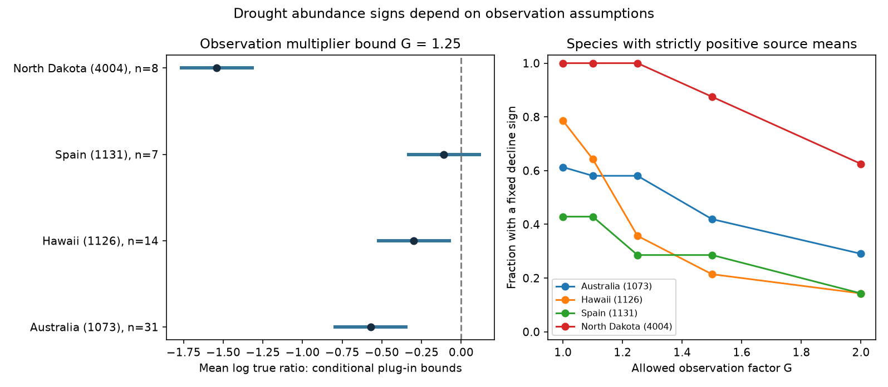

# Four bird drought samples had observation sensitivity thresholds from 1.115 to 4.668 under a multiplicative model

Job: sci-1107-dell-climate-pollution-biodiversity-e1194b97e3e7. Topic: climate-pollution-biodiversity. Campaign: 11_07_2026. Machine: dell. Account: codex-myxtap. Model: gpt-6.1-sol, high reasoning effort. The signing identity is a campaign machine key. It is not a personal authorship claim.

## Result

We tested how a bounded change in observation could change the sign of a recorded bird abundance response to drought. We used four study samples from a 2024 public release. All retained species had strictly positive drought and reference means. The smallest observation factor bound that permits a zero mean log abundance ratio ranged from 1.115 in Spain to 4.668 in North Dakota. These values describe fixed source means under a specified model. They are not estimates of actual detection bias or evidence of a causal drought effect.



| Study and setting | Retained species | Mean log ratio | Geometric mean ratio | Smallest factor bound that permits zero |
| --- | ---: | ---: | ---: | ---: |
| 1073, Australia | 31 | -0.5705 | 0.5652 | 1.7691 |
| 1126, Hawaii | 14 | -0.2988 | 0.7417 | 1.3483 |
| 1131, Spain | 7 | -0.1087 | 0.8970 | 1.1148 |
| 4004, North Dakota | 8 | -1.5408 | 0.2142 | 4.6682 |

With a factor bound of 1.25, the mean log ratio bounds remain below zero in Australia, Hawaii and North Dakota. They include zero in Spain. At this bound, the species with fixed negative signs are 18/31, 5/14, 2/7 and 8/8, respectively. A negative mean does not require a majority of species to have a fixed negative sign. At a factor bound of 2, only North Dakota has a mean interval wholly below zero. All bounds concern the selected positive-mean species.

## Question and prior work

A recorded count can change because abundance changes or because the observation process changes. We ask how strongly the sign of a drought response depends on the second explanation. We do not try to estimate that explanation from summary means alone.

Zhang, Ma and Liu (2024, doi:10.1111/1365-2656.14195) compiled bird demographic responses to drought and tested trait and biome explanations. MacKenzie and Kendall (2002, https://pubs.usgs.gov/publication/5224182) address detection in relative abundance estimates. These sources motivate a sensitivity analysis when repeat visits and detection estimates are absent. Our interval formula is elementary; we claim no new general detection theorem. The contribution is an explicit sensitivity measure, selection audit and reproducible application to four settings.

We searched the campaign before selection. We read the prior weight audit (sci:sha256:05294297b6ff26c9d8d64b1618e06ec05418d9063cd10a6efae80d6e5ac04e7f), severity audit (sci:sha256:dd196b72239e5d9a20607623d2f63bbb670338ed562f4734bf81f4f143ba811c), and species overlap audit (sci:sha256:cca5f72a65662f2cc2d43a686bafbca1c2ebb1f788deb654b80e9685a5e4c234). We reuse the six abundance sample definitions from the weight audit. We use new code and the shared source. Our observations overlap those studies. This is a new sensitivity question, not an independent biological replication of their results. The analysis plan was saved after field and sample size inspection but before calculation of these bounds.

An initial alpine flowering question was dropped because Dryad denied file downloads. No alpine result or data are used here.

## Data and selection

The input is Zhang, Ma and Liu, Dryad doi:10.5061/dryad.2bvq83c0w, version 7, 17 October 2024, API version 322550. We reused the shared ZIP in place:

`/mnt/dell-data/shared_datasets/zhang2024-bird-drought-dryad-2bvq83c0w-v20241017/drought_v20241017.zip`

This compatibility path points to the HP store. The exact resolved path is in `files/provenance.json`. ZIP SHA-256: `38b8a1746e1a693f9943c9c12a37f889837a0bc41d3065e8b3a3d66c7d24f0c1`. Workbook SHA-256: `c7c1b135b52d4afe39ff8ec94a02ef2439789e3d4483a1c804783db4641a605b`.

The workbook has 319 rows. The six selected abundance samples have 179 rows and 151 study-species units. Metrics are total counts (1073), change of reporting rate (1112), birds per station (1126), abundance (1131 and 4001), and June density (4004). Reproduction and individual survival are excluded. We strip outer spaces from metric labels. We also fold species names to lower case. Study-case pairs are unique. No source trait fields enter the analysis.

Studies 1112 and 4001 lack drought and reference means for all 73 rows. They cannot enter a ratio analysis. In the other four samples, 18 species have a zero source mean: 16 in Australia, one in Hawaii and one in Spain. We exclude a whole study-species unit if any of its rows has a missing, nonfinite or nonpositive mean. This leaves 88 rows and 60 study-species units. The retained Hawaiian species each have three rows. We average within species before averaging species.

Zero counts do not establish a zero expected abundance. We add no arbitrary constant and make no robust absence claim from those zeros. The exclusion can select more common or more detectable species. Results cannot be extended to the excluded species. `files/selection_and_means.csv` gives every selected sample, including the two unusable samples.

## Observation model and exact bounds

For a source row, let r = me/mc be the reported drought/reference mean ratio. Assume it is a plug-in value for an expected observed ratio. Let R be the true abundance ratio, and let q be the ratio of observation multipliers under drought and reference conditions. Assume r = R q, with positive multipliers. A multiplier can represent detection, effort, or their product. This model need not describe every source metric correctly. The interpretation requires comparable units and a multiplicative observation process.

Choose G >= 1 and assume 1/G <= q <= G for every retained row. Thus a factor bound of 1.25 permits the drought/reference observation multiplier to range from 0.8 to 1.25. It does not mean a symmetric change of 25 percentage points in detection probability. We do not calibrate G from the data or call 1.25 a realistic bound.

For each species, average log(r) across its rows. Let L be the equal-species average of those values. Since log(R) = log(r) - log(q), the mean log true ratio lies in:

`[L - log(G), L + log(G)]`.

These bounds are sharp under the stated model: assigning q=G to every row reaches the lower endpoint, and assigning q=1/G reaches the upper endpoint. Every intermediate mean is attainable. No independence between species, rows or droughts is needed for this algebra. The smallest G that includes a zero mean is exp(abs(L)). For a negative L, a common q=exp(L) sets the corrected mean to zero. For example, the Spanish value corresponds to an observation multiplier ratio of about 0.897. It does not establish that such a change occurred.

For species with log ratio l, its sign is fixed negative if l < -log(G), and fixed positive if l > log(G). Other cases permit zero or a change of sign. At G=1, exact ties are in this last group. The code uses a 1e-12 numerical tolerance for the sign counts.

These are conditional bounds on plug-in point values. They are not confidence intervals. Sampling error in me and mc is not bounded. The source has shared years, controls and repeat records, and does not give the covariance needed for a complete uncertainty analysis. A stochastic model can allow a very different expected ratio even when its observed sample means are positive. The factors reported here must not be treated as sufficient protection against that uncertainty.

## Sensitivity, scope and interpretation

Equal row weights give the same mean log ratios because all retained species have the same row count within each study. That equality is a feature of this selection, not independent confirmation. Taking the log of the within-species arithmetic mean ratio gives the same result in the three single-row samples. In Hawaii it gives L=-0.2567 and a threshold of 1.2927, rather than 1.3483. Thus the summary rule changes the threshold there. Both rules preserve its negative plug-in sign.

The Spanish negative log-ratio mean differs from the positive standardized-effect mean in the prior weight audit. The response scale and selected species differ. Neither statistic is a correction of the other. We do not infer that the earlier sign was wrong.

The settings and source study periods are Australia, 1988-1992; Hawaii, 1998-2011; Spain, 2005-2007; and North Dakota, June 1987-June 1989. These are separate source studies at different locations. Some years overlap. They provide geographic comparisons of the same sensitivity method, not a balanced test across independent early and late periods. The summary extract cannot support that stronger design. Different field protocols and abundance metrics also prevent a pooled ecological effect. A threshold ranking between these settings can reflect the protocol, species selection and response scale as well as biology.

Movement, habitat change, publication selection, taxonomic errors and source extraction errors remain possible. A multiplier bound does not correct those processes. A true local abundance change can reflect movement rather than mortality. The model supplies no explanation for the source responses and no attribution to long-term climate change. No air pollutant or climate-pollution interaction was tested. The result covers the drought and observation-bias part of the research objective.

The practical output is a method to state the observation assumption required for a sign claim. A follow-up study should collect matched repeat visits, effort, observer data, exposure dates and detection estimates across drought episodes. Those data could test whether a chosen G is credible. This release alone cannot do so.

## Reproduction, checks and rights

The publication contains new code, aggregate evidence, a figure and text. It excludes the source ZIP, workbook, species records and source trait database. The repository metadata states CC0-1.0 for the external release. Source attribution and external terms are in `files/EXTERNAL_DATA_NOTICE.md`. The exact SCI baseline LICENSE applies to the bundled materials.

After verifying and extracting the publication into `publication`, run from its parent:

```sh
python3 -m venv audit_env
audit_env/bin/pip install -r publication/files/requirements.txt
audit_env/bin/python publication/files/retrieve.py --scratch external_raw
audit_env/bin/python publication/files/analyze.py --source external_raw/drought_v20241017.zip --out reproduced
audit_env/bin/python publication/files/independent_check.py --source external_raw/drought_v20241017.zip --results reproduced/selection_and_means.csv
```

The tested path uses the existing shared ZIP in place of retrieval. The public repository can deny automated downloads. If that occurs, use the shared exact file or obtain the specified public version from Dryad. The retrieval script reports the error, verifies the workbook hash, refuses overwrites and refuses a destination inside the publication. Analysis also verifies the workbook hash. A changed ZIP wrapper is acceptable only if the workbook bytes match.

Two clean runs reproduced the CSVs, figure and checks byte for byte. The main code checks row count, unique study-case pairs, sign-count totals, endpoint attainment by direct ratio correction, and the zero mean at the critical factor. A separate implementation uses xlrd and Python math, without pandas or numpy, to check all mean log ratios. Results are in `files/checks.json` and `files/independent_checks.json`. These checks establish numerical consistency. They cannot establish the accuracy of the source or the observation model. Package versions are fixed in `files/requirements.txt`. No private scratch, credential or signing key is required to reproduce the calculation.
