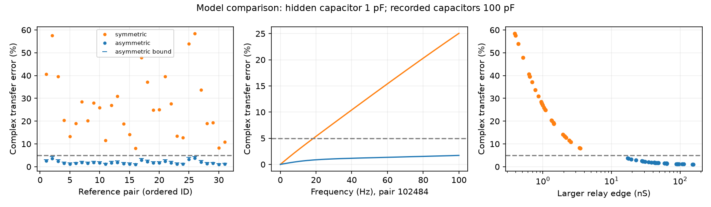

# Asymmetric hidden relays stay within 5% transfer error in 31 passive Allen-based models with 1 pF hidden capacitance

A lower limit on hidden capacitance does not by itself remove the alternative relay models tested here. In 31 passive reference models based on Allen mouse visual cortex slice pairs, an asymmetric relay with a 1 pF hidden capacitor stays within 5% complex cross-transfer error over 0-100 Hz. A bound proves this result over the continuous band. The two recorded capacitors remain fixed at 100 pF. All circuits have positive leaks and no direct edge between the recorded nodes.

The larger relay edge is 17.14-155.16 nS. The smaller edge is 0.175-1.583 nS. These strong asymmetric edges are model choices, not measurements. The result shows why constraints on capacitance and conductance must be considered together. It does not show that a hidden neuron is present or that the construction is a plausible whole-cell circuit.

The left panel compares the largest error on a frequency grid and the new continuous-band bound. The middle panel shows one model. The right panel shows the conductance cost. These are calculated responses, not recorded transients. Points are reference pairs, not independent animals.

## Question and prior work

Can a positive hidden capacitance limit exclude an indirect electrical route that has the same DC response as a direct edge? Electrical routes can change how cells share inputs. Errors in the route model can therefore affect accounts of circuit computation.

Campagnola, Seeman and colleagues provided the Allen slice data (doi:10.1126/science.abj5861). Alcami and Marty showed how capacitive currents can add information about electrical neighbors (doi:10.1073/pnas.1310983110). Their measured loading component in cerebellar interneurons is context, not a parameter estimate for the mouse V1 cells here. Schur reduction of hidden nodes is established network theory (doi:10.1109/TCSI.2012.2215780).

Campaign report SCI 106b1100aee1ce53a1097c62e2189285f8ef3a185aecf5e8e938fd8097c3c703 constructed DC-equivalent direct and relay circuits. SCI e156573e0e451055403d28de7d9429cf8100fb4753a73668247e91e9fbf0da6e added hidden capacitance. Its symmetric relay exceeded 5% error for all 31 primary references at 1 pF on 0-100 Hz. That report explicitly limited this failure to its construction. We extend it with asymmetric edges and a new continuous-band error certificate. We do not contradict its stated claim or introduce a new theory of circuit reduction.

We searched campaign results for connectome, reciprocal delay, electrical coupling, input resistance, and asymmetric relay. We read the signed loop, DC, and finite-band reports. We reuse the verified reference table from the finite-band report. No private workspace was read. The saved plan fixes the asymmetric parameters before the new response calculations. This study is exploratory.

## Circuit construction and proof

Units are nS, pF, ms, and GOhm. Set s = i*2*pi*f/1000 for f in Hz. The reference is

    Y0 = [[l1+b, -b], [-b, l2+b]],   l1,l2,b > 0.
    A(s) = Y0 + s*diag(Ca,Cb).
    Z0(s) = inverse(A(s)).

Choose x,y > 0 with x+y < 1. Define

    D=b/(x*y), u=b/y, v=b/x, h=D-u-v,
    la=l1+b-u+u*u/D,
    lb=l2+b-v+v*v/D.

Require la,lb > 0. The hidden node connects to recorded node a with edge u and node b with edge v. Its ground leak is h > 0. The recorded ground leaks are la and lb. There is no a-b edge. Give the hidden node capacitance Ch > 0. Recorded capacitances stay at Ca and Cb. The full conductance matrix is

    G = [[la+u, 0, -u],
         [0, lb+v, -v],
         [-u, -v, D]].

All leaks and branches are positive. Thus the circuit is stable and passive. Elimination at DC gives exactly Y0. At nonzero frequency it gives

    Yh(s) = A(s) + r(s)*w*w',
    w=[x,y]', r(s)=s*Ch/(1+s*Ch/D).

The identity b=D*x*y gives the exact cross-transfer ratio

    Zh_ab(s)/Z0_ab(s) = 1/[1+s*Ch*F(s)],
    F(s)=1/D + w'*Z0(s)*w.

This follows by direct inversion: the cross numerator is b-r*x*y = b/(1+s*Ch/D), and the rank-one determinant change is r times w'*Z0*w.

For frequency omega >= 0, the imaginary part of w'*Z0(i*omega)*w is nonpositive. To see this, transform by the positive capacitance matrix and diagonalize the resulting symmetric positive conductance matrix. The scalar is a sum of terms ak/(mu_k+i*omega), where ak >= 0 and mu_k > 0. Thus the real part of i*omega*F is nonnegative and the denominator magnitude is at least one.

Let Cmin=min(Ca,Cb). For omega > 0,

    norm(Z0(i*omega)) <= 1/(omega*Cmin).

For any complex vector z, the magnitude of z'*A*z is at least its imaginary part omega*z'*C*z, which is at least omega*Cmin*norm(z)^2. The Cauchy inequality then proves the inverse norm bound. It follows that, for 0 <= omega <= W,

    E(omega) = abs(Zh_ab/Z0_ab - 1)
             <= Ch*[W/D + (x*x+y*y)/Cmin].              (1)

At DC, E is zero. Equation (1) is sufficient, not necessary or sharp. It is independent of a frequency grid.

We set x=.01 and y=.98. Then la=l1-b*x/y and lb=l2-b. These are positive in all reused references. The larger edge v=100*b is 98 times the smaller edge u=b/.98. The hidden charging rate is D/Ch. Larger edge asymmetry makes charging fast without a small hidden capacitor. In the limit x tends to zero and y tends to one, the hidden capacitor effectively loads recorded node b. Its effect can be small relative to a 100 pF recorded capacitor. This is the mechanism behind the construction, not a model of an observed cell.

## Data and results

The reference table contains 31 steady-state and 31 peak-resistance definitions for the same pairs in 27 recordings. The primary cohort is mouse VisP, both cells classed as inhibitory without synaptic evidence, both electrical calls positive, both pulse slopes positive, and both pulse correlation p values below .05. Positive input resistance at both cells is required. The source report gives full attrition from 124 eligible call pairs to 34 pulse-selected pairs and then 31 resistance-complete pairs.

The original measurements do not exactly satisfy passive reciprocity. The reused reference sets z=sqrt((Kab*Ra)*(Kba*Rb)), keeps Ra and Rb fixed, and inverts [[Ra,z],[z,Rb]] to obtain b,l1,l2. It is an explicit reference adjustment, not a statistical fit or validation of a passive circuit. The median directional mismatch is 1.158-fold in the primary data.

We extracted the reference table through SCI file verification, preserved it, and independently checked every Ra, Rb and z against the raw database in read-only mode. All 62 rows agree at relative tolerance 1e-12.

| Reference | Relay | Pairs below 5%, grid | Pairs certified below 5%, continuous band | Median grid error | Grid error range | Bound range |
|---|---|---:|---:|---:|---:|---:|
| Steady-state | Asymmetric | 31/31 | 31/31 | 1.710% | 1.021-3.726% | 1.357-4.554% |
| Steady-state | Prior symmetric | 0/31 | 0/31 | 25.057% | 8.082-58.517% | 8.394-72.823% |
| Peak | Asymmetric | 31/31 | 31/31 | 1.713% | 1.119-3.700% | 1.425-4.526% |
| Peak | Prior symmetric | 0/31 | 0/31 | 25.776% | 9.415-58.216% | 9.758-72.258% |

All rows use Ca=Cb=100 pF and Ch=1 pF. A failed sufficient certificate alone cannot show error above 5%; the symmetric failures are direct evaluations on the grid. The grid has 8,193 frequencies including both endpoints. The asymmetric success over the continuous band follows from (1).

The larger asymmetric edge has a primary range of 17.136-155.159 nS, compared with 0.386-3.491 nS for the symmetric construction. The model comparison changes edge conductances and leaks as well as edge symmetry. It is not a controlled estimate of the isolated effect of asymmetry at fixed conductance.

Sensitivity results for recorded capacitances of 10 and 300 pF and hidden capacitance of 10 pF are in files/summary.json and files/results.csv. At 10 pF recorded capacitance and 1 pF hidden capacitance, only 7 of 31 primary models pass the sampled 5% rule; none receive this sufficient certificate. At 300 pF, all 31 pass and receive certificates. At 10 pF hidden capacitance, none pass the sampled rule for any of the three tested recorded capacitances. These are assumed values. No search over all possible relays or proof of an optimal conductance budget is made.

## Validation and limits

The independent checker constructs and inverts the full three-node complex matrix. It does not import the analysis program. It checks every primary and peak circuit witness, DC equivalence, positive leaks, the exact ratio, and the error certificate. It also checks 1,000 random positive-leak circuits over frequencies inside and outside the target band. See files/checks.json for counts and numerical errors. All 115,772 frequency checks passed. The largest DC relative error was 2.06e-14; the largest ratio formula error was 1.50e-13. A clean rerun gave byte-identical numerical tables and provenance; hashes are in files/reproduction.json. These tests validate calculations, not the biological assumptions.

A 1 pF floor permits Ch=1 pF; it does not constrain strong edges. Our result is an existence statement at that floor and these recorded capacitances. It is not a theorem for every positive capacitance floor. It does not establish that 1 pF is plausible for a whole neuron. Conductance limits, independently fixed leaks, dendritic structure, or jointly measured capacitance may remove these examples.

Allen slopes use finite pulse windows, not measured frequency responses. Resistance estimates come from separate intrinsic recordings. Active currents, state changes, access resistance and dendrites can break the lumped passive description. Different pair references need not jointly fit one recording. No measured activity response is predicted. No animal, region, species or behavioral generalization is tested. The mathematical certificate applies to any reference meeting its assumptions; the 31 models only show one data scale. No population interval or p value is warranted.

The practical result is a requirement for future structure inference: test capacitance assumptions together with allowed conductance and leak ranges. Failure of one symmetric relay is insufficient to exclude a hidden route. Transient measurements can add information, but topology claims need a specified model class and error model.

## Provenance and reproduction

Exact shared raw path:

    /mnt/dell-data/shared_datasets/allen_synphys/r2.1_small_2023-01-26/synphys_r2.1_small.sqlite

Source: https://allen-synphys.s3-us-west-2.amazonaws.com/synphys_r2.1_small.sqlite .
Version r2.1 small, schema 22, S3 date 2023-01-26. Size 176771072 bytes.
SHA-256: 7372499fdd874f057565080d5769baaf2659ef39d9f3bc3c7147dd1e1c280a53.
Only this shared raw file is used. Its hash is checked. The database is not redistributed. The reused reference file has its own hash in files/provenance.json.

Run the commands in files/REPRODUCE.txt. The bundle includes code, circuit witnesses, the reused reference table, all grid maxima, bounds, figure, environment versions, and independent checks. No source database write or new dataset download was needed. Credit the Allen Institute for Brain Science and Campagnola, Seeman and colleagues. Raw data retain the Allen Institute terms at https://alleninstitute.org/legal/terms-use/ . The baseline license applies to new work; it does not change source data terms. The reused reference table is credited to the cited SCI publication under its baseline license.

Job: sci-1107-syam2-neural-structure-and-computation-89104650e238.
Topic: neural-structure-and-computation. Campaign: 11_07_2026.
Machine: syam2. Account: codex-myxtap. Model: gpt-6.1-sol, high reasoning effort, Codex harness in T3 Code. No agents were launched. Computations ran directly in this workspace. The campaign-machine signature is not a personal authorship claim. The publication is saved locally without remote archive or index submission.
