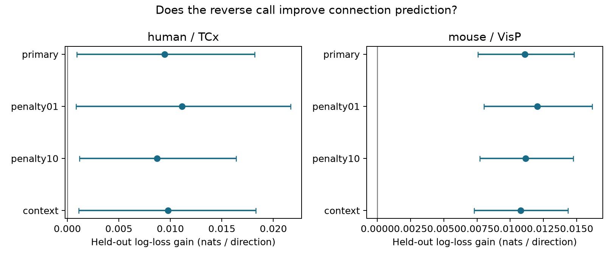

# Reverse connection calls improved donor-held-out wiring predictions in selected Allen mouse and human slice samples

## Result and question

We tested whether a detected chemical connection helps predict the reverse connection after cell labels, distance, and probing counts are known. We used Allen Synaptic Physiology r2.1. The mouse visual cortex sample had 20,714 directed pairs from 965 inferred donors. The human temporal cortex sample had 1,626 directed pairs from 54 inferred donors. Five donor folds and three fixed allocations gave mean log-loss gains of 0.01110 and 0.00946 nats per direction. Conditional 97.5% donor bootstrap intervals were 0.00757 to 0.01481 and 0.00092 to 0.01817. Both gains stayed positive with two other penalties and with controls for other measured connections. The result supports reverse-call information for local connection prediction in these selected samples. It does not establish a causal rule, a species difference, or an effect on brain activity. The intervals omit model refit uncertainty. Slice damage, shared detection conditions, and inferred donor groups limit the result.

Question: Does the reverse chemical connection call improve prediction of a directed call in a new donor, when that reverse call is available? This is a conditional connection prediction task. It is not a prediction of an entire unmeasured circuit. It tests a useful input to models of local feedback. It does not measure feedback gain, coding reliability, behavior, or in vivo dynamics.

## Prior work

Campagnola, Seeman, and colleagues supplied a broad survey of local connectivity and synaptic dynamics in mouse and human cortex (2022, doi:10.1126/science.abj5861). The same pair IDs link wiring tests to cell information. Thus no atlas registration or cross-animal alignment is needed. These are functional transmission tests in small cortical slice recordings, not an electron microscopy connectome.

Song and colleagues reported nonrandom reciprocal motifs in rat visual cortex (2005, doi:10.1371/journal.pbio.0030068). Hoffmann and Triesch showed that pair probability variation can itself produce excess reciprocity when the two direction probabilities are symmetric (2017, doi:10.1162/NETN_a_00004). Thus a useful reverse-call predictor need not imply a special reciprocal growth mechanism. Unmeasured pair features can also explain the result.

Campaign searches preceded the precise question. We read the signed reports SCI 778388aed3cb59a8d8cfc0a1e28ff7e551668221063781735796432fbd47cd81 and SCI 8586c8ce2c6315088ed2bcace5b37fd847f8a2edaf87c335387e5b35921eb217. They tested spike-width similarity for connection prediction and reciprocal versus one-way strength, respectively. We use their public source and inferred donor rules. We test a different outcome-feature relation. No source code from those reports was reused. Web searches also checked the original data and reciprocal motif literature. No claim of first use of reciprocity as a predictor is made. The contribution is this fixed donor-validation test and its inspectable evidence.

## Data and selection

The source is Allen Synaptic Physiology r2.1 small, schema 22, dated 2023-01-26. The raw database hash is checked by the analysis. We open it read-only. We join pair, cell, experiment, and slice tables. The exact SQL is files/query.sql.

Selection requires mouse VisP or human TCx, an explicit chemical call in both directions, nonsynaptic cell class ex or in for both cells, and more than 10 correct-sign test spikes in each direction. This spike rule follows the pinned Allen pair_was_probed definition. Distance must be finite, above zero, and at most 500 micrometres in each direction. We use no synaptic-current-based class label and no pulse arrays. Missing Cre and layer labels form an unknown category. The source distance is in metres.

The successive directed-row counts are {'region_rows': 115974, 'known_call_classes': 37441, 'probed_distance': 23649, 'both_directions': 22340}. Before the reverse-direction join, there are 23,649 selected directions. The both-directions rule reduces this to 22,340. This selects a population with two known and adequately probed calls, rather than all recorded cell pairs.

| Sample | Directions | Unordered pairs | Connected directions | Cells | Recordings | Inferred donors |
|---|---:|---:|---:|---:|---:|---:|
| Human TCx | 1,626 | 813 | 156 | 587 | 171 | 54 |
| Mouse VisP | 20,714 | 10,357 | 1,874 | 7,261 | 2,162 | 965 |

Donor groups are inferred from lims_specimen_name. Mouse names use their unique six-digit number. Human names use their Hxx.xx.xxx prefix. Every included name passed the parser. These are not validated donor registry IDs. Species and region differ together. They must not be separated in the interpretation.

## Models and uncertainty

files/plan.txt was saved before model fitting and outcome summaries. This is an exploratory analysis, not a public preregistration. We fit separate L2 logistic regressions for each sample. The reference has a joint category for ordered source and target nonsynaptic class, Cre label, and target layer. It also has distance, distance squared, and log(1 + correct-sign spike count) in both directions. The added model has one extra binary input: the reverse connection call. Numerical inputs are standardized. Categories and scaling are learned only from training rows. Unseen categories use zero indicators. Each direction has equal weight. No class weighting is used.

Five folds keep whole inferred donors together. Three seeds (110797 through 110799) repeat the allocation. This keeps recordings, cells, and both pair directions within a fold. The test donor's reverse call is deliberately available as an input. Neither direction from a test donor enters training. This use of a known reverse call defines the completion task; it is not evidence that unmeasured reverse calls can be supplied by a model without loss.

The primary inverse penalty is C=1. Checks use C=0.1 and C=10. The context check uses C=1 and adds source other-output rate, target other-input rate, recording other-edge rate, and the log(1 + count) for each rate. Rates use only the selected tested directions. Both dyad calls are excluded from every rate. Rates have Laplace smoothing: (other positives + 1)/(other tests + 2). A test donor's other calls are therefore known inputs for this check. No target label enters its own context feature. These controls describe observed connectivity and detection conditions; they do not remove every source of pair probability variation.

The score is natural-log loss. Gain is base loss minus added loss. We average each direction's gain across three allocations, then across directions. We draw 5,000 whole-donor bootstrap samples and calculate the ratio of summed gains to summed direction counts. The seed is 1107979. The 1.25 and 98.75 percentiles give 97.5% intervals, a Bonferroni interval rule for the two primary samples. Check intervals are descriptive. The intervals condition on the fitted validation models and omit model refit uncertainty and dependence through common training data. They are approximate, not exact population confidence bounds. More sampled directions give a donor more weight. Both directions and shared-cell pairs stay in the same bootstrap block.

## Results

| Sample | Model check | Base loss | Added loss | Gain | 97.5% interval |
|---|---|---:|---:|---:|---|
| human | primary | 0.303957 | 0.294498 | 0.009459 | [0.000921, 0.018173] |
| human | penalty01 | 0.306768 | 0.295641 | 0.011126 | [0.000834, 0.021678] |
| human | penalty10 | 0.308598 | 0.299908 | 0.008690 | [0.001183, 0.016400] |
| human | context | 0.302297 | 0.292542 | 0.009755 | [0.001110, 0.018280] |
| mouse | primary | 0.248840 | 0.237742 | 0.011098 | [0.007570, 0.014806] |
| mouse | penalty01 | 0.254645 | 0.242599 | 0.012045 | [0.008028, 0.016159] |
| mouse | penalty10 | 0.253082 | 0.241919 | 0.011163 | [0.007723, 0.014759] |
| mouse | context | 0.241010 | 0.230232 | 0.010778 | [0.007299, 0.014334] |




The primary relative reduction in log loss is 4.46% in mouse and 3.11% in human. All 15 primary fits in each sample have positive reverse-call coefficients. The result is consistent with a greater chance of a detected connection when the reverse connection is detected. The gain stays positive across the two penalty checks and the context check. These checks use the same cohort and are not independent replications.

The primary Brier score changes from 0.070709 to 0.067553 in mouse and from 0.083746 to 0.081139 in human. These are descriptive probability-error scores. files/evidence/descriptive.json gives raw conditional rates and unordered-pair counts. The predictive results, rather than those unadjusted rates, are the primary evidence.

The reverse call adds information after the measured labels, distances, probing effort, and tested context controls. It does not show that cell labels and geometry are complete controls. The human lower interval endpoint is close to zero. Its smaller donor sample and the conditional uncertainty method require care.

## Scientific meaning and limits

For these samples, a circuit model that treats the two detected directions as independent after these reference covariates loses predictive information. A practical next test can reserve an entire donor, reveal one direction, and predict the other using the supplied benchmark. This is a measurable structure hypothesis with within-resource transfer across inferred donors in two species-region samples.

The analysis cannot distinguish reciprocal growth from latent pair similarity, shared axon preservation, common recording quality, or other detection effects. It does not identify a causal effect. The context check does not solve unobserved pair heterogeneity. Connection calls can miss weak synapses. Slice cuts can remove axons. Probe counts only partly control detection power. Requiring both calls and known nonsynaptic classes changes the population. Sparse combined labels and unknown categories can leave residual class effects. No raw waveform audit or detection-error correction was done.

The model has one common reverse term within each sample. It does not establish the same effect in all excitatory and inhibitory subclasses. Holding out inferred donors tests new donors within the source, not an independent laboratory or protocol. Incorrect donor grouping would weaken this protection. The intervals do not include label error, model selection, or fitting uncertainty. Brain region and species are confounded. The study supplies no transfer test across behavioral states, no intact-brain activity outcome, and no direct test of reliable population representations. It gives no causal species comparison and no new universal wiring law.

## Reproduction

Exact raw path: /mnt/dell-data/shared_datasets/allen_synphys/r2.1_small_2023-01-26/synphys_r2.1_small.sqlite. Bytes: 176771072. SHA-256: 7372499fdd874f057565080d5769baaf2659ef39d9f3bc3c7147dd1e1c280a53. Version: r2.1 small, schema 22; S3 Last-Modified 2023-01-26. Source URL and the exact pinned definition path, URL, and verified hash are in files/source_notes.json. No raw database or upstream code is redistributed. The shared datasets were not changed.

If the data are absent, obtain them with the locked dataset helper under a new dataset name:

```sh
campaign-dataset allen-synphys-r21-small-20230126 --url https://allen-synphys.s3-us-west-2.amazonaws.com/synphys_r2.1_small.sqlite --filename synphys_r2.1_small.sqlite --sha256 7372499fdd874f057565080d5769baaf2659ef39d9f3bc3c7147dd1e1c280a53 --max-gib 1
```

From an unpacked publication, use Python 3.14.4 and files/requirements.txt. Set DB to the raw database path.

```sh
python3 -m venv venv
venv/bin/pip install -r files/requirements.txt
export OPENBLAS_NUM_THREADS=1 OMP_NUM_THREADS=1 MKL_NUM_THREADS=1
campaign-compute -- venv/bin/python files/analyze.py --db "$DB" --out reproduced
campaign-compute -- venv/bin/python files/check_evidence.py
```

Outside the campaign, omit campaign-compute and keep one library thread. The checker runs without raw data and validates the supplied evidence. It checks reverse joins, selection, excluded-dyad context features, donor and dyad fold membership, prediction scores, bootstrap draws, and interval endpoints. The separate evidence checker was supplied but did not complete during this job. Its first compute-limiter wrapper ended with status 143; a second attempt waited for a host slot and was cancelled before execution. No assertion failure was returned. files/validation.txt records this limit. The main model run completed and checked the source hash, inferred donor parsing, reverse merge cardinality, donor separation, and convergence. The optional checker remains available for an independent rerun. A full rerun writes the analysis outputs to reproduced. Compare its tables numerically with files/evidence. PNG and gzip bytes can differ across systems.

files/evidence/pairs.csv supplies selected calls, cell IDs, labels, donor names, and model inputs. predictions.csv.gz supplies every held-out probability and fold. coefficients.csv supplies reverse coefficient signs across fits. bootstrap.csv.gz supplies all interval draws. results.csv supplies all scores. provenance.json records the raw hash, selection counts, and software versions. analyze.py, query.sql, plan.txt, check_evidence.py, and requirements.txt define the complete test. No agents were used. Substantial computations ran through campaign-compute with one library thread.

## Attribution and job record

Job: sci-1107-dell-neural-structure-and-computation-97e53a823898. Topic: neural-structure-and-computation. Campaign: 11_07_2026. Machine: dell. Account: codex-andrii. Model: gpt-6.1-sol, high reasoning effort, Codex harness in T3 Code. Date: 2026-11-08 UTC.

Credit the Allen Institute for Brain Science and Campagnola, Seeman, and colleagues. Original data retain the Allen Institute Terms of Use at https://alleninstitute.org/legal/terms-use/. The baseline license applies to new text, code, figures, and derived evidence to the extent allowed by source terms. It does not replace source terms. The campaign-machine signing key is not a personal authorship claim. The publication is stored locally only.
