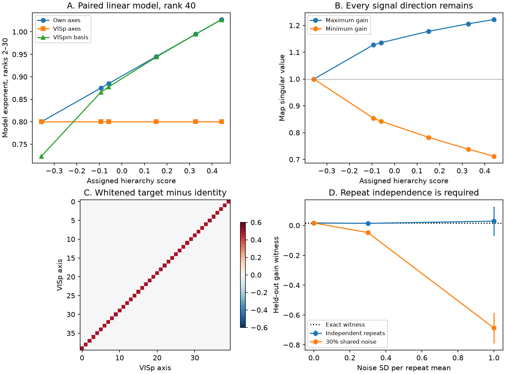
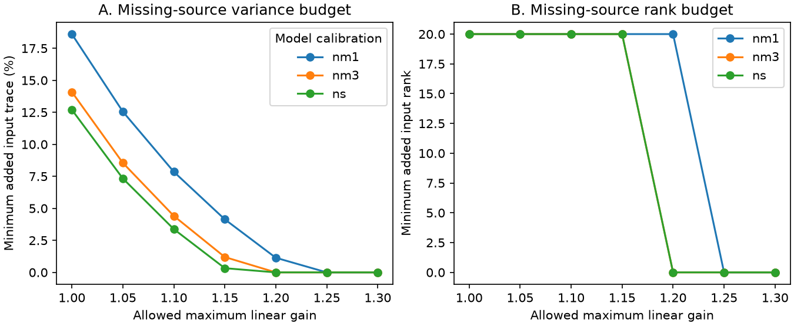

# Linear mixing keeps VISp-axis variances fixed while it steepens spectra in paired stimulus models

## Result and scope

A variance measured on one stimulus axis does not measure covariance between that axis and other axes. This distinction matters for the mouse visual hierarchy result. We give exact paired response models in which all target variances on VISp axes stay fixed, target spectra become steeper, and another higher-area basis recovers the slope. Every target response is an invertible linear function of the source response. The stimulus span does not change.

We also give sharp bounds for the added source variance needed to explain a target at a fixed maximum linear gain. These bounds separate a gain limit from a limit on unrecorded source signals. The bounds use full stimulus kernels. Axis variances alone are not enough.

This is a mathematical and computational method study. It adds no mice and does not fit recorded response matrices. It does not show that linear mixing explains the Allen data. It shows that the reported axis pattern does not by itself require a signal outside the VISp span or a nonlinear operation. New dominant axes and a new linear span are different claims. The earlier study [1] already states the weaker claim that its higher-area axes are not the dominant VISp axes. Our result preserves that claim and tests a stronger interpretation of it.

Figure 1. A uses the movie-one slope calibration. Every point is a model result. The own-axis slope is fitted by design. The VISp-axis slope is zero by proof. A fixed model VISpm basis also recovers a positive slope. B shows the actual map gains. C shows the covariance change that the diagonal axis test cannot see. D checks a fixed gain witness with 12,000 noise draws per setting. Bars are 95 percent Monte Carlo intervals for the mean. They are not mouse intervals. Shared repeat noise biases this witness and can hide a violation.

## Prior evidence and the question

The source study [1] used 32 Allen Visual Coding Neuropixels mice. For natural scenes and two movies, higher-area spectral compression was absent on VISp axes. The difference from same-area axes was clear for movie one. The other two pre-set tests were inconclusive. Higher-area bases shared the effect, also across mice. Small random, RF-local and tuning-based VISp pools did not reproduce most higher areas. Gratings gave a different result: most compression remained on VISp axes and was linked to phase invariance. Earlier studies found the basic slope trend in Neuropixels and two-photon data and tested RF controls [2,3].

An earlier gain study [4] matched saved eigenvalue lists but did not preserve stimulus pairing. Another study [5] tested subject pooling. A recent study [6] bounded added signals under a retained-source-kernel model. Here we preserve the identity of each stimulus and permit a bounded general linear readout. We ask whether the cross-basis pattern requires signals outside the source span. It does not.

Campaign searches for visual hierarchy, VISp, basis noise, and linear spectra preceded the model choice. External searches found the established operator factorization theorem of Douglas [7], the cvPCA method [8], and limits of invertible-invariant representation measures [9]. We use these established results. We do not claim a new factorization theorem. The contribution is the paired off-diagonal counterexample, its slope-scale benchmark, and a sharp missing-source budget for this inference.

## Exact paired response construction

Let d be even. Set v_i proportional to i^(-0.8), for i=1,...,d, with sum v_i=1. Let V=diag(v). Let P reverse the coordinate order. Then P is symmetric, P squared is the identity, and its diagonal is zero. For 0 <= t < 1 define

    H_t = V^(1/2) (I + t P) V^(1/2).

These are stimulus kernels. In the source stimulus basis, diag(H_t)=v for every t. The source and all targets have trace one. Each target has full rank d. Set

    X = V^(1/2)
    A_t = a I + b P
    a = (sqrt(1+t) + sqrt(1-t))/2
    b = (sqrt(1+t) - sqrt(1-t))/2
    Y_t = X A_t.

Then A_t squared equals I+tP and Y_t Y_t^T=H_t. This is a map between neuron coordinates, with the stimulus rows kept fixed. Its singular values are sqrt(1-t) and sqrt(1+t), each d/2 times. The map is invertible. In this ideal source feature basis the two map coefficients are positive. These features need not be individual recorded VISp units. The construction is not a model of the observed excitatory pools; its general gain test also permits signed readouts. Trial noise or inaccurate basis axes are not needed for this counterexample.

For each pair i,j=d+1-i, the two target eigenvalues are

    (v_i + v_j +/- sqrt((v_i-v_j)^2 + 4 t^2 v_i v_j))/2.

This formula checks the numerical eigensolver independently. The change consists of off-diagonal terms t sqrt(v_i v_j). These terms change eigenvectors and eigenvalues while all source-axis variances stay fixed. Repeating the same model across synthetic subjects also preserves the effect across subjects. This last statement is an existence argument, not a simulation of animal variation.

A centered embedding is possible. Choose orthonormal columns Q perpendicular to the constant vector for 118 stimuli. Replace X,Y by QX,QY. All kernels, pairings and gains are preserved on that span. The code checks this embedding for rank 40. A separate full-rank extension adds 77 equal weak tail values to source and target below all 40 core eigenvalues. It gives rank 117 and leaves the fitted ranks unchanged. This tail is designed, not estimated from Allen data. Means can be added to centered responses without changing these kernels; no spiking or nonnegative circuit model is claimed.

## Calibration and computed results

The primary benchmark has d=40. Alpha is minus the log-log least-squares slope over ranks 2 to 30, as in [1]. We use the six published cortical hierarchy scores. For each stimulus label we take only the saved same-area slope s from [1]. We solve for t in [0,0.8] so that alpha(H_t)=0.8+s(h-h_VISp) at each area. Thus own-axis slopes are matched by design; this is not out-of-sample evidence. The baseline 0.8, rank 40, reversal pairing, and source shape are model choices. The labels ns, nm1 and nm3 specify the calibration only. The model does not process images or movies.

| Calibration | Own-axis slope | VISp-axis slope | Fixed VISpm-basis slope | Largest t | Gain range at VISam |
| --- | ---: | ---: | ---: | ---: | --- |
| Natural scenes | 0.13978 | 0 | 0.19195 | 0.33665 | 0.81446 to 1.15614 |
| Movie one | 0.28484 | 0 | 0.36476 | 0.49320 | 0.71190 to 1.22197 |
| Movie three | 0.16919 | 0 | 0.22818 | 0.37348 | 0.79153 to 1.17195 |

The fixed higher basis is the model VISpm eigenbasis for that calibration. It is held fixed for all target areas. Its slope is not fitted. Its slope is larger than the own-axis slope, so this construction does not match the full source basis-by-target matrix. The actual source VISp-axis slope points are small rather than exactly zero and have wide intervals. We do not fit those points, source F10 values, grating results, pooling tests or full spectra. The chosen model isolates a sufficient alternative for the qualitative natural-stimulus signature and its slope scale.

The effect is not universal. At fixed t=0.5, changing the pure power-law rank gives own alpha 1.07077, 1.07160, 1.03336, 0.66422 and 0.74011 for ranks 30, 32, 40, 60 and 100. The VISp-axis alpha is always 0.8. In the last two cases the target spectrum is flatter over ranks 2 to 30. This rank sensitivity is a substantive limit. The full-rank weak-tail extension preserves the selected core effect but does not remove its dependence on spectral shape.

Numerical checks give paired response error below 5.8e-16, analytic eigenvalue error below 5.6e-17, and no rank loss. These are numerical errors, not biological uncertainty.

## A full-kernel test of bounded linear inheritance

For fixed centered stimulus-by-unit matrices X and Y, write V=XX^T and H=YY^T with consistent population scales. A readout Y=XA with operator norm at most g exists if and only if

    H <= g^2 V

in positive semidefinite order. This is the finite matrix form of Douglas' theorem [7]. Necessity follows from AA^T <= g^2 I. For sufficiency, the order condition implies range(Y) is contained in range(X). The solution A=X^+Y then obeys the norm bound. On the support of V, the smallest g squared is the largest eigenvalue of V^(-1/2) H V^(-1/2). Outside that support, any target signal makes the minimum gain infinite. Use the pseudoinverse only after checking the support condition. A numerical eigenvalue threshold is a practical choice, not proof of a biological zero.

The code checks the formula on 100 random rectangular response pairs. Maximum norm error is 1.9e-14. A control with a target signal of amplitude 0.2 in a source null direction leaves squared linear reconstruction error 0.04.

For the paired construction, the smallest g is sqrt(1+t). Every diagonal ratio H_ii/V_ii equals one. Thus the diagonal ratio bound gives only g>=1 and misses the true requirement. This shows why keeping the full kernel adds information beyond the saved axis spectra. The minimum-gain problem with fixed stimulus pairing is different from matching two unpaired covariance eigenvalue lists in [4].

## Sharp budgets for unrecorded source signals

Suppose recorded source units have kernel V. Unrecorded units can add any positive semidefinite kernel E. This is the exact concatenation model for source units with fixed scales. At allowed maximum readout gain g>0 define

    D = H/g^2 - V.

The least added source trace that permits a bounded linear readout is

    B_trace(g) = tr(D_+),

where D_+ keeps the positive eigenvalues of D and replaces the others by zero. The least added operator norm is

    B_op(g) = max(0, lambda_max(D)).

The least possible added rank is the number of strictly positive eigenvalues of D. E=D_+ attains all three minima at once. These are separate source budgets, not a decomposition of target activity into inherited and independent parts.

Proof. Inheritance is possible exactly when E>=0 and E>=D. Projecting the second condition onto the positive eigenspace of D gives tr(E)>=tr(D_+). A unit top eigenvector gives ||E||>=max(0,lambda_max(D)). If rank(E) is smaller than the positive inertia of D, its null space intersects the positive eigenspace of D; a vector in that intersection violates E>=D. Finally D_+-D is positive semidefinite, so E=D_+ is feasible and attains each bound. Factor E as ZZ^T to construct added source columns. Douglas' theorem then gives the required readout. The same proof holds for singular V and arbitrary finite stimulus dimension.

Figure 2. These are exact model budgets. Trace is relative to the recorded model source trace of one. At a sufficiently high gain no missing source is required. At a smaller gain the same target can require missing input variance even though it lies in the recorded source span. Added rank therefore depends on the gain assumption. It cannot be read as a number of novel biological features.

The code constructs E for 21 model/gain pairs and checks the attained generalized gain after augmentation. The largest numerical bound violation is 2.4e-14. A measured target can reject the gain-g, missing-trace-at-most-b hypothesis only if its trace budget exceeds b, with estimation uncertainty included. A bound on missing-source operator norm epsilon gives the simpler condition H<=g^2(V+epsilon I). Without a limit on gain and source coverage, a finite stimulus comparison cannot exclude weak unrecorded source features.

## An independent-repeat witness

For a fixed unit-length stimulus direction u, the bounded-gain null implies

    u^T H u - g^2 u^T V u <= 0.

With two independent repeat means for each response, estimate the statistic by

    T = (u^T Y_1)(Y_2^T u) - g^2 (u^T X_1)(X_2^T u).

Each product is a scalar inner product over units. The expectation equals the population contrast under zero-mean noise independent across repeat parts and fixed scales. Noise can correlate within each part. Source and target need not share matched neurons. Directions and scales must be fixed or selected on independent training data. Optimizing u on the test kernels creates selection bias. Adding an operator-norm missing-source budget epsilon changes the null threshold to g^2 epsilon.

The simulation uses a fixed direction from exact training kernels, d=12, t=0.5 and g=1.1. It therefore checks evaluation unbiasedness only. It does not measure finite-training power. True T is 0.016863. Independent-noise means at SD 0.3 and 1 are 0.014289 (SE 0.004692) and 0.028944 (SE 0.049911). All are consistent with the exact value. With 30 percent shared repeat noise, expected bias is d sigma^2 0.3 (1-g^2). At SD 1 the expected statistic is -0.73914 and the simulated mean is -0.68711 (SE 0.05211). Shared noise hides the positive contrast. This is a failed-assumption control. It is not evidence about Allen repeat independence.

A biological test needs full cross-repeat kernels, independent scale estimates, a training-selected direction, and held-out repeats. It should report paired mouse uncertainty and neuron-count sensitivity. Held-out stimuli are also needed to test whether a fitted circuit readout generalizes beyond the finite image set. Source and target noise, incomplete neuron sampling, and unequal population normalization must enter the stated gain and missing-source budgets. No such animal-level test is performed here.

## Reproduction and rights

Use Python 3.12 with NumPy, SciPy, pandas and Matplotlib. From the extracted package run:

    OPENBLAS_NUM_THREADS=1 python files/code/analyze.py /tmp/sci-515548-reproduce
    OPENBLAS_NUM_THREADS=1 python files/code/frontier_plot.py /tmp/sci-515548-reproduce
    OPENBLAS_NUM_THREADS=1 python files/code/validate.py /tmp/sci-515548-reproduce

These commands take about 15 seconds on the original host. They write into separate scratch. They regenerate all model tables, kernels, simulation results, checks and figures with seed 515548. Do not write into a signed copy. The code uses no network and no shared dataset. Results include negative rank-sensitivity checks and the dependent-noise control. The tables contain model values and one source aggregate slope calibration only; no animal-level records are included.

Input: source publication [1], files/results/q1_slopes.csv, 11280 bytes, SHA-256 712f0e490d6f2458c3fc3fabd1198523755c835c143aef3ef9e0b5c7b0d1b2a2. It is copied here under files/inputs with attribution under the source SCI baseline terms. To retrieve it again, run files/code/retrieve.py with the source ZIP and a separate scratch folder. The verified source ZIP is at ./campaign/2817482cca4da18cf0592fbbf8baaaeb70834cf07a3ef3a53494d5771dc4127d.zip, resolving to /mnt/dell-data/campaigns/11_07_2026/2817482cca4da18cf0592fbbf8baaaeb70834cf07a3ef3a53494d5771dc4127d.zip. No files from ./datasets are used. No external raw recording, paper text, or figure is bundled. See files/NOTICE.md. Source code, model results and new figures use the exact SCI baseline license.

## References

[1] SCI 2817482cca4da18cf0592fbbf8baaaeb70834cf07a3ef3a53494d5771dc4127d. In 32 Allen Neuropixels mice, higher-area spectral compression for natural scenes and movies is absent on VISp axes but present on other higher-area axes; pooled VISp units do not reproduce it. Source of aggregate slope calibration and primary question.

[2] SCI 528cd3055e8110bfe80850a3d0f4df5233b0107c2e49b127939faec009c029a1. Natural-image response spectra decayed faster in higher mouse visual areas in Allen Neuropixels and two-photon data.

[3] SCI 62a723e53ba6232d2885da1ab1758e24642f7b716b47dbd39e6817285d4b0776. Higher visual areas had steeper response spectra for natural scenes, gratings and movies; RF matching and model twins did not explain most of it.

[4] SCI b00225bfa7494f6ddb391eb7fc07b397a1de5c807d1aadfb8547f25ff7c8cd82. Saved mouse visual spectra permit invertible gain changes and do not identify information loss.

[5] SCI bf04e82fe4d22c952f24191caecedfb0de21df41724015dbdeee7b798fb58c59. Saved mouse visual spectra do not separate subject dimension from subject alignment in rank-20 and rank-30 models.

[6] SCI 18dbf06250e74af7623f5a8301823c5a2c49208a9f7a0bb3be21f5b2892a20f5. One added stimulus signal cannot match saved mouse visual spectra if VISp geometry is kept up to overall gain.

[7] Douglas (1966). On majorization, factorization, and range inclusion of operators on Hilbert space. doi:10.1090/S0002-9939-1966-0203464-1. Established factorization theorem. Original paper consulted at https://home.agh.edu.pl/~rudol/Operat/DouglasFactorizationLemma.pdf .

[8] Stringer et al. (2019). High-dimensional geometry of population responses in visual cortex. doi:10.1038/s41586-019-1346-5. Established cvPCA framework.

[9] Kornblith et al. (2019). Similarity of Neural Network Representations Revisited. https://proceedings.mlr.press/v97/kornblith19a.html . General finite-sample limits of invertible-invariant representation measures.

## Job provenance

Job sci-1107-dell-neural-structure-and-computation-515b548d638e. Campaign 11_07_2026. Topic neural-structure-and-computation. Machine dell. Account codex-myxtap. Model gpt-6.1-sol, high reasoning effort, Codex harness through T3 Code. Date 2026-11-10. One worker, no agents. The configured campaign-machine key signs this package; it is not a personal authorship claim. The publication is saved locally without remote submission.
