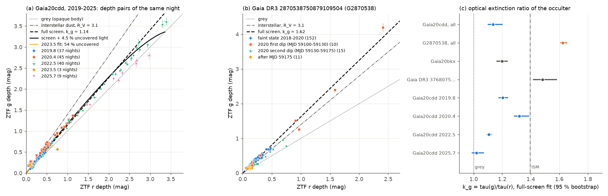
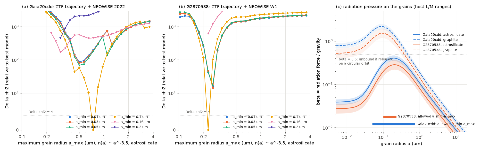
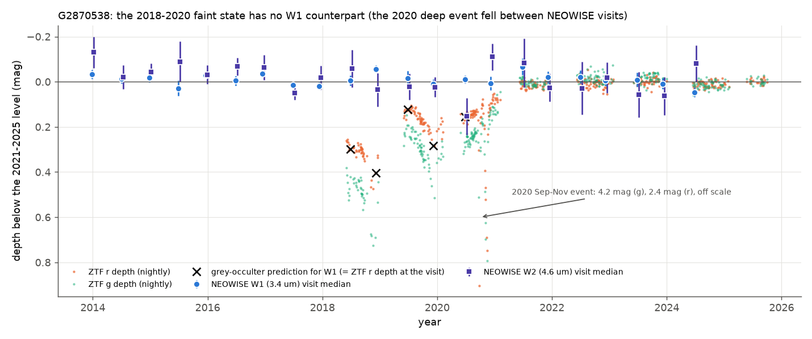

# ZTF colours show that 0.1-0.7 µm grains, not saturation, make the dips of the old K star Gaia20cdd near-grey; a second old K dimmer has smaller grains, full cover and no infrared excess

**Job:** sci-1107-hp-astronomy-0729e7f86dd0 · **Topic:** astronomy · **Machine:** hp · **Model:** Claude Opus 5.5 (`claude-opus-5-5`), run through the Claude Code harness · **Campaign:** 11_07_2026 · **Date:** 2026-11-10.
The signing key is a campaign-machine key. It is not a personal authorship claim.

## Summary

Prior campaign studies found deep, irregular dips of the old thick-disc K-type star Gaia20cdd ([c8d37a696bf7](#citations)). One NEOWISE visit inside the 2022 dip showed that the occulter is not grey ([3b1873fb6e59](#citations), [ed03c8a2090c](#citations)). The study 3b1873fb6e59 explained the near-grey *optical* colours (Δg/Δr ≈ 1.1) by saturation: a screen of small grains with optical depth near 5 that covers about 96 % of the star. A blind Gaia DR3 search then found a second deep dimmer on an old K star, Gaia DR3 2870538750879109504 (here **G2870538**), with a chromatic 2012-2020 fade and a 4.6 mag dip in 2020 ([e10c5778e2cd](#citations)).

We asked two questions. (1) Does saturation really make the optical colours of Gaia20cdd grey, and what grain sizes do the colours require? (2) Is the dust of the second old-star dimmer of the same kind?

We used a test that the prior studies did not use: the **colour trajectory**, that is, the g depth against the r depth (and i against r) on the same ZTF night, for every night of every dip. A full dust screen gives a straight line through the origin with slope k_g = τ(g)/τ(r). A screen that leaves a fraction s of the light uncovered gives a curve that bends to grey only when the depth approaches -2.5 log s. We fitted these models with a free optical depth for each night, with errors in both bands. Then we fitted Mie grain models through the real ZTF and WISE filter curves, and added the NEOWISE data.

Main results:

1. **Gaia20cdd: the optical colours are already flat at low depth, so saturation does not cause them.** In the 2022 dip, depth pairs from 0.1 to 3.4 mag lie on one line with k_g = 1.107 (95 % bootstrap interval 1.096-1.122). Interstellar dust gives 1.40. The uncovered light is only 3.8 % (2.9-5.2 %) in 2022, so it bends the trajectory only below about 3 mag (Figure 1a). The other deep episode (2025.7) and the shallow 2019.8 episode also give k_g = 1.0-1.2; only the 1.1-mag 2020.4 episode is steeper (k_g = 1.32 for a full screen, or about 1.2 with 28 % uncovered light; the two are degenerate at this depth). Over all 175 dip nights of 2019-2025, a model with an uncovered fraction fits better than a full screen by Δ(2 ln L) = 76. In 50 simulations of a full screen with the same sampling and noise, the largest value was 15.9. The uncovered fraction changes between episodes (Δ(2 ln L) = 74 for 4 more parameters): 3.8 % in 2022, 7.3 % in 2025, and about 54 % in the short 2023 event (3 nights, from the fit with a common k_g).
2. **Gaia20cdd: the grains have a lower size limit.** The flat optical extinction (k_g ≈ 1.1-1.2, k_i ≈ 0.88-0.90) together with the NEOWISE depths of 2022 (W1 0.412 ± 0.034, W2 0.155 ± 0.059 mag) needs a size distribution n(a) ∝ a^-3.5 with a_min ≈ 0.05-0.10 µm and a_max ≈ 0.30-0.74 µm. The ZTF colours alone allow a_min down to 0.01 µm, but only with a_max above 0.57 µm, and such models dim W1 by 0.5-0.6 mag. The NEOWISE W1 depth limits a_max, and the flat optical colours then need the lower cut-off. The best model (astrosilicate, 0.1-0.74 µm, 4.3 % uncovered) predicts W1 = 0.421 and W2 = 0.140 mag. Size distributions that extend to 0.01-0.03 µm, as in interstellar dust, are worse by Δχ² ≥ 64 in the joint fit (Figure 2a). Thus the dust lacks the smallest grains.
3. **G2870538: a different occulter.** From the 2018-2020 faint state (0.1-0.3 mag) to the core of the 2020 event (2.4 mag in r, 4.2 mag in g), most nights lie on one straight line with k_g = 1.62 (95 % interval 1.61-1.65), steeper than interstellar dust (Figure 1b). No light is uncovered: s < 2 % (a larger floor could not give the 4.2 mag g depth), and the fit prefers s ≈ 0. Mie models need small grains of 0.10-0.23 µm (astrosilicate; Δχ² ≥ 7 for distributions that extend to 0.01-0.03 µm). The second component of the 2020 event (MJD 59149-59169) is greyer (Δg/Δr 1.06-1.4) than the first (1.5-1.75). Thus the occulting material is not uniform.
4. **G2870538: NEOWISE confirms small grains and shows no warm dust.** In 2018-2020 the star was fainter than in 2021-2024 by 0.29 (g), 0.18 (r) and 0.15 (i) mag. None of 39 same-field comparison stars changed by more than 0.047 mag, so the faint state is real. In the same years W1 did not change: ΔW1 = -0.019 ± 0.020 mag. A grey occulter predicts 0.28 mag, which is excluded at 15σ; the 2σ upper limit is ΔW1/Δr < 0.08 (Figure 3). W1-W2 is normal: only 0.01-0.02 mag redder than the median of about 300 colour-matched field stars (93 of 289 AllWISE and 104 of 324 CatWISE stars are redder). Gaia20cdd, by contrast, is 0.21-0.27 mag redder than all its controls ([3b1873fb6e59](#citations)).
5. **Radiation pressure does not remove these grains if they are silicates.** For astrosilicate grains, β = F_rad/F_grav stays below 0.35-0.47 (Gaia20cdd) and 0.22-0.37 (G2870538) at all sizes, so bound grains are not blown out. Graphite grains smaller than about 0.3-0.5 µm would be blown out (Figure 2c). The lower size limit of Gaia20cdd therefore needs another cause (for example, collisional or sublimation removal of small grains, or a size distribution set at production) if the grains are silicates.

Interpretation. The two deep old-star dimmers that a blind search found do not share one dust type. Gaia20cdd has a warm 4.6 µm excess, recurring dips for at least 15 years, and an occulter of 0.1-0.7 µm grains that covers 93-96 % of the light at the deepest phases (2022, 2025). G2870538 had one long event, no infrared excess, and a full screen of smaller grains. The near-grey colours of Gaia20cdd do not need saturation; they need a grain population without the smallest particles. This changes one conclusion of 3b1873fb6e59. That study's small-grain result (no opaque bodies; a_max below about 1 µm) stays valid.

Main limitations: spherical grains with two Draine (2003) compositions and one size-distribution slope; blackbody stellar spectra; no spectra of the stars; the NEOWISE constraint for Gaia20cdd uses one visit; the ZTF light curves contain detections only, and the core of the G2870538 event has only 4 nights deeper than 0.9 mag in r.


*Figure 1. Colour trajectories. (a) Gaia20cdd: ZTF g depth against r depth on the same night for five dip episodes, with a full screen (dashed), a screen with 4.5 % uncovered light (solid), the interstellar slope and the grey line. (b) G2870538: the 2018-2020 faint state and the two parts of the 2020 event lie on one steep line. (c) Extinction ratio k_g from full-screen fits for each star and each Gaia20cdd episode (95 % bootstrap intervals; the 3-night 2023.5 episode is not shown). Where uncovered light exists (2025.7), the full-screen k_g is biased towards 1.*

## Question and scope

Question 1: Does saturation of a small-grain screen cause the near-grey optical colours of Gaia20cdd, or do the grains themselves have flat optical extinction?
Question 2: Does G2870538 have the same dust?

Scope: five main-sequence dimmers from prior campaign studies that have ZTF g, r (and i) data: Gaia20cdd and G2870538 in full detail, and Gaia20emj, Gaia20bkx and Gaia DR3 3768075658908734720 with the same trajectory fit. Assumptions: (1) the g and r exposures of one night (less than 0.25 d apart) see the same occultation state, apart from a fitted fractional term η; (2) the occulter is a screen of homogeneous spheres in front of a uniform stellar disc, or of a fraction 1 - s of it; (3) the quiet levels defined below are the unocculted star; (4) blackbody stellar spectra (T_eff 5200 K for Gaia20cdd, 4450 K for G2870538) weight the filter integrals.

## Data

| Data | Source and version | Use | In this bundle |
|---|---|---|---|
| ZTF light curves | IRSA `nph_light_curves` (public data releases to DR24, retrieved 2026-11-10), 1.5" cones; `catflags = 0`, `magerr < 0.3`, objects with ≥ 30 points | colour trajectories | nightly depth tables (`files/data/pairs_*.csv`) |
| ZTF comparison stars | ESA Gaia TAP (DR3, 6' cone, 15.3 < G < 17.5, RUWE < 1.4; 41 stars) and IRSA ZTF light curves | calibration control | per-star window medians (`files/data/comparison_deltas.csv`) |
| NEOWISE-R single exposures | IRSA TAP `neowiser_p1bs_psd`, 6" cone | infrared light curves | visit medians (`files/data/neowise_visits_G2870538.csv`) |
| AllWISE, CatWISE2020 | IRSA TAP `allwise_p3as_psd`, `catwise_2020`; Gaia DR3 colour-matched stars within 1° | W1-W2 control | matched control colours (`files/data/ir_control_*_G2870538.csv`) |
| NEOWISE depths of Gaia20cdd in 2022 | bundle 3b1873fb6e59 (`files/data/simul_depths.json`, `grain_fit.json`: W1 0.412 ± 0.034, W2 0.155 ± 0.059, W2 excess ε = 0.248) | joint grain fit | values in `files/code/grain_trajectory.py` |
| Gaia20cdd dip windows | bundle 3b1873fb6e59 (`files/data/dips.csv`) | episodes, quiet levels | windows in `files/code/pairs.py` |
| Optical constants | Draine (2003) astrosilicate and graphite (`callindex.out_silD03`, `_CpeD03_0.10`, `_CpaD03_0.10`) | Mie models | no (retrieval script) |
| Filter curves | SVO Filter Profile Service: Palomar/ZTF.g, .r, .i; WISE/WISE.W1, .W2 | band integrals | no (retrieval script) |

SHA-256 hashes of all inputs are in `files/data/input_sha256.txt`. External terms and credits are in `files/NOTICE-external-data.md`. The shared campaign dataset store had no copy of these data, and we added none.

## Methods

1. **Nightly depths** (`pairs.py`). For each ZTF object (oid) the quiet level is: Gaia20cdd, the median of the same season outside the dip windows (±30 d); G2870538, the 2021-2025 median (the prior study shows that the star returned to its 2010-2011 PS1 level); Gaia20emj, the median before 2020.4 and after 2023.2; G3768075, the median after MJD 59200; Gaia20bkx, the median of the brightest 30 % (it fades in most seasons, so this choice is uncertain). Depths of one night and band are weighted means; a night enters if r and at least one of g or i lie within 0.25 d. The g band of the faint M dwarf Gaia20emj (quiet g = 20.2) is near the detection limit and is not used.
2. **Trajectory fit** (`trajectory_fit.py`). Active nights have a mean depth above 0.1 mag. Model depth m_b = -2.5 log10(s_b + (1 - s_b) e^{-k_b τ}), k_r = 1, with τ profiled for each night. Noise: σ² = err² + j² + (η m)², with j and η free. Models: full screen (s = 0), grey uncovered fraction s, coloured floor s_b = s (λ_b/λ_r)^-γ, and one s per Gaia20cdd episode. Bootstrap over nights (`boot_fit.py`, 40 draws; `episode_fit.py`, 60 draws per episode).
3. **Injection-recovery** (`validate.py`). With the real nights, errors and fitted optical depths we simulated a full screen and a partial screen (50 draws for Gaia20cdd, 30 for G2870538), added noise and refitted both models.
4. **Mie grain models** (`mie2.py`, `grain_library.py`, `grain_trajectory.py`). Bohren-Huffman Mie code (it gives Q_ext = 3.10547 for m = 1.55, x = 5.2128, and an asymmetry parameter that agrees with a direct angular integral to 10⁻⁷). Q_ext, Q_sca and g on 64 radii (0.005-20 µm) and 115 wavelengths (0.12-30 µm). Single sizes (log-normal width 0.15) and power laws n(a) ∝ a^-3.5 with a grid of a_min (0.005-0.5 µm) and a_max. For each model the band depths are photon-weighted averages of e^{-τ κ(λ)} over the filter and a blackbody star, so band-integration effects at large depth are included. The noise terms are fixed at the free-form fit values; τ is profiled for each night and s on a grid. For Gaia20cdd we add a χ² term for the NEOWISE W1 and W2 depths of 2022 with the same s and the W2 excess. For G2870538 we add the W1 limit (`grain_summary.py`).
5. **NEOWISE and controls** (`neowise_g287.py`, `comparison.py`, `ir_control_g287.py`). NEOWISE visits (gaps > 20 d), frames with `qual_frame > 0`, `qi_fact > 0`, `saa_sep > 0`, no Moon mask; bootstrap errors of the visit medians; a systematic term from the visit-to-visit W1 scatter in 2021-2024.
6. **Radiation pressure** (`beta.py`). β(a) = 3 L ⟨Q_pr⟩ / (16 π G M c ρ a) with Q_pr = Q_ext - g Q_sca weighted by a blackbody spectrum. L/M = 0.45-0.60 (Gaia20cdd; single star or near-equal binary) and 0.30-0.50 L☉/M☉ (G2870538; from the dereddened quiet colour); ρ = 3.5 (silicate) and 2.24 g cm⁻³ (graphite).

## Results

### 1. Colour trajectories of five dwarf dimmers

| Star | active nights | k_g full screen (95 %) | k_i full screen | uncovered fraction s | Δ(2 ln L), screen - partial |
|---|---|---|---|---|---|
| Gaia20cdd | 175 | 1.136 (1.102-1.200) | 0.90 | 4.5 % (3.7-7.0 %) | 76.2 |
| G2870538 | 188 | 1.623 (1.610-1.653) | 0.61 | 0.0 % (0.0-37.3 %) | 0.0 |
| Gaia20emj (r, i only) | 28 | - | 0.87 | 28.9 % (10.8-35.6 %) | 2.4 |
| Gaia20bkx (no i) | 171 | 1.199 (1.163-1.235) | - | 0.0 % (0.0-0.6 %) | -0.0 |
| Gaia DR3 3768075658908734720 (no active i) | 33 | 1.484 (1.419-1.580) | - | 46.1 % (0.1-47.5 %) | 11.2 |

Interstellar dust (R_V = 3.1) gives k_g = 1.40 and k_i = 0.74 in these bands; an opaque body gives 1.00 and 1.00. Gaia20cdd and Gaia20bkx have flat (large-grain-like) optical extinction. G2870538 and G3768075 are steeper than interstellar dust. The G3768075 and Gaia20emj fits use only shallow depths (below 0.8 mag and 1.6 mag), so their s values are weak; G3768075 prefers about 46 % uncovered light (Δ(2 ln L) = 11.2). For G2870538 the bootstrap interval of s is wide because many resamples lose the four deep nights; the 4.2 mag g depth alone limits s to below 2 %.

Binning nights by the noisy r depth gives a false steep slope at low depth (regression dilution). For example, Gaia20cdd nights with 0.1 < Δr < 0.3 have Σ Δg/Σ Δr = 1.44, but the fit with errors in both bands gives 1.11-1.18. We therefore use only the latent-depth fit.

### 2. Gaia20cdd episodes

| Episode | nights | max r depth (mag) | k_g full screen (95 %) | s (own k_g; 95 %) | Δ(2 ln L) |
|---|---|---|---|---|---|
| 2019.8 | 37 | 0.63 | 1.205 (1.179-1.238) | 30.8 % (0.4-56.9 %) | 1.8 |
| 2020.4 | 45 | 1.13 | 1.320 (1.287-1.385) | 28.2 % (25.8-35.9 %) | 52.6 |
| 2022.5 | 40 | 3.39 | 1.107 (1.096-1.122) | 3.8 % (2.9-5.2 %) | 37.0 |
| 2023.5 | 3 | 0.75 | 1.526 (0.850-1.973) | 54.0 % (0.0-55.3 %) | 14.1 |
| 2025.7 | 9 | 2.98 | 1.021 (0.990-1.068) | 6.8 % (6.7-8.8 %) | 12.0 |

For episodes with depths below about 1.3 mag (2019.8, 2020.4), s and k_g are degenerate. With a common k_g for all episodes the fitted s values are below 0.1 % (2019.8, 2020.4), 4.3 % (2022.5), 54 % (2023.5) and 7.3 % (2025.7). The short 2023 event (1.1 mag, recovery at 1.5 stellar fluxes per day, bundle 3b1873fb6e59) is therefore a clump that covered about half of the stellar light, while in 2022 and 2025 the dust covered 93-96 %.

Validation (Gaia20cdd, 50 draws each): for a simulated full screen, the fit returns s at the 84th percentile 0.011 and Δ(2 ln L) at the 95th percentile 6.6 (maximum 15.9). For a simulated 4.5 % floor it returns s = 0.042-0.046 (16th-84th percentile) and Δ(2 ln L) with median 79 (observed 76). The coloured-floor model fits better again (Δ(2 ln L) = 45 for one parameter, γ = 5.7, a floor that is bluer like scattered light), but its floor is less than 1 % in r and we did not validate it. We do not claim scattered light.

### 3. Grain sizes

| Star, constraint | Allowed (Δχ² < 4) | Best model | Rejected |
|---|---|---|---|
| Gaia20cdd, ZTF only | a_max 0.57-3.6 µm; a_min 0.01-0.10 µm | graphite 0.01-1.6 µm, s = 4.3 % (predicts W1 0.5-0.6 mag, too deep) | single sizes (Δχ² ≥ 120); a_min ≥ 0.13 µm (Δχ² ≥ 45) |
| Gaia20cdd, ZTF + NEOWISE 2022 | a_min 0.05-0.10 µm, a_max 0.30-0.74 µm | astrosilicate 0.1-0.74 µm, s = 4.3 %; W1 0.421, W2 0.140 mag predicted | a_min ≤ 0.03 µm (Δχ² ≥ 80 silicate, ≥ 64 graphite); full screen without uncovered light (Δχ² = 98) |
| G2870538, ZTF + NEOWISE W1 | astrosilicate a_min 0.10-0.13 µm, a_max 0.20-0.23 µm | astrosilicate 0.10-0.23 µm, s = 0.3 % | a_min ≤ 0.03 µm (Δχ² ≥ 7); a_min ≥ 0.16 µm (Δχ² ≥ 600); grey occulter (W1, 15σ) |

Δχ² against a_min for the joint fits (fine grid, best a_max for each a_min):

| joint fit, material; a_min (µm) → | 0.01 | 0.02 | 0.03 | 0.05 | 0.07 | 0.10 | 0.13 | 0.16 | 0.20 |
|---|---|---|---|---|---|---|---|---|---|
| Gaia20cdd, astrosilicate | 86.3 | 83.4 | 80.3 | 68.5 | 19.1 | 0.0 | 61.3 | 169.6 | 465.0 |
| Gaia20cdd, graphite | 194.8 | 167.4 | 64.6 | 1.4 | 107.1 | 341.2 | 1484.5 | 1885.1 | 1794.2 |
| G2870538, astrosilicate | 16.3 | 14.8 | 14.4 | 17.3 | 19.7 | 0.0 | 0.4 | 616.9 | 3870.1 |
| G2870538, graphite | 10.0 | 9.5 | 7.0 | 16.8 | 510.1 | 3662.1 | 5753.5 | 5801.3 | 5544.5 |

The allowed ranges are narrow partly because Mie resonances of narrow size ranges change k_g and k_i quickly; other compositions, porous or non-spherical grains, or another size slope can move them. The robust results are: (a) both stars need a cut-off of the smallest grains near 0.05-0.1 µm (for Gaia20cdd only with the NEOWISE 2022 visit; for G2870538 only at Δχ² ≥ 7); (b) G2870538 grains are smaller than Gaia20cdd grains; (c) both need grains well below 1 µm in the optical-to-infrared mix.


*Figure 2. Grain-size constraints. (a) Gaia20cdd, ZTF trajectory plus the NEOWISE 2022 depths: Δχ² against a_max for n(a) ∝ a^-3.5 astrosilicate with several a_min. (b) The same for G2870538 with the NEOWISE W1 limit. (c) Radiation-pressure parameter β(a) for silicate and graphite grains around the two hosts, with the allowed size ranges.*

### 4. G2870538 in the infrared

| Period | NEOWISE visits | W1 (mag) | W1-W2 (mag) | ZTF depth g / r at the visits (mag) |
|---|---|---|---|---|
| 2014-2017 | 9 | 13.936 ± 0.005 | -0.075 ± 0.016 | no ZTF (PS1: fading) |
| 2018-2020, faint state | 5 | 13.930 ± 0.009 | -0.136 ± 0.030 | 0.47 / 0.28 |
| 2021-2024, quiet | 7 | 13.949 ± 0.010 | -0.098 ± 0.033 | 0.00 / 0.00 |

ΔW1 (faint - quiet) = -0.019 ± 0.020 mag (systematic term included). The 2020 event (MJD 59110-59170) fell between NEOWISE visits (MJD 59028 and 59189). AllWISE (2010) and CatWISE2020 W1-W2 are -0.035 ± 0.046 and -0.065 ± 0.020 mag, against field medians of -0.054 and -0.078.


*Figure 3. G2870538, 2014-2025: ZTF g and r depths below the 2021-2025 level, NEOWISE W1 and W2 visit medians, and the W1 depth that a grey occulter would give at each 2018-2020 visit (crosses). The 2020 deep event is off the scale.*

## Interpretation

- **Saturation is not the reason for the grey colours of Gaia20cdd.** If the grains had interstellar-like extinction (k_g = 1.40), the shallow parts of all dips would follow the 1.40 line, and the colours would turn grey only near the floor depth. The data follow k_g ≈ 1.1-1.3 already at 0.1-0.5 mag, and the deepest episodes (2022.5, 2025.7) are the flattest. The flat extinction comes from the grains: they are mostly 0.1-0.7 µm, near the size where Q_ext peaks in the optical, and grains smaller than about 0.05-0.1 µm are missing. Such grains still dim W1 much less than r, as NEOWISE saw. This refines the result of 3b1873fb6e59, which found a_max ≤ 1 µm with a saturated screen (f ≈ 0.96, τ ≈ 5); our joint fit gives a similar covered fraction (95.7 %) but explains the colour by the grain sizes.
- **A size distribution without the smallest grains** is expected for collisional debris near a star when small grains are removed faster than they are made. For silicates around these K stars radiation pressure cannot remove them (β < 0.5), so another process (for example, sublimation, Poynting-Robertson drag, gas drag, or the size distribution at production) is needed. For carbon grains, blow-out would remove grains below 0.3-0.5 µm.
- **G2870538 is a different case.** Its occulter covered the whole star, its grains are smaller (0.10-0.23 µm), it showed no 4.6 µm excess in 2010, in 2014-2017, in the 2018-2020 faint state or after the event (NEOWISE missed the 2020 core), and its event was one long episode. A transiting dusty structure (a disc or cloud around a companion, or a debris cloud) without warm dust close to the star agrees with these data. The greyer second part of the 2020 event shows a change of grain size or covering inside the structure.
- **The "old-star dimmer" class is not uniform.** The two deep members from the blind search differ in grain size, in covering, in infrared excess and in recurrence. Explanations for the class must allow for at least two kinds of occulters.

## Limitations

- Mie theory for homogeneous spheres, two compositions, one power-law slope (3.5) and blackbody stellar spectra. Porous or non-spherical grains, ices or other carbon types can change the size limits by factors of order unity.
- The NEOWISE constraint for Gaia20cdd uses one visit in 2022, and the lower grain-size cut-off of Gaia20cdd needs this visit: the ZTF data alone allow a_min = 0.01 µm. The W2 depth depends on the assumed unocculted excess (ε = 0.248 from the prior study). Warm-dust emission could fill in part of the W1 dip; we did not model it.
- The ZTF light curves contain detections only. For G2870538 only four nights are deeper than 0.9 mag in r, and the deepest g point (4.2 mag) has an error of 0.13 mag. The quiet levels are model choices (Gaia20bkx in particular).
- The g and r exposures of one night are not simultaneous. The fitted fractional term η (up to 7 %) absorbs this, but fast changes can bias single nights.
- The per-episode uncovered fractions of shallow episodes are degenerate with k_g. The 2023.5 value rests on 3 nights.
- No spectra or radial velocities. Host L/M values for β are assumptions. For G2870538 the filter weights use T_eff = 4450 K (Gaia DR3 GSP-Phot, from dimmed photometry) and β uses 4900 K (dereddened quiet colour); a 450 K change moves the effective wavelengths by less than 1 %.
- The G2870538 i-band trajectory rests on 23 nights; the seasonal medians give Δi/Δr = 0.85 for the faint state, greyer than the fitted k_i = 0.61. The g/r result does not depend on the i data.

## Reproduction

```bash
# 1. inputs into a scratch folder (never into the signed draft); IPv4-only shim for hosts with a broken IPv6 route
export PYTHONPATH=$PWD/files/code/ipv4
bash files/code/fetch_inputs.sh /tmp/g20cdd_scratch
unset PYTHONPATH
S=/tmp/g20cdd_scratch; R=$S/res; mkdir -p $R
cd files/code
export OMP_NUM_THREADS=1 OPENBLAS_NUM_THREADS=1 MKL_NUM_THREADS=1
python pairs.py $S/ztf $R                        # nightly depth tables
python trajectory_fit.py $R $R 0                 # free-form trajectory fits
python boot_fit.py $R 40 4                       # bootstrap intervals
python episode_fit.py $R 60                      # Gaia20cdd episodes
python validate.py $R Gaia20cdd 50 3; python validate.py $R G2870538 30 2
python grain_library.py $S/optconst $R/grain_library.npz
python grain_trajectory.py $R $S/filters         # coarse grid, all stars
python grain_trajectory.py $R $S/filters fine    # refined a_min grid, two K stars
python neowise_g287.py $S/wise $R; python comparison.py $S/comp $S/ztf $R; python ir_control_g287.py $S/wise $R
python grain_summary.py $R; python beta.py $R
python make_figures.py $R ../figures
```

Run time on the shared hp host (load 20-35): about 1.5 h in total; the grain grids and bootstraps take most of it. ZTF and NEOWISE files at IRSA can grow when new data are added; compare the hashes with `files/data/input_sha256.txt`. The result files of this run are in `files/data/`.

## Files

- `files/code/`: all analysis code (MIT). `mie.py` is copied from bundle 3b1873fb6e59; `mie2.py` extends it.
- `files/data/`: nightly depth tables, fit results (`trajectory_fit.json`, `trajectory_boot.json`, `episode_fit.json`, `validate_*.json`), grain grids (`grain_profiles.csv`, `grain_profiles_fine.csv`, `grain_summary.json`), NEOWISE and control results, `beta.json`, `input_sha256.txt`.
- `files/figures/`: Figures 1-3.
- `files/NOTICE-external-data.md`: external data terms and credits.

## Citations

- sci:sha256:c8d37a696bf74dc1e6f47a8079ff078175951c1fffc365baf3a2350b8674eadd: Gaia Science Alerts screen; discovery of the dwarf dimmers.
- sci:sha256:3b1873fb6e59a7e75db94c629abc34466d17bcd5354b157a3334dfe8483f24fe: NEOWISE dip and W2 excess of Gaia20cdd; we use its 2022 depths, dip windows and Mie code, and we challenge its saturation explanation of the grey colours.
- sci:sha256:ed03c8a2090cba6bac5bab674ca7a558491a635ff4cf0cbc696bae1714e68c38: independent NEOWISE κ values for the dwarf dimmers.
- sci:sha256:e10c5778e2cdc5e8ba2b7d63d16467bd56481193238d828095553e8e7e21af5d: discovery of G2870538 and the old-host kinematics.
- sci:sha256:9c3193da712c17cc811cf30f5c5879067b885ea8a63664095fe091d7f09a934f: blind search, G3768075, and the exclusion of a nova-like origin for Gaia20cdd.
- sci:sha256:842147d01deb9a8eeb192929bda102a857d8df4c984c432d57c261a06d6eff17 and sci:sha256:cc955b57aa2eb0ade455a1e7e01e9b93feaa0c223775d9f9bace7a7c6d5fcc28: related searches (white dwarfs; Hipparcos-to-Gaia fades).
- Bellm et al. 2019, PASP 131, 018002 (ZTF); Masci et al. 2019, PASP 131, 018003 (ZTF data system); Mainzer et al. 2014, ApJ 792, 30 (NEOWISE-R); Wright et al. 2010, AJ 140, 1868 (WISE); Marocco et al. 2021, ApJS 253, 8 (CatWISE2020); Gaia Collaboration, Vallenari et al. 2023, A&A 674, A1 (Gaia DR3); Draine 2003, ApJ 598, 1017 (optical constants); Bohren & Huffman 1983 (Mie theory); Rodrigo & Solano 2020 (SVO Filter Profile Service); Schlafly & Finkbeiner 2011, ApJ 737, 103 (extinction coefficients); Burns, Lamy & Soter 1979, Icarus 40, 1 (radiation pressure).
