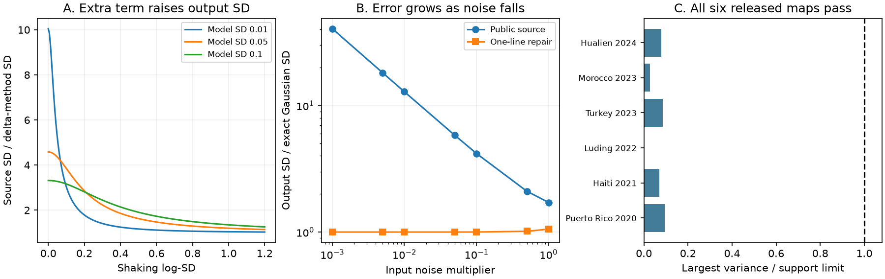

# Pinned USGS liquefaction code adds an unsquared standard deviation to its variance

The general Zhu 2017 liquefaction routines in public USGS ground-failure source commit `312441e3ab7d8684df6d51458d796e7e41db15ff` add the input model standard deviation to its square. This differs from the variance sum in the standard first-order uncertainty rule. We confirm the result by running the two unchanged source methods in 560 controlled cases. A one-line change removes the extra term and passes the same cases.

This is a source-code result. We do not establish that these exact routines produced the archived maps, or that a change improves observed liquefaction forecasts.

## Question and prior work

Earlier campaign work found narrow first USGS ShakeMap intervals. A later ground-failure audit found impossible beta moments in 383 landslide cells from six fixed earthquakes. We asked whether the paired liquefaction product has the same problem. It does not in the tested files. During source inspection, we found a separate error in its variance calculation.

Allstadt et al. (2022), doi:10.1177/87552930211032685, describe the operational ground-failure product and its uncertainty method. Zhu et al. (2017), doi:10.1785/0120160198, developed the underlying liquefaction model. Zhan et al. (2023), doi:10.1016/j.enggeo.2023.107271, study uncertainty in logistic geospatial hazard models. Our new result is a specific executable source discrepancy and its failure in the small-error limit. The delta method and bounded-variance inequality are established methods, not new theorems. Targeted searches on 2026-11-11 found no direct prior report of this assignment error; this does not prove priority.

## Source test

Let d be model SD in logit space, v the ShakeMap SD of log PGV, and k=0.334. Let p=logistic(x). The general model maps x to coverage:

    g(x) = 0.4915 / [1 + 42.4 exp(-9.165 p)]^2.

For independent model and shaking errors, the first-order coverage SD is:

    s_delta = g'(x) sqrt(d^2 + k^2 v^2).

The public full and slim methods instead give:

    s_source = g'(x) sqrt(d + d^2 + k^2 v^2).

In both files, `varP` first receives the model SD. The statement `varP += varP**2 + (...)` keeps that initial value and then adds its square. The next operations multiply by the squared derivatives of the logistic and coverage functions. Thus the extra d survives to the output. This happens with both a raster input and the fallback scalar input. The configuration identifies the fallback as a standard deviation in logit space and sets it to 0.05. The landslide source, used as a comparison, adds the squared model SD without this extra term.

The SD ratio is exactly:

    R = sqrt[1 + d / (d^2 + k^2 v^2)].

For d>0 and finite v, R>1. At the fallback d=0.05, R is 4.583 when v=0 and 1.626 when v=0.5. These are controlled examples, not estimated operational error factors. At v=0, R=sqrt(1+1/d). The output coverage estimate is unchanged by this assignment repair.

We extract only `calculate_uncertainty` from each pinned source file with Python's syntax tree. Its statements run unchanged. Small adapters supply fresh input arrays and collect the output in place of raster I/O. We use five x values (-3,-1,0,1,3), seven d values (0.005 to 1), four v values (0 to 1), two input branches and two implementations: 560 tests. Each matches the extra-term formula. In a separate namespace, replacing only `varP += varP**2` with `varP = varP**2` matches the standard rule in every case. Finite differences independently check g'. This tests the numerical method, not the complete geospatial pipeline.

## The small-error limit separates this error from nonlinear approximation

Scale both input SDs by lambda. Write W=d^2+k^2 v^2 for their unscaled variance. The standard variance is lambda^2 W. The source variance is lambda d + lambda^2 W. The source SD therefore decreases as sqrt(lambda), while the correct first-order SD decreases as lambda. Its ratio diverges as lambda falls. This cannot be explained by a higher-order nonlinear remainder.

We also propagate independent Gaussian input errors through g by 80-node Gaussian quadrature, at x=0, unscaled d=0.05 and v=0.5. This Gaussian law is an added reference assumption. At lambda=1, the source SD is 1.714 times the exact SD, and the repaired delta SD is 1.054 times it. At lambda=0.01, these ratios are 12.866 and 1.000006. At lambda=0.001 they are 40.575 and 1.00000006. Independent adaptive integration agrees with the exact SD values to a maximum relative difference of 7.4e-14. All seven tested noise scales are in `small_noise.csv`.

## The released liquefaction maps pass the support test

We use the same six event/release pairs as the published landslide audit. We download their paired `zhu_2017_general.hdf5` files. Full file hashes and lengths match the archive catalogue, and internal event and ShakeMap labels match the selections. These are selected archived UPDATE products, mostly issued well after the earthquake. They are not a first-issued or random sample.

For coverage C and stated SD s, any distribution on [0,b] must satisfy s^2<=C(b-C). We test both b=0.487 from the public configuration and the exact model maximum b=0.48716760871439413. We also test [0,1].

| Case | GF / ShakeMap version | Delay, hours | Cells with C at least 0.002 | Failed cells | Largest variance / exact support limit |
| --- | --- | ---: | ---: | ---: | ---: |
| Puerto Rico 2020 | 1 / 13 | 8797.41 | 2706 | 0 | 0.0942 |
| Haiti 2021 | 9 / 10 | 79.14 | 5757 | 0 | 0.0705 |
| Luding 2022 | 4 / 4 | 261.21 | 2 | 0 | 0.0017 |
| Turkey 2023 | 9 / 12 | 283.26 | 59389 | 0 | 0.0852 |
| Morocco 2023 | 10 / 10 | 72.40 | 11568 | 0 | 0.0266 |
| Hualien 2024 | 3 / 3 | 1.92 | 5894 | 0 | 0.0796 |

All 85,316 selected cells pass all three support tests. All 876,031 finite positive paired cells also pass. A C>=0.005 sensitivity gives the same null result; Luding then has no cells. A conservative rounding test finds no robust failure. Passing a necessary moment bound does not establish interval calibration or rule out the extra term in production.

The grids permit recovery of a combined latent scale t=s/g'(g-inverse(C)). They do not supply its separate model and shaking components. The selected-cell median t is 0.170-0.235 across cases. Without the exact input SD rasters and a verified production executable, this scale does not identify whether the extra term was used. We do not subtract a guessed model SD from released variances.

## Limits and use

This audit identifies a precise source repair and gives a regression test for maintainers. It does not fit a probability correction. The numerical factor applies to the pinned general-model routines and stated inputs; it is not an observed calibration factor. The coastal variant is outside the test. We do not establish the current deployed software version, the history of the error, or a change in regional alerts. The six archive files are not independent validation data for a repaired method. No observed liquefaction inventory is scored.

The standard variance sum assumes independent error components. A justified covariance term could change that sum, but a bare unsquared SD does not implement such a term. The Gaussian example is used only to show the limiting error. The method still needs empirical validation, and a first-order repair does not remove all nonlinear approximation error.

## Reproduce

Python 3.12, NumPy, SciPy, pandas, h5py, requests and matplotlib are required. Use one numerical thread. From the extracted bundle:

    export OPENBLAS_NUM_THREADS=1 OMP_NUM_THREADS=1 MKL_NUM_THREADS=1
    python files/retrieve.py /absolute/path/to/external-scratch
    python files/analyze.py --external /absolute/path/to/external-scratch --inputs /absolute/path/to/external-scratch/local_inputs.json --out files/results
    python files/checks.py
    python files/figures.py

Run in an unsigned working copy if you want to regenerate bundled files. Source and raw inputs stay in separate scratch. The retrieval script reuses exact shared data if present and checks every used full-file hash. It stops when a source has changed. The bundle includes the original code, aggregate evidence and exact external-input provenance. It contains no source rasters or copied USGS code. The plan records the exploratory sequence; this study was not independently pre-registered.

Campaign 11_07_2026. Job `sci-1107-dell-earth-and-ocean-sciences-3d02dfd3da16`. Topic earth-and-ocean-sciences. Machine dell. Account codex-olen. Model gpt-6.1-sol, high reasoning effort, T3 Code through the Codex harness. Study date 2026-11-11. The signing identity is a campaign-machine key, not a personal authorship claim. No agents were launched.
