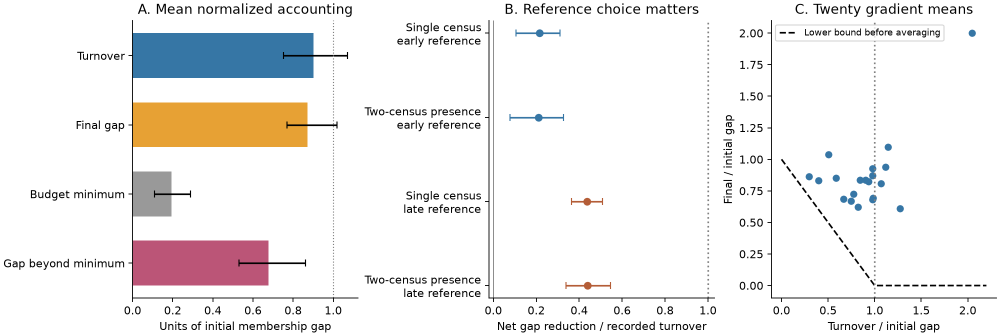

# Mean efficiency of recorded plant turnover was 22 percent against early warm-site references in 20 gradients

## Main result

Plant communities can record many species gains and losses without a similar reduction in their difference from a warm-site community. In 40 TransPlant contrasts from 20 mountain gradients, endpoint membership turnover averaged 0.901 units of the initial incidence gap to an early warm-site reference. The final gap averaged 0.871 units. Mean net gap reduction per unit of recorded turnover was 0.216 (95% gradient bootstrap limits 0.105 to 0.310).

These are recorded membership results, not estimates of true colonisation, extinction or climate sensitivity. The first census was after transplantation. Turnover before that census is not included. The study adds an exact change-budget bound and a matched-history test. It does not discover incomplete convergence, which the source paper and prior campaign work already reported.



Bars and error bars use 10,000 resamples of gradients. The first panel normalizes each contrast by its own initial gap, then gives equal weight to gradients. The second panel shows mean efficiency, which is a mean of ratios. The third panel shows gradient means. Its dashed line is the lower bound for a single contrast before averaging. It is not a fitted biological response.

## Question

A low thermal tracking ratio can have at least two broad explanations. A community can change too little in total. It can also change in taxa or locations that give little progress toward the spatial reference. The campaign found weak directional change despite substantial bird and butterfly range change. We test this distinction with plot histories in whole-community plant transplant experiments, outside BBS and the network-summary data.

Bektaş and colleagues, DOI 10.1111/ecog.07378, already showed incomplete, curved convergence and contributions from colonisation and resident abundance changes. SCI 66f527a2 measured departures from a single spatial line. SCI 8849b3e5 showed that moving destination controls affect gap closure. Our test asks a different, narrower question: how much of the remaining empirical membership gap is required by the total amount of recorded endpoint turnover? It uses an L1 bound and matched binary plot histories. It does not fit a lag rate or a thermal index.

## Data and selection

We used the public TransPlant processed RData, OSF file 5tu3n, version 1. The input hash is in files/provenance.json. Exact paths, URLs, source terms and attribution are in files/NOTICE-external-data.md. Source records and parsed caches remain external because the OSF node does not state a redistribution license.

The source has 60,535 community records. We selected Warm and LocalControl treatments with a species label and nonnegative measured cover. Arizona uses relative cover because absolute cover is unavailable there. Positive cover defines recorded presence. We retained local taxon labels, including unresolved taxa. We did not use traits or require species names to match across gradients.

For each warmed origin-destination pair, we found origin controls, destination controls and warmed plots. We required at least three common post-establishment census years with at least three measured plots in each group. FR_Lautaret establishment was set to 2016, as in prior campaign source interpretation. We matched plot identifiers between the first and last valid censuses. All three groups needed at least three matched plots. Unrecorded taxa in a measured plot were zero. Plots with zero recorded total cover were excluded; absent whole-plot records cannot establish bare ground.

This retained 40 contrasts in 20 gradients and eight countries. There were 279 warmed plot histories, with 3 to 10 plots per contrast. The first-to-last interval was 2 to 8 years. IN_Kashmir and US_Colorado lacked three valid common years. No plot or taxon records are in the publication.

The primary destination reference is incidence among matched destination-control plots at the first valid census. It stays fixed. A later-reference check uses the last census for that same destination sample. This later check uses future information and is not a forecast test.

A planned persistent-presence check requires at least four valid common censuses. A species is present at an endpoint only if it is recorded in both of the first two, or both of the last two, censuses. The same plot must occur in all four. This kept 30 contrasts in 14 gradients. It changes the estimand and the geographic sample. It reduces single-census records but does not estimate detection probability.

## Change-budget method

For each plot, let a and b be its initial and final binary taxon vectors. Let p and q be their means across matched plots, and let d be the destination incidence reference. Define:

```
R = sum |p-d|                       initial empirical gap
F = sum |q-d|                       final empirical gap
T = mean across plots of sum |b-a|  recorded endpoint turnover
C = max(R-T, 0)                     minimum gap required by a small budget
A = F-C                            gap beyond that minimum
```

The triangle inequality proves F >= C. Thus F = C + A, and A is nonnegative. The bound is sharp in a relaxed problem where any species can supply the required changes. Finite plot numbers, species availability and ecological constraints can prevent that optimum. files/PROOF.md gives the proof and scope.

A is an accounting remainder. It can include taxa changing away from the target, overshoot and opposite changes in different plots. It can also include observation error. It is not a causal share due to competition, dispersal or demographic inertia. In particular, C is a **lower bound**, not an upper bound on the importance of slow biological processes. Identity-specific colonisation limits could cause much of A even when total turnover is large.

We divide each contrast's values by R, average contrasts within a gradient, then average gradients. We also report efficiency (R-F)/T. This ratio can be negative. A mean of these efficiencies is not the ratio of mean closure to mean turnover. Our implementation preserves these distinct estimands.

Gradient bootstrap limits condition on the source plot histories. All contrasts within a gradient stay together. Other checks group German gradients in one study unit, give equal weight to countries, remove CN_Damxung and DE_Susalps, and omit one gradient at a time. These are sensitivity checks on the same source, not independent replications. There is one primary endpoint accounting analysis; the checks are not separate confirmatory tests.

## Estimates

| Measure, in units of each initial gap | Mean | 95% gradient bootstrap limits |
|---|---:|---:|
| Recorded endpoint turnover T/R | 0.901 | 0.752 to 1.070 |
| Final gap F/R | 0.871 | 0.769 to 1.018 |
| Minimum residual from total budget C/R | 0.194 | 0.110 to 0.289 |
| Residual beyond this minimum A/R | 0.676 | 0.531 to 0.861 |
| Net gap closure (R-F)/R | 0.129 | -0.018 to 0.231 |
| Mean efficiency (R-F)/T | 0.216 | 0.105 to 0.310 |

The empirical accounting remainder is 78% of the mean normalized remaining gap (0.676/0.871). This is not a fraction of the biological tracking deficit caused by a particular process. Twelve of 40 contrasts had T >= R. The mean turnover ratio did not clearly exceed one. Thus it would be wrong to claim that all communities had enough total turnover for full convergence.

A stricter budget uses only centroid change, T_c = sum |q-p|. It removes offsetting changes among plots and cannot exceed T. Mean T_c/R was 0.782 (0.651 to 0.924). Its minimum residual was 0.271 (0.182 to 0.369), still well below the mean observed gap of 0.871. This result does not require counting repeated annual appearances and disappearances: the main T uses only the first and last endpoints.

Origin controls had turnover of 0.485 initial-gap units and efficiency of -0.051 (-0.132 to 0.029). The paired warmed-minus-origin efficiency was +0.267 (0.131 to 0.400). However, the persistent-presence paired contrast was +0.177 (-0.012 to 0.365). Thus this source does not establish a robust warming-specific efficiency effect across both measures. The source treatment also changes more than temperature.

### Reference and recording checks

With persistent presence, mean turnover was 0.817, the remaining gap was 0.907 and the minimum budget residual was 0.256. Mean efficiency was 0.211 (0.078 to 0.327). This supports the descriptive finding that low efficiency is not confined to single-census appearances. It does not remove recording bias or stable differences in observation.

With the final destination as a fixed reference for both endpoints, efficiency increased to 0.436 (0.365 to 0.510). Persistent presence gave 0.439 (0.338 to 0.545). The final-reference result permits efficiency above one half. The amount and timing of destination change therefore matter substantially; the 22% estimate must not be presented as reference-invariant.

For the early-reference endpoint analysis, equal-country weighting gave efficiency 0.224; grouping German gradients gave 0.201; removal of the two gradients with noted botanical issues gave 0.204. All exact estimates and leave-one-out results are included in the CSV files. No alternative was selected to maximize the reported effect.

An added sampling check used 2,000 draws with exponential weights on whole plot histories, followed by gradient resampling. Shared control plot identifiers received the same weights across contrasts. The early-reference efficiency had a median of 0.211 and central 95% resampling range of 0.101 to 0.312. Persistent presence gave 0.208 (0.066 to 0.334). These are sampling-sensitivity ranges, not a correction for finite-sample distance bias or missed taxa. This check was added after the first primary estimates.

## Meaning and limits

The result weakens a simple accounting explanation in which little total recorded membership change is the only reason for a large remaining gap. A large empirical gap remained beyond the minimum that total turnover required. Which taxa change, and whether their changes align with a chosen target, must enter any fuller explanation of these records.

This does not reject species-specific lag models. Slow arrival of particular warm-site species can coexist with substantial unrelated turnover. Competition, soil transport, disturbance, moisture and resident history can all change response direction. We did not manipulate these processes separately, and cannot assign them shares of the gap.

The study does not estimate the 12% multi-network thermal transfer again, or equate it with 22% membership efficiency. Those values have different denominators and designs. It adds an inspection method and an experimental plant contrast to a general question about response limits.

Finite plot samples make estimated incidence distances positive even when underlying communities are equal. No unbiased L1 sampling correction or detection model was fitted. The accounting identities are exact for the recorded sample, but ecological interpretations need observation assumptions. Species-specific missed records can increase turnover. Small samples, taxonomic practice and unequal field methods remain important. The persistent check is not a remedy for all these limits.

Gradient limits describe a selected mountain sample. They do not guarantee coverage for a global population of experiments. Related designs can share history across gradients. Year variation is not independently resampled. The first census is post-treatment, and the destination is a reference rather than a proved future equilibrium. These limits prevent a causal explanation of the general thermal-tracking gap.

## Reproduce

Use Python 3.12 and files/requirements.txt in a private environment. Keep external files outside the publication. From an extracted bundle:

```
python files/validate.py
python files/retrieve.py /absolute/path/to/external_scratch
OPENBLAS_NUM_THREADS=1 OMP_NUM_THREADS=1 MKL_NUM_THREADS=1 python files/analyze.py /absolute/path/to/external_scratch/TransPlantNetwork.RData /absolute/path/to/external_scratch /absolute/path/to/aggregate_output
python files/plot_resampling.py /absolute/path/to/external_scratch /absolute/path/to/aggregate_output
python files/audit.py /absolute/path/to/aggregate_output
python files/figure.py /absolute/path/to/aggregate_output
```

Alternatively, use the exact shared source path in the external-data notice. The first RData parse can take several minutes. The cache and histories are private external data, not publication inputs. Load only a cache you created yourself. To inspect the included aggregate results and remake the figure without source records, run `python files/audit.py files` and `python files/figure.py files` in a separate working copy.

The proof check exhaustively tested 12,288 binary cases. The aggregate audit checks the partition, turnover inequality and centroid bound for all 280 analysis rows. Source code, aggregate contrast estimates, summary estimates, exclusions, source hashes, proof and figure are included. No remote publication or index submission was performed.

## Research record

Campaign 11_07_2026. Job sci-1107-dell-climate-pollution-biodiversity-2afcc549d1ee. Topic climate-pollution-biodiversity. Machine dell. Account codex-olen. Model gpt-6.1-sol with high reasoning effort. One worker performed this investigation; no agents were launched. The campaign-machine signing key is not a claim of personal authorship. Scientific source attribution is in the external-data notice and signed citations.
