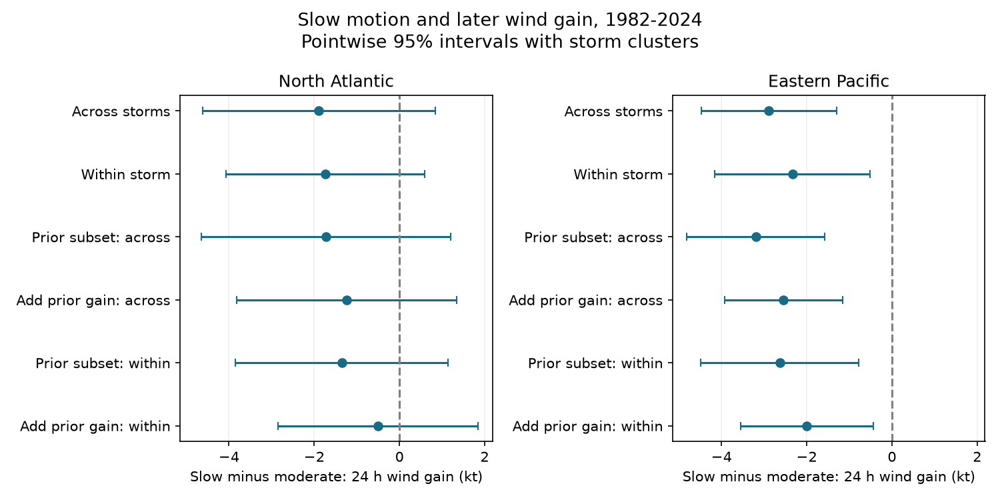

# Slow preceding motion marked lower next-day wind gain in eastern Pacific tropical cyclones in 1982-2024

## Result

We tested whether slow tropical cyclone motion preceded lower wind gain over the next 24 hours. We used fixed IBTrACS v04r01 data for 1982-2024. We selected 8,756 eastern Pacific fixes from 644 storms and 2,283 Atlantic fixes from 245 storms. Each window stayed tropical and more than 200 km from land. Slow motion was below 3 m/s during the preceding six hours. The comparison was 3 to less than 7 m/s. After adjustment for initial wind, position, month and year, the eastern Pacific slow-motion contrast was -2.89 kt, with a storm-cluster 95% interval of -4.47 to -1.30 kt. Within-storm adjustment gave -2.34 kt (-4.16 to -0.52). Adding prior wind gain gave -1.99 kt (-3.55 to -0.44) within storms. The Atlantic primary contrast was -1.89 kt (-4.61 to 0.84). Thus the Atlantic estimate was uncertain. The eastern Pacific sign stayed in all planned checks. The result supplies a test of preceding motion and storm selection. It is consistent with an ocean cooling explanation, but does not test that cause. No ocean temperature, ocean heat content, shear or humidity data were used. Selected surviving windows, wind estimates, model form and pointwise intervals limit the result. Code, input hashes, selected source fields, all estimates, a numerical audit and a figure are included.



The two basins have overlapping intervals. We did not test a basin difference. A result below zero in one basin and an interval that includes zero in another does not establish a difference between basins.

## Question and prior work

Does slow motion before a test window mark lower wind gain in that window, and does the link remain within the same storm? This matters because motion changes the time that a storm spends over water that it cools. It can also mark changes in the atmosphere and storm stage. A link across storms can arise from these differences.

Mei, Pasquero and Primeau (2012; doi:10.1029/2011GL050765) linked motion and intensity over tropical oceans. Their study also examined surface cooling. Guan et al. (2025; doi:10.1029/2024JC022234) examined slow turning stages, cooling and lower intensification. Song et al. (2024; doi:10.1029/2024GL110220) examined motion trends during rapid intensification in the western North Pacific. Our study is a narrower test of preceding speed and later wind gain in two other basins. It does not claim a new physical mechanism.

Campaign searches and the published cold-wake study cited in sci.json showed why storm selection needs a check. That study tested tracks of earlier storms. We test the motion of the current storm. The data overlap with campaign work; this is not independent replication. The search terms and data-scope correction are in files/research_log.md. The plan in files/plan.md was made before outcome calculation, with a stated basin-filter correction after the first results. It is not an external preregistration.

## Data and sample

We reused the existing NA and EP CSV snapshots in place. Source version is IBTrACS v04r01, retrieved on 2026-11-08 by the dataset helper. files/provenance.json gives the exact absolute shared paths, URLs, byte counts and full SHA-256 hashes. The source URLs can change in place. A fresh download is not guaranteed to have the same bytes.

We selected main tracks in 1982-2024 at 00, 06, 12 and 18 UTC. Initial latitude was 5 to 25 degrees north; initial USA wind was 34 to 120 kt. All five six-hour fixes from time t to t+24 h had USA status TD, TS or HU and belonged to the tested basin. Distance to land was above 200 km at each fix. Wind at t+24 h was required. This sample excludes land approaches, transitions and some storms that end during a window. It is not a sample of all forecast opportunities.

Speed is the great-circle distance from t-6 h to t divided by six hours, with Earth radius 6,371 km. It uses no position after t. It is a displacement speed, so a turn can reduce it. Longitudes were put in [-180,180). Slow means below 3 m/s; moderate means 3 to less than 7 m/s. Faster motion was excluded. The outcome is USA wind at t+24 h minus USA wind at t, in kt. USA wind is the NHC one-minute wind estimate in these basins. These are final best tracks, not real-time inputs.

The Atlantic primary sample spans 41 seasons and has 395 slow fixes; the Pacific sample spans 43 seasons and has 2,009 slow fixes. Only 80 Atlantic storms and 297 Pacific storms have both motion groups in the retained sample. The within-storm coefficient depends on this variation. The outcome windows overlap. Each fix receives equal weight, so long storms have more weight.

## Method

The main model is ordinary least squares, run separately in each basin. It includes a slow indicator, linear and squared initial wind, latitude and longitude, and fixed effects for calendar month and season. Wind, latitude and longitude are divided by 50, 20 and 100 to keep the calculation stable. Scaling does not change the slow coefficient.

The within-storm model subtracts each storm mean from the outcome and every model column. It uses the same wind and position terms, but omits month and season effects. It removes constant storm properties. It does not remove time-varying shear, humidity, water temperature or storm structure. A further model includes wind gain during the preceding 24 hours. We also fit the unaugmented model on this smaller subset, so that sample loss and adjustment can be distinguished.

Intervals use the cluster sandwich covariance with a finite-sample correction and a t reference with cluster count minus one degrees of freedom. The main clusters are storms. A season-cluster check allows different storms in the same year to covary. These are model-based pointwise 95% intervals. No correction is made for all sensitivities. For the two main across-storm basin tests only, Holm adjustment gives an eastern Pacific p value about 0.00075 and an Atlantic value about 0.174. We do not treat the sensitivity fits as new discoveries.

## Estimates

Values below are slow minus moderate next-day wind gain in kt. Negative values mean lower gain. All planned model outputs, standard errors, p values, ranks and counts are in files/estimates.csv.

| Basin | Check | Model | Prior gain | Fixes | Contrast | 95% interval |
| --- | --- | --- | --- | ---: | ---: | --- |
| NA | primary; cluster SID | across | False | 2283 | -1.89 | -4.61 to 0.84 |
| NA | primary; cluster SID | within | False | 2283 | -1.74 | -4.07 to 0.58 |
| NA | prior_available; cluster SID | across | False | 2108 | -1.72 | -4.64 to 1.20 |
| NA | prior_available; cluster SID | within | False | 2108 | -1.35 | -3.85 to 1.14 |
| NA | land100; cluster SID | across | False | 2651 | -2.51 | -5.15 to 0.13 |
| NA | land100; cluster SID | within | False | 2651 | -1.74 | -4.02 to 0.54 |
| NA | threshold2; cluster SID | across | False | 2283 | -4.45 | -7.68 to -1.22 |
| NA | threshold2; cluster SID | within | False | 2283 | -3.77 | -6.17 to -1.36 |
| NA | 00UTC; cluster SID | across | False | 565 | -2.79 | -6.42 to 0.84 |
| NA | 00UTC; cluster SID | within | False | 565 | -3.64 | -7.40 to 0.13 |
| NA | lat22; cluster SID | across | False | 1763 | -4.28 | -7.48 to -1.09 |
| NA | lat22; cluster SID | within | False | 1763 | -2.44 | -5.28 to 0.41 |
| NA | prior_available; cluster SID | across | True | 2108 | -1.24 | -3.82 to 1.35 |
| NA | primary; cluster SEASON | across | False | 2283 | -1.89 | -5.26 to 1.48 |
| NA | prior_available; cluster SID | within | True | 2108 | -0.50 | -2.84 to 1.85 |
| NA | primary; cluster SEASON | within | False | 2283 | -1.74 | -4.06 to 0.58 |
| EP | primary; cluster SID | across | False | 8756 | -2.89 | -4.47 to -1.30 |
| EP | primary; cluster SID | within | False | 8756 | -2.34 | -4.16 to -0.52 |
| EP | prior_available; cluster SID | across | False | 8174 | -3.20 | -4.81 to -1.58 |
| EP | prior_available; cluster SID | within | False | 8174 | -2.63 | -4.49 to -0.77 |
| EP | land100; cluster SID | across | False | 9285 | -3.02 | -4.57 to -1.47 |
| EP | land100; cluster SID | within | False | 9285 | -2.46 | -4.16 to -0.75 |
| EP | threshold2; cluster SID | across | False | 8756 | -5.40 | -7.44 to -3.35 |
| EP | threshold2; cluster SID | within | False | 8756 | -4.73 | -7.10 to -2.37 |
| EP | 00UTC; cluster SID | across | False | 2202 | -3.03 | -4.94 to -1.12 |
| EP | 00UTC; cluster SID | within | False | 2202 | -2.38 | -4.73 to -0.03 |
| EP | lat22; cluster SID | across | False | 8479 | -3.01 | -4.65 to -1.38 |
| EP | lat22; cluster SID | within | False | 8479 | -2.37 | -4.22 to -0.51 |
| EP | prior_available; cluster SID | across | True | 8174 | -2.54 | -3.92 to -1.16 |
| EP | primary; cluster SEASON | across | False | 8756 | -2.89 | -4.39 to -1.38 |
| EP | prior_available; cluster SID | within | True | 8174 | -1.99 | -3.55 to -0.44 |
| EP | primary; cluster SEASON | within | False | 8756 | -2.34 | -3.96 to -0.72 |

The eastern Pacific contrast stays negative in every planned fit. With prior gain, the within-storm contrast falls from -2.63 to -1.99 kt on the same 8,174 fixes. Thus some of the association follows earlier intensity change, but this adjustment does not remove it. This does not prove an independent speed effect: prior wind gain is an imperfect measure of storm stage.

The Atlantic main intervals include zero. The below-2-m/s check gives more negative estimates in both basins. That check compares below 2 with 2 to less than 7 m/s; it changes both the exposure and comparison group. The low-latitude Atlantic across-storm interval is negative, but its within-storm interval includes zero. These results limit a broad claim about all slow storms.

Raw mean gains are 5.20 kt for slow and 4.84 kt for moderate Atlantic fixes. They are -1.61 and 0.35 kt in the eastern Pacific. Adjustment reverses the small Atlantic raw contrast. Initial wind and location differ between groups. Raw rapid-intensification rates are supplied only as descriptions in files/descriptive.csv. They are not adjusted tests or forecast scores.

## Interpretation and limits

The eastern Pacific result agrees with a slow-motion penalty in this selected sample. The contribution is a reproducible comparison that uses preceding motion, tests within-storm variation, and checks prior intensity change. Its size is small relative to individual storm intensity changes. It supplies a benchmark for a later study with ocean and atmosphere data.

The data cannot identify the cause. Slow motion can increase cooling and time over cooled water. It can also accompany turning, weak steering, dry air, unfavorable shear, or a late stage in a storm. We did not measure these processes. We did not use sea surface temperature, mixed layer depth, ocean heat content, shear or humidity. Thus an ocean explanation remains untested here.

Further limits are wind rounding and estimation error, changing observations over time, selected complete tropical windows, chosen speed bounds and latitude range, a simple additive model, and uncertainty conditional on that model. The within-storm model does not remove changing local conditions. The season-cluster check does not remove dependence across years. A 00 UTC check reduces window overlap but has wider intervals. Neither the associations nor the final best-track inputs establish operational forecast skill or climate change attribution.

## Inspection and reproduction

The package contains the derived fix table with the source wind, position, status, basin and land-distance fields at each required lag. It also contains preceding wind, exposure speed, all outcomes, code, output tables, environment versions and a static PNG. Full shared raw files are not duplicated.

From the publication root, run:

```sh
OPENBLAS_NUM_THREADS=1 python files/analyze.py
```

This repeats every model and the figure offline from files/fixes.csv.gz. It writes files/estimates.csv, files/descriptive.csv, files/comparison.png and files/environment.json. The one-thread setting reduces overhead for these small fits; it is not required for the method.

For a complete source rebuild, run from the assigned workspace:

```sh
DATASETS=./datasets python work/result/files/build.py
OPENBLAS_NUM_THREADS=1 python work/result/files/analyze.py
OPENBLAS_NUM_THREADS=1 python work/result/files/audit.py
```

The build step checks both full source hashes. The audit independently looks up each primary outcome and preceding displacement in the raw CSVs. It uses a direct least-squares solver and a separately constructed cluster sandwich to check all four primary coefficients and standard errors. files/audit.json records the successful checks. An offline repeat gave identical model tables and figure bytes; files/repeat_check.json records their hashes. This is a numerical check by the same worker, not an independent scientific review. Run the audit from a directory that has the datasets link.

If raw files are absent, use `python files/retrieve.py NEW_LOCAL_DIRECTORY`, then set DATASETS to that directory for build.py. The retrieval script refuses to overwrite a directory and stops if any source hash differs. Use the preserved derived table if the public source has changed. The prepared Python versions are in files/environment.json. Required packages are numpy, pandas, scipy, patsy, statsmodels and matplotlib. Reproduction takes minutes on this host.

## Work provenance

Campaign: 11_07_2026. Job: sci-1107-dell-earth-and-ocean-sciences-9c75a832963c. Topic: earth-and-ocean-sciences. Machine: dell. Account: codex-andrii. Model: gpt-6.1-sol, high reasoning effort, through T3 Code and the Codex harness. Analysis date: 2026-11-09 UTC (2026-11-08 in America/Los_Angeles). The campaign-machine signing key is not a personal authorship claim. No private key is included. This publication is saved and signed locally; no remote archive or index is used.
