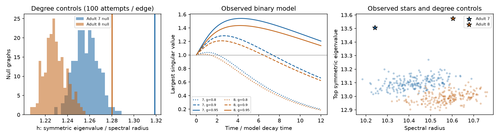

# Two adult worm maps gave wider stable growth intervals than sampled degree controls in a positive linear model

In two adult C. elegans chemical wiring maps, a positive linear model had a wider stable transient-growth interval than every sampled graph with the same labeled input and output degrees. The binary maps gave interval widths of 0.2418 and 0.2189 on the normalized gain scale. Means from 199 long-shuffle controls were 0.2043 and 0.1862. This result concerns the stated model and finite control ensemble. It is not measured neural amplification or evidence that degree is the only relevant control.

Figure 1. Left: the ratio of the top symmetric eigenvalue to the spectral radius, h, in 199 degree controls per adult after 100 swap attempts per edge. Vertical lines mark the recorded maps. Middle: the largest model norm gain at each sampled time for three stable gains. These curves use the recorded binary maps. Right: the two eigenvalue measures before normalization. Stars mark the recorded maps. Points and curves are model results, not neural recordings.

## Question and prior work

Does circuit arrangement allow a wider range of stable transient growth than the same input and output degrees allow in shuffled maps? We test this question in two adult worm chemical synapse maps. The contribution is a reproducible conditional graph benchmark. We do not propose a new growth criterion.

Witvliet and colleagues mapped changes in worm wiring across development (2021, doi:10.1038/s41586-021-03778-8). We use the adult 7 and 8 tables in a fixed version of wormneuroatlas. Baggio and colleagues studied communication through nonnormal networks, including a worm network (2020, doi:10.1126/sciadv.aba2282). Christodoulou and colleagues studied how spectrum and feedforward structure affect transient neural model growth (2022, doi:10.1371/journal.pcbi.1010365). We use the established distinction between eventual stability and short-term norm growth.

Before we fixed this question, we searched signed campaign results for connectome neural structure, Randi, non-normal transient amplification, and amplification. We read SCI bedb57d5, which tested passive conductance after cell loss in these maps, and SCI 0eda2fff, which showed that fixed summaries can leave distinct growth thresholds in small Allen slice circuit models. The first informed our neuron selection. The second is related model work. Our question tests a finite ensemble of degree controls in larger anatomical maps. We use no code or result tables from those publications. No private sibling workspace was read. The source and campaign citations are in sci.json.

The local plan is in files/PLAN.txt. It was written before the main computation, after the prior search. It is not an external registration. A later runtime amendment replaced slow Python shuffles with compiled shuffles and reran all ensembles. The swap rule was unchanged; the random generator changed. Only the final compiled ensembles enter the results.

## Data and graph construction

The two raw shared files are unchanged:

- /mnt/dell-data/shared_datasets/worm-witvliet7-b2e13d88/adult7.csv
- /mnt/dell-data/shared_datasets/worm-witvliet8-b2e13d88/adult8.csv

They come from wormneuroatlas commit b2e13d88b670efcb3438aeacba2ad4bd6c383933. Their SHA-256 hashes are 1370d2a7e26a17e0765edfa834c95ca59ab44d8587efb5fda330432233074165 and 530a6d6b1c0c621d70a019e478ac79c8107cde475b55e79f225582f77b342ce4. The provenance file gives exact URLs, byte counts, workspace paths and resolved paths. No data were downloaded for this study.

We take all cell names present in both source tables. We omit names with the prefixes BWM, CEPsh, GLR, and excgl. This gives 180 neurons. We retain chemical rows between these cells and exclude self edges. The code checks for duplicate directed pairs and positive counts. We keep all 180 nodes, including any sinks or isolated nodes. We do not select a strongly connected component.

Let W have target rows and source columns. In the primary model, Wij is 1 for a recorded chemical connection and 0 otherwise. In a descriptive weight check, Wij is the recorded synapse count. The graph files retain both matrices and the node order. Electrical rows are not used. No neural activity or optogenetic response table is linked to these maps.

## Model and exact criterion

The dimensionless model is

    dx/dt = A x,     A = -I + g W/rho(W),     0 <= g < 1.

All contacts have positive effects. All cells have the same leak and time scale. rho(W) is the spectral radius. Because W is nonnegative, its largest eigenvalue real part is rho(W). Thus the largest eigenvalue real part of A is exactly g-1, and all tested models are stable for g < 1. This normalization compares networks at the same eventual decay margin.

Let s be the top eigenvalue of (W + W transpose)/2. Define h = s/rho(W). For a unit state x, half the derivative of squared Euclidean norm is

    x transpose (A + A transpose) x / 2.

Its maximum is -1 + g h. If g h <= 1, this derivative is nonpositive at every state and at every time, so no initial state can grow in norm. If g h > 1, a top symmetric eigenvector grows initially. If g < 1, it must later decay. Therefore the open stable growth interval is

    1/h < g < 1,

with width 1 - 1/h. The criterion is exact for this linear model. Growth means growth of Euclidean state norm; it is not a measure of information, response accuracy, reliability, or memory. The interval does not specify peak gain.

For each observed binary graph, we also compute the largest singular value of exp(A t) for g = 0.8, 0.9, and 0.95, at 121 equally spaced times from 0 to 12. Each value optimizes the unit initial state at that time. Sampled maxima are lower bounds on the continuous-time peak and may occur at different initial states. No physical time constant is fitted.

## Degree controls

Each control starts from the observed binary map. Choose two edge slots independently and uniformly with replacement. For edges (a,b) and (c,d), replace them by (a,d) and (c,b). Reject the proposal if sources or targets agree, if it creates a self edge, or if either new edge already exists. Rejections count toward the specified attempt total. This symmetric proposal preserves each labeled node's input and output degree, edge count, and absence of loops and duplicate edges. The implementation records accepted swaps and observed-edge overlap.

We generate 199 separate chains per map after 20 attempts per edge, and another 199 after 100 attempts per edge. Seeds are adult*10000000 + attempts_per_edge*10000 + replicate. Replicates start at 0. swap.c uses SplitMix64 with rejection sampling to avoid modulo bias. The code is compiled locally with cc and loaded through ctypes. The package retains every final null graph as packed bits.

This is a finite swap ensemble, not an enumeration or proof of uniform sampling over all graphs with these degrees. Longer chains check one runtime choice; they do not prove mixing or erase restrictions of the move set. In particular, a two-edge directed swap need not connect every possible degree realization. Controls do not preserve geometry, bilateral partners, reciprocity, cell classes, synapse counts, or connectedness.

We report each observed h, control mean and central 95% empirical range, and upper and lower ranks. The upper rank is (1 + number of controls at least as large as observed)/(199 + 1); the lower rank uses controls at most as large. These are ensemble ranks. They are not animal population P values or confidence intervals. There are only two recorded adult maps.

## Results

| Adult and weights | Edges | Spectral radius | Top symmetric eigenvalue | Critical gain | Stable growth width |
|---|---:|---:|---:|---:|---:|
| 7, binary | 1933 | 10.2412 | 13.5068 | 0.7582 | 0.2418 |
| 7, counts | 1933 | 55.3448 | 77.2412 | 0.7165 | 0.2835 |
| 8, binary | 1931 | 10.6034 | 13.5744 | 0.7811 | 0.2189 |
| 8, counts | 1931 | 82.1965 | 101.7672 | 0.8077 | 0.1923 |

The primary binary interval is (0.7582, 1) in adult 7 and (0.7811, 1) in adult 8. The maps have nearly equal edge counts, but their growth thresholds differ. The weighted check keeps a growth interval in both maps. It changes their order: adult 8 has the narrower weighted interval. Thus neither the exact width nor its order is fixed by binary topology.

| Adult | Attempts per edge | Observed h | Control mean h | Control central 95% range | Upper rank |
|---|---:|---:|---:|---:|---:|
| 7 | 20 | 1.3189 | 1.2572 | 1.2371 to 1.2800 | 0.005 |
| 7 | 100 | 1.3189 | 1.2569 | 1.2381 to 1.2790 | 0.005 |
| 8 | 20 | 1.2802 | 1.2294 | 1.2107 to 1.2487 | 0.005 |
| 8 | 100 | 1.2802 | 1.2289 | 1.2117 to 1.2494 | 0.005 |

No control reached the observed h in any of the four groups. Each lower rank was 1.000. After 100 attempts per edge, controls retained a mean 12.69% and 12.34% of observed edges. The short and long control means were close, but this is not a mixing proof. The observed stable growth widths exceeded the long-control mean widths by 0.0374 and 0.0327 on the gain scale. These are descriptive contrasts, not estimates of an animal population effect.

At gain 0.95, sampled largest norm gains were 1.5401 at time 4.3 in adult 7 and 1.4350 at time 4.2 in adult 8. At gain 0.9, they were 1.2841 and 1.2096. At gain 0.8, they were only 1.0381 and 1.0112. Thus the existence of a growth interval does not imply large growth at every stable gain. No control peak-gain comparison was made.

## Checks

The independent checker rebuilt both source count matrices with the standard csv reader and matched the saved matrices. It checked all 796 saved control graphs for exact labeled degrees, edge count, and no self edges. It checked edge overlap and repeated spectral calculations for all observed matrices and every twentieth control with numpy. The largest spectral-score difference was below 5e-15. It replayed the first short-shuffle graph for each adult with a separate pure Python implementation of the unsigned random stream and swap rule. Both outputs matched bit for bit.

A symmetric positive test graph gave h = 1 and no stable transient growth. A two-cell feedforward test gave stable transient growth. For each observed map, a top symmetric eigenvector at a gain inside the growth interval had positive short-time norm growth. Finite differences matched the analytic growth rate within 2e-7. Direct eigenvalues and complex Schur form agreed with spectral abscissa g-1. These checks concern implementation and numerical precision, not missing-synapse uncertainty. Validation results are in files/evidence/validation.json and checks.json.

## Limits and use

Positive weights, equal leak, a shared time scale and spectral-radius normalization are assumptions. Chemical synapses can excite or inhibit. Synapse counts do not directly measure functional strength. There are no delays, plasticity, active membranes, noise, or recorded input patterns. A different cell scaling or norm can change transient norm growth. The model supplies no claim about real amplification without independent functional calibration.

These are partial brain maps, not whole-animal neural networks. Missing cells, cut neurites, missing synapses, and common-node selection can change the spectrum and the control comparison. A shuffled graph can violate spatial or cell-type constraints. Any excess beyond the degree controls can arise from those omitted constraints. It cannot by itself show selection for amplification. The count-weight check changes both weights and their arrangement and has no strength-preserving null.

The two maps come from one species and one study. They do not establish a principle across brain regions, conditions, species, or animal populations. This study does not use Allen data directly. Its relation to the Allen campaign result is conceptual: low-order summaries need not determine a transient-growth model outcome.

The saved matrices, degree controls and curves form a small benchmark for models that add measured signs, strengths, time constants and inputs. Such models must test whether this structural contrast persists and whether actual inputs excite a growing direction.

## Reproduction and record

From an extracted bundle, run:

    python files/analyze.py --datasets /path/to/shared_datasets --out /path/to/scratch/reproduced
    python files/validate.py --evidence /path/to/scratch/reproduced --datasets /path/to/shared_datasets

files/REPRODUCE.md gives requirements, source retrieval commands, hash checks, matrix orientation, and packed-bit decoding. The analysis uses a local output directory. It does not change shared data. Exact library versions are in files/evidence/environment.json. The three campaign searches are retained in compact form in files/prior_search.json. Source hashes, graph matrices, all 796 control matrices, scalar scores, curves, and numerical checks are supplied. Raw source tables are not copied. Plot bytes can vary by software version.

Campaign: 11_07_2026. Job: sci-1107-dell-neural-structure-and-computation-1b6692089315. Topic: neural-structure-and-computation. Machine: dell. Account: codex-andrii. Model: gpt-6.1-sol with high reasoning effort, through the Codex harness in T3 Code. Date: 2026-11-09. One worker performed the study. No agents were launched. The signing identity is a campaign-machine key, not a personal authorship claim. This publication is saved locally only.
