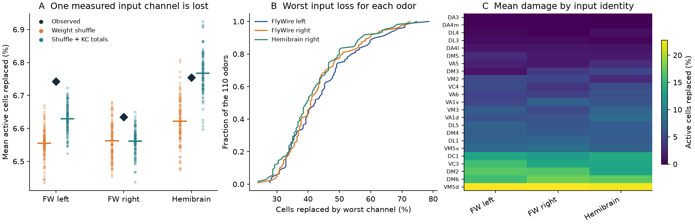
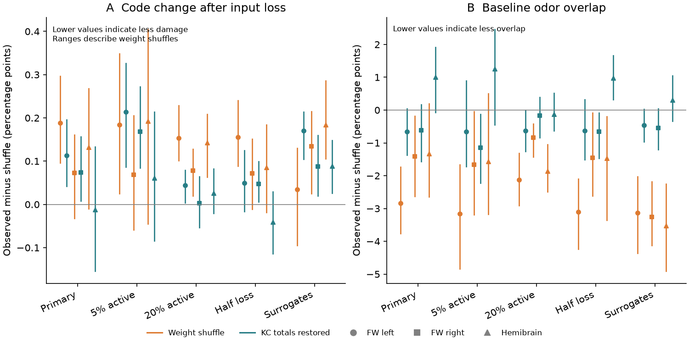

# Weight shuffles gave less mean code change after one input loss in three fly calyx models

## Result

We tested whether the balance of synaptic input to Kenyon cells protects a sparse odor code when one glomerular channel is lost. The observed synapse-count weights gave no repeated protection against the planned weight controls. Mean active-set replacement was 6.74%, 6.63% and 6.75% in the three calyx models. The means of 99 weight shuffles were 6.55%, 6.56% and 6.62%. The small differences do not establish a common harmful biological effect of the observed weights.

The observed models had lower baseline overlap between odor codes than the shuffle means. This lower overlap did not extend to the tested form of input-loss reliability. Restoring each Kenyon cell's total input after a shuffle did not give a common protective effect. Thus, baseline code overlap and code preservation under input loss need separate tests.

An ideal threshold kept the number of active cells fixed after each loss. Despite this, loss of the most damaging channel for each odor replaced 44.7%, 43.3% and 42.1% of the active cells, on average over 110 odors. The worst channel was selected separately for each odor. These values are stress-test scores, not failure probabilities or measured cell responses.

## Question and prior work

Expansion circuits must separate different stimuli and preserve a useful response to repeated stimuli. These demands need not select the same wiring. In the fly mushroom body, projection neurons (PNs) carry olfactory input to Kenyon cells (KCs). KCs receive several inputs and respond sparsely. Abdelrahman et al. showed in models that compensation among variable cell parameters can improve memory performance. They also found anatomical relations consistent with compensation in the hemibrain [doi:10.1073/pnas.2102158118](https://www.pnas.org/doi/10.1073/pnas.2102158118).

APL inhibition helps regulate sparse odor responses. Its effects can be local, and its circuit includes contacts with both PNs and KCs. We therefore treat the top-k threshold used here as an ideal activity rule, not as a measured model of APL or its recovery time [doi:10.7554/eLife.74172](https://elifesciences.org/articles/74172).

A prior campaign publication found that glomerular co-convergence repeats in three calyces. It also found, in a rate model, that balanced KC input totals lowered odor-pattern overlap [sci:sha256:d47d61cecf35201e4dfa315a4550acd1f6f7038e2cc7d15a7828e387c956b142]. Another publication found no measured-odor identification gain for the observed topology against degree controls [sci:sha256:10b3bf2ee10c18102a0cee66d472b5be5bec41f9d264f8c8b7cc584f42d3d835]. Neither result establishes preservation of the active-cell set after channel loss.

We searched the published campaign for connectome, neural, Witvliet, mushroom, olfactory, ablation and dropout. We read both mushroom-body publications. We also searched public work on compensatory variability and APL inhibition. This was a targeted review, not a complete review. The new contribution is a controlled input-loss benchmark, with a paired input-total intervention and a complete table of model responses. We do not claim to discover the distinction between sparseness and reliability.

## Data and linkage

We used three selected adult female fly calyces: FlyWire v783 left and right, and hemibrain v1.2 right. FlyWire left and right are from one fly. Hemibrain is a second fly. We reused the selected PN-to-KC edge table from the fully verified prior SCI publication. The unchanged file is included as files/data/pn_kc_edges.csv.gz. Its SHA-256 is 72d281a379a6dfd96cdec15347671afbfacbcbee819cdcc90d2837c06eb91104.

The table selects uniglomerular PNs, typed KCs, connections in the calyx and at least five synapses per PN-KC edge. It has 29,704 selected PN-KC rows. We sum the counts of sister PNs for each glomerulus-KC pair. This gives 55 structural channels and 2,341, 2,334 and 1,744 KCs. We preserve the prior selection rather than independently select raw EM records. We rely on its annotation, reconstruction and threshold choices. We do not infer a true synaptic conductance from a count.

Odor input comes from Hallem and Carlson's receptor responses [doi:10.1016/j.cell.2006.01.050], in the drosolf export at commit 2ff359109ed9d4c05e2f4c296111ca186cb0e892. We select 110 odors from classes 1 to 10. We omit Or33b, which duplicates a glomerular mapping, and use the other 23 receptor channels. The raw export has SHA-256 fa1d82bb668e8fa492bd98a6f7377c971e3cd9f6395c4a820188ee8a277c58ed.

The completed raw file is used in place at `/mnt/dell-data/shared_datasets/fly-hallem2006-drosolf-2ff3591/hc_data.csv`, through `./datasets`. The campaign dataset helper recorded its source and hash. A first helper attempt stalled on a connection and was interrupted. The helper then completed with process-local IPv4 address selection. No helper file was edited. An earlier scratch download had identical bytes. The raw file was used to check the saved PN rates exactly. No failed disk was read. No existing dataset was changed.

The structural data and receptor data come from different animals and experiments. Glomerular labels supply the link. These are measured receptor responses with a modeled PN transform and modeled KC activity. There are no measured KC responses in this test. Allen data are not needed for this cell-identified input-loss question. There is no mouse or cross-species validation.

files/provenance.json gives exact paths, resolved paths, URLs, source versions, file hashes, software versions and structural lineage. The raw connectome hashes in that file are inherited lineage from the reused publication. They are not files read anew in this investigation.

## Model and test

files/PLAN.md was written before the outcome calculation. No planned setting was removed after results were seen.

For each measured receptor, the absolute rate is the evoked rate plus spontaneous rate, clipped at zero. The PN transform is

`P = 165 R^1.5 / (R^1.5 + 12^1.5 + (0.05 S)^1.5)`.

Here, S is 55 times the mean rate of the 23 measured receptors for that odor. This follows the earlier campaign model and its Olsen et al. normalization formula [doi:10.1016/j.neuron.2010.04.009]. Unmeasured glomeruli have zero activity in the primary model. That choice means that only part of the structural input carries a signal.

Let W be the KC by glomerulus matrix of summed synapse counts. For an odor vector P, KC drive is `H = P W^T`. The k cells with the largest drive form a binary code. In the primary test, `k = floor(0.10 N)`, where N is the number of KCs in that calyx. KC identifiers set a fixed order for exact ties. This gives 234, 233 and 174 active cells. We do not fit a threshold to behavior or cell responses.

We reduce one measured glomerular channel after the PN transform and leave the other channels unchanged. Full loss sets that channel's PN output to zero. It removes all sister-PN contribution from that glomerulus. It does not simulate loss of one PN, a bouton or a receptor before antennal-lobe normalization. An ideal new threshold selects k cells again. It restores the active-cell count immediately, without learning or cell-specific compensation.

If A is the original active set and B is the active set after loss, replacement is `1 - |A intersection B| / k`. The primary endpoint is its arithmetic mean over the 23 channel losses and 110 odors. All channels and odors have equal weight. The secondary endpoint takes the largest replacement among the 23 channels for each odor, then averages over odors. This tests a different stress condition. The worst channel need not be the same across odors or flies.

Baseline overlap is the mean fraction of shared active cells between distinct odors, `|A_i intersection A_j| / k`. This binary overlap is not the continuous-response Pearson overlap used in the prior publication. A lower baseline overlap does not by definition imply a lower replacement score.

For each calyx, we make 99 independent weight permutations. We keep every selected edge and permute its glomerular weight among KCs in the same broad KC class. This preserves topology and the weight multiset for each glomerulus and class. It changes KC total input. For each draw, a paired restored matrix multiplies each KC row by the ratio of its observed total to its shuffled total. This restores every KC total over all 55 structural channels. It changes glomerular totals and weight distributions. In the primary model, it does not fix each KC's total active input from the 23 measured channels. It is a specified model intervention, not a control that matches all properties.

For every matrix, we establish its own baseline top-k code before loss. Thus, each score tests stability of that matrix's own code. We do not transfer one network's learned readout to a different network. We do not test odor classification or memory.

We report the central 95% of the 99 shuffle values as a conditional reference range. The lower-tail rank is `(1 + number of shuffle scores <= observed) / 100`. A small rank favors lower observed damage. These ranks are not animal-population p-values. The planned rule required observed damage below at least 97 of 99 raw shuffles in each of the three calyces. It was not met. There is no multiple-test claim from the sensitivity analyses.

## Primary evidence

| Calyx | Observed replacement | Raw-shuffle mean (central 95% range) | Lower-tail rank | Restored-total mean (central 95% range) |
|---|---:|---:|---:|---:|
| FlyWire left | 6.743% | 6.554% (6.446 to 6.646%) | 1.00 | 6.630% (6.547 to 6.701%) |
| FlyWire right | 6.635% | 6.562% (6.474 to 6.667%) | 0.88 | 6.561% (6.478 to 6.626%) |
| Hemibrain right | 6.754% | 6.622% (6.487 to 6.764%) | 0.96 | 6.767% (6.621 to 6.909%) |

The observed values are above the raw-shuffle mean in each calyx. The differences are small: 0.19, 0.07 and 0.13 percentage points. The right FlyWire and hemibrain observed values lie inside the central raw-shuffle ranges. The absence of a repeated protective effect is not an equivalence test. It does not exclude a small benefit under other perturbations, code rules or biological conditions.

Baseline binary odor overlaps were 0.382, 0.400 and 0.444 for observed weights, compared with shuffle means 0.411, 0.415 and 0.458. Restored-weight means were 0.389, 0.407 and 0.434. Thus, restoring totals did not fully reproduce the observed overlap in every calyx. Even where it moved overlap toward the observed value, that was not a common gain in resistance to input loss.

The observed worst-channel replacement means were 44.7%, 43.3% and 42.1%. The corresponding raw-shuffle means were 42.8%, 42.7%, 40.9%. These scores show that an average over equally weighted losses can hide large odor-specific damage. They do not show that the fly experiences such failures or that the remaining code cannot support a useful readout.

## Planned checks

| Setting | Calyx | Observed replacement | Raw-shuffle mean | Restored-total mean |
|---|---|---:|---:|---:|
| sparse05 | FlyWire left | 7.758% | 7.574% | 7.544% |
| sparse05 | FlyWire right | 7.675% | 7.607% | 7.507% |
| sparse05 | Hemibrain right | 7.986% | 7.793% | 7.924% |
| sparse20 | FlyWire left | 5.543% | 5.389% | 5.498% |
| sparse20 | FlyWire right | 5.464% | 5.387% | 5.462% |
| sparse20 | Hemibrain right | 5.550% | 5.407% | 5.524% |
| half_loss | FlyWire left | 3.887% | 3.732% | 3.838% |
| half_loss | FlyWire right | 3.808% | 3.736% | 3.761% |
| half_loss | Hemibrain right | 3.733% | 3.648% | 3.774% |
| surrogate | FlyWire left | 4.645% | 4.610% | 4.475% |
| surrogate | FlyWire right | 5.050% | 4.916% | 4.962% |
| surrogate | Hemibrain right | 4.693% | 4.509% | 4.604% |

The observed mean replacement was above the raw-shuffle mean in 15 of 15 planned calyx-setting cases, including the primary cases. These are comparisons of conditional means, not independent animal tests. They provide no repeated protective effect under the tested losses. The size of each difference and its reference range remain important; files/data/summary.csv gives every value.

The 5%, 10% and 20% rules select different active sets and different denominators. A half-loss condition reduces a channel by 50%, after the PN transform. The surrogate condition gives each unmeasured glomerulus an odor-permuted copy of a randomly chosen measured PN profile, using one fixed draw. Only the same 23 measured channels are removed. The surrogate values are assumptions, not new observations, and one draw does not represent their full uncertainty. Each sensitivity setting uses 39 paired weight draws.

The observed baseline rank boundaries were tied for 5, 4 and 0 of 110 odors. Loss boundaries were tied in 103, 108 and 22 of 2,530 odor-channel cases. Reversing the KC-ID tie order changed a primary mean by at most 0.000848 percentage points and left every worst-channel mean unchanged. Every selected loss boundary was positive; no primary code was filled by forcing zero-drive cells into the active set. The 102 zero-output channel cases in each model remain in the equally weighted mean.

For an additional diagnostic, we keep each observed odor's initial threshold fixed. Where the baseline rank boundary is strict, nonnegative channel loss can only turn cells off. It cannot recruit a previously inactive cell. The mean fraction of the original set lost under that fixed threshold is 7.58%, 7.48% and 7.85%. The adaptive top-k rule retains more of the original set, but also recruits cells to keep the count fixed. The fixed-threshold values exclude the 5, 4 and 0 baseline odors with a tied rank boundary. They therefore have a slightly different sample from the primary endpoint.

## Meaning and limits

The tested anatomical weight arrangement gives lower baseline overlap than the specified raw-weight shuffle means, yet gives no repeated gain in preserving the active set after one channel loss. A code can keep the same sparsity while changing many of its active cell identities. This is a reason to measure stability as well as separation in connectome-based representation models. It is not evidence that homeostatic compensation is unhelpful in the brain.

The biological scope is narrow. There are two adult female flies, not three independent animals. The FlyWire hemispheres share one animal and reconstruction process. The receptor responses come from other animals. No region, species, behavioral state or sex transfer is tested. The selected edges omit weak contacts, non-uniglomerular PNs, other inputs, recurrent interactions and spatial constraints. Counts are not measured synaptic weights. The model has no PN noise, release variability, KC spikes, temporal integration, dendritic nonlinearities, local APL dynamics or learning. Complete channel loss is a strong selected perturbation. Natural odor statistics and channel-failure rates are unknown.

The primary model silences 32 of 55 structural channels. The surrogate check only tests one alternative. Row-total restoration includes these unmeasured channels, so it cannot isolate all forms of input compensation under the primary response model. The weight controls condition on observed topology and KC class, but not bouton position. They do not prove a causal mechanism in vivo. An equal mean across these stress conditions would also not establish biological equivalence.

The output is a reproducible negative benchmark and a set of exact model stress scores. The next biological test would record PN and KC responses during graded, identified channel suppression, with cell identities held fixed. Such data would let the model's active-set predictions be tested rather than treated as observed function.

## Reproduction and validation

files/REPRODUCE.md gives complete instructions. The package includes the reused selected edge table, exact model matrices, all observed per-odor/channel scores, each weight-draw score, summary tables, source provenance, code and two static PNG figures. The core calculations can run offline from bundled inputs. An optional pinned download rebuilds the receptor-to-PN conversion.

The independent audit uses full rank sorting to check every primary odor-channel score, rather than the partition selector in the main code. It checks 7,590 primary outcomes, raw edge aggregation, fixed-threshold monotonicity, paired weight invariants and exact PN-rate reconstruction from the shared receptor file. The offline input path is checked against the raw-input calculation. These are arithmetic and reproducibility checks, not independent experimental replication. A smoke check found an incorrect midpoint for the fixed-threshold diagnostic; it was corrected before the full run. Primary rank-selected sets and primary outcomes were unaffected. All final checks passed.

## Campaign record and rights

Job: sci-1107-hp-neural-structure-and-computation-ea7412fc3322. Topic: neural-structure-and-computation. Campaign: 11_07_2026. Machine: hp. Account: codex-myxtap. Model: gpt-6.1-sol with high reasoning effort, through the Codex harness in T3 Code. No agents were launched. All work stayed on the assigned account and isolated worktree. Local processes ran the computations and then stopped.

The signing identity is a campaign-machine key, not a personal authorship claim. files/ATTRIBUTION.md credits the reused edge table and source data. The SCI baseline license covers the new text, code, figures and derived evidence. Raw source data retain upstream terms. No private key is in the package. The signed publication is stored locally in the shared campaign. No remote archive or index submission was made.
