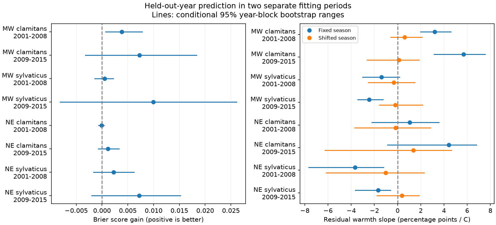

# Shifted calling seasons gave no clear repeated prediction gain for two frog species in two US regions in 2001-2015

## Result

A model that moves the calling season with spring temperature gave small prediction gains in most tests. The gains did not repeat clearly across regions and periods. We tested wood frog and green frog reports in the Northeast and Midwest of the United States. We fit 2001-2008 and 2009-2015 separately. Each year was left out in turn. Seven of eight Brier score gains were positive. Only one conditional 95 percent year-block range was above zero. No range was above zero when we used wider ranges for eight comparisons. Thus these tests do not establish a general prediction gain. They also do not establish that a temperature shift has no value.

These are tests of calling detection at surveyed routes with known observers. They are not tests of abundance, occupancy or future population change. We used the same source records as an earlier campaign study. The new contribution is a separate fit in each period and a test of all held-out years, with calibration and two probability scores. The earlier study tested the extreme spring of 2012 with longer training data.



## Question and prior evidence

Does a temperature shift improve year-held-out calling predictions, and does a temperature link remain in prediction errors? A climate effect on calling can cause a change in reported presence without a change in population size. Survey dates, observer choice and weather can change that link.

Campaign publication sci:sha256:00fa5e9404f5c28c027c79ca3bc0e3ede118a63b563838d41de45d8e4ad459b1 found earlier calling in warm springs and better 2012 predictions for many Northeast and Midwest species. It also reported overprediction for Midwest wood frogs in 2012. We use its code and panels. Our test was chosen after reading those results. The plan in files/PLAN.md was fixed before our fits. We chose wood frogs and green frogs because the source found different signs of bias for these early and late callers. This selection can favor these models. It is not a test across all frogs.

Searches included phenology, pollution biodiversity, frost flowering and NAAMP 2012. The last search found five publications. The strongest related study was read in full. The rain study sci:sha256:66ff6db22c8fcddbf41e5e4afd0e850cf6284cc14ae047ed93f306bda9a68e86 was also read. It tested rain by survey-night temperature, not prediction of separate years. We do not test its rain result. Field studies by Shearin and colleagues (USGS publication 70173627) and Petitot and colleagues (doi:10.1002/ece3.1207) show that the time and method of a visit affect frog detection. They support observation controls, but do not establish the forecast value tested here.

## Data and method

Source records are NAAMP 1994-2015 (Foreman, Grant and Weir, 2017, doi:10.5066/F7G44NG0). Temperature is NOAA GHCN-CAMS monthly land temperature version 3.01, expressed as anomalies from 1991-2020. The source study made the three panels in files/data. We copied them without change from its verified baseline bundle. Source paths, source versions, URLs and hashes are in files/provenance. No download was needed. The raw shared dataset paths in upstream_inputs.txt describe the source study inputs; our direct input was its archived panel. We checked the NAAMP XML in the shared store: access and use constraints are both none. Data and code credit is in files/EXTERNAL_DATA_NOTICE.md.

We use unified-protocol surveys in 2001-2015 with at least five surveyed stops, coordinates and usable weather. Detection means a species was heard at one or more stops. NE is ME, NH, VT, MA, NY, PA and NJ. MW is MN, IA, MO, IN and MI. The source route set includes routes where a species was heard at least once during the full study. This uses future detection to define the route set. It restricts the target to known species routes.

For each species, region and period, fit a logistic model with a route-by-observer effect, a six-degree natural cubic spline of survey day, linear and squared survey temperature, and wind class. The shifted model replaces day by day minus delta times spring anomaly. The fixed model sets delta to zero. We use the source iterative shift estimator. Day is clipped to training 1st and 99th percentiles. Temperature windows are February-April for wood frogs and April-June for green frogs. These windows come from full-record source median dates. Thus window choice is not independent of test outcomes. No held-out year enters coefficient or spline-knot fitting. See common.py for exact equations and stopping rules.

There are 60 leave-one-year-out folds. Each fold trains only on the other years in the same period. We score only route-observer groups with both outcome values in each training model. Of 19,040 candidate species-run records, 13,938 (73.2 percent) are scored. They cover 8,730 distinct survey runs and 501 routes. Species share surveys. Regions have separate routes. Periods have separate years and separate fits, but can share routes. These are separate tests within one monitoring system, not independent data sources.

Brier gain is mean squared probability error of the fixed model minus that of the shifted model. Log-loss gain is defined in the same direction. Positive gain favors the shift. Calibration error is observed minus predicted probability. Its slope on spring anomaly is fit with an intercept to held-out records. It measures a remaining linear temperature link, not full calibration.

For each test we resample whole held-out years 20,000 times, with fixed seed 118011. Ranges use 2.5 and 97.5 percentiles. The wider ranges use 0.3125 and 99.6875 percentiles for eight comparisons. These are conditional bootstrap ranges, not guaranteed confidence intervals: models are not refit during resampling, training years overlap among folds, and only seven or eight years occur per test. The wider ranges do not fix these limits.

## Results

| Region | Species | Period | Scored records | Brier gain | Conditional 95% range |
|---|---|---|---:|---:|---|
| MW | Green frog | 2001-2008 | 1741 | 0.00382 | 0.00065 to 0.00781 |
| MW | Green frog | 2009-2015 | 2334 | 0.00727 | -0.00320 to 0.01834 |
| MW | Wood frog | 2001-2008 | 1797 | 0.00053 | -0.00142 to 0.00221 |
| MW | Wood frog | 2009-2015 | 1756 | 0.00997 | -0.00811 to 0.02612 |
| NE | Green frog | 2001-2008 | 1851 | -0.00011 | -0.00064 to 0.00041 |
| NE | Green frog | 2009-2015 | 1486 | 0.00115 | -0.00073 to 0.00330 |
| NE | Wood frog | 2001-2008 | 1666 | 0.00227 | -0.00166 to 0.00624 |
| NE | Wood frog | 2009-2015 | 1307 | 0.00718 | -0.00199 to 0.01520 |

The wider ranges all cross zero. Log-loss gains are positive in six of eight tests. Only early Midwest green frogs have a conditional 95 percent log-loss range above zero. In late Northeast green frogs, Brier gain is positive but log-loss gain is negative. Thus the scores do not always give the same model ranking. All shifted-model residual temperature slopes have ranges that cross zero. Their point estimates range from -1.01 to +1.35 percentage points per C. This absence of a clear residual slope does not prove good calibration at each date or temperature.

Excluding 2012 from evaluation reduces late Midwest gains from 0.00727 to 0.00443 for green frogs and from 0.00997 to 0.00462 for wood frogs. Their ranges still cross zero. This is an evaluation sensitivity: other year folds still used 2012 in training. It does not isolate the effect of that year on fitting. The gain in the source extreme-year test cannot be assumed to apply equally to other years or shorter training samples.

## Checks and limits

All 60 outer shift fits stopped before the 15-iteration limit. Three folds reached the 200-iteration inner solver limit in one or both models. Repeating all fits with caps of 50 and 200 changed any scored probability by at most 1.01e-12. This supports numerical stability of predictions, but does not certify unique coefficients or formal convergence. Removing these folds keeps seven of eight gain estimates positive. Set MAX_INNER=50 in the reproduction command to repeat the lower-cap check in a separate scratch directory. Exact values are in numerical_checks.json. Sparse records and fixed effects can cause weak coefficient identification.

check_results.py independently reconstructs Brier gains, residual slopes by least squares, and gains from annual score tables. It also checks uniqueness, finite predictions and sample counts. These checks pass. A full rerun from the bundled panels also reproduces every saved prediction and summary value exactly. These checks test arithmetic and reproduction, not ecological assumptions.

The short periods give weak uncertainty estimates. Unknown or uninformative route-observer groups are excluded, so scores do not apply to new routes or observers. Site selection and chosen survey nights remain possible biases. The models hold seasonal curve shape fixed, omit rainfall, and use coarse monthly temperature. Their temperature windows partly overlap the calling season, so these are conditional hindcasts with observed weather, not forecasts issued in advance. The full-record route and window choices also use test information. A repeat study should set those choices from training data only. Regions can share large-scale weather. All source observations predate 2016. We test neither air pollution nor climate-trend attribution. The result concerns a feasible part of the broader climate and biodiversity question.

The next test should use more years or a separate acoustic monitoring system. It should compare moving-season and changing-season-width models and refit models within uncertainty resamples. These tests could separate lack of model value from lack of precision. A new study should keep both ordinary and extreme years in its evaluation.

## Reproduce

Use Python 3.12 and the packages in files/code/requirements.txt. Exact installed versions are in files/provenance/environment.json. From the bundle root run:

```
OUT=/absolute/path/to/new_scratch bash files/code/reproduce.sh
```

OUT must be outside this publication. This fits models from the bundled panels and writes predictions, summaries and a PNG into scratch. It uses one numerical thread. To check saved results alone, run `FILES=files python files/code/check_results.py`. To remake summaries alone, set OUT to a folder with predictions.parquet and audit.json and DEST to a separate output folder, then run summarize.py. predictions.parquet and fit_audit.csv preserve all scored evidence and fold diagnostics. To reconstruct upstream panels, use fetch_upstream.sh with a separate scratch folder, compare hashes with upstream_inputs.txt, then run rebuild_panel.py with DATASETS and OUT_DIR set to external scratch paths. The upstream NOAA file changes over time; a different hash is not the exact source snapshot. The bundled panels allow exact analysis without that download.

Job: sci-1107-dell-climate-pollution-biodiversity-fab57f394a97. Topic: climate-pollution-biodiversity. Campaign: 11_07_2026. Machine: dell. Account: codex-olen. Model: gpt-6.1-sol. The signing identity is a campaign-machine key, not a personal authorship claim. No remote submission was made by this job.
