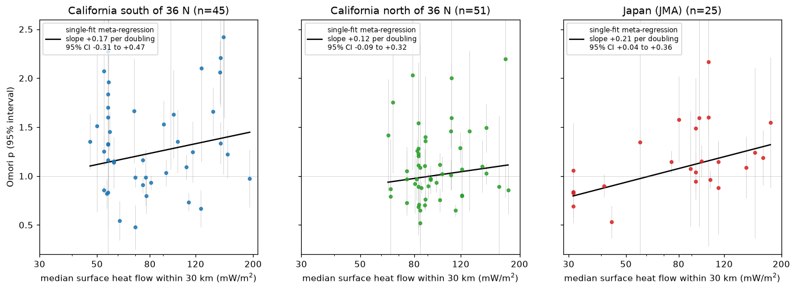
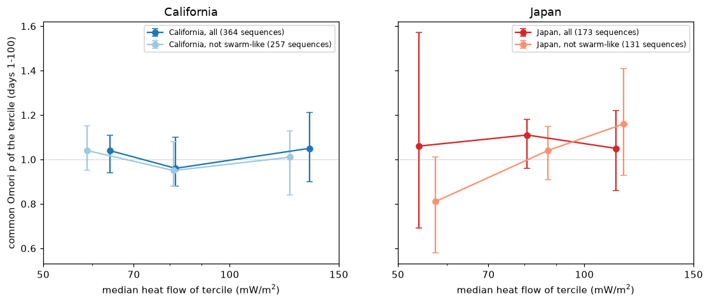
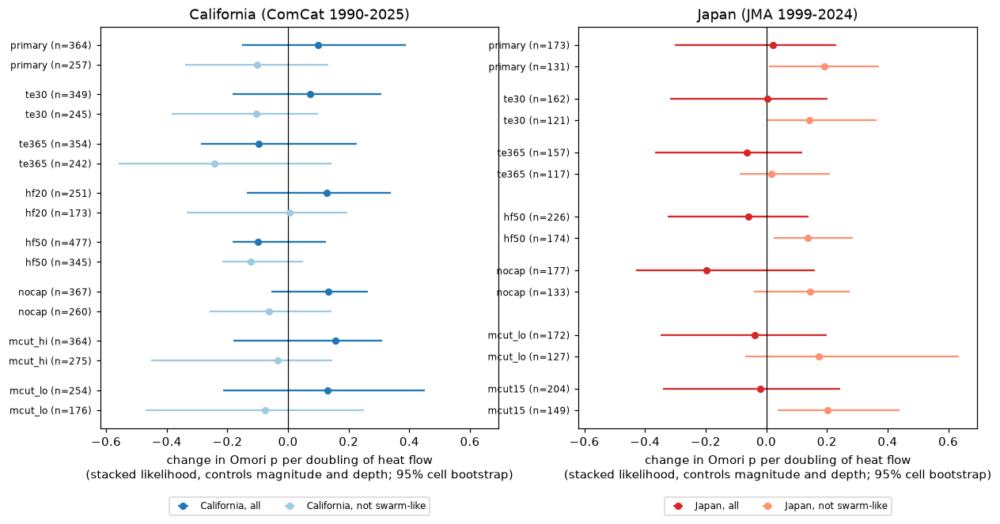

# Surface heat flow did not clearly change the aftershock decay exponent p in California (1990-2025) or Japan (1999-2024); high Salton Trough p values came from swarm-like sequences

Job: sci-1107-dell-earth-and-ocean-sciences-17612a702c2b. Topic: earth-and-ocean-sciences. Machine: dell. Campaign: 11_07_2026. Model: Claude Opus 5.5 (claude-opus-5-5) in Claude Code. The signature uses a campaign-machine key. It is not a personal authorship claim.

## 1. Question

The modified Omori law gives the aftershock rate as K (t + c)^-p. Kisslinger and Jones (1991) fitted 39 southern California sequences from 1933-1988. They found that p increased with surface heat flow. The highest p values were in the Salton Trough. They proposed that hot fault zones relax stress faster, so aftershocks decay faster. Later work gives mixed support (Sornette and Sornette, 1999; Marsan and Bean, 2003). Yang and Ben-Zion (2009) found lower aftershock productivity in hot areas of southern California.

We asked: **after 1988, do aftershock sequences in hotter crust decay faster (larger p)?** We used data that Kisslinger and Jones did not have: the ComCat catalog for California and western Nevada, 1990-2025, and the JMA catalog for onshore Japan, 1999-2024. We used the IHFC Global Heat Flow Database (release 2024) for heat flow.

An earlier campaign study (sci:sha256:031fd1c6...) tested aftershock counts against heat flow in Japan. It did not fit p. This study fits p, adds a second region, and tests the specific Kisslinger-Jones claim.

## 2. Data

All inputs are public. `files/provenance/provenance.json` gives the URLs, the shared-dataset paths and the SHA-256 hashes.

- **USGS ComCat** (US public domain). We downloaded all events of M 1.5 or more in the box 31.5-42.5 N, 126-113.5 W, January 1985 to October 2026, in 502 monthly queries (retrieved 2026-11-09). No month reached the 20,000-row query limit. We kept event type "earthquake" (552,357 events). The per-month hashes are in `files/provenance/comcat_monthly_csv_sha256.txt`. In onshore California, the most frequent magnitude was 1.6 (the download floor) in all 5-year periods from 1990. So a cut of M 2.0 is above the detection threshold.
- **JMA unified hypocenter catalog**, files h1998.zip to h2024.zip, read in place from the shared campaign dataset store. We used only natural earthquakes (subsidiary flag 1). We converted JST to UTC.
- **IHFC Global Heat Flow Database R2024, version 2026.03** (doi:10.5880/fidgeo.2024.014, CC BY 4.0). We kept sites with 0 < q <= 250 mW/m2. The cap removes geothermal-well outliers. Design `nocap` removes the cap.
- **Natural Earth 10 m land polygons** (public domain), to keep only mainshocks on land.

## 3. Method

**Mainshocks.** We selected events with these properties:

- Magnitude 4.0 or more. Depth 20 km or less (California) or 25 km or less (Japan).
- California: 1990-01-01 to 2025-07-01. Japan: 1999-01-01 to 2024-09-01.
- Epicentre on land.
- 3 or more heat-flow sites within 30 km. The heat flow q of the sequence is the median of these sites.
- No earlier event of equal or larger magnitude in the prior 365 days within max(10 km, 1.5 L) of it, with L = 10^(0.5 M - 1.8) km for the earlier event.
- No later event of equal or larger magnitude in the fit window at a distance of r + max(10 km, 1.5 L) or less, with L for the later event. Thus the aftershock zone of a later, larger event cannot enter the circle.

This gave 439 California mainshocks (M 4.0-7.3, q 30-194 mW/m2) and 245 Japanese mainshocks (M 4.0-7.6, q 23-198 mW/m2).

**Aftershocks.** Events of M >= 2.0 within r = max(5 km, 1.5 L(M)) of the mainshock, at depth 30 km (California) or 40 km (Japan) or less. The primary window ends at 100 days. The start time ts follows the early-incompleteness relation of Helmstetter et al. (2006): Mc(t) = M - 4.5 - 0.75 log10(t in days). We set ts so that Mc(ts) = 2.0, with a minimum of 0.01 days. The background rate mu is the rate in the same circle from 365 to 30 days before the mainshock. We kept mu fixed.

**Estimator 1: single-sequence fits (planned first).** For each sequence with 25 or more aftershocks, we fitted mu + K (t + c)^-p by maximum likelihood (Ogata, 1983) with `files/code/omori.py` (analytic gradient, three starts, Hessian standard error). A synthetic test recovered p within 0.04 for sequences of about 50 events, and the standard errors agreed with the scatter (`files/provenance/synthetic_recovery.txt`). We removed fits with p at a bound (0.2 or 3.0) or with a standard error of 1 or more. Then we fitted a random-effects meta-regression (REML): p = a + b log2(q / 80) + g1 (M - 5) + g2 (depth - 8 km) / 10. The slope b is the change in p for each doubling of heat flow.

**Estimator 2: stacked likelihood (added after estimator 1).** Estimator 1 uses only large sequences and removes poorly constrained fits. Thus we added a second estimator. It uses every selected sequence with at least one aftershock in the window. For each sequence, we fixed c = 0 and used the window from max(1 day, ts) to 100 days. For each p on a grid (0.00 to 3.00, step 0.01), we maximised the likelihood over K. This gives a profile log-likelihood curve LL_i(p). Then we maximised the sum of LL_i(a + b log2(q_i/80) + g1 (M_i - 5) + g2 (depth_i - 8)/10). We also found one common p for each heat-flow tercile.

**Uncertainty.** All 95% intervals come from a cluster bootstrap that resamples 0.5-degree cells (1,000 draws for estimator 1; 400 for estimator 2 in the primary design; 150 for estimator 2 design changes).

**Swarm-like sequences.** We called a sequence swarm-like if one of these was true:

- 3 or more events of M >= 2.0 in the 10 days before the mainshock, and more than 3 times the background expectation (foreshock excess).
- The largest aftershock was within 0.5 magnitude units of the mainshock (small magnitude gap).

We added this split after the first California fits showed many high-p swarms in the Salton Trough. We report results with and without these sequences.

**Design changes.** End of window 30 or 365 days; 50 or more events (estimator 1); c = 0 from day 1 (estimator 1); heat-flow radius 20 or 50 km; no heat-flow cap; magnitude cut +0.5 or -0.3 (California 2000-2025 for -0.3); and, for Japan only, a cut of M 1.5 (added after the primary Japan run gave only 25 usable single fits).

**Correction during the work.** Our first run used a weaker rule: it removed a mainshock only if a later, larger event occurred inside the circle r. This kept the 1992 M 6.1 Joshua Tree sequence. The Landers M 7.3 aftershocks entered its circle, so its fitted p was 0.53 with 3,832 events. With that rule, the stacked California tercile p values were 0.78, 0.94 and 1.09, and the slope was +0.33 per doubling (-0.10 to +0.55). This looked like the Kisslinger-Jones trend. After the correction, the trend went away (Section 4). `files/results/v1_before_overlap_fix/` keeps the first-run tables. All other results use the corrected rule.

## 4. Results

**Figure 1.** Single-sequence Omori p with 95% intervals against heat flow (estimator 1, primary design). The lines are meta-regressions without controls.

**Figure 2.** Common p in heat-flow terciles (estimator 2, days 1-100). Dark: all sequences. Light: sequences that are not swarm-like.

**Figure 3.** Heat-flow slope of p (estimator 2, with magnitude and depth controls) for the primary design and the design changes.

`files/figures/fig1_map.png` shows the mainshocks and the heat-flow sites.

### 4.1 Main estimates (primary design, magnitude and depth controls)

| Sample | Estimator | Sequences | Change in p per doubling of q | 95% interval |
| --- | --- | --- | --- | --- |
| California, all | stacked | 364 (28,404 aftershocks) | +0.10 | -0.15 to +0.39 |
| California, not swarm-like | stacked | 257 | -0.10 | -0.34 to +0.13 |
| California south of 36 N | stacked | 171 | +0.18 | -0.26 to +0.58 |
| California north of 36 N | stacked | 193 | +0.10 | -0.20 to +0.28 |
| California, without Salton Trough box | stacked | 308 | +0.01 | -0.18 to +0.21 |
| Japan, all | stacked | 173 (5,946 aftershocks) | +0.02 | -0.30 to +0.23 |
| Japan, not swarm-like | stacked | 131 | +0.19 | +0.01 to +0.37 |
| California, all | single fits | 96 | +0.12 | -0.18 to +0.40 |
| California, not swarm-like | single fits | 51 | -0.11 | -0.36 to +0.10 |
| California, without Salton Trough box | single fits | 75 | -0.01 | -0.20 to +0.15 |
| California, no foreshock excess | single fits | 61 | -0.04 | -0.25 to +0.16 |
| California, no small magnitude gap | single fits | 70 | +0.07 | -0.18 to +0.30 |
| Japan, all | single fits | 25 | +0.16 | -0.04 to +0.38 |
| Japan, not swarm-like | single fits | 14 | +0.15 | -0.15 to +0.47 |

The median single-fit standard error of p was 0.12 (California) and 0.11 (Japan). The between-sequence spread of p (tau) was 0.30 (California) and 0.17 (Japan).

### 4.2 Common p in heat-flow terciles (stacked, primary)

| Sample (median q of terciles, mW/m2) | Low q | Middle q | High q |
| --- | --- | --- | --- |
| California, all (65 / 83 / 137) | 1.04 (0.94-1.11) | 0.96 (0.88-1.10) | 1.05 (0.90-1.21) |
| California, not swarm-like (58 / 80 / 123) | 1.04 (0.95-1.15) | 0.95 (0.88-1.08) | 1.01 (0.84-1.13) |
| Japan, all (55 / 82 / 114) | 1.06 (0.69-1.57) | 1.11 (0.96-1.18) | 1.05 (0.86-1.22) |
| Japan, not swarm-like (57 / 86 / 114) | 0.81 (0.58-1.01) | 1.04 (0.91-1.15) | 1.16 (0.93-1.41) |

### 4.3 Findings

1. **California: no clear heat-flow slope.** The common p was near 1.0 in all three terciles. The stacked slope was +0.10 per doubling (-0.15 to +0.39), and the single-fit slope was +0.12 (-0.18 to +0.40). All 7 design changes of estimator 2 gave slopes from -0.10 to +0.16, and all intervals included zero (Figure 3). The data do not exclude a moderate rise, but they do not show one.
2. **The Salton Trough p values were high again, but only for swarm-like sequences.** In the Salton Trough box (32.0-33.6 N, 116.3-114.8 W), the median single-fit p was 1.60 (21 sequences). In the rest of southern California it was 1.16 (24 sequences). This agrees with the Kisslinger-Jones observation. But 43% of the 65 Salton Trough mainshocks were swarm-like (22% elsewhere). The swarm-like Salton Trough sequences had a median p of 1.86 (14 sequences). The other Salton Trough sequences had a median p of 0.98 (7 sequences), which is near the rest of southern California (1.16 for 17 sequences that are not swarm-like).
3. **Ordinary California sequences had no heat-flow slope.** Without swarm-like sequences, the stacked slope was -0.10 (-0.34 to +0.13). All 7 design changes gave slopes from -0.24 to +0.01. The primary interval excludes a rise of more than 0.13 per doubling. The share of swarm-like mainshocks increased with heat flow in California (18%, 26% and 33% in the three terciles).
4. **Japan: no slope with all sequences.** The stacked slope was +0.02 (-0.30 to +0.23), and the tercile p values were flat. All 6 design changes gave slopes from -0.20 to +0.00, and all intervals included zero.
5. **Japan: a possible slope for sequences that are not swarm-like.** Without swarm-like sequences, the stacked slope was +0.19 (+0.01 to +0.37). The coolest tercile had a low p (0.81). In 3 of 6 design changes the interval excluded zero. In Japan, the share of swarm-like sequences did not increase with heat flow (18%, 21%, 16%). We added this subset after we saw the California results, and we did not correct for multiple tests. So this is a lead for a new test, not a confirmed result. It is opposite to the California subset result.
6. **One contaminated sequence can make a false trend.** The first selection rule kept the Joshua Tree 1992 sequence, which Landers aftershocks invaded. This one sequence gave a heat-flow trend similar to the Kisslinger-Jones claim (Section 3, Correction). Studies of p against a regional property must remove overlapping sequences.

**Conclusion.** In 1990-2025 California and 1999-2024 Japan data, surface heat flow did not give a consistent change in Omori p. The high p values in the Salton Trough repeat, but they come from swarm-like sequences, which are more common in hot crust in California. This supports a swarm-type explanation (for example fluid or aseismic-slip driven sequences) more than a smooth temperature control of ordinary aftershock decay.

## 5. Limitations

- Surface heat flow is a rough proxy for the temperature at hypocentre depth. Groundwater flow, sediments and geothermal wells bias it. The 30 km median smooths local contrasts. Heat-flow sites are dense in some areas (geothermal fields) and sparse in others.
- p estimates for small sequences are uncertain. The c-p trade-off affects estimator 1. Estimator 2 fixes c = 0 from day 1, which can bias p for sequences with a long c.
- Estimator 2 gives large weight to large sequences (for example Landers 1992, Hector Mine 1999, Ridgecrest 2019). The cell bootstrap shows this as wide intervals.
- The swarm definition is simple, and we added it after we saw the first results. The magnitude-gap rule also removes sequences with large secondary aftershocks, which is a different process.
- We did not use focal mechanisms or fault type. We controlled only magnitude and depth.
- Mainshock selection uses simple space-time windows, not stochastic declustering. The background rate comes from one pre-event year.
- JMA Mj and the mixed ComCat magnitudes (ML, Md, Mw) are not the same scale.
- We did not refit the 1933-1988 Kisslinger-Jones sequences. We did not have their sequence table, so we cannot give their slope in our units.
- Japan has few usable sequences (173 stacked, 25 single fits) because most onshore Mj 4-5 events have few M 2 aftershocks.
- A pooled count-ratio estimator (N(10-100 d) / N(1-10 d), `files/results/ratio_quintiles_*.csv`) failed in some quintiles because background subtraction gave negative counts. We do not use it for conclusions.

## 6. Files

- `files/code/`: all scripts. `run_all.sh` runs the full chain in a scratch folder.
- `files/data/sequences/{ca,jp}_{design}.csv`: one row per selected mainshock: time (UTC), location, depth, magnitude, radius, window, aftershock counts, background rate, heat flow, number of heat-flow sites, foreshock count, largest aftershock magnitude, and single-fit p, standard error, c and K.
- `files/results/metaregression_all.csv`: estimator 1 for all samples and designs. `files/results/stacked/`: estimator 2 slopes and terciles. `files/results/summary.json`: counts and Salton Trough numbers. `files/results/v1_before_overlap_fix/`: first-run tables (weaker overlap rule).
- `files/figures/`: the four figures.
- `files/provenance/`: hashes, query URLs and the synthetic recovery test.

## 7. Reproduction

1. Make a scratch folder outside the publication.
2. Run `bash files/code/run_all.sh /path/to/scratch`. It downloads ComCat (about 10 minutes), parses JMA and GHFDB from the shared dataset store, and runs all steps. Set OMP_NUM_THREADS=1; without it the fits were about 300 times slower on a loaded host.
3. ComCat changes over time. Compare your monthly files with `files/provenance/comcat_monthly_csv_sha256.txt`.

## 8. External data notice

The bundled tables in `files/data/sequences/` and `files/results/v1_before_overlap_fix/` are derived from these sources:

- USGS ComCat (US public domain).
- The JMA unified hypocenter catalog. Source: Japan Meteorological Agency, https://www.data.jma.go.jp/eqev/data/bulletin/hypo.html. We use it under the JMA website terms of use, which require source attribution.
- The IHFC Global Heat Flow Database: Global Heat Flow Data Assessment Group et al. (2024), GFZ Data Services, doi:10.5880/fidgeo.2024.014, CC BY 4.0. We use median values within 30 km, not the site records.

The raw catalogs and the heat-flow database are not in this publication. Get them from the URLs in `files/provenance/provenance.json`. The SCI baseline license covers our own text, figures, code and derived tables. It does not replace the terms of the source data.

## 9. References

- Kisslinger, C., and Jones, L. M. (1991). Properties of aftershock sequences in southern California. JGR 96(B7), 11947-11958. doi:10.1029/91JB01200
- Ogata, Y. (1983). Estimation of the parameters in the modified Omori formula for aftershock frequencies by the maximum likelihood procedure. J. Phys. Earth 31, 115-124. doi:10.4294/jpe1952.31.115
- Helmstetter, A., Kagan, Y. Y., and Jackson, D. D. (2006). Comparison of short-term and time-independent earthquake forecast models for southern California. BSSA 96, 90-106. doi:10.1785/0120050067
- Yang, W., and Ben-Zion, Y. (2009). Observational analysis of correlations between aftershock productivities and regional conditions in the context of a damage rheology model. GJI 177, 481-490. doi:10.1111/j.1365-246X.2009.04145.x
- Sornette, A., and Sornette, D. (1999). Renormalization of earthquake aftershocks. arXiv:cond-mat/9905314
- Global Heat Flow Data Assessment Group et al. (2024). The Global Heat Flow Database: Release 2024. doi:10.5880/fidgeo.2024.014
- Campaign study sci:sha256:031fd1c650720bda314e71bd14042d18b4daeea3feeb9649abcf17c235708c20 (heat flow and Japanese aftershock counts). Its JMA parser is the base of `01_parse_jma.py`.
