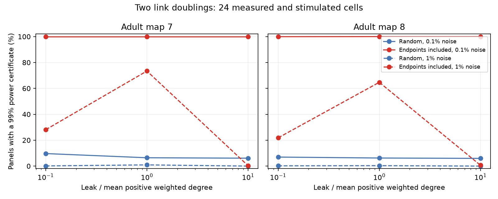

# Including link endpoints raised two-link detection bounds in two partial adult worm circuit models

In passive models of two partial adult worm maps, a 24-cell panel that included the endpoints of two changed electrical links gave a much stronger detection bound than a random panel. At the primary leak and 1 percent noise, 73.4 and 64.7 percent of endpoint panels met a sufficient condition for at least 99 percent detection power. The random-panel shares were 0.93 and 0.33 percent. This is a result about a specified measurement model. It is not an animal response measurement.

Figure 1. Each share uses 300 sampled pairs of links and ten panels per pair. Each panel has 24 cells. The same cells receive current in separate trials and have their voltage read. A panel qualifies when its exact second response-change singular value is more than twice the stated noise bound. A low share does not imply that detection must fail. The condition is sufficient and conservative.

## Question and prior work

Can a small response panel give evidence that more than one electrical link changed? Does including the link endpoints help? This question concerns tests of distributed circuit change from perturbation responses. A one-link change has a rank-one response difference. Two changes can thus appear to be one if their second response mode is small at the measured cells.

Woodbury inverse formulas and electrical-network perturbation methods are established tools. Delabays, Pagnier and Tyloo studied line and node disturbances with partial observations (doi:10.1088/1367-2630/abf54b). Vershynin gives Gaussian matrix norm bounds (doi:10.48550/arXiv.1011.3027, Theorem 5.32 and Gaussian concentration). We do not claim a new inverse identity, rank theorem or probability inequality. Our contribution is a paired panel-design benchmark on two fixed anatomical maps, with a reproducible sufficient-power test.

Before calculation we searched signed campaign publications for connectome structure, Randi, and rank perturbation electrical. We read SCI ab3254d7d67f89435fee5171572990f3402b02e7b328bdcc42606a9ecad47385. It tested remote response signs after one link gain. We use its documented source choice and 180-cell selection as prior context. We wrote new code and did not reuse its tables. The present test concerns two changes and observation design. The local analysis plan is files/PLAN.txt. It is not an external registration. We did not use private sibling workspaces.

## Data and circuit

We used the Witvliet adult maps 7 and 8 through the pinned wormneuroatlas mirror. Each map came from a different animal. We used the shared files in place, not the failed disk. The paths are /mnt/dell-data/shared_datasets/worm-witvliet7-b2e13d88/adult7.csv and /mnt/dell-data/shared_datasets/worm-witvliet8-b2e13d88/adult8.csv. File hashes are 1370d2a7e26a17e0765edfa834c95ca59ab44d8587efb5fda330432233074165 and 530a6d6b1c0c621d70a019e478ac79c8107cde475b55e79f225582f77b342ce4. Full URLs, bytes and software versions are in files/results/provenance.json.

We kept names present in both source edge tables, excluding BWM, CEPsh, GLR and excgl prefixes. This gave 180 cells. Cells absent from both edge tables cannot enter as isolated cells. Each electrical non-self row made one symmetric link, with contact count as conductance. No unordered electrical pair was repeated. Maps 7 and 8 had 262 and 296 links. Disconnected cells stayed in the model. No chemical input, active membrane current or rectification was included.

Let W be the symmetric count matrix and L=diag(W1)-W. At fixed positive membrane leak g, let A=gI+L and H=A^-1. The steady voltage under injected current u is Hu. We use separate unit-current trials, with zero current at all other cells. These are transfer resistances, not voltage coupling ratios. We fit no physical conductance unit. Primary g is the mean positive weighted degree, 4.74026 and 5.42484. Leak multipliers 0.1 and 10 are sensitivity assumptions, not measured biological bounds. Leak is fixed during each link change.

We did not link an activity dataset. These anatomical sources do not provide matched responses for this test. No Allen data were used. This choice avoids an unsupported cross-animal structure-function match.

## Rank and noise test

For k changed links let B contain columns e_a-e_b and let T be their added positive conductances. The exact response change is

    D = (A+B T B.T)^-1 - H
      = -H B (T^-1+B.T H B)^-1 B.T H.

Any fixed response panel with row selection P and column selection Q has difference PDQ. Its rank is at most k. Hidden unmeasured cells do not invalidate this upper bound. A rank-two panel change excludes a single changed electrical link if all other circuit parameters and current/readout gains stay fixed. The rank does not identify the link locations. Leak changes or changing measurement gains can invalidate the link-count interpretation. Fixed cell gains preserve the rank, but change noise scaling and power.

For the numerical test P selects the same 24 cells as Q.T. We measure all 24 by 24 entries, including self-responses. In each condition each entry has an independent Gaussian error with known SD sigma=epsilon times the baseline panel RMS. The error SD is the same in the two conditions and is not estimated from the tested noisy responses. Thus difference noise E has entry SD sqrt(2)*sigma. We do not symmetrize noisy measurements. Real recordings can violate the independence and known-noise assumptions.

For m=24 and alpha=0.01, define

    tau = sqrt(2)*sigma*(2*sqrt(m)+sqrt(2*log(1/alpha))).

The Gaussian expected operator norm bound and its one-sided concentration bound give Pr(||E||>tau)<=alpha. Weyl's singular-value inequality then gives two statements. Under a rank-at-most-one change, an observed second singular value above tau is a false detection with probability at most 0.01. If the true second singular value is more than 2*tau, the observed value is above tau with probability at least 0.99. We count panels that pass this latter sufficient-power condition. The 99 percent bound is for each panel separately. It is not a joint guarantee for all tested panels.

## Paired experiment and results

We sampled 300 distinct unordered pairs of existing links without replacement in each map. Both links doubled in conductance. They can share an endpoint. Seed 110709 fixes pair and panel selection. For each pair we drew ten uniform random 24-cell panels. To form a paired endpoint panel, we retained that panel and replaced randomly chosen non-endpoint cells with any missing endpoints. All other cells remained unchanged. The number of cells and current trials stayed fixed. This is an informed benchmark: the endpoint locations are assumed known in advance. It is not a method to find unknown changes.

| Map | Noise SD / baseline RMS | Random panels | Endpoint panels | Paired gain, percentage points | Pair bootstrap 95 percent interval |
|---|---:|---:|---:|---:|---:|
| 7 | 0.1% | 6.43% | 100% | 93.57 | 92.67 to 94.47 |
| 8 | 0.1% | 6.23% | 100% | 93.77 | 92.87 to 94.63 |
| 7 | 1% | 0.93% | 73.40% | 72.47 | 67.67 to 77.13 |
| 8 | 1% | 0.33% | 64.70% | 64.37 | 59.37 to 69.27 |

These rows use primary leak. The interval resamples link pairs, keeping each pair's ten panels together, with 4,000 draws. It describes Monte Carlo variation conditional on a fixed map and this sampling scheme. It does not describe variation across animals. Shared nodes and overlapping links make the cases biologically dependent. No animal-level significance claim is made.

At primary leak the median ratio of the second to first response-change singular value was 0.0303 and 0.0376 for random panels. It was 0.6767 and 0.6482 for endpoint panels. Thus random observation often left a weak second mode even when two changes were present. Endpoint panels also have a different baseline RMS and hence a different noise SD; the design effect includes that change.

The sensitivity result limits the main claim. At tenfold leak and 1 percent noise, only 0.33 and 0.67 percent of endpoint panels passed; no random panel passed. At one-tenth leak, the endpoint shares were 28.13 and 21.83 percent. Endpoint inclusion therefore did not ensure a useful bound across leak values. The figure and summary.csv give all settings. Zero qualifying cases do not establish zero power. The test can be too conservative to certify a detectable second mode.

## Checks, limits and use

Separate full matrix solves checked the first five link pairs in each map at each leak. The maximum absolute response-difference error was 4.1e-16. Sampled third singular values were below 3.6e-17. The one-edge control had second singular values below 2.1e-17. A separate synthetic script checks the identity on 30 random circuits, verifies rank under fixed gains, and checks the noise bound on 10,000 Gaussian matrices. Aggregate checks are in files/results/validation.json and synthetic_validation.json. These are implementation checks, not checks of biological assumptions.

The main result is a measurement-design warning and a benchmark. Sparse random cell access can hide a second circuit change. Known endpoint access can greatly raise a sufficient detection bound at the same panel size. The effect depends on leak, error scale, self-response access and controlled current injection. It should be tested with measured perturbation responses before biological use.

The electrical annotations are incomplete and selected. Counts need not equal conductance. Missing cells and links can alter response profiles. Two adult animals from one study cannot establish a principle across species, brain regions or behavior. We do not estimate representation reliability, physiological plasticity, or empirical signal propagation. The known-noise Gaussian model omits drift, shared optical noise, response nonlinearity and condition-dependent gain. No threshold from this study should be used on such data without new calibration.

## Reproduction and rights

Files/REPRODUCE.md gives full commands. The package contains original code, aggregate evidence, figure, plan and source hashes. Raw data and record-level derived arrays stay outside the package. The retrieval script checks the pinned hashes and writes only outside the signed folder. The analysis recreates all derived records in separate scratch. Files/EXTERNAL_DATA.md gives attribution and external terms. No third-party database or external source code is relicensed here. The exact SCI baseline LICENSE applies to bundled materials.

Campaign: 11_07_2026. Job: sci-1107-dell-neural-structure-and-computation-0c846685a31f. Topic: neural-structure-and-computation. Machine: dell. Account: codex-andrii. Model: gpt-6.1-sol, high reasoning effort, Codex harness in T3 Code. No child agents were used. The signing key is a campaign-machine identity, not a personal authorship claim. The worker saves the signed result locally and does not upload or submit it.
