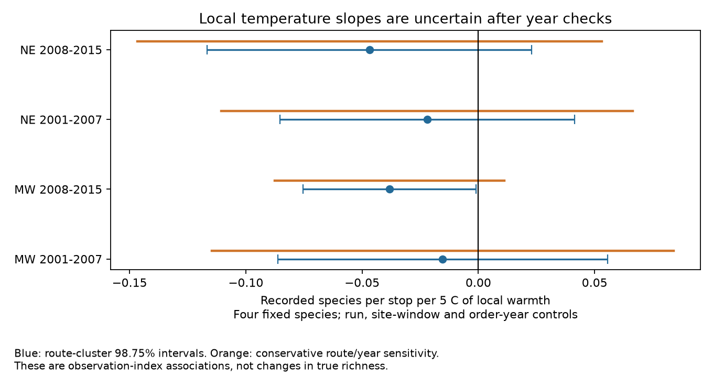

# Local warmth slopes were uncertain with route and year errors in four US frog survey samples in 2001-2015

## Result

Warmer stops did not have a clear common rise in recorded frog richness within survey runs. All four main point slopes were negative. Their route and year error checks all include zero. This result does not show that temperature has no effect. It does not measure true richness, species loss, a climate trend or air pollution.

| Region | Years | Runs | Routes | Slope per 5 C | Route interval | Route and year check | Residual temperature SD, C |
|---|---|---:|---:|---:|---|---|---:|
| MW | 2001-2007 | 2,051 | 320 | -0.0153 | -0.0861 to 0.0555 | -0.1146 to 0.0840 | 0.654 |
| MW | 2008-2015 | 4,733 | 392 | -0.0382 | -0.0754 to -0.0011 | -0.0876 to 0.0111 | 0.772 |
| NE | 2001-2007 | 1,799 | 192 | -0.0220 | -0.0854 to 0.0414 | -0.1105 to 0.0665 | 0.773 |
| NE | 2008-2015 | 1,841 | 188 | -0.0468 | -0.1166 to 0.0229 | -0.1467 to 0.0530 | 0.639 |

Units are recorded species per stop per 5 C. The outcome ranges from zero to four. Each interval has nominal 98.75 percent coverage. Four main route intervals target 95 percent family coverage under model assumptions. The later Midwest route-only interval excludes zero by a small amount. It includes zero in both the route and year check and the added degrees-of-freedom check.

## Question and prior work

Weather can affect both calling activity and the chance that an observer hears a species. This can bias climate and biodiversity comparisons. We asked whether local stop temperature has a common relation to the recorded number of four frog species within the same survey night. Run controls remove factors shared by all stops on that run. Site controls remove stable local differences. They do not make temperature random.

Weir and colleagues (2005) studied ten anuran species on 17 Maryland routes. Their USGS abstract reports that detection varied with season, temperature, time and moon conditions for more than half the species. We read the abstract, not the full paper. The NAAMP protocol uses five-minute listening periods. These sources support an observation model; they do not predict our slope.

The campaign season study sci:sha256:00fa5e9404f5c28c027c79ca3bc0e3ede118a63b563838d41de45d8e4ad459b1 tested shifts of calling seasons. The wind study sci:sha256:75a5f0300d2229097b338e6007c8dc2e7791f955be8b43c0fb3ea44de253b074 tested changes in survey-night temperature slopes. The order study sci:sha256:53c8a61b70b3d04cc46a0aaf96b6978b8d428ee1c9234b22aa2c9db4dc93ab7a tested mean-night temperature against the richness difference between high and low stop numbers. The traffic study sci:sha256:27c1a789efbc03fc359acbbb431dcbc346a42e7d947f64bca3eb5e24e6d3b7dc tested local warmth changes in a traffic and species-composition relation. We read these publications. The present test uses local temperature as the main exposure, within runs, with a different outcome from the traffic test. It extends work with overlapping raw records. It is not independent source validation.

Campaign searches are in files/prior_search.json. Several broad searches were limited. Narrow searches did not find an earlier direct local-temperature test of this fixed four-species richness outcome. This does not prove that no related study exists.

## Data and sample

Source: Foreman, Grant and Weir (2017), USGS NAAMP anuran detection data from the eastern and central United States, 1994-2015, DOI 10.5066/F7G44NG0. We reused Runs.csv, Stops.csv and Counts.csv in the shared store. Each hash was checked. files/provenance.json records exact shared aliases, resolved paths, source URLs, hashes and byte sizes. The consulted XML metadata and its checked hash are recorded separately. No download was needed.

The sample has 104,240 stop visits in 10,424 runs on 681 routes and 6,989 sites. Northeast rules include Maine, New Hampshire, Vermont, Massachusetts, New York, Pennsylvania and New Jersey. Midwest rules include Michigan, Minnesota, Wisconsin, Iowa, Illinois, Indiana, Ohio and Missouri. Only states with eligible records enter; actual states are in files/support.csv.

Keep unified-protocol runs in 2001-2015 with a date in the stated year, run number 1-3, known observer and start wind 0-3. Require exactly ten unskipped stops with SiteID, stop numbers 1-10 and valid temperatures. Convert Fahrenheit to C; accept -5 to 40 C. Retain complete ten-stop runs after filters. No outcome value selects a run.

The fixed species are Pseudacris crucifer, Anaxyrus americanus, Lithobates clamitans and Lithobates catesbeianus. Count each species once at a stop if CallingIndex is 1, 2 or 3. Do not add species-complex labels. A missing species row at an unskipped stop means non-detection for this index. Lost reports could break that assumption. The fixed list matches the prior wind test and spans early and late callers. It is not all anuran diversity.

Regions share no routes. Periods share no years but can share routes. All records come from one survey program. There are four separate region and period tests, not four independent data sources.

## Method

files/PLAN.md was written before outcome fits. It is an internal plan, not external registration. Fit each region-period sample by linear least squares. Regress recorded species count on local temperature divided by five, with survey-run effects, SiteID by RunNumber effects, and StopNumber by RunNumber by SurveyYear effects.

Run effects absorb any constant observer, season or weather value within that run. Site-window effects allow each site its own stable mean within each survey window. Order-window-year effects allow a common stop-order pattern to change each year. They do not control actual elapsed time, site-specific seasonal curves or changing habitat. The coefficient is common across species and the observed temperature range.

Project outcome and predictors off sparse nuisance dummies with LSMR at tolerance 1e-12, then fit residual least squares. Initial alternating group means failed convergence and were replaced before complete results. Mixed source noise text was converted to numbers before complete fits.

Route-cluster scores give main variances, with G/(G-1) correction and t quantiles with G-1 degrees of freedom. Main intervals do not adjust for absorbed nuisance rank. The route and year check uses the largest of route-only, year-only and two-way route plus year minus route-year variances, with t quantiles based on seven or eight years. This is an approximate sensitivity check, not an exact confidence guarantee.

After seeing the small later Midwest route interval, we added files/audit.py. It multiplies route errors by sqrt((n-1)/(n-K-1)). K is the sum of nuisance dummy column counts, an upper bound on their rank. The error multipliers are 1.24-1.51. All four corrected route intervals include zero. This conservative rank check does not correct selection bias or prove interval coverage.

## Checks

Main slopes range from -0.0153 to -0.0468 species per 5 C. Only 0.639-0.773 C of residual temperature standard deviation remains. A 5 C unit is a reporting scale, not a typical local contrast. Median within-run temperature ranges before controls are 2.22-2.78 C.

files/estimates.csv gives main fits and six checks: added site by observer effects, omission of 2012, within-run temperature range at most 5 C, complete noise and traffic rows without controls, the same rows with controls, and a linear stop-number trend for each run. The trend check adds run-specific slope columns. Noise controls use the hearing-impairment flag and passing cars per ten cars. The subset permits noise 0 or 1 and car counts 0-200; observed counts reach 50. It can have fewer than ten rows per run. Singleton runs provide no within-run information.

These checks do not show a common positive temperature slope. The early Midwest noise subset has a small positive point slope; adding controls barely changes it. This sign change is mainly a subset change. Negative main point slopes alone do not establish temperature inhibition.

The independent check fits predictor and dummy columns together with LSQR, instead of LSMR residual projection. Main slopes agree within 1.5e-9 species per 5 C. A generated response with slope 0.3 and arbitrary dummy effects recovers that slope within 5e-10. A second full analysis from the scratch retrieval layout matched all 28 result rows exactly. Species slopes sum to the richness slope within 1.4e-17. files/reproduction_check.json records these checks. These checks test computation, not ecological assumptions. files/checks.json records them. Exploratory species checks are in files/species.csv. Their intervals use the four-test rule and are not adjusted for all sixteen species tests. They are not confirmatory.

## Limits and next work

This tests an observation path relevant to climate-biodiversity inference. Survey dates and wind limits select mild conditions. Temperature rounding and measurement error can matter greatly with less than 1 C of residual variation. Local water, habitat, moonlight, noise, observer location and actual elapsed time remain possible confounders. Within-run temperature differences combine spatial conditions with cooling during a night.

Silent animals, absent animals and unheard calls all give non-detections. A four-species sum can hide opposite responses. The linear model can predict outside zero to four. Few years support each year-based error check. Complete runs and repeat sites may not represent all routes. Records end in 2015. No chemical pollutant was measured.

A next test should use repeated automated acoustic records at fixed sites, simultaneous local temperature and time after sunset, and independent regions and years. It should separate calling from hearing and measure temperature error. This result does not justify removing weather controls from biodiversity monitoring.

## Reproduction

Use Python 3.12 with numpy, pandas, scipy, patsy and matplotlib. Core versions are in files/versions.json. From an extracted bundle, run these commands with output outside the publication:

    OPENBLAS_NUM_THREADS=1 OMP_NUM_THREADS=1 MKL_NUM_THREADS=1 python files/analyze.py --store /path/to/shared_datasets --out /path/to/scratch/analysis
    OPENBLAS_NUM_THREADS=1 python files/check_fit.py /path/to/scratch/analysis
    OPENBLAS_NUM_THREADS=1 python files/audit.py /path/to/scratch/analysis
    OPENBLAS_NUM_THREADS=1 python files/species.py /path/to/scratch/analysis --store /path/to/shared_datasets
    OPENBLAS_NUM_THREADS=1 python files/plot.py /path/to/scratch/analysis

If inputs are absent, first run python files/retrieve.py /path/to/new-scratch-store, then use that store. Retrieval uses exact URLs and refuses changed hashes. It was not network-tested because shared files were present. If URLs move, use the DOI release to locate the recorded bytes. The recipe creates stable dataset alias names. Record-level output stays in external scratch. This bundle contains code, narrative, hashes, figures and aggregate evidence. It does not depend on this worktree surviving.

## Identity and rights

Job: sci-1107-dell-climate-pollution-biodiversity-8297ef776a70. Topic: climate-pollution-biodiversity. Campaign: 11_07_2026. Machine: dell. Account: codex-olen. Model: gpt-6.1-sol with high reasoning effort. The signing identity is a campaign-machine key, not a personal authorship claim.

The unchanged SCI baseline LICENSE applies to bundled work and MIT code adaptations. External attribution and terms are in files/EXTERNAL_DATA_NOTICE.md. Source metadata state no access or use constraints. Raw records and record-level derived tables are not bundled or re-licensed. This worker saves a local signed bundle only; it does not upload or submit it.
