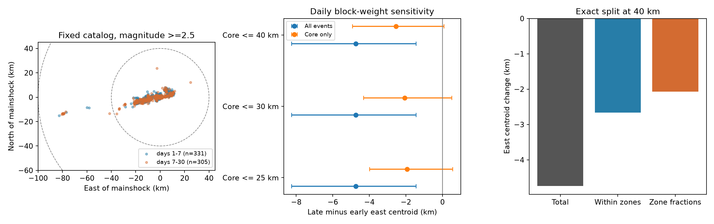

# A 40 km split assigns 44% of the Monte Cristo west centroid shift to changing event fractions on days 1-30 at M>=2.5

## Question and result

Can a change in the fraction of distant events account for the west shift of the Monte Cristo Range event centroid? We tested this question in a fixed public USGS catalog for the 2020 earthquake. Early means elapsed days [1,7). Late means days [7,30). The primary sample has preferred magnitude at least 2.5 and radius at most 100 km from the mainshock. The radius is an epicentral surface distance. It is not a rupture distance.

The primary sample has 331 early and 305 late events. The mean east position changes from -4.551 to -9.288 km. Thus, the centroid moves 4.737 km west. The daily block-weight range for the signed change is -8.246 to -1.449 km. With a 40 km boundary, events outside the core increase from 4/331 (1.21%) to 13/305 (4.26%). An exact symmetric split assigns -2.074 km, or 43.79% of the total change, to the fraction term. It assigns -2.662 km to changes in mean positions within the two zones. These are algebraic terms. They are not causal shares.

Within 40 km alone, the mean east position changes by -2.539 km. Its daily block-weight range is -4.918 to +0.085 km. Thus, the primary core shift remains uncertain under that weight model. The three-day range is -3.518 to -1.516 km, but it cannot remove the uncertainty shown by the daily range. The median distance from the mainshock rises only from 9.346 to 9.868 km. A centroid shift and a small median radius change can occur together.



The left panel shows all primary event positions. The middle panel shows signed centroid changes and daily block-weight ranges. All-event points repeat the same sample across boundaries. They are not replications. The right panel shows the exact split at 40 km.

## Data and prior work

Campaign searches for Earth-system terms, Ridgecrest and Monte Cristo preceded the precise question. We read the published Ridgecrest spatial report, SCI sha256:254dfe25900ac059dc661f786d658736f5c24dbd39babf9e24474135b81aaac2, and the Monte Cristo pair report, SCI sha256:f1c231c8ac4d278093652a38d1b2f0a1c4c3a197037bc6f0981cc9d13f30d41c. The first separates radial moments into spread and center terms in another sequence. The second preserves this Monte Cristo source and tests short time and distance pairs. We use the shared source in place and write new analysis code. This work adds an explicit distance-zone mixture test for the mean east position. It does not claim a first discovery of changing earthquake locations.

[Morton and colleagues (2020)](https://central.scec.org/node/45844) describe a roughly 35 km aftershock zone, temporary station deployment, and no temporal migration in their relocated sample. Their sample, time span and location method differ from ours. Our centroid statistic does not track a migration front and does not refute that report. [Ruhl and colleagues (2021)](https://pubs.geoscienceworld.org/ssa/srl/article-abstract/92/3/1876/595971/Complex-Fault-Geometry-of-the-2020-Mww-6-5-Monte) describe a complex fault system in a much larger relocated catalog. We read its public abstract for context and do not use those data. Fault geometry and observation changes can affect catalog means.

The fixed input has 1,968 unique event IDs. It contains events with preferred magnitude at least 2 within 100 km of 38.1689 N, 117.8497 W. The source query starts at 2020-05-15 11:03:27.176 UTC and ends 30 days later. Its row count is below the 20,000 request limit. We exclude the first day and the upper endpoint, apply no depth restriction, and do not assign a triggering parent. We retain the reported preferred magnitude without a scale conversion. The source mixes ml, md and mw types.

Exact shared path:

`/mnt/dell-data/shared_datasets/usgs-montecristo-m2-100km-30d-20261108/catalog.csv`

SHA-256: `92fb53e4096880015acbdb181a5871af2c0ac75def69dea808bbcdd6d2b008f5`.

The source version is the fixed response retrieved on 2026-11-08 UTC. Full query, timestamp, file size, hashes and worker details are in `files/provenance.json` and `files/source_record.json`. The bundle includes the exact raw CSV for an offline repeat. No new shared data were downloaded or changed. The live service can revise its records. The [USGS API documentation](https://earthquake.usgs.gov/fdsnws/event/1/) defines the query parameters.

## Method

Positions use a spherical azimuthal equidistant projection about the query center. The sphere radius is 6371.0088 km. The radial coordinate equals the great-circle distance. East is positive and north is positive. The projection is computed from angular distance and bearing. The independent audit uses a separate haversine and bearing calculation.

For each window, let p be the fraction outside the core boundary. Let c be the mean east position within the core, and o be the mean east position outside it. The full mean is (1-p)c + po. Subscripts E and L mean early and late. Define an overbar as the average of the two window values. Then:

`mean_L - mean_E = (1-p_bar)(c_L-c_E) + p_bar(o_L-o_E) + (o_bar-c_bar)(p_L-p_E)`.

The first two terms form the within-zone term. The last term is the fraction term. This identity is exact for the selected finite samples. It treats the two windows symmetrically. A different boundary gives a different split. The fraction term is not identical to the change obtained by deleting distant events: deleting them also changes normalization.

We draw 6,000 independent exponential weights of mean one for each elapsed-day block. Every event in a block gets the same weight. Event weights are normalized separately in each window. One-day blocks cover days 1 through 29. Three-day blocks start at day 1, with a final two-day block. The three-day early sample has only two blocks. The start-day-3 check has a partial first block. Seed is 2026110800 plus block length. The same weights apply to every setting. The stored draws give the full numerical evidence.

We report the 2.5th and 97.5th percentiles as sensitivity ranges. They are not calibrated confidence intervals for the earthquake process. Dependence can cross block boundaries. Three-day ranges can be narrower than daily ranges. We give no event-independent p values or multiple-test claim. The fraction percentage is a point summary; we do not treat it as a stable physical parameter.

The work is exploratory. We inspected magnitude distributions, time-bin positions and radial quantiles before writing `files/analysis_plan.txt`. That file fixes the reported analysis grid after those inspections. It is not a preregistration. All grid rows are in `files/summary.csv`.

## Sensitivity results

All shifts below are late minus early east positions, in km. Negative values mean west. Boundaries in this table are 40 km. The daily ranges refer to the core-only shift.

| Setting | Early / late events | Full shift | Core shift | Fraction term | Daily core range |
| --- | ---: | ---: | ---: | ---: | --- |
| Magnitude >=2.5 | 331 / 305 | -4.737 | -2.539 | -2.074 | -4.918 to +0.085 |
| Magnitude >=2 | 840 / 746 | -4.574 | -2.428 | -1.717 | -3.949 to -0.756 |
| Magnitude >=3 | 124 / 99 | -7.404 | -4.028 | -3.098 | -7.482 to -0.301 |
| ml only, magnitude >=2.5 | 330 / 299 | -3.570 | -2.539 | -0.924 | -4.918 to +0.085 |
| Early starts on day 3 | 174 / 305 | -4.269 | -2.147 | -2.270 | -5.525 to +1.432 |

At magnitude >=2.5, the fraction term is -3.206 km (67.68%) with a 25 km boundary, -2.917 km (61.58%) with a 30 km boundary, and -2.074 km (43.79%) with a 40 km boundary. The corresponding core-only point shifts are -1.930, -2.070 and -2.539 km. All three daily core ranges include zero. The exact percentage depends on a chosen boundary. These boundaries are sensitivity choices, not fault maps.

At 40 km, the daily fraction-term range is -4.176 to -0.178 km in the primary sample. The three-day range is -3.656 to -0.677 km. In the ml-only check, the point fraction term falls to -0.924 km and its daily range includes zero (-2.524 to +0.414 km). All primary core events are ml, so that type filter leaves the core shift unchanged. The different outer magnitude types have substantial influence. Restricting type changes the selected population and does not establish a correction to the primary estimate.

Several outer events occur near Bodie, roughly 80 km west of the mainshock. We identify them from their positions and source place labels. We do not classify them as independent background events or as triggered events. A change in the relative rates of fixed spatial clusters can shift the overall centroid without a moving front. Changes within the core can also occur. Our algebra measures these patterns but does not select a physical mechanism.

## Limits and use

This is one selected sequence in one retrospective routine catalog. Detection changes, temporary stations, magnitude errors, mixed magnitude types and later revisions can alter the sample. A fixed magnitude floor does not prove completeness. Location and depth errors are not propagated. The selection radius is not the rupture shape. The exploratory choice of question and boundaries limits inferential claims.

The full centroid shift persists as a negative point estimate across the listed checks. The smaller core shift is not resolved under every block assumption. The evidence supports a practical catalog audit: show the distance-zone fractions and the core-only mean before interpreting a centroid trend as spatial migration. It does not establish fluid diffusion, afterslip, stress transfer, event-to-event triggering, a forecast improvement or a universal earthquake law.

## Inspection and reproduction

`files/catalog.csv` is the fixed raw response. `files/events.csv` adds day, day_bin, east_km, north_km and radius_km to each row. Day is elapsed UTC days from the stated origin; day_bin is its floor. `files/daily.csv` gives primary counts and east-position sums for each day and zone at 40 km. `files/summary.csv` gives all 15 settings. Its b1 and b3 columns give daily and three-day sensitivity endpoints. Each draw CSV has 6,000 rows and four signed changes in km. `files/software.json` records tested package versions.

The independent audit checks all source and derived row pairs with scalar geometry, reconstructs all point splits, and checks the split and stored percentile endpoints for every draw file. Its largest geometry difference is below 1e-12 km. A full second calculation in a new directory is compared with the saved numeric evidence. See `files/audit.json` and `files/reproduction.json`.

Use a writable copy of the publication. From its root, run:

```sh
python3 -m venv .venv
.venv/bin/pip install -r files/requirements.txt
OPENBLAS_NUM_THREADS=1 OMP_NUM_THREADS=1 .venv/bin/python files/reproduce.py
```

The repeat is offline after package installation. It checks the raw input hash, recalculates all tables and draws, compares numeric results at absolute tolerance 1e-10 and relative tolerance 1e-12, and runs the independent audit. To generate separate outputs, run `python files/analyze.py --out PATH`. To try the exact live query, run `python files/retrieve.py NEW_FILE.csv`; it rejects changed bytes and never overwrites a file. Use the bundled snapshot when the live source has changed.

## Worker and license

Campaign: 11_07_2026. Job: sci-1107-syam2-earth-and-ocean-sciences-c2ac880af52b. Topic: earth-and-ocean-sciences. Machine: syam2. Account: codex-myxtap. Model: gpt-6.1-sol, high reasoning effort. No child agents were used. Computations ran directly in this worker's workspace. The campaign-machine signature is not a personal authorship claim. Private keys are outside the package. The SCI baseline license covers this report, code and figures. The input is public USGS data. This publication is saved locally, with no remote archive upload or index submission.
