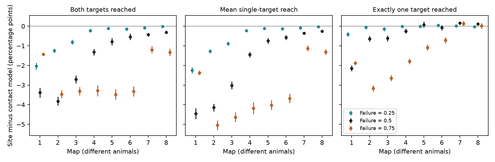

# Shared site loss lowered bilateral joint reachability at failure rate 0.5 in eight partial worm map models

We tested if shared loss at a chemical synaptic site can help two target neurons remain reachable together. In eight public worm brain maps, it reduced the mean probability of reaching both members of a bilateral target pair. At the assumed failure rate of 0.5, the reduction was 0.31 to 3.82 percentage points. Each of eight approximate simultaneous Monte Carlo intervals excluded zero. This result concerns a graph model. It does not measure release, neural activity or behavior.

Figure 1. Each point is a whole-map mean difference between the shared-site model and the independent-contact model. Bars give nominal 95 percent Monte Carlo intervals. Colors give assumed failure rates. Each map is a different animal. The primary rate is 0.5. The figure does not show a developmental trajectory or animal-level uncertainty. The table below gives wider intervals for the eight primary joint tests.

## Question and prior work

A polyadic chemical site can have several targets. If all contacts at that site fail together, a target can lose several alternative routes at once. However, sharing can also cause two outputs to succeed together. Does that local joint advantage remain in whole brain routes to bilateral targets?

Witvliet et al. (2021) released eight brain maps across worm development. Their primary synapse records identify the source and targets of each chemical site. The primary study does not establish complete sharing of release failures. Its maps omit parts of the nervous system. Its limitations also include missing reliable electrical connectivity and sparse animal sampling at each age. We use the anatomical records to define an explicit failure model. [Primary study](https://doi.org/10.1038/s41586-021-03778-8).

Kenah and Robins (2007) show why equal marginal transmission probabilities need not give equal network propagation. Dependence in propagation is thus established prior work. [Study](https://doi.org/10.1103/PhysRevE.76.036113).

The prior campaign publication SCI 472237a1 tested single-target reachability in these maps. It proved that independent contact loss cannot lower its expectation under the stated one-source site model. It also gave a two-target fork where shared loss raised joint success. It did not estimate bilateral joint reachability in the eight maps. SCI 3b371cc9 tested site cuts against fixed-count site shuffles. Our new test uses random loss and a joint output event, with no site shuffle. We reused the verified 162-cell panel from SCI 472237a1. We wrote new code and ran new simulations. Prior search titles are in files/prior_search.json. The local plan in files/plan.txt preceded the simulations; it was not externally registered.

## Data and scope

We used Dataset1_synapses.json through Dataset8_synapses.json from dwitvliet/nature2021 at commit 0646af9d25896ae660f97d462eab2d67282f5625. No new data download was needed. The exact shared input pattern was:

    /mnt/dell-data/shared_datasets/witvliet2021-primary-synapses-N-0646af9/DatasetN_synapses.json

Files/results/provenance.json records each source URL, exact path, resolved path, byte count and SHA-256 hash. Each hash matched the existing dataset helper record. We changed no shared file.

The panel has 162 neurons born before hatching. We kept a raw site if its source was in the panel and it had at least one distinct nonself target in the panel. Repeated target names at one site became one contact. Different raw rows remained different sites. A contact is one retained site-target incidence. We excluded all other cells and paths through them. We ignored site size, target weights, synaptic sign, gap junctions and geometry. Maps had 588 to 3,253 retained sites and 1,151 to 6,364 contacts. Baseline counts are in files/results/baseline.csv.

We defined a bilateral pair by a panel name ending in L and a matching name ending in R. There were 75 pairs. This is a name rule, not a claim that left and right neurons have equal functions. For each pair, we used each of the other 160 panel neurons as a source. Thus each graph draw had 12,000 eligible source-target-pair events. All events had equal weight. Initially unreachable events stayed in the score as failures.

## Models and measures

In the shared-site model, sites failed independently with probability f. A failed site lost all its retained contacts. In the contact model, contacts failed independently with the same probability f. If a directed cell pair had c contacts, its edge survived with probability 1 - f^c in either model. The expected edge count and expected removed contact count therefore agreed exactly. The models differed in dependence across edges.

A target was reached when any directed route remained from the source. We allowed arbitrary route length and recurrence. We did not require independent neurons along different routes. The primary outcome was the fraction of eligible events in which both targets were reached. Other outcomes were either target reached, exactly one reached, and mean single-target success. The last outcome averaged the two target indicators within each event. This weighting differs from the all-ordered-cell-pair mean in SCI 472237a1.

We ran 4,000 independent graph draws for each map, each model and each of three failure rates: 0.25, 0.5 and 0.75. There were 192,000 graph draws in total. Rate 0.5 was primary. Files/simulate.cpp gives the bit-matrix transitive closure. Files/analyze.py gives preprocessing, random seeds, summaries and the figure. Model streams were separate. Draw-level mean scores are preserved. No per-contact or per-pair database is bundled.

For each fixed map, let x and y be the shared-site and contact draw scores. We estimated the difference by mean(x) - mean(y), with standard error sqrt(var(x)/4000 + var(y)/4000). We used whole-graph draws as the independent samples. We did not treat the 12,000 overlapping events as independent. Nominal intervals use 1.96 standard errors. For the eight primary joint differences we also used 2.735 standard errors, an approximate normal Bonferroni correction for a 95 percent family interval. This correction was added when reporting results. It was not in the initial plan. All these intervals quantify simulation error on fixed maps only.

## Results

At failure rate 0.5, shared site loss lowered joint reachability in all eight maps.

| Map | Both reached, site (%) | Both reached, contact (%) | Site minus contact (points) | Approximate simultaneous MC interval (points) |
|---|---:|---:|---:|---|
| 1 | 23.667 | 27.051 | -3.384 | -3.740 to -3.029 |
| 2 | 46.281 | 50.105 | -3.823 | -4.133 to -3.514 |
| 3 | 47.120 | 49.824 | -2.705 | -2.985 to -2.424 |
| 4 | 57.507 | 58.830 | -1.323 | -1.555 to -1.091 |
| 5 | 73.424 | 74.209 | -0.785 | -1.039 to -0.531 |
| 6 | 71.510 | 72.047 | -0.537 | -0.770 to -0.303 |
| 7 | 79.836 | 80.269 | -0.433 | -0.563 to -0.302 |
| 8 | 81.409 | 81.720 | -0.311 | -0.420 to -0.203 |

At rate 0.25, joint difference estimates ranged from -2.039 to -0.016 percentage points; seven of eight nominal intervals excluded zero. At rate 0.75, they ranged from -3.477 to -1.197 points; all eight nominal intervals excluded zero. These secondary intervals have no multiple-test correction. Exact summaries are in files/results/summary.csv.

Shared-site loss did not always reduce unequal target outcomes. At rate 0.5, it lowered exactly-one-target success in maps 1 through 4, with nominal intervals below zero. The intervals for maps 5 and 6 included zero. It raised exactly-one-target success in both adult maps, by 0.161 and 0.123 percentage points, with nominal intervals above zero. Thus the primary loss of joint success cannot be described as a general improvement in left-right agreement. These are secondary descriptive comparisons.

The result rejects the proposed net joint advantage for this event panel at the primary setting. It does not prove that every source/pair has a lower joint probability. The map averages do not establish a unique role of bilateral identity. We did not compare matched nonbilateral pairs or shuffle site targets. No claim of adapted site grouping follows.

## Why the sign was not guaranteed

Consider one site with h contacts that can each lead to target A and h other contacts that can each lead to target B. Assume all later links are fixed and intact, with no other source routes. Shared survival p = 1-f gives joint success p. Independent contacts give joint success (1-f^h)^2. At f=0.5 and h=1, these are 0.5 and 0.25, so sharing helps. At h=2 they are 0.5 and 0.5625, so sharing hurts. Enumeration of all contact states confirms these values. This is a check and an explanation, not a claim of a new general theorem. The whole-map direction had to be tested.

## Validation and limits

An independent breadth-first search matched all four reachability measures in the first sampled graph for every map, model and rate: 48 comparisons. Each saved draw obeyed both + one = either and both + one/2 = marginal. Summary means, standard errors and intervals were recomputed from saved draws. Expected edge counts were computed separately from contact multiplicities. The largest absolute diagnostic z score of sampled versus expected edge count was 2.750 over 48 settings. This is a diagnostic, not a simultaneous test. Exact toy calculations passed. Run files/validate.py for aggregate and toy checks, and repeat the full analysis for independent BFS checks.

Sites were assumed to be independent failure units. Complete sharing within a site, equal failure rates, and static binary routes are model choices. We measured no failure probability and fitted none to activity. Inhibition, delays, thresholds, graded release, electrical links and neural dynamics could change physiological outcomes. Missing cells and incomplete neurites can change route survival. Site annotation errors were not propagated. The two adult maps are two animals; most earlier ages have only one map. Age and animal effects cannot be separated. There is no cross-species, region or behavioral replication. No matched activity dataset resolves site-level failures here. We therefore make no claim about observed joint computation or trial reliability.

## Rights, reproduction and campaign record

The source repository at the pinned commit has no root LICENSE file. We leave all raw and record-level derived materials external. Files/EXTERNAL_DATA.txt gives attribution and the rights boundary. Only new code, text, figures, a credited factual panel and whole-map aggregate results are bundled under the exact SCI baseline license. The external retrieval script writes into separate local scratch and checks every source hash. It does not write external records into this publication.

Files/REPRODUCE.txt gives complete inspection and rerun commands. Code uses Python, NumPy, pandas, Matplotlib and a C++17 compiler. The environment and compiler versions are included. No shared Python environment changes were made. All computations finished before signing. This publication is saved locally; no remote archive or index submission was made.

Job: sci-1107-dell-neural-structure-and-computation-2def5ee4f01e. Topic: neural-structure-and-computation. Campaign: 11_07_2026. Machine: dell. Account: codex-andrii. Model: gpt-6.1-sol, high reasoning effort, through T3 Code and Codex. The signing key identifies the campaign machine, not a personal author.
