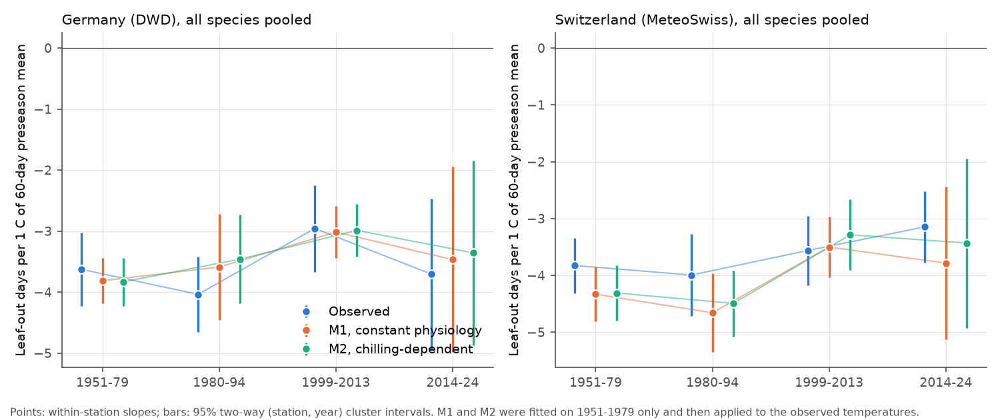
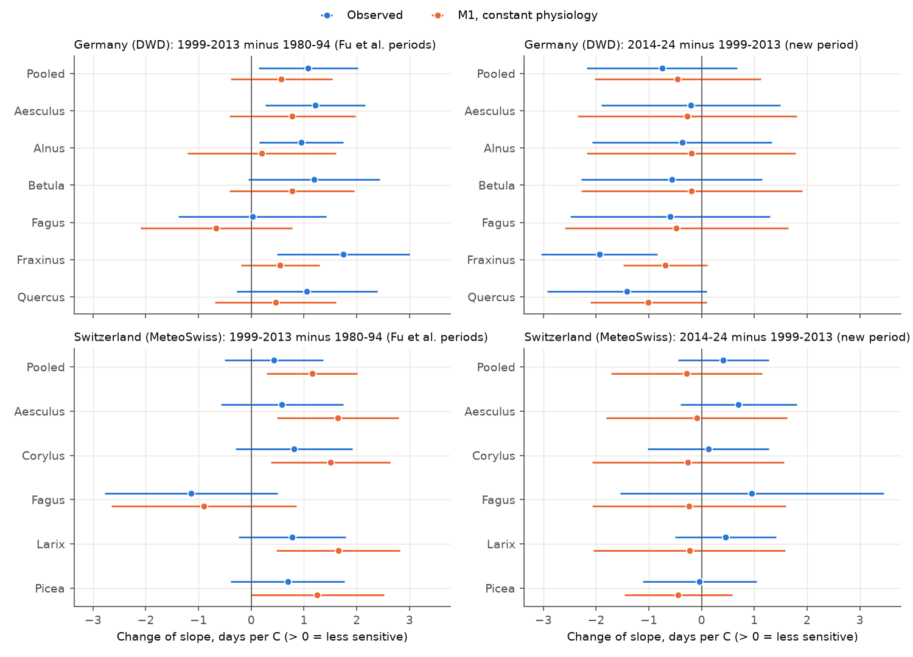
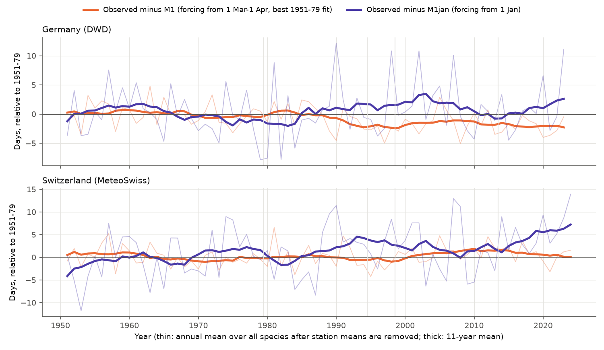

# A constant thermal-time model accounts for the change in leaf-out sensitivity to spring temperature at German and Swiss stations in 1951-2024; the 1999-2013 decrease did not continue in 2014-2023

Job `sci-1107-hp-climate-pollution-biodiversity-8440ede28d8a`, topic climate-pollution-biodiversity, campaign 11_07_2026, machine hp, model Claude Opus 5.5 (`claude-opus-5-5`). The signing key is a campaign-machine key. It is not a personal authorship claim. All data are public. Data sources: DWD Climate Data Center, MeteoSwiss (Source: MeteoSwiss), E-OBS (Copernicus Climate Change Service and the ECA&D data providers), Berkeley Earth.

## Summary

**Question.** Fu et al. (2015, Nature, doi:10.1038/nature15402) reported that the advance of spring leaf unfolding per 1 C of preseason warming decreased by about 40% from 1980-1994 to 1999-2013 in European trees. Most of their records came from Germany. Two explanations compete. (a) Physiology changed: warmer winters give less chilling, so trees need more spring warmth. (b) The change is apparent: with a constant thermal-time requirement, a slope in days per C becomes smaller when springs get warmer. We asked four questions with 790,000 leaf-out records from 6,647 German and Swiss stations:

1. Did the apparent sensitivity change, and did the change continue in the new period 2014-2024?
2. Does a forcing-only model with constant physiology (M1), fitted on 1951-1979 only, predict the same change?
3. Is there a direct chilling signal (later leaf-out after warm winters at the same spring temperature)?
4. Did observed leaf-out move away from the constant-physiology prediction in the warm decades?

**Main results** (95% two-way cluster intervals, station and year; Germany: 6 species, 712,823 records; Switzerland: 5 taxa, 30,885 records):

| Test | Germany (DWD) | Switzerland (MeteoSwiss) |
|---|---|---|
| Sensitivity, days per C of 60-day preseason mean, 1951-79 / 1980-94 / 1999-2013 / 2014-24 | -3.63 / -4.04 / -2.96 / -3.71 | -3.83 / -3.99 / -3.56 / -3.15 |
| Observed change 1980-94 to 1999-2013 (Fu et al. periods) | +1.08 [+0.14, +2.02] (27% less sensitive); year bootstrap [-0.04, +1.98] | +0.43 [-0.50, +1.37] |
| M1 change, same periods and station-years | +0.57 [-0.39, +1.54] | +1.16 [+0.30, +2.02] |
| Excess (observed minus M1) | +0.51 [-0.51, +1.52] | -0.72 [-1.84, +0.40] |
| Observed change 1999-2013 to 2014-24 | -0.75 [-2.18, +0.68] (more sensitive again) | +0.41 [-0.45, +1.27] |
| Excess, 2014-24 minus 1951-79 | -0.43 [-1.14, +0.29] | +0.13 [-0.84, +1.11] |
| Leaf-out change per 1 C warmer December-February at the same spring temperature (observed) | -0.08 to -0.63 days in 6 of 6 species (earlier or no change, not later) | -0.67 to +0.05 days in 5 of 5 taxa |
| Observed minus M1, 2014-24 relative to 1951-79 | **-3.77 [-4.86, -2.68] days** (earlier than M1) | +1.07 [-0.63, +2.77] days |
| Same, with forcing counted from 1 January (M1jan) | +2.32 [-0.88, +5.53] days | **+5.80 [+2.48, +9.11] days** (later than M1jan) |

**Conclusions, with their scope.**

* **A decrease like that of Fu et al. is present in the German records, but it is borderline and it did not continue.** From 1980-1994 to 1999-2013 the German slope became 1.08 days per C less negative. The two-way cluster interval excluded zero (+0.14 to +2.02); the year bootstrap interval just included zero (-0.04 to +1.98). The sign was the same in 6 of 6 species and in 4 of 4 German regions. In 2014-2023 the slope returned to -3.71 days per C, near the 1951-1979 value. Thus a steady loss of sensitivity under continued warming is not supported in this network.
* **A constant-physiology model gave a change of similar size.** M1 was fitted on 1951-1979 only and then applied to observed temperatures. For the Fu et al. periods M1 gave about half of the observed German decrease. The remainder (+0.51 days per C) had an interval that included zero. Relative to 1951-1979, the observed and M1 changes were almost equal in all periods (excess -0.43 to -0.13 days per C). A positive excess would show sensitivity lost beyond the constant-physiology prediction. Of 221 excess contrasts (species, pooled, regions, balanced panels; 30, 60 and 90-day windows), 4 had intervals above zero and 6 had intervals below zero. This is near the number expected by chance (about 5.5 on each side). In Switzerland, M1 predicted a larger decrease than the observed one.
* **No general chilling delay.** At the same spring temperature, warmer December-February periods did not delay leaf-out. The observed effect was earlier leaf-out or no clear effect in 11 of 11 species-network samples. At the warmest third of stations, only Swiss hazel showed a delay (+0.62 days per C, interval +0.15 to +1.10). Days at 0-5 C from November to February did not decrease (52.4 in 1951-1979, 54.8 in 2014-2023 in Germany), because winter warming moved cold days into this range.
* **A drift away from the model exists, but its sign depends on the model structure.** With the best 1951-1979 model (forcing from 1 March to 1 April), German leaf-out in 2014-2023 was 3.8 days earlier than predicted. The sign was the same in 6 of 6 species (-2.5 to -6.3 days) and in 4 of 4 regions. With forcing counted from 1 January, the same records were 2.3 days later than predicted (interval includes zero), and the Swiss records were 5.8 days later. The 1 January model fitted the 1951-1979 data worse (RMSE 8.9-13.4 days against 7.5-11.9 days). Thus the observed warm-decade drift cannot identify a chilling loss or a new advance without a better-constrained model. The chilling-dependent model M2 did not remove the drift.
* **Pollution-related checks gave no clear explanation (exploratory, added after the first results).** Spring solar radiation over German stations increased by 15 W/m2 in 2014-2023 relative to 1951-1979 (E-OBS). More radiation at the same air temperature gave earlier leaf-out (-0.08 days per W/m2). It explained about 11% of the German drift (-3.77 to -3.35 days). Former East German stations (sulfur dioxide emissions decreased by much more after 1990) did not show a consistent extra drift: East minus West was -0.38, -1.03 and -0.44 days in 1991-98, 1999-2013 and 2014-23.

**Figure 1.** Within-station sensitivity of leaf-out to the 60-day preseason mean temperature, by period. Blue: observed dates. Orange: M1 dates (constant thermal-time requirement). Green: M2 dates (forcing requirement depends on chilling). M1 and M2 were fitted on 1951-1979 only. Bars are 95% two-way (station, year) cluster intervals.

## 1. Background

Spring leaf-out controls the start of the growing season. It changes carbon uptake and the timing of food for insects and birds. Ecologists use the slope of leaf-out date on spring temperature (days per C) as a measure of the response to climate change. Fu et al. (2015) found that this slope decreased in Europe, and they related the decrease to less winter chilling. Later work showed that a slope in days per C can decrease with no change in the plant. If development needs a fixed heat sum, one extra degree shortens a warm spring by fewer days than a cold spring. Earlier campaign work tested this for cherry bloom ([d997794c](sci:sha256:d997794cd5da3aabb17a004339fe9e877502137746ec1c02d19fd110ce5bb960), [a893337e](sci:sha256:a893337e0f64f73382ff79f62aea73d1510b1a533e38a0c1805ac0fcbc617d93)). In Switzerland a constant model explained the cherry decrease; in Japan the sensitivity increased. This study tests the main species of Fu et al. in their main source network, adds the decade 2014-2023, and uses an independent Swiss network.

## 2. Data

* **DWD phenology, annual reporters, wild plants, historical files** (retrieved 2026-11-09): phase 4, beginning of leaf unfolding, of silver birch (*Betula pendula*), European beech (*Fagus sylvatica*), pedunculate oak (*Quercus robur*), horse chestnut (*Aesculus hippocastanum*), European ash (*Fraxinus excelsior*) and black alder (*Alnus glutinosa*). These are 6 of the 7 species of Fu et al.; DWD lime leaf-out records end in 1994. The historical files contain years to 2023. Quality bytes 5, 7 and 8 (doubtful, invalid, wrong) were removed.
* **MeteoSwiss phenology open data** (STAC collection `ch.meteoschweiz.ogd-phenology`, 175 station files, retrieved 2026-11-09): leaf unfolding 50% (horse chestnut, beech, hazel), needle emergence 50% (larch, spruce). Swiss taxa with fewer than 1,000 records in 1951-1979 were not modelled (birch, rowan, lime, maple, sweet chestnut, black locust).
* **E-OBS v31.0e**, 0.25 degree ensemble mean daily mean temperature (tg, 1950-2024) and surface shortwave radiation (qq). Each station uses the nearest cell with data (median distance 8.9 km in Germany, 9.5 km in Switzerland). Temperature was adjusted to station height with -0.0065 C per m from the E-OBS cell elevation.
* **Berkeley Earth** 1 degree monthly land temperature (shared dataset `berkeley-earth-complete-tavg-latlong1-20261109`, SHA-256 `4b78118b5552cc4987a7c575b042a0ea92de55d7c01f47783edb81d082c40664`), used only for the drift check.

Cleaning: dates outside day of year 60-170 removed; per station and species, dates more than 30 days from the station median removed (0.4% of records in total). Final sample: 757,136 German records (6,472 stations, 1951-2023) and 33,191 Swiss records (175 stations, 1951-2024). The analysis periods hold 712,823 and 30,885 records. The German network decreased from about 5,600 stations per species in 1951-1979 to about 1,300 in 2014-2023 (`files/results/sample_by_period.csv`).

## 3. Methods

The plan (`files/PLAN.md`) was written before any leaf-out date was paired with temperature. Deviations are listed in section 6.

**Periods.** P0 1951-1979 (calibration), P1 1980-1994 and P2 1999-2013 (the periods of Fu et al.), P3 2014-2024 (Germany: 2014-2023).

**Sensitivity.** T60 is the mean temperature of the 60 days that end on the mean leaf-out day of that station and species. The window is the same in all years and periods, so it does not move with leaf-out. For each species and network we fit `DOY = station-period intercept + b_p * T60`, one slope per period. Pooled fits use station-species-period intercepts and one slope per period. Variants use 30-day and 90-day windows, a balanced panel (station-species with at least 8 records in P0 and in the test period), and four German regions (north and south of 51 N, east and west of 10.5 E).

**Constant-physiology model M1.** Leaf-out occurs on the first day when the sum of max(T - Tb, 0) from day t0 reaches F. For each species and network, (t0, Tb, F) were fitted by grid and golden-section search on at most 15,000 random 1951-1979 records (t0 from 1 January to 15 April, Tb 0-8 C). M1 dates were then simulated for all years from observed temperatures. The same sensitivity regression was applied to M1 dates on the same station-years. **Excess change** = observed slope change minus M1 slope change. It equals the slope change of R = observed minus M1. A variant (M1s) uses a station-specific F for stations with at least 8 calibration years.

**Chilling model M2.** Same forcing as M1, but the requirement is `a + b * exp(-c * CD)`, where CD is the number of days at 0-5 C since 1 November (alternating model of Murray et al. 1989). b = 0 gives M1. M2 was also fitted on 1951-1979 only.

**Direct chilling test.** Within stations, we regressed R and DOY on the December-February mean temperature together with T60, separately for the coldest, middle and warmest third of stations by mean winter temperature.

**Drift from the model.** Mean R by period with station-species intercepts (P1, P2, P3 minus P0).

**Uncertainty.** Two-way cluster sandwich (station and year) with small-sample factors and a t distribution with min(stations, years) - 1 degrees of freedom. A year-resampling bootstrap (years drawn with replacement within each period, 300 draws) checks the main pooled contrasts.

**Robustness and exploratory checks (added after the first results).** (1) Two other M1 structures: forcing from 1 January with Tb from -4 to 8 C (M1jan); and the full t0 grid with Tb down to -4 C (M1neg). (2) Mean E-OBS shortwave radiation over the same 60-day window (Q60) as an extra regressor. Reduced aerosol pollution has increased surface radiation in Europe since the 1980s ("brightening"). (3) Former East German states against other states, in five periods. East German sulfur dioxide emissions decreased mainly after 1990, West German emissions mainly before 1990. (4) Temperature-input drift: E-OBS minus Berkeley Earth, February-May, at the cells used.

## 4. Results

### 4.1 Apparent sensitivity and the constant-physiology prediction

**Figure 2.** Change of the slope between the Fu et al. periods (left) and between 1999-2013 and 2014-2024 (right). Blue: observed. Orange: M1 on the same station-years. Positive values mean less sensitivity.

German pooled slopes (days per C, 60-day window): -3.63 [-4.23, -3.02] in 1951-1979, -4.04 [-4.65, -3.42] in 1980-1994, -2.96 [-3.67, -2.24] in 1999-2013 and -3.71 [-4.94, -2.47] in 2014-2023. The Fu et al. contrast (+1.08 [+0.14, +2.02]) had the same sign in all six species: horse chestnut +1.21, alder +0.95, birch +1.19, beech +0.02, ash +1.75, oak +1.06. The interval excluded zero for horse chestnut, alder and ash. In the four German regions the same contrast was +0.88 to +1.38. With a 30-day window it was +0.72 [-0.08, +1.51]; with a 90-day window +1.00 [+0.01, +1.98]. The year bootstrap interval for the 60-day pooled contrast was [-0.04, +1.98]. Thus the evidence for this decrease is borderline.

From 1999-2013 to 2014-2023 the German slope became more negative again in all six species (-0.75 [-2.18, +0.68] pooled; ash -1.94 [-3.04, -0.84]). Thus the 1999-2013 value was a low point, not the start of a trend.

M1 changes on the same station-years: +0.57 [-0.39, +1.54] (Fu et al. contrast), +0.80 [+0.23, +1.36] (1999-2013 minus 1951-1979), +0.35 [-1.22, +1.91] (2014-2023 minus 1951-1979). Excess changes: +0.51 [-0.51, +1.52], -0.13 [-0.88, +0.62] and -0.43 [-1.14, +0.29]. The station-specific model M1s gave excess changes of +0.36, -0.09 and -0.33, all with intervals that include zero. Over all 165 species-level excess contrasts (3 windows, 11 samples, 5 contrasts) 3 intervals were above zero (Swiss horse chestnut and beech, 2014-2024 minus 1999-2013, 90-day window; German horse chestnut, 1999-2013 minus 1951-1979, 30-day window) and 4 were below zero. The German regional excess for 2014-2023 minus 1951-1979 was -0.67 [-1.32, -0.02] (northeast), -0.79 [-1.49, -0.10] (northwest), -0.37 [-1.07, +0.33] (southeast) and 0.00 [-0.86, +0.86] (southwest). Thus, where an excess was clear, it had the opposite sign to a physiological loss of sensitivity.

Switzerland: observed slope changes were small and uncertain (Fu et al. contrast +0.43 [-0.50, +1.37]). M1 predicted a larger decrease (+1.16 [+0.30, +2.02]), so the excess was negative (-0.72 [-1.84, +0.40]). Beech was the exception in both networks: beech and its M1 changed little between the Fu et al. periods. M1 for beech uses forcing from 1 April.

The year-resampling bootstrap results are in `files/results/bootstrap_years.csv`; see section 4.5.

### 4.2 No direct chilling delay

At fixed T60, one degree warmer December-February changed observed leaf-out by -0.33 (horse chestnut), -0.24 (alder), -0.08 (birch), -0.63 (beech), -0.53 (ash) and -0.34 days (oak) in Germany. In Switzerland the values were +0.04 (horse chestnut), +0.05 (hazel), -0.67 (beech), -0.03 (larch) and -0.35 days (spruce). No sample showed a delay with an interval above zero for all stations together. At the warmest third of stations the values were -0.67 to -0.01 days in Germany and -0.41 to +0.62 days in Switzerland; Swiss hazel (+0.62 [+0.15, +1.10]) was the only interval above zero. Relative to M1, warm winters gave earlier leaf-out in 10 of 11 samples (R slope -0.43 to -1.01 days per C). M1 counts no warmth before March. Thus late-winter warmth had a small advancing effect that M1 does not contain. Details: `files/results/chilling_test.csv`.

### 4.3 Drift from the constant-physiology prediction

**Figure 3.** Annual mean of observed minus model leaf-out date (station-species means removed, 1951-1979 set to zero). Orange: M1, forcing from 1 March to 1 April (best fit in 1951-1979). Purple: M1jan, forcing from 1 January. Thick lines: 11-year means.

German observed leaf-out advanced by 10.9 days from 1951-1979 to 2014-2023 (station-species intercepts). M1 predicted about 7 days. Observed minus M1 was -0.79 [-2.06, +0.48] days in 1980-1994, -2.68 [-3.87, -1.49] in 1999-2013 and -3.77 [-4.86, -2.68] in 2014-2023. All six species had intervals below zero in 2014-2023 (horse chestnut -2.96, alder -4.19, birch -2.71, beech -6.28, ash -2.49, oak -4.34). All four regions also had intervals below zero (-3.57 to -4.19). M2 gave -3.85 [-4.82, -2.87], and M1s gave -4.11 [-5.22, -3.00]. In Switzerland observed minus M1 was +1.58 [+0.05, +3.11] days in 1999-2013 and +1.07 [-0.63, +2.77] in 2014-2024. Three Swiss taxa had positive values (horse chestnut +2.44, hazel +1.72, spruce +2.60); beech (-1.29) and larch (+0.26) did not.

The sign depends on the forcing start. M1jan (forcing from 1 January, fitted on the same 1951-1979 records) gave +2.40 [-0.24, +5.04] (1999-2013) and +2.32 [-0.88, +5.53] (2014-2023) days in Germany, and +5.80 [+2.48, +9.11] days in Switzerland in 2014-2024. M1jan had a larger calibration error in all 11 samples (RMSE 8.9-13.4 days against 7.5-11.9 days for M1). The M1neg grid (Tb down to -4 C) gave the same result as M1 (-3.76 days in Germany). Thus the warm-decade drift is real relative to a given model, but its sign is not identified. Warm late winters are outside the 1951-1979 calibration range: December-February was 2.5 C warmer in 2014-2023 than in 1951-1979. A model that ignores January-February warmth gives too late dates. A model that counts all January-February warmth gives too early dates.

### 4.4 Temperature input and pollution-related checks

E-OBS minus Berkeley Earth (February-May, weighted by records): Germany 0.00, -0.01, 0.00 and -0.04 C in the four periods; Switzerland 0.00, -0.18, -0.12 and -0.19 C. The German results do not depend on a temperature-input drift. In Switzerland, E-OBS is cooler after 1980. A correction would make M1 dates about 0.5-0.8 days earlier, so Swiss observed minus M1 would be slightly more positive.

Spring radiation (Q60) over German stations was -2.1, +6.0 and +15.3 [+6.4, +24.1] W/m2 in P1, P2 and P3 relative to P0. At the same T60, 1 W/m2 more gave -0.08 [-0.11, -0.04] days in Germany and -0.04 [-0.07, -0.01] days in Switzerland. With Q60 in the model, German observed minus M1 in 2014-2023 changed from -3.77 to -3.35 [-4.39, -2.31] days. Thus brightening can explain only a small part of the German drift in this test. E-OBS radiation has fewer input stations than temperature, so this estimate is uncertain.

East-West: observed minus M1 relative to 1951-1980 was, for the West, -0.33, -2.50, -2.32 and -3.56 days in 1981-90, 1991-98, 1999-2013 and 2014-23, and for the East -0.17, -2.87, -3.35 and -4.00 days. East minus West: +0.16 [-1.21, +1.54], -0.38 [-1.60, +0.85], -1.03 [-1.76, -0.30] and -0.44 [-1.21, +0.32] days. A sulfur dioxide effect would predict a West-specific change in the 1980s and an East-specific change in the 1990s. The data do not show this pattern. The phenology networks of the two German states were joined in 1991, so this test cannot separate pollution from network changes.

### 4.5 Year-resampling bootstrap

Years were resampled with replacement inside each period (300 draws; all records of one year move together). The bootstrap intervals agree with the two-way cluster intervals, with one exception. The German Fu et al. contrast (+1.08) has a bootstrap interval of [-0.04, +1.98], which just includes zero.

| Statistic | Germany estimate [bootstrap 95%] | Switzerland estimate [bootstrap 95%] |
|---|---|---|
| Observed change, 1999-2013 minus 1980-94 | +1.08 [-0.04, +1.98] | +0.43 [-0.32, +1.53] |
| M1 change, same contrast | +0.57 [-0.42, +1.79] | +1.16 [+0.29, +2.16] |
| Excess, same contrast | +0.51 [-0.71, +1.50] | -0.72 [-1.86, +0.60] |
| Observed change, 2014-24 minus 1999-2013 | -0.75 [-2.12, +0.79] | +0.41 [-0.76, +1.23] |
| Excess, 2014-24 minus 1951-79 | -0.43 [-1.06, +0.36] | +0.13 [-0.79, +1.04] |
| Observed minus M1, 1999-2013 minus 1951-79 (days) | -2.68 [-3.77, -1.50] | +1.58 [+0.56, +2.69] |
| Observed minus M1, 2014-24 minus 1951-79 (days) | -3.77 [-4.75, -2.77] | +1.07 [-0.19, +2.32] |

## 5. Limitations

* **Model dependence.** The main test compares observations with one class of simple models. The excess-change result was similar for three M1 variants and for M2, but the drift result (section 4.3) changed sign with the forcing start. The models do not include photoperiod.
* **Observation bias.** The DWD network shrank from about 5,600 to about 1,300 stations per species. Station-period intercepts remove changes in the station mix, but not changes within a station (new observer, new trees, more urban surroundings). The data do not identify observers. Urban warming at a station is not in the 0.25 degree E-OBS grid. Such changes could contribute to the German drift toward earlier dates.
* **Phase definitions differ.** DWD records the beginning of leaf unfolding; MeteoSwiss records 50%. We compare changes inside each network only.
* **Temperature data.** E-OBS is not homogenised. The Berkeley Earth check found no German drift, but a Swiss drift of -0.12 to -0.19 C after 1980. E-OBS cells are 0.25 degree; the lapse-rate correction is approximate in the Alps.
* **Small Swiss sample.** The Swiss intervals are wide (30,885 records). The Swiss results do not establish an effect in either direction.
* **Years as clusters.** All intervals treat years as independent clusters. The last period has 10-11 years, so its intervals are wide.
* **Exploratory checks.** The radiation and East-West checks were not in the plan. Their intervals are not corrected for multiple tests. They do not test pollution effects directly, because no pollutant concentrations were used.

## 6. Deviations from the plan

* After a calibration-only test on Swiss beech, we extended the M1 grid for t0 to 1 and 15 April and changed M2 to share the M1 forcing (so that b = 0 gives M1). This was before any slope or residual was computed.
* MeteoSwiss taxa with fewer than 1,000 calibration records were not modelled.
* The robustness checks M1jan and M1neg, the radiation test and the East-West test were added after the first results.
* A memory problem on the shared machine stopped the first model run. The rerun used the same code with chunked prediction. The random seed and fit samples were the same.

## 7. Reproducibility

Code is in `files/code/` (Python 3.12, numpy, pandas, scipy, netCDF4, matplotlib, pyarrow).

1. Download the raw files listed in `files/provenance/source_urls.txt` into `RAW/dwd`, `RAW/ch`, `RAW/ch/stations` and `RAW/eobs`. Check them against `files/provenance/raw_sha256.txt` (SHA-256 and size). The E-OBS tg and qq files were also offered to the shared campaign store as `eobs-v31.0e-tg-ens-mean-0.25deg` and `eobs-v31.0e-qq-ens-mean-0.25deg` (see `files/provenance/shared_datasets.md`).
2. `python 01_build.py RAW BUILT` (records, station-cell match, daily cell temperature).
3. `NWORK=3 python 02_models.py BUILT MODELS` (M1, M1s, M2 fits; one checkpoint file per species and network). Then concatenate the checkpoint files: `python -c "import pandas as pd, glob; pd.concat([pd.read_parquet(f) for f in glob.glob('MODELS/group_*.parquet')]).to_parquet('MODELS/records_model.parquet', index=False)"`.
4. `python 03_analysis.py MODELS RESULTS` (slopes, excess, drift, chilling test, skill).
5. `python 04_drift.py BUILT BERKELEY_NC RESULTS` (E-OBS minus Berkeley Earth).
6. `python 06_robustness.py BUILT MODELS QQ_NC DWD_STATION_FILE ROBUST` (M1jan, M1neg, radiation, East-West).
7. `python 07_bootstrap.py MODELS RESULTS 300`.
8. `python 05_figures.py RESULTS FIGS ROBUST`.

The fitted model parameters are in `files/results/model_params.csv` and `files/results/robust_model_params.json`. All result tables are in `files/results/`. A per-record derived table (station, species, year, observed date, T60, December-February temperature, chilling days, M1, M1s and M2 dates) is in `files/data/records_model.csv.gz`, so the regression results can be checked without the raw data.

## 8. References

* Fu, Y. H. et al. (2015). Declining global warming effects on the phenology of spring leaf unfolding. Nature 526, 104-107. doi:10.1038/nature15402
* Murray, M. B., Cannell, M. G. R. and Smith, R. I. (1989). Date of budburst of fifteen tree species in Britain following climatic warming. Journal of Applied Ecology 26, 693-700. doi:10.2307/2404093
* Cornes, R. C. et al. (2018). An ensemble version of the E-OBS temperature and precipitation data sets. J. Geophys. Res. Atmos. 123, 9391-9409. doi:10.1029/2017JD028200
* Rohde, R. A. and Hausfather, Z. (2020). The Berkeley Earth land/ocean temperature record. Earth Syst. Sci. Data 12, 3469-3479. doi:10.5194/essd-12-3469-2020
* Campaign publications: d997794c (cherry bloom, constant thermal-time test), a893337e (year-control robustness of that test), 6d514d9c (DWD leaf-out and frost exposure), 70b69f10 (DWD and MeteoSwiss autumn colouring with E-OBS).
