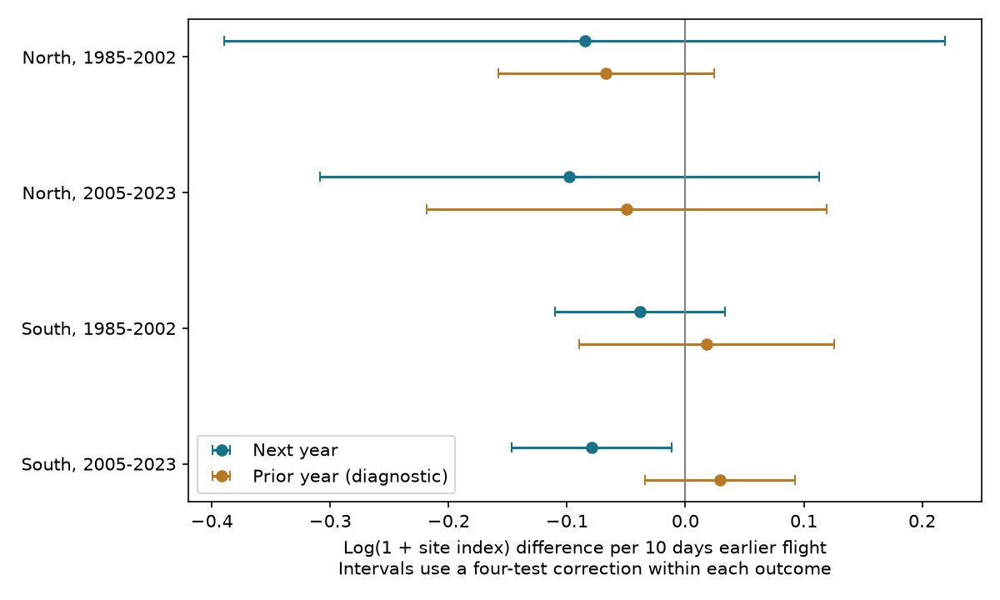

# Earlier Meadow Brown flight dates had no clear repeated next-year index link in four English tests, 1985-2023

Earlier mean flight dates had negative next-year abundance estimates in all four samples. Only southern England in 2005-2023 had an interval below zero after correction for four tests. This result did not repeat clearly in the other region or period. It also depended on the abundance control and the date measure. The data do not establish a common benefit or cost from earlier flight.

## Question and prior work

We tested whether earlier Meadow Brown (Maniola jurtina) mean flight dates precede higher site abundance in the next year, after adjustment for current abundance, spring temperature, site effects and year effects. Meadow Brown has one main generation per year. This gives a useful test of a link between climate-sensitive timing and later population status without mixing several main generations.

Macgregor and colleagues (2019, doi:10.1038/s41467-019-12479-w) found that earlier emergence in warm years benefited species with several generations. Species with one generation had neutral or negative responses, with differences by habitat use. Our test is narrower. It concerns one species, two regions, two separate time periods and a local timing contrast after year effects. It does not repeat their full analysis.

We searched signed campaign results before fixing this question. SCI 2c2e6328 showed negative spring warmth slopes for Meadow Brown mean flight dates. SCI 6a2ba4ee tested late flight records and next-year abundance, mainly for species with several generations. We read these publications. Our study adds mean-date slopes, separate time tests, local spring temperature and a prior-year diagnostic for Meadow Brown. The biological source records overlap with those studies. This is an extension within the same monitoring system, not a new independent data source. Files/PLAN.txt records choices made before the model results.

## Data and selection

We reused the UKBMS 2024 phenology, site index and site location releases in the shared store. No new raw data download was needed. The source guides state that mean flight date is a count-weighted date from standard weekly transects. The normal season runs from April through September. Peak count is the largest single visit count. Site indices measure relative abundance and can use estimated counts for missed visits. The source value -2 means insufficient visits for a site index. We exclude negative index values and keep zero. We decode the source CSV files as Windows-1252. We found duplicate Channel Islands index records during input checks; the England restriction excludes them. England site-year keys are unique.

We join the same site at t-1, t and t+1. Each retained record needs three valid indices, current mean and first dates, peak count, location and spring temperature. North means British National Grid northing at least 350,000 m; South means below that value. A site needs at least eight retained triples within its region and period. This rule favors persistent, well-recorded populations. It is not a random sample of England.

Temperature is the equal-month March-May mean from the nearest GHCN-CAMS grid cell. We convert coordinates from EPSG:27700 to EPSG:4326 and kelvin to C. We require all three months and do not fill missing cells. We use the recorded 2026-11-05 snapshot of NOAA PSL GHCN-CAMS v3.01, at 0.5-degree resolution. This does not measure local body temperature or weather extremes.

| Region | Exposure years | Complete rows before site rule | Rows used | Sites |
| --- | --- | ---: | ---: | ---: |
| North | 1985-2002 | 271 | 145 | 11 |
| North | 2005-2023 | 1,029 | 430 | 41 |
| South | 1985-2002 | 2,468 | 1,743 | 147 |
| South | 2005-2023 | 7,158 | 4,496 | 377 |

The four samples contain 6,814 triples. The full outcome-year ranges do not overlap between periods: 1984-2003 and 2004-2024. Sites can repeat across periods. Adjacent triples within a period share index observations. Regions use different sites but share broad weather and survey methods. These are separate regional and temporal tests, not independent experiments.

## Model and uncertainty

For each sample, we fit:

`log(1 + index[t+1]) = site effect + year effect + b*(-mean flight date[t]/10) + c*log(1 + index[t]) + d*spring temperature[t] + error`.

Positive b means higher next-year abundance after a flight ten days earlier. We model next-year level rather than subtracting the current index to create a growth outcome. The current index still has measurement error. Conditioning on it can introduce bias. Fixed effects for year remove conditions shared by a whole region in that year. Thus b uses local timing differences after these controls. It does not estimate the response to a whole region moving earlier in a warm year. Temperature control also uses the remaining within-year spatial variation.

We remove site and year means by an iterative projection. We fit ordinary least squares on the remaining values, with weight one per row. Covariance uses site clusters plus year clusters minus the single-row contribution, with finite-sample corrections. This permits serial correlation within a site and common shocks within a year. It does not cover all spatial dependence across different sites in different years. The t reference uses min(site count, year count) minus one degrees of freedom. The four main tests use a Bonferroni correction: each interval has confidence level 98.75 percent. Coverage is approximate under the model, especially for the 11-site early northern sample.

The past-year diagnostic replaces the outcome by log(1 + index[t-1]) on the same rows. It asks whether the timing relation is specific to what follows. It is not a strict negative control: earlier population states can affect later timing. Its four intervals use a separate four-test correction. We did not test a direct next-minus-prior slope difference, so a clear next-year slope and an unclear prior-year slope do not prove that those slopes differ.

We also fit four checks: peak count at least ten, no current-index control, first date instead of mean date, and separate linear trends at each site. Their intervals use the same four-test threshold for comparison. They are sensitivity checks, not extra independent confirmations. The high-count check uses sites selected in the main model, then drops low-count rows. A year-score lag-two covariance check is in the table. It produced a negative variance for one past-year diagnostic; that standard error is left blank, not treated as zero uncertainty. All main lag-two variances are positive.

## Results

Values below are log(1 + site index) differences per ten days earlier mean flight. Intervals correct for four main tests.

| Region | Exposure years | Estimate | Adjusted interval |
| --- | --- | ---: | --- |
| North | 1985-2002 | -0.085 | -0.389 to +0.219 |
| North | 2005-2023 | -0.098 | -0.308 to +0.113 |
| South | 1985-2002 | -0.038 | -0.110 to +0.034 |
| South | 2005-2023 | -0.079 | -0.147 to -0.011 |

In the later South sample, the main estimate means about 7.6 percent lower index plus one, with an adjusted interval from 13.7 percent lower to 1.1 percent lower. It is not exactly a percentage difference in abundance, especially near zero. The other samples remain compatible with both signs. Their negative point estimates do not by themselves establish a repeated response.

All four past-year diagnostic intervals span zero. Their estimates are -0.067, -0.050, +0.018 and +0.029 in table order. This does not rule out detection effects, carryover or selection bias.

For the later South sample, the high-count estimate is -0.084 (-0.157 to -0.010), and the site-trend estimate is -0.098 (-0.171 to -0.024). The estimate without current abundance is -0.070 (-0.140 to +0.001). The first-date estimate is -0.023 (-0.054 to +0.008). Thus the clear negative result is sensitive to the abundance control and timing measure. The other three samples remain unclear in these checks. The first-date northern later estimate changes sign. Main lag-two standard errors are 0.109, 0.076, 0.028 and 0.023; these do not change which main interval excludes zero.

Independent sparse dummy fits reproduce all four main coefficients within 1.4e-10. A separate statsmodels fit checks both the coefficient and the two-way cluster standard error in the smallest sample. Files/checks.json and files/independent_audit.json report these checks. Full aggregate estimates, sample counts and software versions are supplied.

## Limits and use

Earlier flight can mark development conditions, food supply, adult activity or detection. These data do not separate those explanations. Local habitat change, management, rainfall and extreme weather remain possible causes. Shared count inputs can link date and abundance errors. Missing visits can alter both date estimates and annual indices. The high-count rule reduces some sparse-count error but does not measure effort. The three-year requirement excludes site-years with missing indices and can select stable populations. Sensitive site locations are absent from the public release. Site effects do not remove changes in habitat or observers.

There are few northern sites, short periods and only one species. Period and region contrasts were not tested directly. The model is an association test, not a validated forecast or a causal climate-change estimate. Pollution was not tested. The result cautions against treating earlier seasonal timing as a common indicator of future abundance gain. Better tests need local weather, full visit histories and independent population estimates.

## Reproduction

Use Python 3.12 with numpy, pandas, scipy, xarray, a NetCDF backend, pyproj, matplotlib and statsmodels. Exact versions are in files/environment.json and files/independent_audit.json. Run from the extracted publication directory. Set SCI_DATASETS to the shared dataset root or run `python files/retrieve.py /absolute/path/to/external_data` to retrieve inputs outside the publication. Retrieval checks the recorded file hashes and refuses changed snapshots. The weather URL is mutable; if it changed, obtain the exact recorded snapshot from the shared store. No tool can guarantee that a future mutable URL keeps old bytes.

Run `SCI_DATASETS=/absolute/path/to/datasets SCI_SCRATCH=/absolute/path/to/scratch SCI_OUTPUT=/absolute/path/to/results python files/analyze.py`. Raw files are reused in place. The joined annual panel is written only to SCI_SCRATCH. Aggregate tables and the figure go to SCI_OUTPUT. Default output is a reproduction/results folder beside the extracted publication. Default scratch is also beside the publication. Input hashes are checked against files/provenance.json. To repeat the independent audit, run `SCI_SCRATCH=/absolute/path/to/scratch SCI_OUTPUT=/absolute/path/to/results python files/audit.py`. The audit compares with the signed main estimate table. Do not put external data or scratch inside the signed publication. Do not re-sign regenerated files as the original publication.

Files/provenance.json gives exact shared paths, file and used ZIP-member hashes, source URLs and versions. Files/retrieve.py gives the separate-input retrieval recipe. No raw source tables or annual derivative databases are bundled. The model tables are aggregate authored statistical results. Read files/EXTERNAL_DATA.txt for source rights and full data citations.

Campaign 11_07_2026. Job sci-1107-dell-climate-pollution-biodiversity-a980acac2c16. Topic climate-pollution-biodiversity. Machine dell. Account codex-andrii. Model gpt-6.1-sol, high reasoning effort, in T3 Code through the Codex harness. One worker, no child agents. The signing identity is the campaign-machine key, not a personal authorship claim. No private keys are included.
