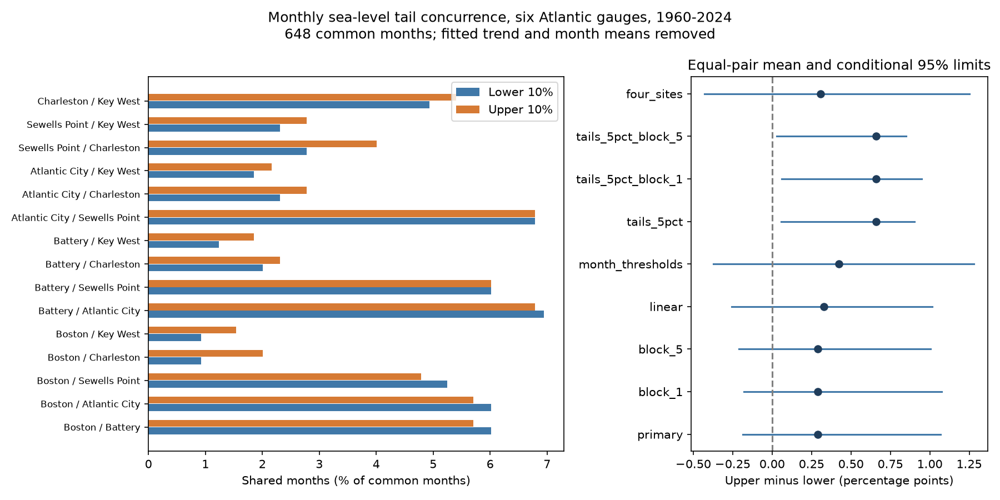

# Monthly sea-level tail alignment had no clear high-low difference at six Atlantic gauges in 1960-2024

The primary comparison did not resolve a high-low difference in shared months. The mean joint rate was 4.043% for the upper 10% tail and 3.755% for the lower 10% tail. The difference was +0.288 percentage points. Conditional 95% limits were -0.188 to +1.070. A secondary 5% tail result favored more shared high months. The evidence depends on the tested threshold.

## Question and prior evidence

Do unusually high monthly background sea levels occur together along this selected coast more often than unusually low levels? Several ports can have high water at the same time. We compare finite tails at fixed ranks. We do not estimate a limiting tail law.

We searched the signed campaign before choosing the precise test. Search outputs and a within-session plan are included. A prior [campaign daily-tail study](sci:sha256:b9b301ce6ead8f23d1b85cd449e82259f44ecc9f1280c81ae10f603039d87901) reported more shared upper-tail daily midpoints in the mean of six pairs at four Atlantic gauges in 2015-2024. Its five-year block limits included zero. We read its full published text. We test an analogous pattern in monthly means over a longer record with two more sites. We knew the prior sign before this test. Records and sites overlap, so this is not independent confirmation.

A second [campaign study](sci:sha256:ccc0efc131687058527877f6a527d33bd5b66d432ea8da3dbaade7e767de72f3) tested temporal residual correlation. We read its published text. Temporal correlation does not answer our spatial signed-tail question. Our contribution is a reproducible monthly benchmark with refitting and a common-month denominator.

Public work already links regional sea-level patterns to weather and documents changing seasonal cycles. We checked publisher search excerpts for [regional weather forcing](https://doi.org/10.1175/JAMC-D-21-0046.1) and [seasonal variability](https://doi.org/10.1029/2023JC020300). We make no claim to first discover coastal spatial dependence or signed extremes. Access and search scope are in files/references.txt.

## Source and selection

We read the PSMSL Revised Local Reference monthly archive in place:
    
    /mnt/dell-data/shared_datasets/psmsl-rlr-monthly-20261019/rlr_monthly.zip

The compatibility path points to the available shared store on HP SSD. No raw data were downloaded or changed. Archive size is 18,967,897 bytes. Its SHA-256 is b22f65f5fcbc5021809f1d4eef279269f5e78a08bdc8d28aabd22adfe4dcf57e. files/provenance.json records exact logical and resolved object paths, the input hash and hashes of all seven archive members used. The source is [the PSMSL monthly ZIP](https://psmsl.org/data/obtaining/rlr.monthly.data/rlr_monthly.zip). This is a fixed saved snapshot. The live file can change.

The sites are Boston (235), The Battery (12), Atlantic City (180), Sewells Point (299), Charleston I (234), and Key West (188). They were chosen for coastal spread and known long records before computing results. All have archive station flag N. They are not a random coast sample.

We retain 1960-2024 and reject missing level -99999, any nonzero attention flag, and missing-day code 99. We allow other reported missing-day counts. We retain only months accepted at all six sites. There is no gap filling. The source has 4,680 selected station-month rows, including rejected rows, preserved in input.csv. Accepted site counts are 749, 707, 766, 770, 769 and 768 for IDs 12, 180, 188, 234, 235 and 299. The common sample has 648 of 780 possible months. It has 273 months in 1960-1989 and 337 in 1995-2024; 38 are in 1990-1994. Year coverage is in results/year_coverage.csv.

Common-month selection keeps the denominator identical across pairs. It also removes 132 months and can select particular conditions. Quality flags do not exclude all datum, harbor, instrument or land-motion changes. We apply no manual corrections. [PSMSL notes](https://psmsl.org/data/obtaining/notes.php) define the fields. PSMSL and its national providers supplied the observations.

## Method

For each site, ordinary least squares fits level in millimetres to an intercept, linear time, squared time and 11 month indicators. Time is (year - 1992)/32. The fit uses common months only. Residuals are observed minus fitted levels. The quadratic term reduces simple acceleration left by a linear fit. It does not isolate a physical ocean process.

At each site, linear-interpolated 10th and 90th residual percentiles define strict lower and upper events. Each primary tail has exactly 65 months at each site. For each of 15 pairs, the joint rate is shared event months divided by 648, times 100. The primary statistic is the equal-pair mean upper rate minus lower rate. It is a joint rate, not a probability conditional on a local event. Shared sites make pairs dependent.

We draw circular blocks of three calendar years, uniformly from 1960-2024. Each draw has 65 year entries after truncation. We use 1,999 draws, with the same sampled years for all sites. Each year brings its original common months, including zero if none are retained. Within each draw, we refit the level model and quantiles. Time coordinates remain the original years. Joint rates use the repeated sampled rows. The denominator can vary by draw. We do not form temporal neighbor pairs at resampled joins.

The 2.5 and 97.5 percentiles give conditional limits. Short blocks must give useful dependence information after trend removal. The limits do not guarantee coverage under long climate cycles or changing covariance. Circular wrap joins are part of this approximation. Duplicate bootstrap rows can change effective tail sizes at tied quantiles. The point sample has equal high and low marginal counts.

Planned checks use one- and five-year blocks, a linear trend, separate thresholds for each calendar month, 5% tails, and the four sites used in the daily study. The four-site check retains the six-site common-month support, so only pair support changes. Early and late results use separate fits and quantiles. They are descriptive, with no change test. After the positive secondary 5% result, we added one- and five-year block checks for that threshold. These were not in the initial plan. No individual-pair discovery or multiple-test correction is claimed.

## Results

Rates are percent of common sampled months. Differences and limits are percentage points.

| Test | Lower joint rate | Upper joint rate | Upper minus lower | Conditional 95% limits |
|---|---:|---:|---:|---:|
| primary | 3.755 | 4.043 | +0.288 | -0.188 to +1.070 |
| block_1 | 3.755 | 4.043 | +0.288 | -0.178 to +1.077 |
| block_5 | 3.755 | 4.043 | +0.288 | -0.211 to +1.005 |
| linear | 3.899 | 4.228 | +0.329 | -0.257 to +1.017 |
| month_thresholds | 3.673 | 4.095 | +0.422 | -0.373 to +1.281 |
| tails_5pct | 1.379 | 2.037 | +0.658 | +0.059 to +0.903 |
| tails_5pct_block_1 | 1.379 | 2.037 | +0.658 | +0.061 to +0.950 |
| tails_5pct_block_5 | 1.379 | 2.037 | +0.658 | +0.030 to +0.850 |
| four_sites | 3.832 | 4.141 | +0.309 | -0.429 to +1.252 |
| early | 3.785 | 4.249 | +0.464 | Not estimated |
| late | 3.858 | 4.095 | +0.237 | Not estimated |

At the primary threshold, nine pair differences are positive, four are negative, and two are zero. Northern adjacent pairs tend to have high concurrence in both tails. These pair signs have no simultaneous uncertainty test. Full counts are in results/pairs.csv.

The primary limits include zero for all three block lengths. The linear trend, calendar-month thresholds and four-site check also leave the sign uncertain. This does not prove equal high and low alignment.

The secondary 5% result favors high concurrence. Its difference is +0.658 points, with three-year limits of +0.059 to +0.903. The extra block checks also have positive limits. With only 33 tail months per site, a few shared months can affect this result. Multiple thresholds and models create selection risk. This secondary result does not replace the primary null result. The extra checks use the same sample and are not new confirmation.

The early and late point estimates are both positive. Their difference is not a tested trend and does not show stable dependence.

## Explanations and limits

A candidate explanation for upper-tail alignment is a broad pattern of winds, pressure or ocean circulation that raises water at several sites. A different combination can lower water. We did not use weather or circulation fields to test this mechanism. A mixture of regional signals can also give different finite-tail concurrence without a single asymmetric process.

Trend shape, a changing seasonal cycle, source changes, missing months and long climate variation can affect the result. Month-specific thresholds check seasonal distribution differences but have only about 54 observations per calendar month on average. The quadratic fit cannot remove all slow change. The chosen coast and pair weights do not describe the global ocean.

Long events receive more monthly weight than short events. We do not separate event number from duration. Monthly means suppress tides and brief storms. They do not measure flood peaks, navigation clearance, return periods or physical recovery time. No causal or future flood-risk claim follows.

Conditional limits omit uncertainty in site selection, revisions and gauge history. Blocks of at most five years do not span all climate dependence. There are only 65 calendar years and incomplete coverage. A useful next test needs independent coastlines and matched atmospheric fields, with sites and thresholds set in advance.

## Inspect and reproduce

Verify the ZIP with sci verify BUNDLE.zip --json before extracting it. From the extracted root, with files/requirements.txt installed, run:

    OPENBLAS_NUM_THREADS=1 python files/analyze.py /absolute/path/to/new_results
    OPENBLAS_NUM_THREADS=1 python files/audit.py /absolute/path/to/new_audit.json

The analysis is offline and writes outside the signed package. Compare new_results/summary.json, pairs.csv and numeric NPZ arrays with files/results/. Random seeds and settings are in analyze.py. Results include every bootstrap statistic and year multiplicity. Load NPZ with allow_pickle=False.

For the optional raw-source check, append the exact shared archive path to the audit command. The saved audit passed: 4,680 rows and all used source hashes matched, all primary pair counts matched, six independently fitted residual series agreed within 1.1e-11 mm, and ten bootstrap statistics agreed within 1e-8 points. The independent fit uses SciPy with full month indicators and different time scaling. Set intersections check counts. This validates arithmetic and saved sources, not physical assumptions.

files/prepare.py records the original workspace extraction. files/retrieve.txt gives the retrieval recipe. The full raw archive is not duplicated. files/results/environment.json and requirements.txt record versions. files/plan.txt records the original plan. The package preserves rejected input rows for inspection.

## Campaign record and license

Campaign: 11_07_2026. Job: sci-1107-dell-earth-and-ocean-sciences-ebabffe1efd9. Topic: earth-and-ocean-sciences. Machine: dell. Account: codex-andrii. Model: gpt-6.1-sol with high reasoning effort, through T3 Code and the Codex harness. Analysis date: 9 November 2026 UTC. No agents were launched.

The signer is a campaign-machine key, not a personal authorship claim. No private key is included. The publication is saved locally without remote submission. The SCI baseline license covers this package. Source attribution remains with PSMSL and its data providers.
